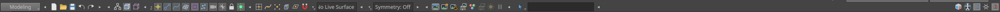

# Aztek: behaviour target

Aztek follows the reference application's behaviour for modelling, UVs, rigging and animation, plus viewport navigation,
manipulators, the script editor and preferences, and renders with Harold, its own path tracer, in place of every renderer
the reference carries. Dynamics depart on purpose: one solver stands for the reference's several dynamics systems, and
their files load into it (see the dated section and docs/DYNAMICS.md). The product carries none of the reference's names, icons or branding.

## Names and pivots

Done 09/11/2026 (PLAN 1.2 to 1.8). `group` is `group1`, `group2`, under its members' shared parent with pivots at the world's origin. `rename` takes `#`. A trailing number keeps its padding in every generated name. A copied shape takes the next free shape name. `listRelatives` gives leaf names unless `-path` or `-fullPath`, so a script handing a result to another command wants one of those, as in the reference. `move` on `obj.rotatePivot` and `obj.scalePivot` takes `-a`, `-r`, `-ws`, `-os`, one pivot at a time. `InvertSelection` and `hotkey -q` work. Unverified against a capture: all the naming rules (`tools/reference_capture/WANTED.md`).

## Short flags and polyEvaluate

Done 09/11/2026 (PLAN 1.9 to 1.11). Whether `-e` or `-q` means edit and query now comes from each command's flag table. Commands where it doesn't: `-e` on `polyEvaluate` and `polyCheck` (edge), `polyCompare` (edges), `delete` (expressions), `findType` (exact), `attributeInfo` (enumerated), `createSet` and `createDisplayLayer` (empty), `namingConvention` (enable), `timer` (endTimer), `scriptJob` (event); `-q` on `usdPy` (quiet). `-c` was never read as anything generic.

`polyEvaluate`: `-v -e -f -t -uv -s -b -b2 -a -wa -vc -ec -fc -uvc -tc -bc -bc2 -us -uid -uis -aus -as`, with `-uvs` accepted for the current set and `-ds` accepted. Several flags give a dictionary by long name in Python and an array in MEL in the order given. `-s` counts mesh shells, where it counted UV shells; `-us` counts those. Lengths and areas are in the current unit: unverified (`units.m.polyEvaluate.b`).

## Smooth preview and shading flags

Done 09/11/2026 (PLAN 1.12, 1.13). Smooth preview is `displaySmoothMesh` (0, 1, 2) and `smoothLevel` on the shape, with `useSmoothPreviewForRender` and `renderSmoothLevel` for Harold. `displaySmoothness -po` maps 1, 2, 3 onto it and `-q -po` answers per object. `smoothPreview` stays as a command and as an alias for old files and scripts. `shadingNode` takes `-isColorManaged` and `-asRendering`; `hyperShade` has `-listUpstreamShaderNodes`, `-listDownstreamShaderNodes`, `-shaderNetwork` and `-duplicate`. Its window flags are accepted and do nothing.

## Instances

PLAN 1.14, partly (09/11/2026). An instanced shape behaves as one shape to a script: `listRelatives -ap` gives every parent, `setAttr` on one reaches the others, a rename follows, geometry is shared and `.ma` holds the reference's `parent -s -add` form. Inside, each parent still holds a node of its own, so a direct graph write doesn't carry across, `MFnDagNode.instanceCount` doesn't see it, and only meshes instance. TICKETS.md has the rest.

## Checks

`tools/check_examples.sh` opens every example under `--batch` and fails on any warning. `tools/ui_checks/channel_box.py` drives the Channel Box's multi-edit by mouse and keyboard on Xvfb with a window manager; without one, Qt never takes the window as active and keys go to the hotkeys. Both run in CI on Linux.

## Units

Done 09/11/2026 (PLAN 1.1). What's stored is centimetres and radians. A command called from a script or the interface is in the current units, and `execute` converts its flags, arguments and results by tags in `crates/aztek_scene/src/unit_tables.rs`; commands called by other commands, viewport tools and the Python API are in stored units. `currentUnit` lives in `aztek_ops::units`, per scene: a new scene starts in File > New Scene's default working units (cm, degrees and film unless changed, kept as the `workingUnitLinearDefault`, `workingUnitAngularDefault` and `workingUnitTimeDefault` optionVars), opening a file takes on the file's.

- Scene files: written in the scene's current units, which the header names; read by the units the file names. `.ma` angle curves hold stored radians once read. Tangents in files stay as the file has them (value per second).
- `connectAttr` between plugs that measure different things makes a `unitConversion` node with the reference's factor (translate to rotate is 0.0174533), one per axis for a whole vector. `disconnectAttr` removes it, `isConnected` sees through it, `listConnections` shows it unless `-scn`. A file's own connection is taken as written.
- Python API (`maya.api.OpenMaya`, plug-ins): centimetres and radians whatever the scene, as the reference's are. `MAngle.uiUnit` and `MDistance.uiUnit` follow `currentUnit`.
- Panels: Channel Box and its multi-edit (`+=`, `-=`, `*=`, `/=` work on what's shown), Attribute Editor, Graph Editor and Dope Sheet key values read in the current units through `query.rs`. Manipulator drags work in stored units and echo in the current ones.
- Expressions: angular plugs read in the current unit unless `-uc none`, distances under `-uc all`.
- Time: film, pal, ntsc, show and the rest of the reference's names, `29.97df` as its own unit beside `29.97fps`, and custom rates such as `37fps`. Keys keep their seconds across a change unless `-ua 0` (Keep keys at current frame). Frames are what's stored, rescaled on a change, where the reference stores ticks: same results.
- Preferences > Settings, as of 10/11/2026: Working Units (linear, angular, time, Keep keys at current frame) set the current scene's units; New Scene Options (File > New Scene's option box) set the defaults. A change tells `scriptJob -e linearUnitChanged`, `angularUnitChanged` and `timeUnitChanged`.
- Grid: `grid` sizes and spacings are in the current linear unit, as the reference's are, so 12 units each way is 12 metres in a metre scene. The move tool's step and a held J step in the linear unit; the drag's readout in the view shows the current units.
- USD stages hold degrees: converted where they meet the scene.

## Up axis

As of 10/11/2026. Y or Z up, as Preferences > Settings > World Coordinate System sets it: a preference kept between
sessions (`optionVar upAxisDirection`), not part of a scene, so a new scene keeps it. `upAxis -ax z` changes it;
`-rv` turns the default cameras with the world so the ground stays where it was on screen, as the Preferences do on
Save. With Z up:

- The default cameras of a new scene, `viewSet -home`, `-top` (down Z, Y up the screen), `-front` (from -Y),
  `-side`, `-persp`, `orbit`, `tumble` and `viewPlace` work about Z; the views tumble about Z and their pitch is
  above the XY ground.
- The grid lies on XY in the perspective view. Clicks that place on the ground (joints, curves, interactive
  primitives, `X` grid snapping) use XY.
- Primitives are built standing up Z (their `upAxis` attribute says z).
- Saving writes the reference's `upAxisScriptNode` (`upAxis -ax "z"; viewSet -home persp;`). Opening such a file in a Y
  up session switches to Z up and homes the perspective camera, as running that script does; the node isn't kept and
  is written again on save. A Y up file opened in a Z up session leaves the session Z up, as the reference does. The
  file's default cameras start from the defaults of the axis it was saved in.
- `MGlobal.isYAxisUp`, `isZAxisUp`, `upAxis`, `setYAxisUp` and `setZAxisUp` follow it. OBJ, PLY and STL `-upAxis`
  and USD import convert to it; USD import with `-axisAndUnitMethod overwritePrefs` takes the stage's axis.
- Not changed by the axis: attribute defaults (aim vectors, gravity and field directions). Unchecked against the
  reference: whether its gravity and nucleus defaults follow Z up.
- Batch mode (`aztek --batch`) starts Y up with the default units: it doesn't read the saved preferences. It does use the user folder: its paths and modules, the plug-ins marked Auto load and `userSetup`.
- Left as they are: HumanIK's per-joint state attributes keep what their solver works in. Attributes Aztek adds itself with no counterpart (`hardAngle`, `minAngle`) and UV angles the reference documents in degrees (`polyEditUV -angle`, `polyMoveUV -ra`) stay in degrees.
- Unverified, all on the capture list: whether `xform -q -m` answers in the current unit (here centimetres), whether a primitive's default size follows the unit (here it doesn't: `polyCube` with no `-w` in a metre scene is 1 cm wide), and whether `polyEvaluate -b` scales (1.11).

Audited, commands whose flags carry a unit:

- `ambientLight`: -position (distance), -rotation (angle)
- `directionalLight`: -position (distance), -rotation (angle)
- `pointLight`: -position (distance), -rotation (angle)
- `unfrozenTransforms`: -rotateStep (angle)
- `xform`: -translation (distance), -rotatePivot (distance), -scalePivot (distance), -pivots (distance), -rotateTranslation (distance), -scaleTranslation (distance), -rotation (angle), -rotateAxis (angle), -boundingBox (distance)
- `rotate`: -pivot (distance), -by (angle), -to (angle), -x (angle), -y (angle), -z (angle)
- `move`: -x (distance), -y (distance), -z (distance), -by (distance), -to (distance)
- `scale`: -pivot (distance)
- `duplicate`: -translate (distance), -rotate (angle), -pivotPoint (distance)
- `joint`: -position (distance), -orientation (angle), -scaleOrientation (angle), -angleX (angle), -angleY (angle), -angleZ (angle), -limitX (angle), -limitY (angle), -limitZ (angle)
- `ikHandle`: -twist (angle), -roll (angle), -offset (distance)
- `spaceLocator`: -position (distance)
- `camera`: -position (distance), -rotation (angle), -nearClipPlane (distance), -farClipPlane (distance), -orthographicWidth (distance), -centerOfInterest (distance), -worldCenterOfInterest (distance)
- `viewPlace`: -orthoWidth (distance)
- `viewClipPlane`: -nearClipPlane (distance), -farClipPlane (distance)
- `lookThru`: -nearClip (distance), -farClip (distance)
- `dolly`: -distance (distance)
- `tumble`: -azimuthAngle (angle), -elevationAngle (angle), -rotationAngles (angle)
- `orbit`: -horizontalAngle (angle), -verticalAngle (angle), -rotationAngles (angle)
- `roll`: -degree (angle)
- `spotLight`: -position (distance), -rotation (angle), -coneAngle (angle), -penumbra (angle), -leftBarnDoorAngle (angle), -rightBarnDoorAngle (angle), -topBarnDoorAngle (angle), -bottomBarnDoorAngle (angle)
- `curve`: -point (distance), -editPoint (distance)
- `circle`: -center (distance), -radius (distance), -sweep (angle), -firstPoint (distance)
- `nurbsSquare`: -center (distance), -sideLength1 (distance)
- `sphere`: -pivot (distance), -radius (distance), -startSweep (angle), -endSweep (angle)
- `cone`: -pivot (distance), -radius (distance), -startSweep (angle), -endSweep (angle)
- `cylinder`: -pivot (distance), -radius (distance), -startSweep (angle), -endSweep (angle)
- `torus`: -pivot (distance), -radius (distance), -startSweep (angle), -endSweep (angle), -minorSweep (angle)
- `nurbsPlane`: -pivot (distance), -width (distance)
- `nurbsCube`: -pivot (distance), -width (distance)
- `revolve`: -pivot (distance), -startSweep (angle), -endSweep (angle)
- `extrude`: -length (distance), -rotation (angle)
- `offsetCurve`: -distance (distance)
- `offsetSurface`: -distance (distance)
- `extendCurve`: -distance (distance)
- `extendSurface`: -distance (distance)
- `threePointArc`: -point1 (distance), -point2 (distance), -point3 (distance), -radius (distance)
- `twoPointArc`: -point1 (distance), -point2 (distance), -radius (distance)
- `nonLinear`: -startAngle (angle), -endAngle (angle), -wavelength (distance)
- `softMod`: -falloffRadius (distance), -falloffCenter (distance)
- `softSelect`: -softSelectDistance (distance)
- `wire`: -dropoffDistance (distance), -rotation (angle)
- `wrap`: -maxDistance (distance)
- `lattice`: -position (distance), -rotation (angle)
- `pathAnimation`: -bankLimit (angle), -bankThreshold (angle)
- `polyMergeVertex`: -distance (distance)
- `polyMerge`: -distance (distance)
- `polyBevel`: -offset (distance), -smoothingAngle (angle)
- `polyBevel3`: -offset (distance), -angleTolerance (angle), -miteringAngle (angle), -smoothingAngle (angle)
- `polySoftEdge`: -angle (angle)
- `polyCut`: -cutPlaneCenter (distance), -cutPlaneRotate (angle), -cutPlaneWidth (distance), -cutPlaneHeight (distance), -extractOffset (distance)
- `polyMirrorFace`: -mirrorPosition (distance), -pivot (distance), -pivotX (distance), -pivotY (distance), -pivotZ (distance), -smoothingAngle (angle)
- `polyMirror`: -mirrorPosition (distance), -pivot (distance), -pivotX (distance), -pivotY (distance), -pivotZ (distance), -tolerance (distance)
- `polyPoke`: -translate (distance), -translateX (distance), -translateY (distance), -translateZ (distance), -localTranslate (distance), -localTranslateX (distance), -localTranslateY (distance), -localTranslateZ (distance)
- `polyInset`: -thickness (distance), -depth (distance)
- `polyCreateFacet`: -point (distance)
- `polyAppend`: -point (distance)
- `polyChamferVtx`: -width (distance)
- `polyWedgeFace`: -wedgeAngle (angle), -center (distance)
- `polyQuad`: -angle (angle)
- `polyQuadrangulate`: -maxAngle (angle)
- `polyBridgeEdge`: -twist (angle), -smoothingAngle (angle)
- `polyBridge`: -twist (angle), -smoothingAngle (angle)
- `polySpherize`: -radius (distance), -center (distance)
- `rotateComponents`: -by (angle), -pivot (distance)
- `scaleComponents`: -pivot (distance)
- `moveComponents`: -by (distance), -to (distance)
- `distanceDimension`: -startPoint (distance), -endPoint (distance)
- `closestPointOnMesh`: -inPosition (distance)
- `nearestPointOnMesh`: -inPosition (distance)
- `setPivot`: -position (distance)
- `transformLimits`: -translation (distance), -translationX (distance), -translationY (distance), -translationZ (distance), -rotation (angle), -rotationX (angle), -rotationY (angle), -rotationZ (angle)
- Primitives (`polyCube`, `polySphere`, `polyCylinder`, `polyCone`, `polyPlane`, `polyTorus`, `polyPrism`, `polyPyramid`, `polyPipe`, `polyHelix`, `polyDisc`, `polyCapsule`, `polyPlatonicSolid`, `polyPrimitive`, `polySoccerBall`, `polyIcoSphere`, `polyQuadSphere`, `polySuperShape`): -position, -width, -height, -depth, -radius, -sideLength, -length, -tipRadius, -sectionRadius, -thickness (distance); -rotation, -twist (angle)
- Component edits (`polyExtrudeFacet`, `polyExtrudeEdge`, `polyExtrude`, `polyMoveVertex`, `polyMoveEdge`, `polyMoveFacet`, `polyChipOff`, `polyDuplicateEdge`): -translate, -localTranslate, -pivot and their X Y Z, -offset, -thickness (distance); -rotate, -localRotate and their X Y Z, -smoothingAngle, -twist (angle)
- Constraints (`pointConstraint`, `orientConstraint`, `aimConstraint`, `geometryConstraint`, `normalConstraint`, `tangentConstraint`, `poleVectorConstraint`, `pointOnPolyConstraint`): -offset (angle on orient and aim, distance on the rest)
- Any command's -smoothingAngle, -miteringAngle, -angleTolerance (angle)
- Arguments: `move` (distance), `rotate` (angle)
- Results: `pointPosition`, `objectCenter`, `exactWorldBoundingBox`, `arclen`, `pointOnCurve`, `pointOnSurface` (distance); `angleBetween` (angle)
- In their bodies: `getAttr`, `setAttr`, `addAttr`, `attributeQuery`, `setKeyframe -v`, `keyframe -vc`, `keyTangent` angles, `setDrivenKeyframe -v`, `unfrozenTransforms`, `getParticleAttr`

Attributes tagged as angles: `rotate`, `rotateAxis`, `jointOrient`, `preferredAngle`, `minRotLimit`, `maxRotLimit`, `restRotate`, `constraintRotate`, `constraintJointOrient`, `constraintRotateAxis`, `targetOffsetRotate`, `targetRotate`, `targetJointOrient`, `localRotate`, `twist`, `roll`, `startAngle`, `endAngle`, `coneAngle`, `penumbraAngle`, `shutterAngle`, `startSweep`, `endSweep`, `sweep`, `minorSweep`, `smoothingAngle`, `smoothingangle`, `miteringAngle`, `angleTolerance`, `outRotate`, `outputRotate`, `inputRotate`, `inRotate1`, `inRotate2`, `rotateFrame`, `rotateUV`, `pivotOrient`, `cutPlaneRotate`, `bankLimit`, `wedgeAngle`, `frontTwist`, `upTwist`, `sideTwist`, `twistRotation`, `rollRotation`, `projectionHorizontalSweep`, `rotation`, `dTwistStart`, `dTwistEnd`, `dTwistRampMult`, `euler`. As distances: `translate`, `rotatePivot`, `scalePivot`, `rotatePivotTranslate`, `scalePivotTranslate`, `transMinusRotatePivot`, `center`, `boundingBoxMin`, `boundingBoxMax`, `boundingBoxSize`, `constraintTranslate`, `constraintRotatePivot`, `constraintRotateTranslate`, `targetTranslate`, `targetRotatePivot`, `targetRotateTranslate`, `targetScalePivot`, `targetOffsetTranslate`, `restTranslate`, `localTranslate`, `localPosition`, `cutPlaneCenter`, `centerOfIllumination`, `centerOfInterest`, `focusDistance`, `nearClipPlane`, `farClipPlane`, `orthographicWidth`, `distance`, `point1`, `point2`, `falloffRadius`, `falloffCenter`, `maxDistance`, `minDistance`, and sizes on primitives. The attribute fixtures check these (`doubleAngle`, `doubleLinear`) once captured.

## Reference and checks

- The reference's published command reference (flags, short names, create/query/edit modes, return values) and node reference
  (node types, attribute long and short names, defaults) are the spec.
- Every command and node gets tests written from that spec. Behaviour the reference does not pin down is checked
  against the reference by srlegrand and recorded in the test.

## Scene model

- DAG with transform and shape nodes: `pCube1` (transform) over `pCubeShape1` (mesh). Shapes are DAG leaves.
  `listRelatives -s`, instancing (one shape under several transforms) and DAG paths (`|grp|pCube1|pCubeShape1`) behave
  as the reference's.
- Dependency graph: plugs, connections, dirty propagation and lazy evaluation (the existing graph core).
- Construction history: creation nodes (`polyCube1.output -> pCubeShape1.inMesh`) and one poly node per edit
  (`polyExtrudeFace1`, `polySplitRing1`, `polyTweak1`, ...) inserted upstream of the shape, each with
  `inputPolymesh`, `output` and `inputComponents`. The `constructionHistory` toggle and `-ch` flags decide whether an
  edit adds a node or writes the shape's own mesh. `delete -ch`, `bakePartialHistory`, `polyEvaluate`.
- Component addressing: `pCube1.vtx[0:7]`, `.e[]`, `.f[]`, `.map[]`, `.vtxFace[][]`, `*`, `[1:3]`; `ls -fl`,
  `filterExpand`, selection of components through the transform or the shape.
- Default naming: `pCube1`, `pCubeShape1`, `polyCube1`, `joint1`, `ikHandle1`, `skinCluster1`, ... with the reference's
  numbering rules.
- Attribute names, short names and defaults as the reference's (`translateX`/`tx`, `rotateOrder`, `jointOrient`,
  `segmentScaleCompensate`, `inheritsTransform`, `displayHandle`, ...).

## Commands and scripting

- Command layer with the reference's create, query (`-q`) and edit (`-e`) modes, flag names and short names, multi-use flags,
  and the reference's return values.
- Embedded CPython. The official module is `aztek.cmds`; a `the_reference` package shim maps `maya.cmds`, `maya.mel` and
  `maya.api.OpenMaya` onto Aztek's, so simple scripts run unchanged.
- Ground truth: `tools/reference_capture/` writes fixtures from a running copy of the reference (calls, attributes per node type, runtime commands, hotkeys, `.ma` scenes, posed results). None has been captured yet, so expectations remain hand-written readings. `reference_fixtures.rs` compares against a capture where there is one, and `tests/data/reference_open.txt` lists what still differs.
- Batch: `aztek --batch` (also `-batch`, `-file`, `-script`, `-command`) opens a scene and runs scripts with no window and no Vulkan, and `about -batch` answers true. Exit 0, 1 on an uncaught error or a failed deferred call, or `sys.exit`'s value. A failed step stops the steps after it. Output comes out as it happens. Unverified: whether the reference's exit status counts a deferred error the same way.
- MEL: an interpreter for the subset scripts use (procedures, variables, arrays, control flow, command syntax,
  backticks, `eval`).
- OpenMaya API 2.0 subset: `MSelectionList`, `MDagPath`, `MObject`, `MFnMesh`, `MFnTransform`, `MFnDependencyNode`,
  `MPoint`/`MVector`/`MMatrix`/`MTransformationMatrix`, `MItMeshVertex`/`Edge`/`Polygon`, `MGlobal`, and Python
  plugins through `MFnPlugin` with `MPxCommand` and simple `MPxNode`s. Compiled C++ plugins cannot load.
- Script editor with Python and MEL tabs, history, echo all commands.

## Order of work

1. Scene model: transform and shape split, construction history nodes, naming, component addressing.
2. Command modes (create, query, edit) in the command layer; the reference's signatures on the modelling and UV commands.
3. Modelling and UV commands to complete the reference's Mesh, Edit Mesh, Mesh Tools and UV menus.
4. Rigging: joints (orient, mirror, insert, segment scale compensate), IK (`ikSCsolver`, `ikRPsolver`, spline IK, pole
   vectors), constraints (point, orient, parent, scale, aim, pole vector), `skinCluster` with weight painting and
   mirroring, `blendShape`, set driven keys, `nurbsCurve` controls.
5. Animation: `animCurve` nodes, keyframes and tangents, time slider, graph editor, playback.
6. Python with `aztek.cmds` and the `the_reference` shim, then MEL, then the OpenMaya subset.
7. Application: ash viewport, egui shell; Alt-drag navigation, QWERTY tools and manipulators, marking menus, hotbox,
   channel box, attribute editor, outliner, shelf, preferences.
8. Files: Aztek's own scene format; `.ma` read and write for exchange.

## Status

Step 1 (scene model), as of 05/11/2026:

- Transform and shape split: every mesh is a `transform` over a `mesh` shape (`pCube1` / `pCubeShape1`); `locator`
  is a shape under its transform. Names and selections take either; edits resolve the transform to its shape, and
  results and component strings name the transform, as the reference does.
- Construction history: component edits insert a node per edit after the generator (`polyCube1 -> polyExtrudeFace1
  -> pCubeShape1`), its settings the command's flags and its components in `inputComponents` (`f[0:3]`). Changing a
  setting, or the generator's, re-runs the chain. A mesh with no history gets an intermediate `polySurfaceShape1` to
  feed the first node. Vertex moves on a mesh with history go into a `polyTweak`. `delete -ch` bakes and removes the
  history; deleting an object takes its history; `constructionHistory -toggle` turns recording off; `listHistory`
  lists the chain; primitives take `constructionHistory=False`. History saves and loads.
- Edits with history nodes: extrude (faces, edges), inset, bevel, bridge (not along a path curve), delete components,
  insert edge loop (`polySplitRing`), split rings, offset loop, merge, merge to centre, collapse, dissolve, poke, spin
  edge, fill hole (`polyCloseBorder`), grid fill, flip (`polyNormal`), conform, triangulate, quadrangulate
  (`polyQuad`), soft/hard edge, duplicate faces, connect, weighted normals, lock and unlock normals.
- Component strings: `select("pCube1.f[0:2]")` with add, deselect and toggle; `ls(sl=True)` returns the current
  mode's components as ranges, `flatten=True` one per item.

Polygon command set, as of 06/11/2026 (`crates/aztek_scene/src/mesh_edit/ref_poly*`, `tests/ref_poly.rs`): the reference's
command names run natively with all their flags, taken from the reference's tables. Component arguments are read by
the command and leave the selection alone; commands return their history node, or [transform, node]. Query and edit
reach each node's attributes by the reference's names, short names included (`polyExtrudeFace1.ltz`). Primitives:
`polyCube`, `polyPlane`, `polySphere`, `polyCylinder`, `polyCone`, `polyTorus`, `polyDisc`, `polyPipe` answer to the
reference's attribute names, old names as aliases; `polyPrism`, `polyPyramid`, `polyHelix`, `polyPlatonicSolid`,
`polyPrimitive`, `polySoccerBall`, `polySuperShape` are new. New or now native with a node: extrude facet, edge and
vertex (with divisions, local and world moves, along a curve), `polyMoveVertex/Edge/Facet`, `polyChipOff`, `polyBevel3`,
`polySplitRing`, `polyMergeVertex/Edge/Facet`, `polyDelVertex/Edge/Facet`, `polyCollapseEdge/Facet`, `polyChamferVtx`,
`polyCircularize`, `polyConnectComponents`, `polySplitVertex`, `polySplitEdge`, `polyDetachEdges`, `polySubdivideFacet/Edge`,
`polyPoke`, `polyWedgeFace`, `polyDuplicateEdge`, `polyFlipEdge`, `polyHole`, `polyAverageVertex`, `polySplit` (`-ep -fp
-ip -pc`), `polyProjectCurve`, `polyAppend`, `polyCreateFacet`, `polySmooth`, `polyReduce` (`-p -trm -vct -tct`),
`polyRemesh`, `polyRetopo`, `polyMirrorFace`, `polyUnite`, `polySeparate`, `polyCBoolOp`, `polyBoolOp`, `polyBooleanCmd`,
`transferAttributes` (live), `polyNormal`, `polyNormalPerVertex`, `polySetToFaceNormal`, `polyAverageNormal`,
`polyColorPerVertex`, `polyColorSet`, `polyUVSet`, `polyMoveUV`, `polyMergeUV`, `polyLayoutUV`, `polyCopyUV`, `polyForceUV`,
`polyContourProjection`. Without nodes: `polyInfo`, `polySelect`, `polySelectConstraint` (state, `-q`, `-rs`, `-pp`),
`polySelectSp`, `polyListComponentConversion`, `filterExpand`, `polyCleanup`, `polyCleanupArgList`, `polyClipboard`,
`polyPasteFace`, `polyOptions` (a table for scripts), `meshReorder`, `polyPinUV`.

Falls short of the reference: `polySeparate` makes one node per shell rather than one with several outputs;
`polyExtrudeFacet -inc` keeps the curve's samples, so a later change to the curve doesn't follow; `polyWedgeFace` and
`polyMirrorFace` have no smoothing; `polySmooth` on part of a mesh relaxes the new points rather than running Catmull-Clark,
`-mth 1` ignores `-ps -ro`, and the `osd` flags are accepted only; `polyHole` marks faces but they still draw;
`polyContourProjection` is a planar projection unfolded; `polyCreateFacet` and `polyAppend` take no holes; `-roundCap` is
accepted and the ends stay flat; `polySubdivideFacet -m 1` is one fan per level, from memory, not checked against the
original. Mixed `-ep` and `-fp` run edges first, since flags don't keep their order across kinds.

Still destructive (they bake the history before them): target weld, symmetrize, bridge along a path, `meshReorder`,
`polyPinUV`, `polyClipboard -ps`, `polyCleanup` when it fixes, `polyTransfer` of vertices and colours, edits under radial
symmetry, vertex moves with symmetry on (the symmetry pairs live on the stored mesh). Node names that differ from the reference's where Aztek's edit has no twin in the reference:
`polySplitRingsFace/Edge`, `polyOffsetLoop`, `polyMergeCenter`, `polyDissolveVertex/Edge`, `polyBevelFace`,
`polyBridgeFace/Edge`, `polyGridFillVertex/Edge/Face`, `polyConnectVertex/Edge`, `polyDuplicateFaces`,
`polyWeightedNormals`, `polyUnlockNormals`, `polySpinEdge`.

Next: the remaining destructive edits.

Application, as of 06/11/2026: Qt Widgets shell over the Rust core (`cmake --build build`, see README.md). Menus by
menu set (Modeling, Rigging, Animation), status line, shelves (Poly Modeling, General, Rigging, Animation, UV Editing,
Custom), toolbox and layouts, four views with model panel menus, outliner, channel box with the reference's channel colours,
picked channels and the middle-drag virtual slider, layer editor, attribute editor, script editor, command line, help
line, time and range sliders with key ticks, playback, marking menus, hotbox, option boxes, preferences, the reference's
hotkeys. Viewport: Alt navigation, picking with pre-selection highlight, marquee, edge loops on double-click, move,
rotate and scale manipulators, smooth preview, soft selection falloff colours, joints, IK handles, locators and
deformer handles.

Animation, as of 06/11/2026: `animCurveTL/TA/TU` nodes with auto, spline, clamped, linear, flat, step, plateau and
fixed tangents and infinity modes; `setKeyframe`, `keyframe` (query and edit), `cutKey`, `keyTangent`,
`findKeyframe`, `currentTime` (frames), `playbackOptions`, `autoKeyframe`; changed channels hold until the time moves,
as in the reference. Graph Editor with key picking, dragging, tangent buttons and stats.

Animation in full, as of 06/11/2026: tangents as the reference holds them, a vector of seconds and value, with angles in value per
second; weighted curves are cubic Beziers in time and value (`keyTangent -wt -iw -ow -ix -iy -ox -oy -l -wl -unify -r`),
unweighted ones Hermite. `keyframe`, `setKeyframe` (`-i` keeps the curve's shape), `cutKey -o`, `selectKey` with their
remaining flags. `rotationInterpolation`, `filterCurve` (euler, butterworth, gaussian, keyReducer, keySync, peakRemover,
resample, simplify), `simplify`, `bufferCurve`, `keyframeStats`, `mute`, `setAttr -k`. `motionPath`, `pathAnimation`,
`snapshot`, `motionTrail` (drawn in the viewport). `animLayer` with blend node chains, keys resolved through the stack,
`mergeAnimLayers`. `character`, `currentCharacters`, `clip`, `clipSchedule`, `pose`. `playbackOptions`, `play`,
`timeControl`, `currentUnit`, ghosting as scene state. Graph Editor menus: infinities, tangents, Euler filter, simplify,
resample, buffer curves, stacked and normalized views, isolate, copy, paste, snap, retime hotkeys.

Not yet: tangent handles dragged in the Graph Editor; ghosts drawn; `-cp` keys no control points, which have no
channels of their own; the Trax Editor. Bank amount and the unweighted-to-weighted
conversion of fixed tangents are our reading, not checked against the reference, as are the tangent formulas beyond what its
documentation states. Clips play through a `clipChannel` node per channel, which the reference does not have.

UVs, as of 06/11/2026: maps (`pCube1.map[3]`) and shells derived from the per-corner UVs and seams; `polyProjection`
(planar, cylindrical, spherical), `polyAutoProjection`, `u3dUnfold`, `u3dLayout`, `polyMapCut`, `polyMapSew`,
`polyMapSewMove`, `polyEditUV` (query too), `polyNormalizeUV`, `polyFlipUV`, `polyRotateUVs`, each a history node
(`polyPlanarProj1`, `polyTweakUV1`, ...). UV Editor.

Skeletons, IK and constraints, as of 06/11/2026: `joint` with its query and edit flags (limits, degrees of freedom,
preferred angles, zero scale orient), joint labels, segment scale compensate through `inverseScale`, `mirrorJoint`,
`insertJoint`, `removeJoint`, `connectJoint`, `disconnectJoint`, `reroot`. `ikHandle` query and edit, a real `ikEffector`,
`ikSolver`, `ikSystem`, `.ikBlend`, `.twist`, `.roll`, chains of any length, solving from the preferred angles within
joint limits. Handle `weight`, `poWeight`, `priority`, `stickiness` and joint `stiffness` are stored but don't change the
solve. Constraints: parent, point, orient, scale, aim, `poleVectorConstraint`, `geometryConstraint`, `normalConstraint`,
`pointOnPolyConstraint` with `-e`, `-q`, `-rm`, skip flags, offsets, rest position, `interpType`, `nodeState` and weight
attrs `<target>W0`. Constraint nodes
are not DAG children of what they drive, as they are in the reference: the graph orders whole nodes, so that would be a cycle.

Rigging and deformers, as of 06/11/2026: `joint` (create, edit with orient, query), `orientJoint`, the joint tool,
`skinCluster` (closest distance weights, unbind, influence query), `skinPercent`, `parentConstraint`,
`pointConstraint`, `orientConstraint`, `scaleConstraint`, `aimConstraint` (with maintain offset), `ikHandle` (RP and SC
solvers, pole vector, twist), `nonLinear` (bend, twist, squash, flare, sine, wave) with handles, `cluster`,
`blendShape` with a weight per target. Everything saves and loads.

MEL, as of 06/11/2026: a real interpreter (`crates/aztek_host/src/mel/`). Comments, all five types with arrays and
coercions, globals, top-level variables that stay between runs, operators, control flow, procedures (array arguments by
reference, local to their file), command and function syntax, backticks, `eval`, `source` and auto-sourcing from
`AZTEK_SCRIPT_PATH` or `MAYA_SCRIPT_PATH`, `catch`, `python`, `whatIs`, `exists`, `about`, and the standard string, math
and array functions. Multi-use flags read their arity; query mode gives a flag a value only by a per-command table.
Differs from the reference: unknown procedures and undeclared variables fail when reached, not before the script starts; errors
carry a line number only for syntax errors; an array of one element converts to a scalar on assignment.

Deform menu, as of 06/11/2026: `lattice` (`ffd`, `lattice`, `baseLattice`; `ffd1Lattice.pt[s][t][u]` select, move and list with
`ls -fl`; local influence, outside modes, freeze mapping, `-e -remap`, `-e -resetLattice`), `softMod` (selection or centre,
volume or surface, `falloffCurve` ramp), `deltaMush`, `tension`, `wrap` (with `deformer -type wrap` and `wrap -e -inf`), `wire`,
`deformer` (`-type`, `-q -g`, `-q -gi`, `-e -g`, `-e -rm -g`), `percent`, `reorderDeformers`, `listHistory -type`. Deleting a deformer
closes the chain and takes its handle or lattice. Differences: a deformer on several meshes is one chain node per mesh with the
first node's settings connected in, so `ls` shows ffd1 and ffd2 where the reference has one node. `wire` follows the driver's points as a
polyline, so a NURBS curve follows its control points until a sampler is added; the base wire is data on the node, with no
`curve1BaseWire` shape.

Deform and skin weights, as of 06/11/2026. `blendShape`: `.weight[i]` with target aliases (`aliasAttr`, `listAttr -m`), `-t`, `-w`,
`-ib`, `-ibt`, `-tc`, `-o`, `-par`, `-foc`, `-e -rm -t`, `-rtd`, `-q -w -wc -t -g -en -o -tc`, live targets baked on delete, per-point
base and target weights (`.inputTarget[0].baseWeights[v]`, `.inputTargetGroup[t].targetWeights[v]`), `sculptTarget`, `invertShape`,
Shape Editor. `sculpt`, `jiggle` (stepped a frame at a time, seen frames kept), `shrinkWrap`, `morph`, `wrinkle`, `proximityWrap`,
`solidify`, `pointOnCurveDeformer` (`deformer -type pointOnCurve`), `textureDeformer` (procedural value plus `.texture`), `curveWarp`.
`artAttrCtx`, `artSetToolAndSelectAttr`, the Paint Attribute tool with its Tool Settings page and Deform > Paint Weights. Skin:
`-bm 2` real heat diffusion with `-hmf`, `-sm 2` with `.blendWeights` and `skinPercent -dqb`, `deformerWeights` (XML, JSON; index,
nearest, barycentric, bilinear, over), `weightHammerVerts`, `copySkinWeights -uv`, `transferBetweenInfluences`, `-ai -ug`,
`substituteGeometry`, `-mjm`, `removeUnusedInfluences`, `-nw 2`, Hold shown in the paint tool. `pCubeShape1Orig` as a real
intermediate shape (`listHistory -pdo`, `deformableShape`, Outliner Display > Intermediate Objects), `cluster1Set` as real membership
(`sets`, `deformer -e -g`, Edit Membership Tool).

Differences and gaps: `blendShape` origin defaults to local, where the documentation says world and the option box sends local.
`-par` makes no parallelBlender node: the blendShape sits last, measured from the original, which adds the same way. wrinkle is one
node with a handle, not a cluster over wires, and creases by normal. solidify fits the whole mesh, so several shells count as one.
shrinkWrap's `.projection` enum order is from memory and needs checking against the reference. `copySkinWeights -uv` reads the one UV set.
`transferBetweenInfluences`, `attrPaintStamp` and `pointOnCurveDeformer` are Aztek's own names. A skinCluster has no set, so
membership doesn't limit a skin. `.ma` doesn't carry the new deformers. `poseInterpolator`: see its own section (16/11/2026).

Files, as of 06/11/2026: `.ma` read and write (`ma_file.rs`) and the `file` command (`-new`, `-open`, `-save`, `-rename`,
`-import`, `-exportAll`, `-exportSelected`, `-type`, `-q -sn -ex -type`). Reads transforms, joints, locators, meshes
(`.vt .ed .fc`, UV sets, `.pt`, hard edges), poly creators, `polyTweak` over stored geometry, animCurves (T and U kinds,
tangents, infinities), skinCluster, dagPose, constraints, RP and SC ikHandle, display layers and user attributes. Other
history is taken from stored geometry; what cannot be represented is a warning naming its node type. Writes the same,
meshes baked. Written from knowledge of the format with no copy of the reference to check against; `.kit`/`.kot` codes, `.kix`/`.kiy`
units and `.xm` xform order are the parts to check first. Not handled: references, instances, NURBS, blendShape and
cluster (baked with a warning), multiple shapes sharing a skinCluster.

Python API, as of 06/11/2026: `aztek.api.OpenMaya` and `aztek.api.OpenMayaAnim`, also as `maya.api.*`: value classes
and arrays, `MGlobal`, `MSelectionList`, `MObject`, `MDagPath`, `MPlug`, modifiers, function sets for nodes, transforms,
meshes (rays and closest points included), curves, sets, attributes, data and components, the selection, DAG, graph and
mesh iterators, `MFnSkinCluster`, `MAnimControl`, `MFnAnimCurve`. Python plug-ins with `loadPlugin`, `unloadPlugin` and
`pluginInfo`: `MPxCommand` (runs from `cmds` and MEL, `undoIt` and `redoIt` on the undo stack) and `MPxNode` for plain
dependency nodes. Since 17/11/2026 also deformers: `MPxDeformerNode` and `MPxGeometryFilter` (in `OpenMayaAnim`, and
in `OpenMayaMPx` with `cvar` for 1.0), made with `deformer -type`; `deform()` gets the mesh's points through an
`MItGeometry`, `weightValue` the painted weights, the matrix the mesh's world matrix; curves aren't handed to Python
deformers, and a deformer's own `compute` isn't called. Also since then: meshes reach `compute` and leave it
(`asMesh`, `MFnMeshData`, `MFnMesh.create` with mesh data as parent), arrays of compounds (held as `group.child`
arrays, as the scene's ramps are; a compound inside one isn't available), `MRampAttribute`, `MPxFileTranslator`
(`identifyFile` isn't asked: a file goes to a translator by `-type` or its extension), several UV sets on `MFnMesh`, and
shear on `MFnTransform`. Differences from the reference: one path per DAG node, `setKeyable` only on added attributes,
and cycles are refused node by node, not plug by plug. MEL can't pass flags to a plug-in command with no syntax.

Python API 1.0, as of 10/11/2026: `maya.OpenMaya`, `maya.OpenMayaAnim` and `maya.OpenMayaMPx`, built on the 2.0 classes
above, so it covers the same classes. Each 1.0 class is its 2.0 class with the 1.0 calls on top: results handed back
through the arguments (`sel.getDagPath(0, path)`, `mesh.getPoints(points, space)`, `it.getConnectedVertices(ids)`),
`MScriptUtil` pointers for numbers (`asIntPtr`, `asDoublePtr`, `asDouble3Ptr`, the `get`/`set` and `ArrayItem` calls,
`createMatrixFromList`), the long `closestIntersection`/`allIntersections` argument lists, the `getX()` spellings
(`getTranslation`, `getRotatePivot`), calls where 2.0 has properties (`numVertices()`, `fnAttr.name()`,
`setKeyable(True)`, `isKeyable()`), `length()` and `set(value, index)` on arrays, `m(row, col)` and `m[row][col]` on
matrices, `MStatus` and `MCommandResult`. A plug-in without `maya_useNewAPI()` loads as a 1.0 plug-in, registered
through `OpenMayaMPx.MFnPlugin` with `asMPxPtr` creators. `MDagPath`s compare by the path they lead to and follow their
node through renames and reparenting. Not there in either API: `MMessage` and its callback classes, `MFnNurbsSurface`,
`MFnCamera`, `MFnLight`, `MFnIkJoint`, `MFnLattice`, the geometry data sets (`MFnMeshData` and the array data sets),
`MItCurveCV`, `MItSurfaceCV`, `MAnimUtil`, `MFileIO`, and the `MPx` classes beyond commands and plain nodes.

NURBS surfaces, as of 06/11/2026: `nurbsSurface` shape, CVs as `surface1.cv[u][v]` (select, move, undo, tweaks on top of
history), drawn shaded with isoparms and a CV hull in vertex mode, `selectType -cv`, `displaySmoothness` and the 1, 2, 3
keys. `sphere`, `nurbsCube`, `cylinder`, `cone`, `torus`, `nurbsPlane` with `make*` nodes. `loft`, `revolve`, `extrude`
and `planar` make NURBS, polygons with `-po 1`; `boundary`, `square`, `singleProfileBirailSurface`, `rebuildSurface`,
`reverseSurface`, `insertKnotSurface`, `detachSurface`, `attachSurface`, `offsetSurface`, `closeSurface`, `nurbsToPoly`
(`nurbsTessellate`), `duplicateCurve` for isoparms, `pointOnSurface`, and the `surfaceInfo`, `closestPointOnSurface` and
`pointOnSurfaceInfo` nodes. Differs from the reference: non-rational, so a sphere is the reference's cubic approximation only; `-ut` and `-tol` on primitives
are accepted and ignored; `loft` takes degrees 1 to 3; `attachSurface` copies its second surface rather than following
it. None of this has been compared with a running copy of the reference: the sphere's CV values, which way U runs on `loft` and `extrude`,
the direction flags' numbering and the bare commands' axis of 1 0 0 are from memory of the reference's files and docs.

Audit of the command list, as of 07/11/2026. NURBS (`nurbs_ops.rs`, `nurbs_components.rs`): `filletCurve`, `circularFillet`,
`freeFormFillet`, `curveIntersect`, `intersect` (sampled from the tessellation), `curveOnSurface` (surface->curve names),
`projectCurve`, `projectTangent`, `offsetCurveOnSurface`, `trim` and `untrim` with real trims (kept on the surface as (u, v)
loops, drawn and tessellated, saved in both formats; `.ma` as an `aztekTrim` string, so the reference keeps but doesn't draw them),
`planar` and `planarSrf` trim non-rectangles, `stitchSurface` (boundaries only, copies its partner when run),
`stitchSurfacePoints`, `globalStitch`, `extendSurface`, `duplicateSurface`, `surface`, `plane` (a square curve),
`squareSurface`, `smoothTangentSurface`, `hardenPointCurve`, `makeSingleSurface`, `nurbsSelect`, `bevel` and `bevelPlus` (one
surface per wall; `bevelPlus` caps are in the polygon output, or trimmed surfaces under a group), `textCurves` (one stroke
font, Create > Text), `twoPointArc`, `threePointArc`, `pointCurveConstraint`, components `curve1.ep[0]`, `curve1.u[0.5]`,
`surface1.ep[0][1]`, `.u[]`, `.v[]`, `.sf[][]` (edit points move; the rest select and answer). `nurbsBoolean` returns a polygon
mesh. Not here: `roundConstantRadius` (needs NURBS solids to trim back).
Polygons (`ref_poly/more_cmds.rs`): `polyCut`, `polySewEdge`, `polyDuplicateAndConnect`, `polyMoveFacetUV`, `polyOutput`,
`polyCheck`, `polyCompare`, `polyClean`, `polySmartBevel`, blind data (numbers only), `polyColorMod`, `polyColorDel`,
`polyAverageColor`, `polyBlendColor`, `polyGeoSampler` (the mesh's own colours, no lights), `moveVertexAlongDirection`,
`symmetricModelling` with `-topoSymmetry` from a selected seam edge, on the Symmetry dropdown. A topological partner goes to
the mirror image rather than moving by the mirrored delta. Which side `polyCut -df` deletes (the normal's) is from memory.
UVs (`uv_misc.rs`): `polyMapDel` (corners always hold a UV: they go to 0), `polyEditUVShell`, `polyOptUvs`, `polyUVRectangle`
(squares the border on its bounding box, not from two edges), `polyUVOverlap`, `polyUVCoverage` (512 a side),
`polyUVStackSimilarShells`, `polyStraightenUVBorder`, `u3dAutoSeam`, `u3dOptimize`, `untangleUV`, `uvSnapshot` (PNG with its
own encoder, or PPM), `polyEvaluate -b2 -bc2`.
Rigging (`rig_misc.rs`): `bindSkin` and `rigidBind` (a skinCluster with one influence a point), `geomBind` (`-bm 3` runs the heat
bind), `pairBlend`, `matchTransform`, `inheritTransform`, `container`, `controller`, `annotate`, `distanceDimension`,
`paramDimension` (drawn with labels), `findDeformers`, `copyDeformerWeights` (closest point). `jointCluster` holds settings and
softens nothing; `dropoffLocator` marks the place and doesn't change the wire. Not here: `flexor`, `combinationShape`,
`skeletonEmbed`, `weightsColor`.
Animation (`anim_misc.rs`, `characters.rs`): `timeWarp` (linear between its frames), `setKeyPath`, `selectKeyframe`,
`tickDrawSpecial`, `recordAttr` (kept for scripts; no `record`), `bakeClip`, `clipMatching`, `bakeSimulation`, `animDisplay`,
`keyingGroup`, `characterMap`. Not here: `characterize`.
System (`system_cmds.rs`): `upAxis` (see Up axis), `cycleCheck`, `convertUnit`,
`copyAttr`, `evaluationManager` and `threadCount` (settings only), `dgInfo`, `dgtimer` (zeros), `displayColor`, `displayRGBColor`,
`colorIndex`, `displayLevelOfDetail`, `displayPref`, `displayStats`, `displaySurface` (all kept for scripts, not yet drawn by),
`listNodeTypes`, `listLights` (empty), `selectPriority`, `selectedNodes`, `findType`, `objectCenter`, `nearestPointOnMesh`,
`closestPointOnMesh` with U and V from the mesh's UVs, `hitTest` (empty outside the UI), `isDirty`, `isTrue`, `getModulePath`,
`encodeString`, `attributeName`, `attributeInfo`, `transformCompare`, `lockNode` (a locked node can't be deleted or renamed).
References (`references.rs`): `file -r -ns`, `reference`, `referenceQuery`, unload, reload and remove. Edits are attribute values
and connections with the scene, kept as plain setAttr and connectAttr lines in `.ma` rather than as reference-node edits, so
The reference reads them but not as edits. References are flat: one inside a referenced file becomes its own. Instances, `container`,
`distanceDimShape` and locks go through `.ma`; an instance reads back as a mesh of its own fed by the first.

Utility nodes, expressions and core commands, as of 06/11/2026: `multiplyDivide`, `plusMinusAverage`, `condition`,
`clamp`, `setRange`, `reverse`, `blendColors`, `blendTwoAttr`, `remapValue`, `distanceBetween`, `angleBetween`,
`vectorProduct`, `pairBlend`, `decomposeMatrix`, `composeMatrix`, `multMatrix` and the other matrix nodes, the quaternion
nodes, `blendMatrix`, `aimMatrix`, `pickMatrix`, the float, colour and modern math nodes, `closestPointOnMesh`
(`utility_nodes.rs`). Connections depend on plugs rather than nodes, so `pCube1.tx -> node -> pCube1.ty` runs; array
elements have components (`input3D[0].input3Dx`) and can drive. `expression` node and command (`expression.rs`) over real
connections. Transforms: `offsetParentMatrix`, `shear`, limits and `transformLimits`, `inheritsTransform`, inverse
matrices, `rotateQuaternion`, bounding box attributes, `hiddenInOutliner`. UUIDs and namespaces. Full flag sets for the
core commands (`ref_attrs.rs`, `ref_xforms.rs`, `ref_scene.rs`).

Differences from the reference in these: a connection that truly feeds a plug back into itself (`a.tx -> b.tx -> a.tx`) is refused, where the reference connects it and warns when it evaluates (ticket). `parentMatrix` read through a connection includes `offsetParentMatrix` (getAttr gives the reference's value). Expression
numbers are all doubles, so `1/2` is 0.5. `parent -add` makes an instance through `instance`. `closestPointOnMesh` leaves
`parameterU` and `parameterV` at 0. Limits apply when the node computes, so a plug reading a limited channel directly can
see the value before the limit. The defaults of `multiplyDivide.input1`, `condition.colorIfTrue` and `floatMath.floatB`
were written from memory with no copy of the reference to check against. In MEL a 0 or 1 after a
switch of move, rotate or scale is a value, not the switch's own, so `move -r 1 0 0` reads as it should.

`.ma` files keep utility nodes and expressions, and read the reference's slot spelling of an expression (`.O[0] = .I[0] * 2;`). On
reading, a `unitConversion` is seen through, its factor dropped, since Aztek's angles are degrees throughout.

Not yet in these: `displayCull`, `snapMode` and the display attributes (`displayHandle`, `displayLocalAxis` and so on) hold their values
but the viewport does not draw from them.

(As of that date. All of these have since been done; see below.)

Interface, as of 06/11/2026: named actions callable from hotkeys, MEL and Python (`runTimeCommand`, `nameCommand`,
`hotkey`), an editable hotkey table in the Hotkey Editor, saved in settings. Status line: selection scope, masks
(`selectType`), snap toggles beside the X, C and V hold keys (grid, curve, point, view plane, live), lock and highlight
selection, symmetry dropdown, soft select, numeric input and select by name. Selection: lasso, paint selection, Tab-drag,
Shift+double-click loops and rings, Shortest Edge Path Tool, All by Type, Similar, Shell, Shell Border, Quick Select Sets.
Manipulators: plane handles, Ctrl-click constraints, view ring, trackball, numeric readout, J discrete rotate, step snap,
component scale along the manipulator's axes, B-drag sizing the falloff; W, E, R, Q + left press menus; right-click menus
by object type with history inputs and Paint Weights on a joint. Hotbox with zones. Shelves saved between sessions, Shelf
Editor, middle-drag from the Script Editor, Ctrl+Shift+click on a menu item, `shelf_*.mel` import; Curves / Surfaces and
Sculpting shelves. Windows: Attribute Spread Sheet, Component Editor with skin weights, Connection Editor, Hypergraph,
Namespace Editor (listing only), Channel Control, Modeling Toolkit, Shape Editor,
workspaces, main pane only, panel layouts, saved layouts, a panel holding an outliner or editor. Panel menus: cameras,
`lookThru`, bookmarks, camera tools, gates, safe action; flat, bounding box, X-Ray and its joint and component kinds,
backface culling; Show filters, `isolateSelect`. Heads up display and `headsUpDisplay`; `polyOptions`. In-View Editor and
the channel box's virtual slider on INPUTS. Attribute Editor sections by node type, sliders, Notes, Copy Tab. Outliner
filters and icons. Layer editor V, P, T, R, colour, reorder. Script Editor tabs, highlighting, line numbers, save and
source. File, Edit, Modify and Display menus; Preferences saved and `optionVar`; time units by name; playback speed and
looping in real time.

As of 11/11/2026:

- Shift-drag on a move, rotate or scale handle makes something new and drags that: selected faces or edges are
  extruded (`polyExtrude`), objects duplicated. The extrude or duplicate and the drag are two undo steps.
- Shift + right-click with nothing selected: the polygon primitives of the Create menu and the Create Polygon Tool,
  made as the menu's items make them. The items' compass positions are unchecked against the reference.
- Ctrl+Shift + right-click, laid out from screenshots of the reference's Move tool and Select tool menus. With
  something selected and Move, Rotate or Scale active: Symmetry, Object, Component, World, Snap, Axis, Keep Spacing
  (Move) and Select round the compass; Selection Constraints, Transform Constraints, Shift Extrude, Shift Duplicate,
  Preserve UVs, Preserve Children, Tweak Mode, Update Triad (Move) and the tool's Options below. Otherwise: Symmetry,
  Paint Select, Lasso, Select, and the two constraint menus. The items set the same context flags as Tool Settings,
  which shows them (Shift Extrude, Shift Duplicate and Update Triad are new there). It replaces a primitives menu
  that was on these keys. Not checked against the reference: what the submenus hold (Symmetry, Select, Snap, Axis and
  both constraint menus are filled from Aztek's own settings), and the Rotate and Scale menus, built on the Move
  tool's layout. Selection Constraints holds Off and the Use Constraints window, not the reference's list. Update
  Triad and the transform constraint are stored but the tools do not act on them yet.
- The UV Editor's Checker also shows on the selected meshes in the views (shaded, not wireframe), as well as behind
  the UVs. One checker, eight squares to a UV tile; `checkerColor1`, `checkerColor2` and `checkerDensity` are accepted
  and not applied.
- Outliner Display > DAG Objects Only starts on. Off, every other node is listed after the DAG: a skin's bind pose,
  skin clusters, materials, history nodes. Sets show either way.
- `uiPref name value` from MEL and Python stores the value (it stored nothing before, so the settings the Preferences
  pass through it, the drag readout among them, now take effect).

Not yet in the interface: Topology symmetry (World X, Y, Z act in object space: `setSymmetry` has no world mode), Cut,
curve Edit Point and Curve Point modes, UV and Vertex Face component modes in the marking menu,
per-object display toggles are not saved with the scene,
Outliner reorder between siblings. Roll stays in the view, not the
camera node.

Scripts that build their own interface, as of 07/11/2026. The ELF commands (`window`, the layouts, the controls and
their groups, menus, `textScrollList`, dialogs, `progressWindow`, `workspaceControl`, `uiTemplate`) create, edit and
query against a model in the core (`aztek_host/src/scriptui.rs`), so they work without an interface; `app/src/scriptui.cpp`
mirrors it in Qt. Names and `|` paths as the reference returns them, `setParent` with `..`, `$gMainWindow` and `$gMainProgressBar`.
Callbacks in MEL (`#1` and `%1` take the value) or Python: callables get what the reference passes, strings from Python are
Python, one undo step each. `scriptJob` (events, conditions, attributes, nodes, controls; fired at idle by comparing
state), `scriptNode` (saved in both file formats, run on open and close), `evalDeferred`, `executeDeferred`, `timer`,
`stackTrace`, `getLastError`, and `warning`, `error`, `print`, `whatIs` in `cmds`. `getPanel`, `modelPanel` (also inside a
script's layout), `modelEditor`, `panel`, `scriptedPanel`, `lookThru`, `viewFit`, `viewSet`, `viewLookAt`, `viewCamera`,
`viewPlace`, `viewHeadOn`, `viewClipPlane`, `dolly`, `orbit`, `roll`, `track`, `listCameras`, `playblast` (image sequences
through the view). Tool contexts: `setToolTo`, `currentCtx`, `resetTool`, `ctxEditMode`, `contextInfo`, the manip contexts
and about thirty Ctx commands.

Events with no source in the core (`linearUnitChanged` and the like) are accepted and never fire. Contexts with no tool
yet warn once and stay on Select: IK handle, spline IK, curve sketch, poly cut, select edit, skin bind, soft mod, and
`texSmudgeUVContext` and `texLatticeDeformContext` in the UV Editor.

### More script-built interface (07/11/2026)

Attribute-bound controls (`attr_ui.rs`). `connectControl` (with `-index`, 1 being a group's label) and `attrFieldSliderGrp`,
`attrFieldGrp`, `attrControlGrp`, `attrColorSliderGrp`, `attrEnumOptionMenuGrp`, `attrEnumOptionMenu` pick the plain control
the attribute calls for and bind it. The control shows the plug and follows it at idle, drags preview silently, and letting
go leaves one echoed, undoable `setAttr`. A script's `-e -v` on a bound control sets the plug. Fields take the channel box's
colours for keyed, on a key, connected, changed, muted and locked.

Controls: `floatSliderButtonGrp`, `symbolButton`, `shelfTabLayout`, `scriptTable` (cells from `-getCellCmd`, `-cellChangedCmd`
may refuse an edit), `layerButton`, `toolButton` and `toolCollection` (they set the tool and follow it), `toolHasOptions`,
`hudButton`, `hudSlider`, `hudSliderButton` (drawn and working in the views, removed by `headsUpDisplay -rem`), `timePort`,
`rangeControl`, `timeRangeControl`. Objects: `itemFilter` with `lsThroughFilter`, `selectionConnection`, `panelConfiguration`
(`getPanel -allConfigs`, `-configWithLabel`), `editorTemplate` (an `AE<type>Template` procedure lays out the Attribute Editor's
tab for that type), `baseTemplate`.

Editors a script makes are the real Qt editors in its layout: `outlinerEditor`, `outlinerPanel`, `nodeEditor`,
`dopeSheetEditor`, `animCurveEditor`, `blendShapeEditor`, `blendShapePanel`, `componentEditor`, `spreadSheetEditor`,
`textureWindow`, `keyframeOutliner`. Made with no parent, `-e -p` puts them in a layout and `-up` takes them out.
`outlinerPanel1` and the like answer under the reference's names; of those only the main Outliner hears edits so far.

Tools. Views: `orbitCtx`, `boxDollyCtx`, `walkCtx`, `modelCurrentTimeCtx`, `curveAddPtCtx`, `curveMoveEPCtx`, `curveBezierCtx` (a
Bezier curve tool), `twoPointArcCtx`, `threePointArcCtx`, `polySelectCtx`, `polySuperCtx`, `polyCreaseCtx`, `polyMergeEdgeCtx`,
`polyMergeFacetCtx`, `createPolyCubeCtx`, `createPolyPlaneCtx`, `snapTogetherCtx`, `showManipCtx`, `setEditCtx`,
`softSelectOptionsCtx`, `scriptCtx` (`$Selection1`, `ctxCompletion`), `userCtx`, `artPuttyCtx`, `artSetPaintCtx`,
`artUserPaintCtx`, `artAttrPaintVertexCtx`. Graph Editor and Dope Sheet: `graphDollyCtx`, `graphTrackCtx`,
`graphSelectContext`, `directKeyCtx`, `currentTimeCtx`, `curveEditorCtx`, the key tools and the `keyframeRegion*Ctx` family. UV
Editor, by `setToolTo`: `texMoveContext`, `texRotateContext`, `texScaleContext`, `texSelectContext`, `texMoveUVShellContext`,
`texCutContext`, `texSmoothContext`, `texTweakUVContext`, `texSelectShortestPathCtx`, `textureLassoContext`, `texWinToolCtx`.
Commands: `tumble`, `manipPivot`, `manipOptions`, `setXformManip`, `pixelMove`, `viewManip`, `panZoom`, `ctxAbort`.
`manipMoveContext -ah` and its like reach the manipulator: a middle drag off the handles takes that handle.

Menus and layouts: `-optionBox` puts the box on the row of the item before it. `workspaceControl` and `dockControl` dock in
the main window (`-dtm`, `-dtc`, `-dtp`, `-ttc`, `-a`, `-fl`). `paneLayout -ps`. `-dgc` and `-dpc` work with the middle button,
as in the reference. `playblast -fmt qt`, `avi` or `movie` writes a frame sequence and runs ffmpeg, with a plain error if none is on
the PATH.

Less than the reference does, in these:

- `attrControlGrp -e -a` onto another type of attribute makes the control again at the end of its layout. Bound controls have
  no right-click key menu and no map button; `-extraButton` is held and not shown.
- `editorTemplate`: `-callCustom` is recorded and not run, and `-addControl` names only what the editor lists, so `translate`
  and not `translateX`. `-dimControl` is recorded and does nothing. `baseTemplate` keeps names and reads no files.
- `layerButton` ignores `-color`. `timePort` always shows the global time. `scriptTable` asks for every cell (to 2000 rows, 200
  columns) rather than those drawn; `-sortEnabled` and the cell colours are held only.
- `hudSlider` has no `-sliderIncrement` stepping or frame. `selectionConnection -switch`, `-addScript` and `-removeScript` are
  held; the Outliner is the only editor that reads a connection or filter. `-filter` on the other editors is held only.
- `poseEditor` and `posePanel` are a list of pose interpolator nodes, as there is no pose system. `clipEditor` warns and opens
  the Dope Sheet. `keyframeOutliner` lists times and values. `nodeEditor` acts on `-rfs`, `-addNode` and `-rootNode`; the rest are
  held. `componentEditor` and `spreadSheetEditor` flags are held, and the widgets go by the selection.
- `walkCtx`: dragging only, no WASD. `snapTogetherCtx` moves the object and does not turn it to match the normals.
  `createPolyCubeCtx` and `createPolyPlaneCtx` take their size from the mouse and ignore their other flags. `curveMoveEPCtx` is
  the move tool and does not switch component mode itself.
- `scriptCtx` has one selection set: `-totalSelectionSets` and the masks are held. `panZoom` moves the camera, as there is no
  2D film pan, and `-absolute` is held. `viewManip` shows and hides the corner axes; there is no cube. `manipPivot -o` is held,
  and `setXformManip` is held only.
- The paint contexts `artSetPaintCtx`, `artUserPaintCtx` and `artAttrPaintVertexCtx` paint by selecting: each point the brush
  takes gets the action once, at full value, and stays selected. No brush falloff or opacity reaches the action.
- `texSmoothContext` is one unfold on a press, not a drag. Tool buttons exist for four of the UV tools; the others have none lit.
- The key tools are one setting shared by the Graph Editor and the Dope Sheet, and the UV tool is shared by every UV Editor.
  The Dope Sheet's set key tool inserts at the frame rather than taking a value.
- `-dtc` beside a dock in a tab group joins the group, which is Qt's rule. That is the Outliner, tabbed with Tool Settings.
  `-dtp` docks to the side of the main window. There are no draggable separators in `paneLayout`.

### .ma deformers (07/11/2026)

Deformers save and load in `.ma` as the reference lays them out: Orig shape, groupParts and groupId, the deformer, its objectSet, `.wl` weights, `.gm`. blendShape uses `.it[g].itg[i].iti[k].ipt/.ict`, `.tw`, `.bw` and `attributeAlias`; live targets connect at `.igt`. cluster and nonLinear handles are a transform with the reference's shape (clusterHandle, deformBend and so on), with nonlinear settings on the shape. A deformer on several meshes reads from `.ip[n]`/`.og[n]` into one node per mesh, with the followers linked to the leader. Point moves in a `tweak` node go into the Orig geometry; a polyTweak below a deformer stays in the chain. Data that the reference's attributes can't hold goes in an added string attribute, aztekState. Other history below a deformer still bakes, with a warning.

To check against the reference: the `.cc` lattice layout, whether a file opens without a set for every deformer, the skinCluster's own groupParts, and scripted reading of a real rig.

## A real rig (07/11/2026)

Tested against a production rig made in the reference (2020): a character of 1,588 transforms, 414 joints, 37 skinClusters, 17 blendShapes, 102
follicles, 82 IK handles, ribbons, wires and pose readers. `crates/aztek_scene/examples/load_ma.rs` loads any `.ma` with no UI and
reports warnings and how far the result is from what the file says: influences against their bind matrices, channels against the values
The reference stored, meshes against their originals. `rig_diff.rs` compares two files under a pose. `tests/rig_files.rs` holds each fault found,
from small `.ma` files written by hand.

Works on that rig: opens in about 3 seconds with nothing dropped but render settings and polyBridgeEdge history (its meshes hold their
geometry); every stored translate comes out as saved, and every stored rotate except on 63 eyelid joints, which are up to 0.51 degrees off (cause not found); body, arm IK and FK, legs, spine, head, jaw, lips,
cheeks, brows and blink all reach the final meshes; 13 to 44 ms per change; saving and reopening gives the same result under every pose
tried, to the last digit.

Added or fixed for it:

- A node connected to itself no longer hangs the graph.
- `follicle`, on surfaces and meshes: X along U, Y along V, Z the normal. It may drive its own transform (`free_of_parent` on its type).
- `transformGeometry`, makeNurbCircle and makeNurbPlane in files; curve `.cp[k]` drivable; `blendWeighted` and `pointOnCurveInfo` read.
- Deformers on curves and surfaces: `nurbsToPoints` and `pointsToNurbs` carry the CVs through skinCluster, blendShape, wire and tweak.
  They are extra nodes in `listHistory`, which the reference does not have. They are not saved: files hold the reference's own connections.
- Constraints go to the target's rotate pivot; aim, normal and tangent work in the parent's frame; a mirrored matrix is a rotation with
  every axis scaled by -1. Weights can be driven (space switches), world up objects connect, rest values read and write, pairBlend between
  constraint and object.
- Pole vectors are in the space of the start joint's parent. A file's stored pole is the chain's rest reference.
- Spline IK from files, and it keeps rootOnCurve.
- Live blendShape targets from meshes (`.w`). Importing no longer pins a driven plug at the value in the file.
- The default cameras exist as soon as a file opens, take the file's values, and are written with `-s`.

Shallower than the reference:

- Nothing here has been compared with the reference running. The checks are against values the reference saved at rest; posed results are only checked to be
  plausible and the same after saving. Whether the reference opens what Aztek writes is unchecked.
- Follicle hair: startPosition, currentPosition, pointLock, simulationMethod, outHair and outCurve are used (see
  docs/DYNAMICS.md, Hair); its other hair attributes are ignored. `pu` and `pv` are clamped to 0 to 1.
- Spline IK stretch comes only from what the rig wires up. Advanced twist: see the next section.
- blendWeighted ignores `.w`. A periodic curve's skin weights cover its first lap only.
- A mesh named the same as its transform needs a path: `hair|hair`, as in the reference.
- A wire reads driver curves by sampling; `.sc` (scale) on a wire is not used.
- A rest error of 5.3 on one mesh of that rig is unexplained. It is probably the blend targets the file has on at weight 1, but this has not been shown.
### Three more production rigs (07/11/2026)

A second production rig (the reference (2023), 11,936 nodes), a third (the reference (2020), 4,516 nodes, 161 MB, its spine on a ramp and matrix nodes) and a fourth (the reference (2019), AdvancedSkeleton style, 8,146 nodes, 68 expressions). None of their data is in the repo; each fault below has a small hand-written file in `tests/rig_files.rs`. `load_ma` now also compares constraints with the rotation the reference last stored (`.lr`), which are posed results the reference computed. `rig_pose` tries controls and says what moved and how long it took.

| | second | third | fourth |
|---|---|---|---|
| open, before | 47.4 s, 4050 warnings | 11.6 s, 88 | 7.7 s, 200 |
| open, now | 5.3 s, 0 | 3.7 s, 0 | 4.6 s, 2 |
| influences off their bind, before | 126 of 244 | 202 of 975 | 67 of 411 |
| now | 0 | 10, explained below | 0 |
| rest error on final meshes, now | 0.000 | 0.000 but the tongue | 0.000 |
| stored channels that differ, now | 15, none on a skin | 0 | 0 |

Faults found, all general:

- Opening ran an evaluation for every constraint; 3,500 passes took 42 of the 47 s. Evaluation is held while constraints are made.
- Dependency is closer to per plug. `parentMatrix`, `parentInverseMatrix` and `transMinusRotatePivot` depend on the parent or the pivots alone. An attribute added to a DAG node or a utility node, and a DAG node's visibility and display settings, order nothing and are filled in last. A position's constraint reads a target's `tt`, `trp`, `trt` and `tpm`, a scale constraint its `ts` and `tpm`. That removed every refusal of the form "would create a cycle" on these rigs.
- `message` exists on every node, shows in `listAttr`, and neither orders nor dirties anything. Added message attributes, multis among them, are read and saved. `controller` holds real connections, as the reference wires them.
- Long strings are written `("a" + "b")`, and the brackets were taken for the value, so most long expressions ran as nothing. `||` lexed as a DAG path; an expression can hold `setAttr x.y (expr);`, whose value is worked out and dropped.
- Target weights driven by a utility node were dropped without a word, as were `ikBlend` and most handle channels. `AZTEK_MA_DROPS=1` now lists what a file held that was not read.
- `unitConversion` was always skipped. A factor beyond radians and degrees is now kept: 0.1, -1, 2.5 degrees per unit. The node is written with the factor as Aztek reads it, so 0.0436 comes back as 2.5.
- Offsets (`.o`, `.tg[k].tor`) are in the driven object's rotate order. A scale constraint on a mirrored target has Z negative. An aim with a zero `wu` turns the shortest way. A constraint drives only the channels the file wires. `nodeState` and offset can be driven, and a node blocked from the start holds its rest values. `interpType` is read and saved.
- `.cp[k]` on a curve with history is a move on top of it. A curve fed straight by another curve keeps the connection. Deformer membership on curves (`cv[...]`) reaches the weights. `pointOnCurveInfo.top` is a share of the parameter range. Edit points exist (`eps[k].yve`). A wrap can be driven by a curve, each point keeping its offset from the nearest CV.
- `multiplyDivide.input1` starts at 0. `pickMatrix`, `aimMatrix`, `blendMatrix` and `setRange` have the reference's short names; a blendMatrix target has `useMatrix`. `pairBlend` has its modes. `ramp`, `motionPath`, `makeNurbsSquare`, `extrude` and `reverseSurface` come from files. Transform limits read and can be driven (`mntl`, `mxtl`, `xtxe`). `.pa` is read and saved, where saving used to lose it. A single chain handle's rotation means its difference from the file's pose.
- Spline IK advanced twist: up types, world up axis, vectors and matrices, Total, Start/End and Ramp values. The bone's way out of the joint counts as forward, whatever `dForwardAxis` says, as a mirrored chain at rest shows.
- `createColorSet` passes through. `deleteComponent` and `polyDelEdge` apply to the stored mesh. Renderer nodes (RenderMan, Arnold) are quiet and left out on saving. Images are also looked for in `Textures` beside the scene.

Looked at: all four rigs posed through arm IK and FK, legs, spine, head, jaw and fingers, each reaching the final meshes, and back at rest to 0.0000. Screenshots at rest and posed, textured, under Xvfb. Saved and reopened: 0 warnings on the second and third, and on the fourth 0 where it had 2, as what it can't represent is dropped by the save.

Shallower than the reference, most noticeable first:

- The fourth rig's `poseInterpolator` nodes are not read, so the corrective shapes on elbows and wrists don't fire. Nothing stands in for them and they are lost on saving. (16/11/2026: the node now exists, see its section; not yet tried on this rig, which isn't in the repo.)
- Its `SquintRightToLeftBS`, a blendShape on a lattice, is not read: the left squint lattice doesn't follow the right. A lattice has no deformers on it here.
- Per change, measured over 30 changes: 13 to 127 ms on the second and third rigs and 29 to 206 ms on the fourth, the top of each range being the root control. A change to an attribute that computes nothing, such as a visibility switch on the main control, still recomputes everything below that node: 65 to 90 ms there.
- Saved and reopened, the fourth rig under an arm IK pose differs by 8 on one proxy mesh's transform and 0.1 on twist joints, the third by 0.09 on a shoulder under a spine pose, the second by 0.05 on a finger joint under an FK arm pose. Cause not found. Other poses tried agree to 0.01.
- The second rig has 15 stored rotations that differ, on spline IK joints not on a skin: up to 11 degrees on one thumb guide, 95 on one wrist joint. The wrist's up locators reach a rotation the reference's `.lr` disagrees with by 120 degrees, unexplained: the constraint's parent would have to be ignored for the reference's number to come out.
- `.lr` is sometimes old: a constraint at weight 0 keeps the last value. Those differences are noise, and the check only points at places to look.
- The third rig's tongue is 204 units off its bind at rest. Its constraint's `.lr` holds the same 25 degrees, so the reference had it there too.
- `dForwardAxis` and the Closest up axes are not used as such; closest is taken as positive. `setAttr` in an expression has no effect. Faces and edges deleted by history are matched by number against the stored mesh, which has only been seen on proxy meshes.
- `distanceDimShape` labels draw even when the shape's parents are hidden.

### Remaining rigging, animation, NURBS and general commands (07/11/2026)

Flags and short names come from the reference's 2024 command documentation; no copy of the reference was run. In `rig_extra.rs`, `anim_extra.rs`, `model_extra.rs`, `general_cmds.rs`, `nurbs_ops.rs` and `aztek_host/src/host_general.rs`.

Working as the reference describes them: `combinationShape` with its node (the smooth method's formula is our own, the reference doesn't document it), `blendTwoAttr`, `instanceable` (`instance` refuses, not `duplicate -ilf`), `effector`, `ikSystemInfo`, `jointDisplayScale` and `ikHandleDisplayScale` (the views read them), `expandedSelection`, `dataStructure`, `addMetadata`, `editMetadata`, `getMetadata`, `nodeCast`, `sysFile`, `getFileList`, `stringArrayIntersector`, `condition` (also through `isTrue` and `scriptJob -ct`), `disable`, `getProcArguments`, `clear` and `print` and `warning` from `cmds`, `hotkeyCheck` (keys bound with `hotkey`, not the shell's built-in table), `help` (from each command's registered text).

Shallower than the reference:

- `flexor`, `copyFlexor`, `jointLattice`, `boneLattice`: the node bulges the lattice's points by the bend, and `.ma` keeps them. The bulge's shape is our own. The lattice follows the joints through constraints and its ffd runs after the skin, where the reference's node moves the lattice's ends rigidly. Of `-dc` only `-dv` and `-mxd` are read. A sculpt flexor follows its joint and no attribute drives it. `copyFlexor` doesn't reflect a mirrored bone.
- `skeletonEmbed` is a shallow heuristic: a straight chain along the bounds' longest axis through the middle of each slice of points. It embeds no skeleton, and `-sm` and `-sr` change nothing. `-jc` is ours.
- `characterize` makes a character from names and `-sk`. `-type label` reads names too, and the pivot, effector and stance flags fail, as there is no full body solver. `hikGlobals` is only held. `hikGetDependNodes` has no the reference documentation: what it returns (joints, then connected nodes) is inferred from its name.
- `setKeyframeBlendshapeTargetWts` keys `targetWeightKeys` elements on the blendShape, which override the painted weight: the reference's per-point weights under `inputTarget` aren't plugs here. `.ma` keeps them under that name, which the reference won't read as weights.
- `ghosting` sets the ghost attributes and answers about frames, but the views draw no ghosts, so `-en`, the colours and the opacities have no effect.
- `blend2` takes one curve or edge per rail. `-pt`, `-tt` and `-mk` are only held. `roundConstantRadius` makes the fillets but doesn't trim the surfaces or build corners; compound edges and `-a` fail; the sections are cubics, up to about 0.2% of the radius off a true arc, and assume the surfaces are flat at each section.
- `nurbsCurveToBezier` keeps a `nurbsCurve` shape with tripled knots and a marker attribute, not the reference's `bezierCurve` type, as `.ma` writes curves by that name. `bezierAnchorState` and `bezierAnchorPreset` move the tangents once: no state is kept, and later drags don't keep them smooth or even. Preset tangent lengths are our own.
- `nurbsUVSet`, `nurbsCopyUVSet`, `nurbsEditUV`: one explicit set per surface, implicit values evenly spaced by CV rather than from the knots, and nothing draws from them.
- `polyInstallAction` knows a table of actions; only `polyCloseBorder` has a constraint and a display.
- `grid`: size, spacing, divisions and toggle reach the four model panels, as a line every spacing over divisions. Darker lines stay every 5, and new panels don't get the settings. Defaults are 12, 5, 5 as the views and Preferences have them; the reference's text says spacing and divisions of 10.
- `commandEcho -st` echoes commands from Python only. `nodePreset` writes JSON and leaves out multis and hidden attributes; `-ctm` does nothing. `nodeCast` doesn't refuse referenced nodes.

Stored with no effect, as their command text says: `weightsColor`, `ikfkDisplayMethod`, `xformConstraint`, `relationship`, `displayAffected`, `timeCode`, `makePaintable`, `uvLink`, `setAttrMapping`, `toggleAxis -o`, `grid`'s label, axis and division line flags, `help`'s popup settings, `hideDisplay` on effectors. Only `instanceable`, metadata on nodes, explicit UVs and the Bezier marker are saved in files; structures, scene metadata and the rest last for the session.

Not done, and why:

- No documentation from the reference in the 2016 to 2025 references, and nothing found on what they do, so there is no behaviour to copy: `proxyWire`, `setDrawOverride`, `meshIntersectTarget`, `mouldMesh` (real, listed by PyMEL in 2011 with no arguments). `createCurveWarp` has no page either; it is the Deform menu's item and runs `curveWarp`.
- Not commands of the reference, as far as its documentation shows: `birailOp`, `reparent`.
- `blendCtx`: no page, and Ctx commands are separate work. `getDefaultBrush`: Paint Effects, out of scope. `surfaceSampler`: bakes texture maps, render only.
- `selectKeyframeRegionCtx`-free helpers: the keyframe region commands are all contexts; no non-UI ones were identified.

Fixed along the way: `setKeyframe` and `keyframe` on an array element such as `blendShape1.w[0]` took it for a component and keyed the node's own channels (the envelope); `freeFormFillet` and `projectTangent` took a surface's point for its U derivative.

Found and left: after `select shape`, `ls -sl` still lists the earlier components, and `select -cl` leaves the component lists in place. The reference clears them.

### Lights in the viewport (07/11/2026)

Nodes (`aztek_scene/src/lights.rs`): `light`, `renderLight`, `nonAmbientLightShapeNode` and `nonExtendedLightShapeNode` (abstract), and on them
`ambientLight`, `directionalLight`, `pointLight`, `spotLight`, `areaLight` and `volumeLight` (built on `pointLight`), a transform over a shape, with the
names, short names and defaults of the 2024 node reference, so `ls -lights` and `ls -type light` find them all. Attributes that only a renderer samples
are there for scripts, hidden. `listNodeTypes` and `getClassification` answer `light`.

Commands (`light_cmds.rs`): `directionalLight`, `pointLight`, `spotLight`, `ambientLight` with create, query and edit and the flags of the command
reference, returning the shape; `shadingNode -asLight`, returning the transform; `listLights`; `lightlink` with `-light -object -make -b -query -sets -shapes
-transforms -shadow -useActiveLights -useActiveObjects`; `CreateAmbientLight` to `CreateVolumeLight`; `defaultAmbientLight` to `defaultVolumeLight`. A light
made by any of them joins `defaultLightSet`; one from `createNode` doesn't, and lights nothing until linked. A duplicate keeps its place in the set. A light
lights an object if a link says so and no break says otherwise, or else if it is in the set. Links are on a `lightLinker1` made when first needed, and undo.

`.ma` (`ma_file/lights.rs`): attributes with short names, `.ltd` to `:lightList1.l`, `.iog` to `:defaultLightSet.dsm`, `relationship "link"` and `"ignore"`
lines with their shadow forms. A volume light's `colorRange` and `penumbra` ramps are kept as read and written back.

Viewport (`aztek_host/src/lighting.rs`, the material shader in `render.rs`): Use Default Lighting, Use All Lights (7), Use Selected Lights, Use Flat Lighting,
Use No Lights, Two Sided Lighting, and `modelEditor -displayLights` with `default`, `all`, `selected`, `active`, `flat`, `none`, `-twoSidedLighting`,
`-lights`, `-shadows`. 5 and 6 go back to default lighting; 7 keeps the textures. Up to 16 lights in one forward loop, the first in the scene past that. Lambert
diffuse from each, multiplying the texture as before; decay 0 to 3; a spot's cone, penumbra either way and dropoff; ambientShade; `emitDiffuse`, `emitSpecular`;
links per shape; hidden lights don't light. blinn and phong highlights from `specularColor`, `eccentricity`, `specularRollOff`, `cosinePower`. Default lighting
takes the shader's old path: the same picture to the pixel as before lights were added, with materials and transparency. It has no highlights, as before.

Shaders stay GLSL compiled by naga at start-up, so no shader tool is needed on either platform and CI is unchanged. Vulkan's 256 bytes of push constants were
full, so each view has a uniform buffer of lights and one of highlights, as descriptor set 2 of the material pipelines. A test compiles every shader without a device.

Interface: Create > Lights with option boxes; icons drawn in the view in the display colour, with selection colours, picked by clicking, on the rendering
selection mask; Show > Lights; outliner icons; Look Through Selected, a spot through its cone; a panel button for all lights; Attribute Editor sections with
Type, which swaps the shape and keeps what the two types share, and Illuminates by Default; colour channels in the Channel Box read R, G, B.

Checked: `aztek_scene/tests/lights.rs`, `aztek_host/tests/lights_mel.rs`, and pictures of hand-made scenes: each light type, decay rates, a spot's edge, highlights,
emit flags, each mode, two sided both ways, a textured sphere under a coloured light, linking, hotkeys, menus, a click on an icon. Nothing has been compared
to a running copy of the reference, and no file from the reference with lights has been read: the test files are written by hand from the documented layout.

Not in the reference, so from memory and unconfirmed: the arguments of the `default*Light` procedures (intensity and colour are used, and for spot and ambient
lights their own values) and what they return; `listLights`; "flat" as a `-displayLights` value, which the reference doesn't list; `selected` meaning the same as
`active`, where the reference may hold on to the lights selected earlier; 5 and 6 returning to default lighting; the file's `shadowLink` and `shadowIgnore` words; the
direction of a cone volume light; the enum names of `decayRate`, `lightShape`, `volumeLightDir` and `fogType`, which the reference doesn't give. It gives
`useRayTraceShadows` as on by default, followed here, though the interface of older versions showed it off.

Shallower than the reference:

- No shadows: `-shadows`, depth map and ray trace settings are stored and saved, not drawn.
- An area light is the rectangle's nearest point to the surface, lit from one side and fading with the angle; no real area integral, and its highlight is a point's.
- A volume light fades in a straight line from its middle to its boundary. Its ramps are kept and not read; `arc` and `coneEndRadius` for a cylinder are not drawn.
- Highlights: the blinn formula is the textbook one and not checked against the reference's. phongE, anisotropic and standardSurface draw a blinn of about the same width.
- No image based light, reflections, bump, fog, barn doors, decay regions, or light colour from a texture.
- A link is per shape: one made to a shading group holds for shapes the group holds whole or in part, not per face.
- X-Ray draws with default lighting. A device with under 256 bytes of push constants draws flat colours, as it did.
- No spot light cone or penumbra manipulators, no Show Manipulator tool for lights, no Light Linking editor. Use Default Material under lights has no highlights.
- `lightlink -hierarchy` is accepted and has no effect. Past 16 lights nothing says some were left out.

### Materials, texturing and viewport textures (07/11/2026)

On the real rig above: `Body.png` and `Eyes.png` draw on the character from beside the scene despite their `D:/` paths, the missing `waitress.bmp` gives one warning, the textures stay on the skin when arm IK, arm FK and fingers are posed, and saving and reopening keeps the members of `initialShadingGroup`, NURBS ribbons included. Opening a file keeps the camera it saved rather than framing everything.

Nodes (`aztek_scene/src/shading.rs`): `lambert`, `reflect` (abstract), `phong`, `blinn`, `phongE`, `anisotropic`,
`surfaceShader`, `standardSurface`, `shadingEngine` (an `objectSet`), `materialInfo`, `file`, `place2dTexture`, `bump2d`,
with the reference's long and short names and defaults; `ls -type lambert` finds the ones built on it. Every scene has `lambert1`,
`initialShadingGroup` and `initialMaterialInfo`, which can't be deleted or renamed. A new mesh joins
`initialShadingGroup` in the undo step that made it; a duplicate keeps its material.

Membership is a shading group's member list (shapes, or a mesh's faces, one group to a face), mirrored in real
connections: `shape.instObjGroups[0]` or `shape.instObjGroups[0].objectGroups[k]` to `SG.dagSetMembers`. Scripts that
connect or disconnect those by hand move the member list with them. Members follow history and direct edits. A face no
group names, as an extrusion's sides, takes the group of its neighbour, the group with fewest faces first.

Commands: `shadingNode`, `sets -renderable -noSurfaceShader -empty -name`, `sets -e -forceElement` on objects and faces,
`sets -q -renderable`, `hyperShade -assign -objects -shaderNetworksSelectMaterialNodes -listUpstreamNodes
-listDownstreamNodes`, `defaultNavigation -connectToExisting`, `ls -mat -tex`, `listSets -type -allSets -object
-extendToShape`, `listConnections`, `getAttr`, `setAttr`, undo. `select` of objects now replaces picked components.

`.ma` (`ma_file/shading.rs`): `.iog` and `.iog.og[k]` to `.dsm`, faces from `.iog[0].og[k].gcl` or the groupParts behind
its groupId, `.gid`, `.gco`, `.gn`, `.ss`, materials and textures attribute by attribute with short names, `select -ne
:lambert1`, and on writing what the reference's file also has: `.pa` to `:renderPartition.st`, `:defaultShaderList1.s`,
`:defaultTextureList1.tx`, `:defaultRenderUtilityList1.u`, `lightLinker1` and its `relationship` lines. Exporting a
selection takes its materials along.

Texture paths: as written; relative to the project and the scene; what follows `sourceimages/` in the path; then by file
name, any case, beside the scene and in the sourceimages folders. A missing or broken image is one warning in the script
history, and the material draws the file node's default colour.

Viewport: `textures.rs` decodes png, jpeg, tga, bmp and tiff in Rust, uploads with a mip chain, and keeps one cache per
device keyed by path and colour space, reloading when the file's time changes. Triangles are batched per shading group, so
per-face assignments draw; smooth preview keeps them. Shaded (5) draws each material's colour, diffuse, ambient and
incandescence; Textured (6, Shading > Hardware Texturing, the panel button, `modelEditor -displayTextures`) samples the
colour's file through coverage, translateFrame, rotateFrame, repeat, offset, rotateUV, wrap and mirror, with colorGain and
colorOffset. Transparency, flat or from a file's alpha (luminance when the image has none), blends after everything solid,
far meshes first. `modelEditor -useDefaultMaterial` draws grey. A shape no group holds draws green.

Interface: Lighting/Shading menu; Assign New Material, Assign Existing Material and Material Attributes on the object
marking menu, applying to picked faces in face mode; Attribute Editor tabs for the shading groups and materials of a mesh,
colour swatches, a texture slot that browses for an image and builds file and place2dTexture, goes to what is connected,
and breaks the connection on right click; the file node's path with browse and where it was found. Windows > Rendering
Editors > Hypershade: materials, textures and utilities with swatches; create, assign to selection, select objects,
attributes, graph, rename, delete. The UV Editor draws the image behind the UVs, with an Image button to hide it.

Checked: the tests in `aztek_scene/tests/shading.rs` and `aztek_host/tests/shading_mel.rs`; screenshots of hand-made
scenes and of one real rig. None of it has been read back by a real copy of the reference.

Shallower than the reference:

- Under default lighting every material is lit by the same two fixed lights, with no highlights. Blinn and phong highlights and real lights: see Lights in the
  viewport. No reflections or bump.
- Only `uv0` is sampled; `uvChooser` and other UV sets aren't. No `layeredTexture`, ramp or procedural textures: a node
  Aztek doesn't know is reported "not represented", and a shader it doesn't know draws as `lambert1`.
- A file reached through utility nodes draws the file alone, ignoring what they do. `stagger`, `noiseUV`, `filterType`,
  `exposure` and `invert` are stored and not drawn. A material's alpha map uses its colour map's placement when it has both.
- `colorSpace` is sRGB or not; no OCIO, no view transform. Frame sequences and UDIM tiles aren't read.
- `file.outColor` as a plug is the default colour: the node never samples its image outside the viewport.
- Transparent meshes sort as wholes, not by triangle, and don't sort within a mesh.
- The shape's instance number is not kept: membership is per shape, and an instance draws its source's material.
- `polyUnite` and `polySeparate` don't carry per-face assignments: the result goes in `initialShadingGroup`. `createNode
  mesh` also joins it, where the reference leaves the mesh unassigned.
- A written deformed mesh with per-face materials has `.gcl` but no groupParts in its chain: unchecked in the reference.
- No `Create Render Node` window or material favourites. Hypershade has no work area;
  Graph opens the Node Editor. Assign Existing is a plain popup, not a submenu of the marking menu.

## Drawing overrides and wireframe colours (07/11/2026)

On 22/11/2026, joints and dormant wires use the dark blue requested in #215. The lead selection uses the
requested green. The [2026 Display Layer Editor help](https://help.autodesk.com/cloudhelp/2026/ENU/Maya-Basics/files/GUID-8415A1A6-7798-43F5-9D64-783BD0642071.htm)
confirms that templates draw as wireframes and references keep the current display mode. Factory RGB values
in the reference are PROVISIONAL.

The colour a control has in its file now carries through. Found on a production rig: `.ove` and `.ovc` on curve shapes were dropped on
reading, so every control drew the default blue. Names, short names and defaults are from the reference's 2024 node reference for dagNode and
displayLayer. `crates/aztek_scene/src/draw_style.rs` makes every decision, so `tests/draw_style.rs` tests them with no GPU; the viewport
only asks it.

Done:

- `drawOverride` (`do`) and its children on every DAG node, read, written, by long and short name: `ovdt`, `ovlod`, `ovs`, `ovt`, `ovp`,
  `ove`, `ovv`, `hpb`, `ovrgbf`, `ovc`, `ovrgb` with `ovcr` `ovcg` `ovcb`, `ovca`. Also `tmp`, `uoc`, `oc`, `obcc`, `wfcc`, `uocol`, `oclr`,
  `hio`, `sech`. `getAttr` and `setAttr` take `.do` as a compound.
- `displayLayer` as the reference has it: `color` is a palette index and 0 is none, with `overrideRGBColors`, `overrideColorRGB`,
  `levelOfDetail`, `shading`, `texturing`, `playback`, `enabled`, `identification`. The old `useColor` and RGB `color` are gone, and the
  `displayLayer` command takes `-c` index or `-rgb` r g b. Layers read and write all of it, and a shape can be a member.
- A layer works by its connection: while `layer.di` drives `node.do`, the node's override children read the layer's values and `setAttr` on
  them refuses, as on any connected plug.
- Drawn: index and RGB overrides, inherited from parents with the nearest winning; template and reference; shading, texturing, visibility,
  level of detail, hide on playback; object colours; selected, lead and child highlight colours. For curves, surfaces, meshes, joints,
  locators, IK handles, lattices, deformer handles. Template and reference refuse viewport picks, on the shape as well as the transform.
- One palette: `colorIndex` edits what is drawn, and `displayColor` and `displayRGBColor` change the type defaults, the lead and the template
  colour. They were stored and not read. The `color` command is new. `play` now tells hide on playback, which nothing called before.
- Attribute Editor: Drawing Overrides laid out as a section, greyed until enabled, index slider with swatch or RGB swatch. Display >
  Wireframe Color. Layer Editor swatch opens the 32 entries and RGB. Outliner: `outlinerColor`, templates dim. `toggle -template` from Display
  > Object Display now sets `.template`, not an override. `createDisplayLayer -e` is empty rather than edit mode.

Not confirmed against the reference, which we have no copy of. These are best readings, and the order is written at the top of `draw_style.rs`:

- Precedence: selection, then display type, then the nearest override colour, then object colour, then the type default. The reference
  gives the attributes but not this order.
- A child with its own colour keeps it under a coloured layer. A child in a normal layer of its own is normal under a template layer; a
  child with its own normal override is not (it stays template or reference, on the API's description of a templated path).
- Reference draws black whatever its override colour, and template draws in the template colour.
- Shading, texturing and level of detail count as off if off anywhere on the path.
- `overridePlayback` off hides during playback. The reference only says it overrides the ability to animate.
- `objectColor` 0 to 7 is palette entries 24 to 31. `color` writes on the node named and on a transform's shapes. Object colour looks at the
  shape and its transform, no further up.
- The child highlight colour and the selected template colour (index 20) are chosen by eye. So is the outliner's dimming of templates.
- RGB overrides draw as stored, with no colour management.
- `useOutlinerColor`, `outlinerColor` and `hiddenInOutliner` are not on the reference's dagNode or transform pages. Their names and short
  names are from memory, and the test rig stores none of them.

Shallower than the reference:

- Level of detail is a world aligned box for line items and an object one for meshes. Overrides don't reach component display or CV colours.
- A see-through material keeps its textures with texturing off. `overrideColorA` is stored and not drawn. `objectColorRGB` is stored and not drawn.
- `colorIndex` and `displayColor` aren't undoable, aren't saved as preferences, and `-rs` resets to factory. `displayColor -qi` and the 2024
  `colorIndex -atv -dor -uc` flags are not done.
- The Wireframe Color window's Index row sets drawing overrides on what is selected: unverified whether that is what the reference's does.
- A wheel over a combo box in the Attribute Editor changes it, which is how Qt behaves and predates this.

### Default cameras (07/11/2026)

`persp`, `top`, `front` and `side` with `perspShape` and the rest, in every new scene from start-up, with the positions, centres of interest, `.rnd`, image names and home commands a new scene saved by the reference holds (checked against the reference-written files in `tests/data/ref_files`). The camera shape has the node reference's stored attributes by long and short name, read and written in `.ma`; those past the view's own are kept and don't yet change a view. They can't be deleted until `camera -e -startupCamera false`.

## The feedback button (07/11/2026)

A project feature, not a behaviour of the reference application. "This doesn't feel right!" sits in the shelf tab row's corner, so it stays when tabs scroll, at any window width and with any shelf or menu set. Help has an entry, and `AztekFeedback` is a runtime command. `app/src/feedback.cpp` is the window, `crates/aztek_host/src/feedback.rs` the link and the zip.

GitHub has no API for attachments and a write token can't go in a public binary, so the report goes through the browser: the text in a `issues/new` link of at most 7,000 characters, the picture on the clipboard and as a PNG, the scene as `aztek-scene.zip`. A long description is cut in the link with a note, keeping the environment section, and Copy Full Text gets the whole of it. `AZTEK_FEEDBACK_DRYRUN=<file>` writes the link to the file and opens no browser or folder.

Shallower than it could be:

- Checked under Xvfb in dry-run mode only. The real browser, pasting into GitHub, a real upload, opening the folder with the file selected, and Windows have not been exercised.
- The screenshot covers the app's own windows, placed as they are on the screen and overlapping in no particular order. Under Wayland they go one under another (not exercised).
- Folders under `feedback/` in the data location are kept, and nothing cleans them up.

### References (07/11/2026)

`references.rs` rewritten against scenes written by the reference (`tests/data/ref_files`), whose world matrices match the reference's recorded values. Load state from `-rdi`, nesting, the reference's `.ed` edits and placeholders, failed edits kept, `referenceEdit`, `file -ir -cr -gr -lck -rpr -mnc`, `ls -rn`, Reference Editor, File > Create Reference. Three production rigs referenced twice save and reopen with no joint difference (`examples/ref_rig.rs`). Shallower: `-shd` and `exportEdits` not done; painted skin weights and mesh tweaks on a referenced mesh aren't kept as edits; a few IK solver values show as edits; a second reference of a large rig loads slower than the first.

## USD (07/11/2026)

Built on the native Rust crate `openusd` 0.8 and `openusd-schemas`, with no C++ library. `crates/aztek_usd`; `docs/USD.md` says how to
use it. The target is the reference's USD plug-in's commands and the Animal Logic USD plug-in's, neither checked against the real plug-ins: flags and names
come from their published docs. Compositional results were checked against Pixar's library, `usd-core` 26.11, run by hand and not in CI:

- Files Pixar's library wrote (usda and usdc: references, payloads, variants, instances, indexed UVs, subsets, skinning, time samples)
  and real assets from `usd-wg/assets` (Teapot, OpenChessSet, StandardShaderBall, ElephantWithMonochord, TextureCoordinateTest,
  AnimatedCube, RiggedSimple, CesiumMan, BrainStem) import with every mesh's world points equal to Pixar's reading within 0.001, skinning
  included. Two differ a little: BrainStem by up to 0.004 at a frame between samples, ElephantWithMonochord by up to 0.025 at its
  last frame. Joints key as Euler channels with linear tangents, and non-uniform scale on a joint loses shear.
- Files Aztek wrote (usda, usdc, usdz) validate clean under `UsdValidation`'s full set of validators, except a stage with several roots,
  which it flags for having no default prim. Pixar's skinning of them gives Aztek's own deformed points.

In: import and export, the proxy shape drawn in the viewport, picking, the Outliner, Channel Box and Attribute Editor on prims, manipulators
authoring xform ops, variants, payloads, activation, namespace edits, the Layer Editor, the commands of both plug-ins for layers, pull and
push, MayaReference prims, cameras following prims, `pxr` in Python, translators, events, a resolver, stats, collections, drop.

Shallower than the plug-ins, what a user would notice first:

- MaterialX and other non-preview looks draw grey in the viewport and read as plain materials. Only `UsdPreviewSurface` carries colour,
  opacity and a diffuse texture; emissive, normal maps and the rest aren't drawn.
- Subdivision meshes draw their hull, with no refinement. Polygons draw as fans, so concave faces can look wrong. Flat normals aren't
  worked out for `subdivisionScheme = none`.
- A selected prim shows a box, not its wireframe. A marquee takes prims by their centre. There's no point, edge or face selection in a
  stage, no pick mode for models or groups, and no prim hover highlight.
- Time slider, Graph Editor and Dope Sheet don't see time samples. `setKeyframe` authors samples, a channel takes one when it has any,
  and the Channel Box colours it; there's no curve to edit.
- Time-sampled points read their first sample on import: no point cache node. Animated points on a proxy do draw. On a proxy, a
  time-varying stage reads all its prims again per frame, which is slow for a big animated stage.
- Merge writes specs in place of what the edit target holds at the prim; children an arc brings in stay. Transform, geometry and bindings
  merge; a pulled material's edits don't.
- Editing inside a variant, a reference or an instance's prototype isn't offered: edit targets are layers only.
- `flatten` also flattens references and payloads, where the reference's USD plug-in's flattens the layer stack.
- `time` has no `time1` to connect to by default: with nothing connected, a proxy follows the frame. No `outStageData` consumers.
- `shareStage` shares by file; turning it off gives a separate stage rather than an unshared root under a session sublayer.
- `AL_usdmaya_ProxyShapeImportAllTransforms`, `chaser`, `jobContext`, `apiSchema`, `useAsAnimationCache`, `melPerFrameCallback` and
  `referenceObjectMode` are accepted or missing. Export of collections and render settings isn't there; schema translators import only.
- Opening a stage with many instances stalls for a moment once: 64,201 prims took 1.8 s in one step, of 4.8 s reading in all, as
  composition finds the prototypes. Not divisible from here.
- The `pxr` module is a subset in Python over JSON; whole arrays of a large mesh are slow, and there's no `UsdSkel`, `UsdLux` or
  `UsdShade.ConnectableAPI`.

## Show Manipulator, tool options and menus (07/11/2026)

None of this has been compared with a running copy of the reference. Handle layouts, in-view rows, option box labels and defaults are from memory unless said otherwise.

Show Manipulator (T, `showManipCtx`, `crates/aztek_host/src/node_manip.rs`). Handles write the node's own attributes. A drag previews silently and runs one `setAttr` on release, so the history shows one line and undo takes one step. Worked out with no GPU, so `tests/node_manips.rs` drives real presses, moves and releases. A poly edit run from a menu or hotkey brings its handles up straight away; the same command from a script does not.

- Extrude, Chip Off, Duplicate, polyMoveFace, polyMoveEdge, polyMoveVertex: `localTranslate`, `localRotate`, `localScale` arrows, rings and boxes in the node's own axes, with a box that swaps to world `translate`, `rotate`, `scale`.
- polyExtrudeVertex `length`, polyPoke `localTranslate`, polyMirror `mirrorPosition` with its plane, polyWedgeFace `wedgeAngle`.
- polyCube, polySphere, polyCylinder, polyCone, polyTorus, polyPlane: size handles.
- polyPlanarProj, polyCylProj, polySphProj: now hold `projectionCenter`, `rotate`, `projectionWidth`, `projectionHeight`, `imageCenter`, `imageScale`, `projectionHorizontalSweep`. The stored UVs stand until an attribute changes, then the node reprojects from them.
- bend, flare (with its missing `endFlareZ`), sine, squash, twist, wave on their own attributes; softMod `falloffCenter` and `falloffRadius` with its circle; sculpt; ikHandle `poleVector` and `twist`; camera `centerOfInterest`. Any other object gets translate arrows, which covers cluster handles and lattices.
- Picking a node or channel under INPUTS shows that node's handles; a highlighted channel lights its handle and a middle drag anywhere takes it.

In-view editor: rows named per node type (Thickness, Offset, Divisions, Keep Faces Together and so on), the labels drag as virtual sliders, the fields take typing, and they follow the handles. It no longer opens for every `poly` line a script prints. `polyBevel3 -fraction` is new, and a bare Bevel now goes by fraction 0.5.

Tool options. `manipMoveContext`, `manipRotateContext` and `manipScaleContext` take the flags and short names of the 2024 command reference. The modes are the reference's: move and scale 0 object, 1 parent, 2 world, 3 normal, 4 rotation axis, 5 live object, 6 custom, 10 component; rotate 0 object, 1 world, 2 gimbal, 3 custom, 10 component. Each tool keeps its own. Done: Move Normal (each point on its own U, V, N, labelled in the view; Modify > Transformation Tools > Move Normal Tool), custom axes (Set to Point, Edge, Face, Reset, `-oa`, `-oo`, `-aa`), relative and absolute step snap, J stepping with no step set, Shift+middle drag taking the axis it runs along, Tweak Mode, Preserve Children, Prevent Negative Scale, soft select's four falloff modes kept with `softSelect -e -ssf`. Tool Settings has foldable sections with a falloff curve editor and presets, saved between sessions. The W, E and R marking menus set the contexts, so the page and scripts agree.

Menus. Option boxes for constraints, Bind Skin, IK, the deformers, Extrude, Bevel, curves, surfaces and keys are laid out by command in `option_boxes.rs`, and a test checks every row is a flag of its command. An option box now keeps what its item passes, such as a projection's type. Added: Edit Mesh and UV sections with titles, Transform, Spin Edge Forward and Backward, Reorder Vertices, Project Curve on Mesh, Difference (B - A), Contour Stretch, Auto Seams, Merge UVs, Delete UVs, Optimize, Straighten, Mirror Deformer Weights, Export and Import Weights, Match Transformations, Hide Unselected Objects, Show All, Scale and Snap Keys, Bezier and arc tools, more primitives, Interactive Creation (dragging cube, plane, sphere, cylinder, cone, torus). Repaired: Cut, Non-Deformer History (`bakePartialHistory`), Grow and Shrink Along Loop, Bounding Box display.

Held only, read by nothing yet: Preserve UVs, Keep Spacing, Pin Component Pivot, Snap Pivot Position and Orientation, Use Manipulator Pivot, the Constraint row, Preserve Seam.

Not done, the ones a user would notice first:

- UV, Vertex Face, Multi component modes in the view and marking menu: disabled entries, as `ComponentMode` has no such modes.
- Soft select Global and Object are kept but act as Volume. World symmetry still mirrors in object space.
- Universal Manipulator is missing. Absolute step snap for rotate works in Gimbal only (16/11/2026: Gimbal draws the channels' own axes).
- Extract makes a new object with no history node, so it has no handles. Bevel and Bridge have numbers but no handles in the view, from memory as the reference does. Wire dropoff locators, jiggle, wrap, blendShape and delta mush have Envelope only. Lattice has translate arrows on the whole lattice. motionPath markers, pointConstraint and the light cones have nothing.
- The extrude handles do not follow `offset`, `localRotate` or several separate regions: one set sits at the middle of them.
- Tools have no option boxes. Box for Mesh Reduce is raw flags (the NURBS primitives, Detach, Surfaces, Unfold, Layout and Combine have layouts since; see below).
- Missing menu items, by use, as of 16/11/2026: Interactive Bind Skin, Deform > Edit > Blend Shape's Swap and Bake Topology to Targets, Wire's edits other than Add Wire, Connect and Disconnect from IK/FK, the Cache menu's nCache and Geometry Cache. The rest of the list from 07/11/2026 is in; see the dated sections below.
- `polyBevel3`'s node is `polyBevel1`, with no test pinning anything else. From memory, not confirmed: `bevel.name` in the capture kit.

## Animation layers and HumanIK, 07/11/2026

Nothing here has been compared with a running copy of the reference. The layout comes from the node and command pages and from scenes saved by the reference on this machine: one layered scene, one with three characters. Those files stay out of the repo.

### Animation layers

`anim_layers.rs` (chains, values at any frame, solving, editing), `anim_layer_nodes.rs`, `anim_layer_cmds.rs`, `anim_layer_menu.rs`, `app/src/animlayers.cpp`, `tests/anim_layers.rs`.

- Nodes with the attribute names the reference's files use: `animLayer` (`mt lo sl ovrd wgth fgwt bgwt pwth ram sam oram slct pref pthg omte pmte sslo csol chsl cdly play bnds gh ghc coll`), `animBlendNodeAdditive*`, `animBlendNodeAdditiveRotation` by axis (`iax ibx ox`), `...Scale`, `...Boolean`, `...Enum`, `...Time`. Blends by the pages' formulas: `a*wa + b*wb`, `power(a,wa)*power(b,wb)` when multiplying, b unless the weight is 0 for boolean and enum. A key on additive scale is therefore an amount added, 0 for nothing, where this used to take 1 for nothing.
- Modes: additive, override, passthrough (off: opaque). Rotation by component, or by layer as concatenated quaternions, a slerp when overriding. Mute goes down to children. Solo is per level as the guide says. Weight can be keyed and everything solved at a frame reads that frame's weight.
- Every flag on the `animLayer` page, query and edit. `-copy`, `-copyAnimation`, `-copyNoAnimation`, `-extractAnimation` take a layer name as the page says, `-layeredPlug`, `-bestAnimLayer`, `-removeSelectedObjects`, `-addRelatedKG`, `-writeBlendnodeDestinations`.
- Keys: Selected, Last Active and Hybrid (default) modes (`animLayerOptions -km`), preferred first. With no layer selected a key now goes to the last active layer holding the channel, not the base, as the guide says of Hybrid. `setKeyframe -identity` is the Zero Key. A layered rotate keyed as it stands is solved once for its three axes.
- `animLayerMerge` (also `mergeAnimLayers`): `-mergeTo`, `-includeChildren`, `-resultLayerMode`, `-deleteBaked`, `-sampleBy`, `-smart`, `-fidelity`. `bakeResults -dl -bol -ral -rba -rwl`; by default baked layers are muted, as its page says.
- `layerEditorExtractObjects`, `layerEditorExtractNonLayered`, `layerEditorSelectObjects`, `layerEditorCopyLayer`, `layerEditorEmpty`, `layerEditorDeleteEmpty`, `layerEditorMoveToNewLayer`: what the menus do by the guide. These names are ours.
- On 25/11/2026 (#290), selected layers' keyed weights appear in the Graph Editor and Dope Sheet, and as ticks on the
  Time Slider that can be moved there. Show Layer Weight is on by default, as in the reference: Display Key Ticks in
  the Time Slider's menu, Animation Layers Filter in the Graph Editor outliner's right-click menu (#293).
- Anim tab: the stack with active and affected dots, M S L G, weight slider with its key state, K, Zero Key, Weight Key, Layers, Options and Show menus, the same menu on right click, drag between rows to reorder and onto a row to parent. Channels in a layer with nothing to key on the active layer are tinted. Graph Editor and Dope Sheet list a curve per layer by the Show filter; the Time Slider shows the active and selected layers' keys.
- `.ma`: a layered scene saved by the reference read and written again keeps all 5061 layer connections, 616 blends and 1540 layer curves, indices of `.bnds` aside.

Shallower, most noticed first:

- Ghosts aren't drawn, as for ghosting in general: the button and colour are held. Key ticks don't take the layer's colour.
- Multiple selected layers: a key goes to the topmost, where the guide's plural may mean all of them. Not confirmed.
- By-layer concatenation order (`a * b`, the layer applied first in the joint's frame) is our reading; the page's formula doesn't settle it.
- An override layer with no keys holds what was under it when added, rather than following it.
- Extract Non-Layered makes an override layer so the result stays; the guide doesn't say what the base keeps. `-maxLayers` answers the largest integer: the page gives no number. `-excludeProxy` has nothing to exclude. Bake's `-smart` isn't in; merge's is. Channel box tint colour is ours. Export Layer, Package Into Assets, Exclusive Solo, Template Curves of Locked Layers, the layer drop-down by the Range Slider and Ghost options aren't in.
- `.dsm` isn't a connection here, as it would be a cycle: read past and written from the blends. `.bllm`, `.ri`, `.im` aren't kept.

### HumanIK

`hik.rs`, `hik_nodes.rs`, `hik_solve.rs`, `hik_slots.rs`, `hik_rig.rs`, `hik_commands.rs`, `app/src/hikwindow.cpp`, `tests/hik_retarget.rs`. The reference documents none of this beyond `characterize` and `hikGlobals`; the node pages are absent from its reference. Procedure names are as community scripts quote them, argument lists partly inferred.

- Nodes as a saved file shows them: `HIKCharacterNode` (joint `.ch` to `.Hips`, world T-pose in `.HipsTx`, `.HipsRx`, `.HipsSx`, `.HipsJointOrientx`, limits, `.InputCharacterizationLock`, `.propertyState`), `HIKProperty2State`, `HIKSolverNode`, `HIKState2SK`, `HIKSK2State`, `HIKFK2State`, `HIKRetargeterNode`, in the same connections. `HIKEffector2State`, `HIKPinning2State`, `HIKState2FK`, `HIKState2GlobalSK`, `HIKState2Effector`, `HIKControlSetNode`, `CustomRigRetargeterNode` are held only. Slots 0 to 171 in a saved file's order, 172 to 211 from a published table's end.
- Commands: `hikCreateCharacter`, `newCharacterWithName`, `hikCreateDefinition`, `setCharacterObject`, `hikSetCharacterObject`, `GetHIKNodeName`, `hikGetNodeCount`, `hikGetSkNode`, `hikGetSkeletonNodes`, `hikGetCurrentCharacter`, `hikSetCurrentCharacter`, `hikGetCurrentSource`, `hikSetCurrentSource`, `hikSetCurrentSourceFromCharacter`, `mayaHIKgetInputCharacter`, `hikCharacterLock`, `hikToggleLockDefinition`, `hikIsDefinitionLocked`, `hikEnableCharacter`, `hikCreateControlRig`, `hikDeleteControlRig`, `hikBakeToSkeleton`, `hikBakeToControlRig`, the `hikUpdate*` refreshes as no-ops. Ours: `hikDefinitionStatus`, `hikNameMatch`, `hikMirrorMatching`, `hikSaveTemplate`, `hikLoadTemplate`, `hikStraightenArms`, `hikInfo`.
- The retarget is ours, as HumanIK's solver is closed, to what the Retarget Specific attributes describe. World turns from the T-poses, spine and neck by position along the chain so counts may differ, joints with no source follow their parent, hips and ankles moved by the action space scale (Auto: hip heights), a two bone solve at the ankle keeping the knee's side. Match Source, Mirror, Action Space, Hips Level, Feet Spacing and Ankle Height modes, hand reach.
- Human IK window (`HumanIK`, Skeleton > HumanIK): Character, Source, Lock, Create Control Rig, Stance, a drawn figure with slots red, yellow, green and the messages, Assign Selected Bone, Mirror Matching, Name Match, Controls figure selecting the control rig, Properties, bake options, templates.
- Tried on a mocap skeleton from a scene on this machine onto a rig whose limbs hang under groups: joints follow in proportion and the feet land. Its torso mesh stretches when the source lies down, as that rig skins to spine joints not in the definition.

Shallower, most noticed first:

- Custom Rig is not here: the retarget drives joints. A rig's controls don't follow; its constraints on mapped joints are set aside while driven, and rig-driven groups above them held still. So a rig with a spline spine doesn't deform as its own spine would.
- A retarget's stance is where the joints are at lock. A rig saved in a pose can't be stood up here but by posing it: the checks say so. `hikStraightenArms` covers arms-down binds and isn't the reference's.
- Pull, Stiffness, Mass Center and most Reach effectors aren't solved, nor pinning. No full body solve: Control Rig source is FK and IK with constraints, not `HIKFK2State` through the solver, so a real file's control rig reads as held nodes only.
- Finger and roll joints without source follow their parents; Roll attributes (`RollEx`, `ParamLeaf*`) are held, no roll extraction.
- `HIKState2SK`'s parent matrix inputs are written for the reference but not read: unmapped transforms above a joint must hold still, and connections set aside aren't remembered through a file.
- Property attribute names for Retarget Specific (`MatchSource`, `ScaleCompensation` and the like) couldn't be checked: no file on this machine has them changed. Template `.xml` layout is ours, reading any element with key and value. Name Matching knows common words, no the reference template set. No FBX import, so `TOPH_RIG_simple.fbx` wasn't tried; the frame range field stops at 100000.

### Symmetry on every action, soft select, more options (07/11/2026)

Not compared with a running copy of the reference. The reference's pages confirm the four falloff modes and that Multi-Cut and Insert Edge Loop take object, world and topological symmetry. I found no page listing which actions the reference does not mirror, so none are excluded here on that account.

Symmetry. Every history edit now takes the picked components and their mirror images, in `history::apply_edit`, so an action can't forget. `tests/symmetry_actions.rs` runs 34 actions by their commands from one side and checks both points and faces come out paired, and Insert Edge Loop, Multi-Cut's loop, Merge, Bridge, Quad Draw's face and soft select on top. Spin and Flip Triangle turn the mirror side the other way. Merge goes to the centre under symmetry, so the two sides meet alike. A pick in the view takes its mirror too, the mirror side drawn blue (the colour is chosen by eye); a `select` from a script does not. Handles sit on the picked side. Sculpt mirrors about the mesh's own plane. World symmetry goes by the world's axis wherever the object is: a turned object at an angle to its axes gets a plane at that angle, whose edits bake rather than record history, as radial's do. The status line lists Object, World and Topology and shows what is in force.

Soft select. B's tap stopped toggling after any B-drag, because the drag's mark was never cleared: reproduced with real keys and fixed. It now toggles in every tool, with focus in a number field too, and a held key lets go if the window loses the keyboard. Held, B draws the falloff circle on the surface under the mouse, and a drag sizes it with the colours following. Global reaches other meshes and colours them. Object takes other top-level objects along by a share of the move, rotate or scale, undoing as one step, for `move`, `rotate` and `scale` run from scripts as well. Surface goes by distance along the mesh.

Options that now act: Preserve UVs (a UV edit after the move, first order at each corner), Keep Spacing off with a grid snap (`moveComponents -snapEach`, not a reference flag), Pin Component Pivot, Snap Pivot Position, Use Manipulator Pivot, the edge and surface constraints (`xformConstraint -type`), Preserve Seam (`symmetricModelling -ps`). Shelf buttons and the Modeling Toolkit bring up handles for MEL edits; Python shelf buttons still don't.

Menus added: Joint Labelling, Copy and Paste Vertex Weights (`artAttrSkinWeightCopy`, `artAttrSkinWeightPaste`), Rivet (a locator with `pointOnPolyConstraint`; from memory the reference's uses a uvPin), Subdiv Proxy (a connected smoothed copy, with no proxy node or display toggles), Hold Current Keys, Display and Hide Intermediate Objects, UV Set Editor (New, Copy, Set Current, Delete), Select > Multi. Option boxes added for the NURBS primitives, Detach, Insert Knot, Attach Surface, Unfold, Layout, Delta Mush, Tension, Jiggle, Combine, Freeze Transformations, `copySkinWeights`.

Still not done:

- UV and Vertex Face component modes in the view: `ComponentMode` has neither and they touch everything that uses it. Multi switches to the kind under the mouse, so a selection doesn't mix kinds.
- (16/11/2026: Snap Pivot Orientation and Gimbal axes are in.)
- (16/11/2026: Global reaches NURBS.) Object mode has no colours in the view.
- (16/11/2026: a World symmetry mesh moved after symmetry was set pairs across the world plane; a test holds it.)
- As of 16/11/2026: Interactive Bind Skin, Blend Shape's Swap and Bake Topology to Targets, most of Wire's edits, nCache and Geometry Cache.

## Harold renderer (07/11/2026)

One renderer, named Harold everywhere in the interface: a CPU path tracer in Rust (`crates/aztek_render`), translated
from the scene by `aztek_scene::harold`, with its commands, Render View, Render Settings, Attribute Editor frames,
Create > Harold, a Rendering shelf and batch rendering with no display. [docs/HAROLD.md](docs/HAROLD.md) has what it does,
the checks with their numbers, and timings. Nothing was compared with a running Maya or any other renderer: the furnace,
point and quad light, clamp and Cornell box checks compare against closed forms and against Harold's own high sample
renders.

Settings use the node and attribute names files hold (`defaultRenderGlobals`, `defaultResolution`,
`defaultArnoldRenderOptions` as `aiOptions`, `aiAOVFilter`, `aiAOVDriver`, `aiAOV`) and save with the scene; the shared
nodes are written with `createNode -s`. The shape attributes (`aiSubdivType`, `primaryVisibility`, ...) save on meshes
and NURBS surfaces. `render`, `hrender` with `arnoldRender` as a second name, `renderSettings`, `renderWindowEditor`.

From older renderers, not honoured (each named in a warning when a scene uses it):

- lambert family: translucence, glow, reflected colour (ambient colour is added as the viewport adds it); Maya's highlight shapes are approximated by a
  roughness (blinn's eccentricity, phong's cosine power, phongE's roughness, anisotropic's spreads).
- rampShader: its colour, specular and transparency ramps.
- layeredShader: textures as layers, glow.
- mia_material and its variants: the custom reflection curve (brdf_*), translucency.
- Lights: depth map shadows and their settings, `useRayTraceShadows` (shadows are always traced, `aiCastShadows` turns
  them off), light glow and optical effects, a volume light's colour and penumbra ramps.
- Settings of other renderers in `defaultRenderGlobals.currentRenderer`: read and ignored, with a warning.
- Render layers and render setup: not read; the master layer renders.

Shallower than the brief, ranked by what a user would notice: render layers; hair and curves rendered since 16/11/2026 (docs/HAROLD.md, Strands);
subsurface noisier than it should be at default samples; USD stages not rendered; whole-image texture loading with a
memory limit rather than an evicting tile cache; no vector displacement or autobump; a simple non-local means
denoiser run on the interface thread; light group AOVs by the light that started the light, mesh lights' direct light
seen in reflections counted as indirect; rough metal at roughness 1 keeps 90% of the light (99.9% at 0.6).
## Unified dynamics (07/11/2026)

One solver (`aztek_dyn`, XPBD on particles in substeps) for cloth, particles and rigid bodies, which collide with and
push each other. Dynamics menu set (F5) with Cloth, Particles, Rigid Bodies, Fields, Constraints, Cache and Solver
menus; Dynamics shelf; cloth presets in the Attribute Editor; Interactive Playback. Details and numbers in
docs/DYNAMICS.md.

Done:
- Cloth as a deformer on any incoming mesh (skinned, animated), stretch, compression, dihedral bending, area, input
  attract with a per vertex map, pins, tearing, stretch limits and long range attachments; colliders with side
  tracking so fast ones do not tunnel; self collision; impossible states handled per vertex with a blend to the input or
  the neighbours and back, marked in the view and counted (`outOfSimulation`, `dynInfo`).
- Particles from omni, directional, surface, volume, curve and point emitters with lifespans; drawn as points, spheres
  or blobs; `particle`, `nParticle`, `getParticleAttr`, `setParticleAttr`, `connectDynamic`.
- Rigid bodies, active and passive, from their mesh, a box, sphere or capsule; pin, hinge, spring and nail.
- Fields: air, drag, gravity, newton, radial, turbulence, uniform, vortex, volume axis, with attenuation and maximum
  distance.
- Time as the reference: no solving backwards, the start frame starts again, a jump forward solves one frame, solved
  frames kept in memory; a disk cache in Aztek's own format with create, append, replace and delete.
- Files: nucleus, nCloth, nParticle, particle, nRigid, rigidBody, rigidSolver, the Bullet solver and rigid body,
  pointEmitter and the nine fields read into the one system with settings mapped by name and unused ones kept; hair,
  fluids, nComponent, caches and the like held and written back unchanged. Own nodes round trip exactly.
- Tests: analytic free fall and pendulum, drape, rigid stack, determinism across thread counts, squeeze, pushed
  through, 24 random fuzz cases with extreme inputs, scene and file tests.

Not honoured from the older systems (kept in the file, not used): nCloth lift, stickiness, pressure, rigidity, wind
shadow, self collision flags, per vertex maps but input attract and mass; nucleus wind noise, plane bounce, plane
normal, collision layers; particle ramps; per particle creation and runtime expressions (kept as text, not run);
field volume shapes and falloff curves; rigid solver settings; Bullet constraints and soft bodies; the components of
dynamic constraints from files; hair collisions and nucleus, fluid and molecular matter simulation.

Shallower than the reference, most important first:
1. Speed: a 3,000 vertex shirt on a 15,000 vertex skinned body solves in 130 to 190 ms a frame, 12,000 vertices in 240
   to 320 ms; a free 20,000 vertex drape landing on a sphere with self collision takes 140 to 270 ms and more as it
   folds, as contact search grows with relative motion.
2. Fine cloth stretches under its own weight where nothing pins it: at 20,000 vertices the mean edge ends about 1.1
   times rest and single edges near the contact reach several times, where the impossible state handling then takes
   them out. The stretch limits measure across a curve rather than along it.
3. Rigid bodies on cloth are springy: boxes dropped on a hammock rebound and slide apart.
4. Self collision is vertex against triangle only, no edge against edge.
5. Torn edges stop pulling but the mesh is not split.
6. Rigid bodies find their object by its path, so renaming it breaks the link.
7. Per particle expressions, ramps and the instancer are not there; particles keep colour and opacity per particle but
   nothing sets them but `setParticleAttr`.
8. The disk cache is Aztek's own format; `.mcx` caches are not read.
9. Nothing has been compared against a running copy of the reference.

### One light model (08/11/2026)

The reference's six lights now light a render as they light the viewport: decay rates, colour times intensity, spot
edge and dropoff, ambient shade, area and volume lights, emit flags and light linking, from one formula
(`aztek_scene::lights::viewport_diffuse`; the viewport's GLSL is its copy, pinned by a host test). `tests/light_parity.rs`
compares the renderer's direct light on a white matte surface with it at 25 points and normals for every type, all four
decay rates, both penumbra signs, normalised and not, and every volume shape and direction: exact for point, spot,
directional and volume lights, within 0.004% for the sampled ambient parts, within 0.8% for area lights 200 units off
(the viewport lights from the rectangle's nearest point, the renderer from all of it; closer, that is the soft light
only a renderer has). A scene with no lights renders with the viewport's default lighting. `physicalLights` on the
options node gives physical units instead. Specular highlights stay the standard surface's, not blinn's and phong's
shapes, and the legacy materials' specular layer takes a few percent from the diffuse beneath it where the viewport adds
the two.

Measured beside the viewport (Use All Lights) from the same session at 955 x 720, render over viewport in linear light
on lit pixels: `examples/lights.ma` median 1.02 (quartiles 1.01 and 1.03); a scene with no lights under default
lighting 1.03; the Toph rig with a key, a rim and a fill added 0.98, the shadowed quarter lower. Found on the way: the
spot light was missing from renders before this (no decay in the file, intensity 2, but rendered with quadratic falloff
about 13 units from the floor: a hundredth of the light), ambient
colour wasn't honoured, and an ambient light's all-round half was lost to a multiple importance weight no ray could
balance; each has a test.

### Binary scene files (09/11/2026)

`.mb` files open, import and load as references (File > Open, Import, Create Reference, `file -o/-i/-r`, the command
line). `mb_file.rs` reads the IFF tree and writes it out as `.ma` text for the `.ma` reader, so both formats go through
the same code: nodes with their ids, values of every kind seen so far (numbers, compounds, strings and string arrays,
Int32/double/point arrays, matrices and transformation matrices, component lists, attribute aliases, key times),
meshes (points, edges, normals, faces with holes, uv and colour sets), added attributes, `select -ne` values on default
nodes, connections, relationships, plug-in requires, references with their load state and reference edits. Values are
kept in internal units with the file's own units given to the scene afterwards. Checked by opening twelve scenes the
reference saved both ways and writing out what Aztek holds: eleven match line for line, and the metre scene differs only
by the camera distances below. Node types come from a table of
four-character ids plus the ids a file's plug-ins declare; a node of a type not in it is skipped with a warning (a
transform stands in for an unknown transform kind). Not yet (written since, 14/11/2026: see "Scene files are .ma and .mb only"): writing `.mb`; added attributes beyond bool, double and the
data types; NURBS geometry data. Found on the way and fixed for `.ma`: mesh points (`.vt`, `.pt`) were read and written
without the file's linear unit, so a mesh in a metre scene came out a hundredth of its size; a display layer's colour
set a channel at a time wasn't read. Still to do in `.ma`: camera distances (`.coi`, `.ow`, clip planes) don't take
the file's linear unit.

### Rigs from later releases, outliner keys, viewport (09/11/2026)

Three production rigs saved by a 2027 release open at rest and pose. What they needed:
- unitConversion carries a rotation's three angles as well as one value (its input and output take either), as the
  reference's does; 146 connections per rig went through one.
- addDL, multDL, distanceBetweenDL and angleBetweenDL, the later releases' twins of the double-linear nodes.
- A nurbsCurve's control points by their parts, `.cp[3].xv`, which eyelid and lip rigs drive.
- Constraints count the driven object's offsetParentMatrix, as the reference's do: a buffer group placed by its
  offsetParentMatrix and point-constrained sat that far off twice.
- The transform's own space-switch attribute was called `space`, the name rigs give their own enum: it is now
  `aztekSpace`.
- A plug-in named in `requires` with its node types warns only when one of those types is used and unknown.
The worst body went from 721 units off its rest shape to under 2. Not yet: colorCorrect (shading only), ngSkinTools'
layer data (the skinCluster's own weights are used).

Outliner: F frames its selection (opens what is above and scrolls to it), the arrow keys walk the list, Shift-click on
an arrow opens or closes the whole hierarchy under it, as do Shift+Right and Shift+Left. A change of selection or a
value no longer rebuilds the tree, and nothing is rebuilt while a button is held over a view.

Viewport: 4x multisampling (AZTEK_MSAA=1, 2, 4 or 8 for another count; fewer where the device allows fewer).
Evaluation keeps the orders of the last 32 passes instead of one, so a drag's repeated passes (a wire sampling its
drivers before the scene evaluates) stop working the order out again; an aim constraint reads its object's translate
from whatever drives it in the same pass instead of a second evaluation after each frame. Dragging a rig's body control
went from 114 to 75 ms a step on two cores, an arm from 34 to 17.

The Script Editor's history is kept from start-up: opening it shows everything since, as the reference's does.

### Object and component mode after modelling (10/11/2026)

Checked against the reference's behaviour: Bevel given a whole object bevels every edge and leaves the object selected
in object mode (it used to switch to edge mode with every edge picked, so the next click or Ctrl+D worked on edges).
Duplicate copies a mesh with construction history as it looks now, with no history, as the reference's Duplicate does
without -upstreamNodes; the copy used to take a broken chain of the history nodes and came out empty. A stack of
Aztek's own modifiers is still copied live. `ls -hl` is empty in object mode. `polyBevel -sg` sets the segments.

### Plug-in Manager and the user folder (11/11/2026)

Windows > Settings/Preferences > Plug-in Manager: every plug-in file on the plug-in path grouped by folder, Loaded and Auto load
ticks, Browse, Refresh, a filter and an information box, as the reference's. Auto load is kept by file in `pluginPrefs.json`.
`pluginInfo -autoload` and `-listPluginsPath`, `internalVar` for the user folder's places, `moduleInfo`.

The user folder (Preferences > User Folder, `aztekUserFolder`) is Aztek's own (`~/aztek`), an existing folder of the reference's
used in place, or a custom one; an existing folder can be copied into Aztek's own. From it: `scripts` (MEL and Python paths),
`plug-ins`, `modules` with `.mod` files (`MAYAVERSION`, `PLATFORM` and `LOCALE` conditions, `=`, `:=`, `+=`, `+:=`, `scripts:` and
`plug-ins:` lines), `Maya.env` or `Aztek.env`, the optionVars in `prefs/userPrefs.mel` as defaults, `userSetup.mel` (the first on
the path) and every `userSetup.py`, and its shelves on request.

Differences from the reference:

- A compiled plug-in built for the reference is listed as "Compiled for Maya" and never loaded; it is told by reading the file for
  what it exports, not by loading it.
- The reference writes its preferences into its user folder. Aztek keeps its own in `~/.aztek` and never writes to a linked folder.
- Of the saved preferences only optionVars are read. Hotkeys, marking menus, colours, window layouts and `pluginPrefs.mel` are not.
- `.mod` conditions other than the three above stop the line being read as conditions; `[r]` recursion on `scripts:` is taken as
  the folder alone. Module blocks for several versions: the block for the version in use, else the first.
- Plug-ins are listed one folder deep, as the reference lists them.
- `internalVar -mayaInstallDir` is Aztek's folder.
- Not checked against the reference: the order of `userSetup` against auto loaded plug-ins (plug-ins first here).

### Script functions for files, the shell and dates (11/11/2026)

`fopen`, `fclose`, `fprint`, `fwrite`, `fread`, `fgetline`, `fgetword`, `feof`, `fflush`, `frewind`, `popen`, `pclose`, `system`,
`date` (`-format`, `-date`, `-time`, `-shortDate`, `-shortTime`), `timerX`, `filetest`, `fileExtension`, `basenameEx`, `trace`,
`format -stringArg`, `rehash`, `gauss`, `sphrand`, `noise`, `hermite`, `rot`, `stringArrayRemoveAtIndex`, `stringAddPrefix`,
`stringRemovePrefix`, `attributeExists`. Found missing by running a list of the reference's common commands against the build.

Differences from the reference, none checked against it:

- `noise` is gradient noise in the same range, zero at whole numbers; its values are not the reference's. `gauss` and `sphrand`
  draw from Aztek's own generator, so a seeded script gives other numbers.
- `fwrite` and `fread` take strings (ended by a zero byte), ints and floats in four bytes each; the reference's byte layout for
  numbers was not checked.
- `filetest` has `-e -f -d -r -w -x -s -z -l`; the others are an error.
- `date` is local time on Linux and macOS, UTC on Windows.
- `trace` writes to the terminal. `rehash` does nothing: scripts are looked for on the path each time.
- A file opened for reading is read whole at `fopen`.

Still missing from that list, as commands: `commandPort`, `fileInfo`, `lsUI`, `listAnimatable`, `scriptEditorInfo`, `hotkeySet` (16/11/2026: in),
`dimWhen`, `memory`, `exec`, `treeView`, `iconTextScrollList`, `channelBox`, `cmdScrollFieldExecuter`, `cmdScrollFieldReporter`,
`toolBar`, `draggerContext`, `repeatLast`, `quit`, `createRenderLayer` and the render layer commands, `cacheFile`, `geometryCache`,
`timeEditor`, `AbcExport`, `AbcImport`, `FBXExport`, `FBXImport`, `gpuCache`, the fluid commands, `polyToSubdiv`, `subdiv`.

### Audit and timing (11/11/2026)

- Compiler warnings: none. Clippy stopped at its first errors in `aztek_dyn`, so the crates after it were never linted; those
  errors are fixed (ordering types whose `PartialOrd` was derived beside a hand-written `Ord`, two literal values of pi, an empty
  range on purpose, the C interface's pointer arguments) and it now runs through the workspace with style warnings only.
- `-staticSingleSample` on USD export changes nothing: samples all alike are written as a static value either way.
- Creating meshes slowed with every mesh in the scene: each new one re-read and re-wired the whole default shading group, and the
  search for a free default name counted from 1. 4000 `polyCube` calls took 40 s and take 1.9 s; 4000 `spaceLocator` 0.84 s to 0.08 s
  (release build, batch).
- Not fixed: with something dirty in the scene, each `getAttr` walks every node (the dirty scan in `Graph::evaluate_dirty` and the
  rig hook `rig::sync`), about 1 ms a call at 4000 cubes. Deleting 4000 cubes takes 4.4 s. Opening a 73 MB `.ma` of one dense
  mesh takes 1.0 s and saving it 0.8 s.

### Edit Pivot, Preserve UVs, UV sets, glTF export (11/11/2026)

Edit Pivot (issue 23):

- A drag in Edit Pivot mode did nothing: the command it sends, `movePivot` with both pivots named, asked `xform` a
  question in a form `xform` refuses. It moves the pivot now.
- D and Insert: a tap turns Edit Pivot on or off, as the reference's do; D held through a drag edits the pivot only
  while held. A tap is under 300 ms. The Tool Settings button shows the mode and sets the same one. A ring round
  the manipulator's centre shows the mode is on; the reference draws its own pivot manipulator.
- Bake Pivot baked only a pivot orientation, so with the pivot only moved it did nothing. It bakes the position too:
  the translate goes to the pivot, the four pivot offsets go to zero, the points are countered and children stay
  where they are. `bakePivot -position` and `-orientation` choose; both are on by default.
- Choosing a tool (W, E, R, Q, a tool button) leaves Edit Pivot, as the reference does.
- The pivot turns in the view: in Edit Pivot on an object the manipulator has three rings outside its arrows, and a
  drag on one turns the pivot's axes about that axis. The object stays. Step Snap and J apply. The tools' Axis
  Orientation then goes to Object, which shows the pivot's axes (`pivotOrient`); the reference goes to its Custom
  orientation. Edit Pivot shows the pivot's axes whatever the orientation chosen. `setPivot -turnAxis -turnAngle`
  is the command; Bake Pivot turns the object onto the axes. Not on joints.
- Not done: in component mode Edit Pivot still moves the components rather than the manipulator.

Preserve UVs (issue 24): each face answered for its own corner of a moved point, and where the faces disagreed (a
move out of their plane, or faces mapped at different scales) the UV point came apart. Corners that shared a UV take
the mean of their faces' answers and stay one UV point.

UV sets (issue 25):

- A mesh's sets keep their names and order (`uv_sets.rs`). The current one is what the UV Editor, the UV tools and
  the views use. Each set has its own seams: before, making a set current kept the other set's seams, so its shells
  were cut wrongly. A new set is empty; `polyUVSet -create` and `-copy` return the name, made unique.
- `.ma` files keep every set, its name, the order and the current one. Before, only numbered layers were written, as
  map1, map2, and sets made with `polyUVSet` were lost on save.
- The UV Set Editor (Windows > Modeling Editors, `UVSetEditor`) lists the selected mesh's sets and follows the
  selection: picking one makes it current, New, Copy, Rename and Delete act on the one picked. The UV Editor has a
  UV Set list.
- Differences from the reference: textures in the views and renders go by the current set, where the reference uses
  the first set unless `uvLink` says otherwise (`uvLink` is still stored only). No per-instance sets, no Propagate, no
  UV Linking editors. `mesh.uvSet[i].uvSetName` and `mesh.currentUVSet` are not attributes: ask `polyUVSet -q`.
  `polyEvaluate -uvs` counts the current set whichever is named. The editor's buttons are from memory of the
  reference's, unchecked.

Undo after reading a file: a mesh operation, then anything that evaluated the mesh, then undo left the edited mesh
on the shape, because undoing a connection did not put back a mesh plug's own value. It does now.

glTF 2.0 (issue 26): `exportGltf path [objects]`, `-all`, and File > Export All and Export Selection with a `.glb` or
`.gltf` name.

- Written: the transform hierarchy leading to meshes; meshes as they stand (deformed, triangulated, split along hard
  edges and seams); normals; every UV set in set order (`TEXCOORD_0` is the first); vertex colours; one primitive per
  shading group; materials as metallic-roughness with base colour, opacity, emission, metalness and roughness from
  standardSurface (a lambert is fully rough, the other older types half), `KHR_materials_unlit` for a surfaceShader;
  the colour texture, inside a `.glb` and by relative path from a `.gltf`, with `KHR_texture_transform` for repeat and
  offset. Centimetres become metres. A Z-up scene gets a node over it that turns it Y up.
- Not written: skins, animation, blend shapes, cameras, lights, textures on anything but colour, and images that are
  not PNG or JPEG (the export says which).
- Checked against the format's rules by a script here and against Aztek's own world bounds. Not opened in another
  application or run through the Khronos validator: neither was available.
- FBX is not written. The format can be written without its owner's SDK, but nothing here can read one back to check it.

### glTF blend shapes, animation and the export browser's options (17/11/2026, #122)

- `exportGltf -blendShapes` (on by default): each blendShape target on a mesh's history goes out as a morph target,
  its full-weight deltas times its per point weights, named in the mesh's `extras.targetNames` (the target's alias),
  with the weights as they stand (envelope included) as the mesh's `weights`. The mesh is written with every target
  at nothing. In-between shapes are left out and the result says so.
- `-animation` with `-startTime` and `-endTime` (the playback range by default): each exported node's translation,
  rotation and scale and each morph weight, sampled once a frame, linear; only channels that change are written.
- `-materials` and `-skins` false leave materials and skins out.
- File > Export All and Export Selection: the browser has the chosen file type's options at its right, as the
  reference's has (FBX, USD and glTF; the others say they have none), and follows the Files of type list. The glTF
  options (Format, Up axis, Materials, Skins, Blend Shapes, Animation, Frame range) replace the Y Up question that
  came after the browser, and are also in Export All Options and Export Selection Options. A name given without an
  extension takes the chosen type's; glTF's is `.glb` or `.gltf` as Format says.

### File browsers that leave Aztek usable (17/11/2026, #109)

The Import, Export All and Export Selection browsers (with their options panels), their Options windows, and now
File > Create Reference, the Alembic Cache menu's browsers (Open, Reference, Import, Import onto Selection,
Replace, Export All, Export Selection), the groom cache's and Import Audio's no longer hold the rest of Aztek while
they are open: the scene can be selected, framed and edited beside them, and they stay over the main window. Open
Scene and Save Scene As still wait for an answer, as they replace or write the scene
(docs/issues/109-browser-not-modal.png: pCube1 picked in the Outliner with Create Reference open).

### UV Editor menus, round two (17/11/2026, #108)

Added to the UV Editor's menus, in the reference's places: Edit > Reset Settings > Reset UV Editor UI (display
switches, image settings, toolbar, toolkit and view back as the editor opens); Select > Components (the selection
type), Grow Along Loop and Shrink Along Loop, and Filter Selection (the picked components narrowed to back-facing,
front-facing, texture border or unmapped ones); View > Heads-Up Display > UV Statistics (UV shells, UVs, faces and
selected UVs at the canvas's top left); UV Sets > Per Instance Sharing (greyed: instances share their UVs here) and
Auto-Load Textures. The UV Toolkit beside the canvas already follows the reference's sections, Selection to UV Sets
(docs/issues/108-uv-toolkit-menus.png).

### Report screenshots with a delay (17/11/2026, #126)

The report window's pictures have Take Another beside Retake, and a Delay (0 to 30 seconds, kept between sessions):
the window hides, a count shows in the corner of the screen, and the screenshot is taken when it runs out, without the
count, so a drag, a menu or a tool's feedback in the views can be caught. Take Another adds the picture after the
others (docs/issues/126-screenshot-delay.png).

### Renderer menu: Default and Legacy (23/11/2026)

The Renderer menu's Realtime is now Default and is what every view starts in; Viewport 2.0 is now Legacy. A device
that can't draw Default falls back to Legacy with a warning, as before. `AZTEK_VIEW_RENDERER=legacy` starts test
builds in Legacy.

On 24/11/2026 (#285), Bounce Light keeps the brightness of emissive surfaces above display white when sampling
the visible scene. Brighter emitters can light nearby surfaces more strongly. The effect uses screen-space samples.

### Mesh history in scene files (23/11/2026, #209)

A mesh's construction history now goes through `.ma` and `.mb` as the reference keeps it, in place of being baked into
the shape. Written, the creator (`polyCube` and the other primitives), every edit (`polyBevel3`, `polyExtrudeFace`, the
UV projections and every other edit with a history node here), `polyTweak` and `transformGeometry` go out as nodes,
connected `.out` to `.ip` down to the shape's `.i`; the shape holds no geometry of its own. Settings use the
reference's short names (filled in from the command reference where the node here had none), the components as a
`componentList` in `.ics`, the world matrix of a world-space edit as `.ix` with the shape's `.wm` into `.mp`, and a cut's
points as `.e`/`.d`. The few settings a node has here and not in the reference go as hidden added attributes, which the
reference keeps without using. Under deformers the history feeds the Orig shape. Keys on a setting go with it.

Read, every node of a mesh's chain that has a node type here is made as that node and connected in order, before and
after deformers, so a bevelled cube from the reference opens bevelled and live (it opened as a plain cube). Chains
with a node there is no type for read as before, from stored geometry, with a warning.

Component lists name components as the mesh numbers them at that step, so history is written only where reading it
back numbers them the same: from a creator, or from a stored mesh with no gaps in its numbering (and, under deformers,
no gaps in the original's points). Otherwise it is baked with a warning saying why. Thirty-six kinds of edit are
checked to read back to the same mesh (`tests/history_files.rs`). Matching the reference's own numbering after each
edit, so that its files' component lists pick the same components here, is each edit's parity, not the file's.

### Report window attachments laid out (23/11/2026, #225)

The report window's attachments are always on show, one box each for Pictures, Video and Scene, in place of tick boxes
that hid their controls until ticked. Pictures are a row of thumbnails with a remove button each; the screenshot taken
as the window opened is offered as the first, added with a click. Take Screenshot (with its delay), Add Image File and
Paste add more, as does an image pasted into the description or dropped anywhere on the window. A thumbnail opens the
pictures at a size to draw on, crop, retake or remove. The video box records as before, and also takes a video file of
the person's own (`.mp4`, `.mov`, `.webm`, up to 10 MB), from a file or a drop; a file of theirs is copied, never
deleted. The preview of the page is folded away. The public warning is asked the first time each kind is added.

### Live surfaces can't be edited (17/11/2026, #125, #127)

A live surface never goes into component mode: picked in the Outliner, it stays drawn as an object whatever the
selection type, and `ls -hilite` leaves it out. Modelling tools (Multi-Cut, Insert and Offset Edge Loop, Target Weld,
Slide Edge, Crease, Append Polygon, Cut/Sew) work on everything but the live surface; only Quad Draw and Create
Polygon draw onto it. The mesh being built on a live surface (the selected one, or Quad Draw's) is drawn see-through in
blue and pulled forward, as the reference shows it (docs/issues/125-127-live-surface.png: a patch on a live sphere;
the live sphere picked in component mode).

### Texture baking and PSD networks (17/11/2026, #108)

- `convertSolidTx attribute objects`: as the reference's, the colour an attribute gets (a material's color with
  whatever network drives it, a texture's outColor, procedural and 3D textures included) evaluated by Harold at each
  texel of the objects' faces and written to an image (-rx -ry, -fin, -bc, -aa, -al, -uvr; -fts grows the faces out
  at the seams), with a file node reading it. `-noFileNode` (Aztek's) writes only the image.
- UV Editor > Image > UV Editor Baking: the first selected mesh's material colour baked behind its UVs, made again
  when the material, the network or the UVs change (docs/issues/108-uv-editor-baking.png).
- Image > Create PSD Network (`createPsdNetwork`): the options as the reference's (image name, size, UV snapshot,
  the material's attributes), then a Photoshop file with a layer set for each attribute named shader.attribute,
  filled with the attribute as it is now, the UV snapshot as a layer over them, and a psdFileTex with its
  place2dTexture in each attribute's place (a bump through bump2d) (docs/issues/108-psd-network.png).
- Image > Update PSD Networks (`updatePsdNetworks`): the snapshot layer of each PSD drawn again from the UVs as they
  are, the painted layers kept; the textures show the file again.
- `psdFileTex`: a file texture on a PSD; layerSetName (a list of the document's sets in the Attribute Editor) picks
  the set, empty for all of it. PSDs are read as Photoshop saves them (raw, RLE or zip layers, groups, opacity,
  visibility; normal blend for every mode), 8 bit RGB or greyscale; a set is turned into a PNG in the temporary
  folder whenever the file changes, for the views, the UV Editor and Harold alike. `psdTextureFile` writes a PSD
  from images and channel names, `psdExport` writes a set out to an image or, with no image, lists the sets.

### Modeling Toolkit (17/11/2026, #107)

The status line's Modeling Toolkit button (and ToggleModelingToolkit) opens the toolkit beside the Channel Box and
Attribute Editor, laid out as the reference's: Object and Help menus; Multi-Component and the five selection types
drawn as the reference's (orange cube, square corners, diamond edge, lit top face, UV square), each with its tooltip
(F8 to F12, Ctrl+click converts, Ctrl+Shift+click converts to the perimeter, right click clears); Pick/Marquee,
Drag, Tweak/Marquee; Highlight Backfaces, Highlight Nearest Component; Camera Based Selection, Symmetry, Selection
and Transform Constraint; Soft Selection with its curve; then Mesh (Combine, Separate, Smooth, Boolean), Components
(Extrude, Bevel, Smart Extrude, Add Divisions, Bridge) and Tools (Multi-Cut, Target Weld, Connect, Quad Draw), in
the reference's order (docs/issues/107-modeling-toolkit.png).

### Joint Tool quits on Enter (17/11/2026, #106)

Enter ends the joint chain (with an IK handle down it when the tool's settings make one) and, as the reference's
does, leaves the Joint Tool for the Select tool; the help line says which tool is on (docs/issues/106-joint-tool-quits.png: the help line before and
after Enter).

### Paint Skin Weights in Select mode (17/11/2026, #104)

Switching the Paint Skin Weights Tool's Mode to Select (or Paint Select) drops the weight colours, as the
reference's does: the mesh is drawn plain with its vertices to pick; back to Paint, the colours return
(docs/issues/104-select-mode-plain.png: Paint, then Select).

### Influence locks, and docked panels behind a tab (17/11/2026, #105)

The Paint Skin Weights Tool's influence list has a column of lock buttons at its far left, lined up whatever the
depth, shut and blue-grey when held, open and faint when not. A click on a lock holds or releases that influence, or
every selected one when it is among them, leaving the selection as it is: pick two, Invert Selection, click a lock,
and only the two take paint. Hold All and Release All are under the list (docs/issues/105-influence-locks.png).

Fixed with it: a docked panel tabbed behind another (Tool Settings behind the Outliner, the Attribute Editor behind
the Channel Box) was not brought up to date when its tab came to the front, so the tool's skin clusters and
influences could show empty until the scene next changed.

### Deleting edges (17/11/2026, #103)

Delete on edges dissolves them as the reference's does: the faces either side become one and the polyDelEdge node
says With Faces off. Edit Mesh > Delete Edge/Vertex (Ctrl+Delete, runtime command DeletePolyElements) also cleans up
the vertices left on a straight run (Clean Vertices on); on vertices it is polyDelVertex.

### Option windows stay above after Reset Settings (17/11/2026, #139)

Option windows belong to the main window whatever was active when they opened, so after Edit > Reset Settings opens
one again (in the same place) it still stays above the main window. Save Settings and Reset Settings are in every
option window's Edit menu, as in the reference: the command option boxes (Mirror Joints and the rest) and Grid Options
lost their Reset buttons for it; Orient Joint and the file option windows already had the menu.

### What's new by release (17/11/2026, #135)

The welcome screen's What's new lists the last hundred changes in their commits' words, newest first, under the
release each went out in, with its version and date, those not released yet at the top; this copy's release and change
are marked, and issue numbers link to the issues.

### Picked channels and the manipulator (17/11/2026, #136, #138)

Picked translate channels in the Channel Box turn the Move manipulator to the parent's axes, whatever orientation it is
set to, as those channels are values in the parent's space; letting them go turns it back. With nothing selected the
Channel Box lets its picked channels go, so clicking empty space ends it, as in the reference.

A selected joint draws its transform hint: red X, green Y and blue Z from its centre out to its ball, without the
letters Local Rotation Axes have, in object mode only.

### Channel Box right-click menus (17/11/2026, #137)

Right-click in the Channel Box is the reference's Channels menu: Key Selected, Key All Keyable, Breakdown, Mute and
Unmute; Sync Selection in Graph Editor and Sync Timeline Display (kept as settings, not acted on yet); Cut, Copy, Paste
and Delete Selected keys; Copy and Paste Selected Attribute Values; Duplicate Values (the lead object's values to the
other selected objects); Freeze Translate, Rotate, Scale or All; Break Connections and Select Connection; Lock, Unlock,
Hide, Lock and Hide, Make Selected Nonkeyable and Keyable; Add to and Remove From Selected (animation) Layers. Select All
Channels and Deselect Channels, which the reference doesn't have, are gone.

Ctrl+right-click is the Edit menu for the node under the click (the object, a shape or an input): the editors,
Material Attributes, Add, Edit (rename) and Delete Attributes, Select Node, Delete Node, Delete History, Settings
(slider speed Slowest to Fast, Hyperbolic, Show Namespace, No, Invisible or Standard Manipulators, Change Precision,
Reset to Default) and Channel Names (Nice, Long, Short). Duplicate Attribute and the asset entries are there but off:
Aztek has neither yet. The speeds are 0.1, 0.5, 1 and 2 times the slider's step; the reference's own factors aren't
known here.

### Script Editor menus and marking menus (17/11/2026, #133)

Right-click on the Script Editor's history or input opens the reference's marking menu: New Tab... north, Go to
Previous and Next Tab west and east, Save All Script Tabs south-west, Delete south-east (All Other Tabs or Current Tab),
Rename Tab... south. Below, the input's list has Execute, Quick Help (the command under the cursor's flags, through
help), Command documentation, Undo, Redo, Cut, Copy, Paste, Select All, Clear Input and Clear All; the history's has
Copy, Select All, Clear History and Clear All.

The menus are the reference's: File (Open, Source, Save Script, Save All Script Tabs, Save Script to Shelf), Edit (Undo,
Redo, Cut, Copy, Paste, Select All, Goto line, Search and Replace, Indent and Unindent Selection, the Clears), History
(Batch Render Messages, Echo All Commands, Line numbers in errors, Show Stack Trace, History Output, the six Suppress
settings), Command (Show line numbers, Use tabs for indent, Show tabs and spaces, Auto-close braces, the completion and
help settings, Execute), Tabs (New Tab asks for MEL or Python, Rename, Previous, Next, Delete, Delete All Other Tabs)
and Help (Aztek's pages). Acted on: Echo All Commands, Show Stack Trace, Suppress Command Results, Info (comment lines),
Warning and Error Messages, line numbers, tabs for indent, tabs and spaces shown, auto-closed braces. Held but not acted
on yet: Batch Render Messages, Line numbers in errors, History Output, Suppress Duplicate Variable Messages and Stack
Window, Command and Object Path Completion, Tooltip Help and quick help.

### Workspaces (17/11/2026, #134)

The reference's workspaces, in its Workspace box at the top right of the menu bar and under Windows > Workspaces:
General; Modeling - Standard (the Modeling Toolkit tabbed with the Attribute Editor, no time slider); Modeling - Expert
(the view alone: no shelf, tool box, time slider or panels); Sculpting (the Shape Editor over the Tool Settings);
Pose Sculpting (as Sculpting, with the Attribute Editor and Channel Box beside the Tool Settings: the reference's Pose
Editor isn't in Aztek, so the Shape Editor stands alone at the top); UV Editing (the UV Editor docked beside the view);
XJEN and XJEN - Interactive Groom (the groom editor tabbed with the Channel Box, Attribute Editor and Outliner);
Rigging and Animation (Outliner left, Channel Box right, the Node Editor or the Graph Editor under the view);
Rendering - Standard (Outliner, the Script Editor under the view, the Attribute Editor) and Rendering - Expert (with
the Render View docked left; the reference's Render Setup and Property Editor aren't in Aztek); Bicrust Fluids, which
is General. Each sets its menu set and shelf. The box also has Reset, Save Current Workspace As... and Delete Current
Workspace; a saved arrangement under a workspace's name wins over the shipped one until reset. The editors a
workspace docks go back to windows when another is chosen. `workspaceLayoutManager -setCurrent`, `-q -current`,
`-listLayouts` and `-reset` script it. MASH and Motion Graphics wait for TRASH.

23/11/2026 (#261): On launch the last selected workspace opens with its own layout. Once its editors exist, the docks
are restored to their last positions if the saved session used that workspace.

### Tangent types: auto mix, ease and custom, slow and fast (18/11/2026, #141)

`MFnAnimCurve` in both APIs has the reference's whole TangentType list, `kTangentAutoMix`, `kTangentAutoEase` and
`kTangentAutoCustom` (12, 13, 14) after `kTangentAuto`, and the devkit's header has them too. `keyTangent` takes and
reports `automix`, `autoease`, `autocustom`, `slow` and `fast`, and the API reads and sets them by those names.
Files keep slow and fast as their own codes (6 and 7). The three auto kinds are drawn like auto for now, and slow and
fast like spline; a file writes the auto kinds as auto.

### The main window by its name (18/11/2026, #142)

The main window's Qt object name is `MayaWindow`, what `$gMainWindow` holds, as in the reference: a tool can find it
among `QApplication.topLevelWidgets()` through PySide alone, without shiboken. `maya.app.general.mayaMixin` finds it
that way first, then through `MQtUtil.mainWindow()` and shiboken, and only imports shiboken when it gets that far.

### Texture deformer (18/11/2026, #143)

The reference's textureDeformer: Point Space (World, Local, UV, UV by default), Direction (Normal, Handle, Vector,
Handle by default), Vector Space, Texture, Strength, Offset, Vector Strength and Vector Offset, under their own short
names. Texture is a colour with a map button: a texture connected to it (a checker, a ramp, a file, any network) is
worked out at each point, at its UV, its object-space place or its world place through the handle, and the point
moves by the colour's brightness times Strength, plus Offset, in world units, along the handle's up axis or the
point's normal; with Vector, R G B move it along X Y Z, times Vector Strength plus Vector Offset. Strength and Offset
have sliders but no limits. `textureDeformer` makes a textureDeformerHandle at the middle of what it deforms,
connected to the deformer's handleMatrix, and returns both. Vector Space Tangent is taken as Object for now. The
procedural noise and its two attributes Aztek had before are gone.

### Duplicate Special (18/11/2026, #144)

Edit > Duplicate Special's options are the reference's: Geometry type (Copy, Instance), Group under (Parent, World,
New group), Smart transform, Translate, Rotate, Scale, Number of copies, Duplicate input graph, Duplicate input
connections, Instance leaf nodes and Assign unique name to children nodes. Under Instance the three input switches
grey out and don't apply; Duplicate input graph and Duplicate input connections exclude each other, one turning the
other off and greying it out. Duplicate input graph (`duplicate -un`) copies everything upstream of the hierarchy and
its shapes, wired as the original's, sharing only DAG nodes outside it and the scene's own nodes; Duplicate input
connections (`-ic`) feeds the copies from the original's own inputs, so they share history. `-ilf` copies the
hierarchy with its leaf shapes instances of the originals', and `-groupUnder world` or `group` places the copies.
Option windows take radio rows, rows greyed out by another's value and pairs of switches that exclude each other.

### Quad Draw and Multi-Cut as mode tools (18/11/2026, #140)

In the Modeling Toolkit, Quad Draw and Multi-Cut stay lit while on, and their options show under the tools, with the
shortcuts. Quad Draw Options: Auto-weld and its distance in pixels (a vertex dragged that near another welds to it when
let go), Relax (Auto-Lock, Interior, Border, All Vertices: the points Shift+drag on the mesh relaxes), Extend (Edge,
Loop, Border: what Tab+drag on a border edge extrudes; Loop runs along the border through points of three edges), Quad
Strip Width, Clear Dots and Reset Settings. Tab held over the surface previews a quad along the way the mouse last
moved; Tab+drag there draws a strip of quads, each on the last; Tab+middle drag sizes it, or on a border edge extends
its loop. Ctrl+middle click inserts a centred loop; Ctrl+Shift+click on an edge deletes its loop. Ctrl+Shift+right
click is its marking menu: Relax, Extend, Multi-Cut, the toolkit and Clear Dots.

Multi-Cut Options: Snap Step % (Shift+click snaps along an edge in those steps), Smoothing Angle, Edge Flow and its
amount (off on a live surface), Subdivisions; the Slice Tool's Ignore Backfaces, Delete Faces, Extract Faces with its
offset, and Slice Along Plane YZ, ZX and XY, which cut the selected objects through their middle. A middle drag across
a mesh slices it through the view, Shift turning the line in 45 degree steps. Ctrl+Shift after a point on an edge
puts the next one square to that edge. Multi-Cut's Force Cage + Smooth shows smooth previews' cage while the tool is
on; Color Settings colour the cut line and each point by what it sits on (vertex, edge, face). Slice Along Plane leaves
the cut's plane in the Show Manipulator tool: arrows move its centre and rings turn it, the cut following.

Live Constraint Options, the same in both tools: Wireframe Overlay and its colour (the wire of a mesh built on the live
surface, black by default, while its components aren't showing), Mesh Color and Mesh Alpha (0.75), Surface Offset (new
points sit that far off the live surface along its normal, toward the eye) and Snap to Backfaces (off: points land on
faces turned toward the view only). With no live surface, a middle drag on a dot or a vertex moves it along its normal
(a dot's is the grid's up); Shift+middle drag relaxes the picked points, by the Relax setting. Not yet: Multi-Cut's X
and V snapping.

### Parity ledger (18/11/2026)

`parity/` holds what the reference exposes, one row per item, in tab-separated files by area (commands, flags, node
types, attributes, both scripting APIs, the C++ API, environment variables, preferences, runtime and name commands,
hotkeys, menus, shelves, panels, tool contexts, translators, project rules, plug-ins), each with a status (done,
partial, missing, n/a) and its evidence. Commands, flags, node types and attributes are ticked by a checker
(`cargo run -p aztek_host --example parity -- --write`), the rest by hand; a test fails while the checked rows or the
summary are stale. The welcome screen's bar is the areas' weighted mean, partial counting half and n/a left out, and its
tooltip lists each area. `tools/reference_capture/inventory.py`, run inside the reference, lists every area with the
product's and vendor's names and the user's paths taken out; `tools/parity/import_inventory.py` merges its zip into the
ledger, keeping what has been ticked. Until the first one comes in, the ledger holds the 1198 commands and 40285 flag
names the bar counted before. parity/README.md.

### Recent Files take saved scenes (19/11/2026, #155)

File > Recent Files and the welcome screen's Recent list take a scene when it's saved, not only when it's opened: Save,
Save As, Increment and Save, and a script's `file -save` all put it at the top.

### The welcome screen fetches again when it opens (19/11/2026, #157)

Help > Welcome Screen builds the screen afresh where it was, so the announcements and the names going by are fetched
again rather than shown as they were at start, and the fetches ask past any cache. The release notes end at the version
running: changes made after it aren't listed. A build whose commit isn't on GitHub's list shows them all, as before.

### F frames the render (19/11/2026, #158)

In the Render View, F frames the image in the window, as View > Frame Image does, and the menu shows the key. The keys
follow the pointer into the image, so F over it frames the image rather than the viewport behind it, docked or in its
own window.

### Channel Box narrow, Attribute Editor wide (19/11/2026, #159)

The Channel Box and the Attribute Editor share a side but no longer a width: the Channel Box starts at 260 pixels, the
Attribute Editor at twice that, and Ctrl+A between them changes the side's width with the tab. Each keeps the width it
was last dragged to, from one session to the next.

### Deleting a node in the middle of the history (19/11/2026, #173)

Deleting a history node that sits between others, from the Channel Box's Delete Node or with `delete`, closes the chain
up round it as the reference does: what fed it feeds what it fed, so the nodes before it stay in the history and the
mesh is what they and the nodes after it make. Before, the nodes before it dropped out of the mesh's history.

### Global procedures that come with Aztek (19/11/2026, #171)

Aztek has a scripts folder laid out as the reference's installation's: `startup/` and `others/`, global MEL procedures
built into the program, found after the user's script path so a script of the same name there wins. `whatIs` names the
file one comes from (`Mel procedure found in: .../scripts/startup/preferencesWnd.mel`), the startup ones counting as
already sourced as the reference's do, and `exists` knows them. The Linux packages put a copy to read in
share/aztek/scripts. The first is `preferencesWnd`; more are added as scripts people use call them (scripts/README.md).

### Non-deformer history, all of it (19/11/2026, #172)

Edit > Delete by Type > Non-Deformer History has the reference's option box, Delete: All non-deformer history or
History before deformers only. All of it now takes the modelling edits made after the deformers too: they move to feed
the original shape and are baked into it with the rest, the deformers staying, and a skin's weights follow the points
(a point the edits add takes the weights of the nearest point before). Before, only the history before the deformers
went. The menu items run the reference's runtime commands, `BakeNonDefHistory` and, under Delete All by Type,
`BakeAllNonDefHistory` (with `BakeNonDefHistoryOptions` for the box), which call the global procedure
`doBakeNonDefHistory(1, {"prePost"})` or `{"pre"}`, found in scripts/others as the reference's is; it runs
`bakePartialHistory`.

### A drag down the Channel Box's values (19/11/2026, #161)

A drag down the Channel Box's value fields picks the run of channels, as a drag down the names does, and the fields
light up with their names. What's typed next goes to all of them, on every selected object, as one undo step. The UI
check (tools/ui_checks/channel_box.py) drives it.

### Double-click a face for its shell (19/11/2026, #154)

In face mode a double-click on a face selects its whole shell, the polygon island it's part of, as the reference does;
Shift+double-click adds the shell to what's picked. Double-click in edge mode is still the edge loop, and
Shift+double-click after a pick the loop or ring between the two (or the shorter path) in any component mode.

### The live surface's wire only with Wireframe on Shaded (19/11/2026, #162)

The live surface is shaded as the view's settings say, as any other object, and its dark green wire shows only when
the view shows wires: Wireframe on Shaded, or wireframe display. Before, the wire was always drawn over it. It still
leaves the selection when made live.

### Conform onto the live surface (19/11/2026, #165)

Mesh > Conform is the reference's: it conforms the selection to the live surface, with the reference's Conform Options,
Projection (Along Normals: each point to the nearest hit either way along its normal; Closest Point) and Surface Offset
(world units off the surface, along its normal). With nothing live it says so and changes nothing. The command is
`polyConformToLive -projection normals|closest -surfaceOffset d`. Aztek's own conform onto another mesh or a curve is
beside it as Mesh > Conform to Object (`polyConformToObject`).

### PySide's "could not init enum" as an error that says why (19/11/2026, #169)

Two more ways a PySide stops the whole of Aztek as it loads, with "init_enum: libshiboken: could not init enum", are
checked before it loads and become an ImportError that names the cause: a shiboken6 of another version than the
PySide6, and an `enum` module that isn't Python's own (a Python 2 backport, enum34, or a tool's enum.py earlier on the
path). Not confirmed as the cause of #169: the reporter's setup is still to be checked.

### HumanIK as the mayaHIK plug-in (19/11/2026, #167)

HumanIK is a plug-in of Aztek's own named mayaHIK, as the reference's is, loaded at start and listed in the Plug-in
Manager. `pluginInfo -q -command mayaHIK` lists its commands and `-dependNode` its node types (HIKCharacterNode,
HIKSolverNode, HIKState2SK, HIKProperty2State); unloading it takes the commands away and loading puts them back, and
built-in plug-ins now answer -dependNode. Of the reference plug-in's own commands only GetHIKNodeName, hikGetNodeCount
and hikGetNodeIdFromName are here; the rest of its list (HIKComputeReference, GetHIKChildId, hikBodyPart, the
character state nodes and data types, and so on) is still to do.

### New points from Quad Draw and Multi-Cut go onto the live surface (19/11/2026, #163)

With a live surface, the points a cut or a new loop makes go onto it at their closest point, in the same undo step: Quad
Draw's Ctrl loop, Multi-Cut's clicked cuts and its Ctrl loops (with or without edge flow or subdivisions), and the
Insert Edge Loop tool. Before, they lay on the old edges, across the surface's curve. Quad Draw's own dots and strips
already sat on it.

### Set Key in the Attribute Editor leaves the attribute editable (19/11/2026, #174)

An attribute keyed from the Attribute Editor's right-click Set Key (or anywhere else) shows as keyed, in the Channel
Box's key colour, and can still be typed into, ticked and keyed again. Before, its keys counted as a connection there,
so the field went read-only and looked locked; the Channel Box was right. A vector's parts keyed one by one show keyed
one by one.

### H toggles show and hide (19/11/2026, #175)

A tap of H shows or hides the selection, as Display > Toggle Show/Hide and the reference's H do; held with a left click
in a view, H gives the menu sets. Before, H only opened the menu sets. Show > Show Selection shows its Shift+H.
### Quad Draw: highlight, drag any component, vertex extrude (19/11/2026, #164)

In Quad Draw, with no keys held, the vertex, edge or face under the pointer lights up red, as the reference shows it. A
left drag, or a middle drag with a live surface, moves that vertex, edge or face, its points staying on the live
surface; a lone vertex dragged near another within the auto weld distance snaps onto it and is welded on release when
Auto Weld is on. Tab+drag on a border vertex pulls a quad out of its corner, from its two border neighbours to a new
point on the surface. Before, only a vertex could be dragged, with the left button, and nothing lit up.

### Quad Draw follows soft selection (19/11/2026, #166)

With soft selection on, Quad Draw's drags carry the points round what's dragged by its falloff: a left or middle drag
of a vertex, edge or face over the live surface (the points it carries staying on the surface too), and a middle drag
of a vertex along its normal with nothing live. Before, only the vertex under the pointer moved.

### Humanoid IK as a tab; panels tabbed by default (19/11/2026, #177)

Human IK is now Humanoid IK, and it opens as a tab on the right with the Channel Box and the Attribute Editor rather
than as a window of its own (Windows > Humanoid IK, the status line button, and the HumanIK runtime commands). Picking
a built-in workspace puts the panels back as a fresh layout has them: the Channel Box, the Attribute Editor, the
Modeling Toolkit and Humanoid IK tabbed on the right, the Outliner and the Tool Settings tabbed on the left, rather than
stacked as another workspace may have left them.

### Humanoid IK panel laid out as the reference's (19/11/2026, #168)

The Humanoid IK panel follows the reference's HumanIK panel: the menu button, Character and Source, a row of tool
buttons that changes with the tab, then Skeleton, Definition, Controls and Properties.

- Skeleton: the reference's frames, Scale and Bones (Character Scale, Spine, Neck, Shoulder / Clavicle), Roll Bones,
  Finger Bones and Toe Bones (which digits, Num Bones, the base and in-hand or in-foot bones), and Create Skeleton,
  which makes that skeleton with a definition. `hikCreateSkeleton` takes all of them as flags.
- Definition: the body with a marker per slot, green when a joint is in it, a tick or a cross for whether the
  definition is valid, and ways into the hands, feet, spine, clavicles, neck and (red squares) each limb's roll bones,
  with a way back. A click picks a slot and selects its joint; a right click assigns the selected joint, removes it or
  selects it. Under the figure the status, then the slot, its joint, the scene selection and the joint's values.
- Controls: once the source is the control rig, sticks for the bones and circles for the hand and foot effectors, a
  click selecting the control (a finger's stick its whole finger), and the hands and feet with the other side's in
  the corner to go to it. The HumanIK Controls frame's IK Blend T sets the picked effector's IK blend; IK Blend R and IK
  Pull are there but not in Aztek yet.

The figures are Aztek's own drawings.

### Option windows name themselves once, and Delete Non Deformer History's button says Delete (19/11/2026, #181)

The Delete Non Deformer History option window was titled "Delete Non Deformer History Options Options" and its first
button carried the whole title. As in the reference, the title says "Options" once, the buttons are Delete, Apply and
Close, and the window has Help beside Edit.

### Panel titles keep the letters that hang below the line (19/11/2026, #187)

A panel's title bar is as tall as Qt works it out from what sits over its text, but the themes put more under it (a
border, more padding), so "g", "p" and "y" in Tool Settings or Modeling Toolkit lost their bottoms. What sits under the
text is never more than what sits over it now.

### Ctrl+Space in a four-view layout fills the window with the view under the pointer (19/11/2026, #189)

Ctrl+Space hid the panels and bars round the views but left a two-, three- or four-view layout as it was. As in the
reference, the view under the pointer now fills the pane too; Ctrl+Space again puts the layout and the panels back.

### F in the Node Editor and Hypergraph frames the selected node (19/11/2026, #182)

F framed the whole graph, at its top left. It now frames the selected nodes, those picked in the editor or else those
selected in the scene, in the middle and at a size that reads (up to one and a half times). A, or F with nothing
selected, frames them all, also in the middle.

### Esc stops a render (19/11/2026, #186)

Esc, wherever the keyboard is, stops the render under way, a frame in the Render View, interactive rendering or a
Render Sequence, as in the reference, and the Script Editor says so. With nothing rendering, Esc goes on to whatever had
it.

### The Channel Box and Outliner are up to date when they show again (19/11/2026, #185)

A panel brought back (its tab clicked, or shown after Modeling Toolkit took its place) could look before its window was
laid out, see nothing of itself on screen and wait for the next change in the scene: the Channel Box showed old INPUTS
and the Outliner could be empty until a click in a view. It looks again a moment later now, until it is on screen.

### No Input Components field on poly edits (19/11/2026, #191)

Every poly edit's node showed Input Components, the components it works on as text, in the Attribute Editor and the
Channel Box. The reference doesn't show it: which components an edit takes is changed through the selection. It is
still in the node, the file and scripts. Average Vertices with an object selected averages all of its vertices, from
Mesh > Average Vertices and its option window.

### Rotating or scaling joints in a chain turns each by the same amount (19/11/2026, #178)

With joint1 to joint5 selected, the rotate manipulator turned only joint1, since the rest went with it; the Channel Box
turned each. As in the reference, rotate and scale now go to every selected object, one under another selected one
too, so a chain curls with each joint turned by the same amount, by the manipulator, the Channel Box or rotate and
scale in scripts. About a point, only the tops of the selection travel round it. Move still moves the tops only, so a
child doesn't go twice as far.

### Viewport marking menus (23/11/2026, #183)

Ctrl+right-click opens the selection conversion menu. Ctrl+Shift+right-click opens Symmetry, Lasso, Select and Paint
Select around the compass, with Selection Constraints and Transform Constraints below.
With nothing selected, Shift+right-click opens the polygon creation compass and the full list below it, with icons,
option boxes, Interactive Creation and Polygon Display All.
Shift+right-click in object, vertex, edge and face mode gives the reference's menus item for
item, in their places and order: round the compass, the list under it with its rules, the submenus (Merge Vertices,
Vertex Normals, Merge/Collapse Edges, Flip/Spin Edge, Soften/Harden Edges, Face Normals, Mapping, Booleans, Polygon
Display) and the option boxes, which open the command's option window or the tool's settings. Items Aztek has nothing
behind yet (Smart Extrude, Connect Tool, Vertex Normal Edit Tool, Transfer Vertex Order, Split mesh with projected
curve, To Face Path, Select Border Edge Tool) are there greyed out. The compass sits closer, in five rows, as the
reference's does.

### Delete Non-Deformer History smooths the skin over cuts made after it (19/11/2026, #179)

Points that cuts made after a skin took the weights of the nearest old point, so a new loop halfway between two joints
went with one of them and bent the mesh. Each new point now takes the weights of where it lies on the mesh before the
cuts, blended between the points round it, as if it had been there when the skin was bound; bakePartialHistory takes
-postSmooth, which also evens out the new points' weights with their neighbours', and Edit > Delete by Type >
Non-Deformer History uses it, as the reference's does.

### .ma files with cuts after a skin read and write again (19/11/2026, #180)

The reference's polySplit nodes in a file weren't read: a mesh cut before and after its skin opened as the bare cube.
They are now: the cuts before the skin go into the original, those after it are polySplit history after the skin,
named as in the file. A mesh's edges are numbered as the file numbers them, and polySplit through points on edges
numbers its new points and edges as the reference does, so the file's later cuts land on the right edges. Writing, a
mesh with edits after its skin lost the skin; it is written now as Delete Non-Deformer History would leave it, the
edits in the original and the weights following, and the scene itself is left as it was.

### The Render View, Hypershade, UV Editor and Node Editor dock into the main window (19/11/2026, #184)

They opened as windows of their own. They open as floating panels now: dragged by the title onto an edge of the main
window or onto another panel, they dock beside it or as a tab, as in the reference. Right-clicking a panel's title gives
that panel's Undock Tab and Close Tab rather than the list of every panel and bar.

23/11/2026 (#274): File > Close in the Render View closes the panel. Opening it again brings back the same view.

### The second Outliner (19/11/2026, #188)

As in the reference, a second Outliner sits under the first, closed: drag the bottom edge of the Outliner up to bring
it out and look at one part of a long hierarchy in each.

### Short videos in the report window (19/11/2026, #153)

This doesn't feel right! can include a video: tick Include a video, choose 3, 5 or 10 seconds and a delay, and press
Record. The window steps aside, a count shows in the corner, and the windows of Aztek are recorded at 720p and 24
frames a second as H.264 in an MP4 (about 3 MB for ten seconds, well under GitHub's 10 MB). Play shows it; Open on
GitHub puts aztek-video.mp4 in the report's folder to drag onto the page.

### Hotbox menu rows (22/11/2026)

Compact common and active panel menus sit above Recent Commands, the Aztek camera tile and Hotbox Controls.
Modeling, Rigging, Animation, Dynamics and Rendering each get a centered row, regardless of the main menu set.
Hotbox Controls can hide each task row. The surrounding viewport keeps its original brightness.
A quadrant marking menu leaves the Hotbox visible while Space is held. Releasing Space dismisses both.
The north, east, south and west menus use the captured compass positions for layouts, interface visibility, panel
types and selection masks (23/11/2026). The east Attributes submenu keeps the Channel Box and Layer Editor paired
in their combined dock. West uses the available object masks and the polygon face mode. The reference's hybrid
preset selection modes and automatic priority changes still need support.
The 2026 help illustration sets the layout. Exact spacing, zone boundaries and the full Hotbox Style menu
remain PROVISIONAL.
### Deleted history no longer brings back old tool settings (22/11/2026, #205)

The Show Manipulator tool tracks the history node it was asked to edit. Deleting that node drops its handles,
even if a later edit reuses its name. The In-View Editor refreshes or closes when that target goes away.
The [2026 Extrude help](https://help.autodesk.com/cloudhelp/2026/ENU/Maya-Modeling/files/GUID-20202ED3-5EC7-420E-860E-EC29D101A7A8.htm)
ties the tool and editor to construction history. Exact timing after Delete History is PROVISIONAL.

### The hotbox's Aztek box: Perspective at the top, Top View on the left (20/11/2026, #192)

Top View and Perspective were the wrong way round in the camera marking menu over the hotbox's Aztek box. As in the
reference, Perspective is at the top and Top View on the left.

### An AppImage for 64-bit ARM Linux (20/11/2026, #193)

Releases carry aztek-<version>-aarch64.AppImage beside the x86_64 one: built on GitHub's ARM runner in Rocky 9 with its
Qt 6 bundled, and started in a clean Ubuntu 24.04 on ARM before it goes out. It needs glibc 2.34 or newer and a Vulkan
driver; the viewport has no OpenGL ES path. Its build can't fail a run or hold a release back. Check for Updates in
it fetches the ARM one, and the web page links it.

### The reference's scripts, first batch: 45 of them (20/11/2026)

The procedures the reference's own runtime commands call were missing, so scripts calling them stopped. 45 scripts
are now built in, each written from a description of what the reference's does: Duplicate, Duplicate Special, Group,
Parent, Unparent, Orient Joint, Delete Non-Deformer History, delete and selection conversion, Set Key, the polygon
hotkey procedures, the bevel and extrude tools, the paint attribute tools, frame stepping and playback, Frame
Selected and All, subdiv display level, the selection constraint and UV set windows, Increment and Save, New Scene,
the File menu and file options, the project file dialog, Playblast, the Expression Editor, Node Editor, Plug-in
Manager, Hotkey Editor, the Windows menu, the Outliner, Help, UI components, the Render View, Render Sequence, Render
Settings, colour management, the heads-up display, the Display menu and the Script Editor. Their procedures are
known by name as the reference's are, and `source` finds them. What they still need is in docs/SCRIPT_GAPS.md.

### Duplicate: a copy of an object driven by a rigid body, a constraint or another node stays where the object is (20/11/2026, #190)

Duplicate gave a driven attribute its default on the copy, so a copy of a brick in the rigid wall example landed at the
origin with no rotation. As in the reference, each driven attribute of the copy takes the value it has at the time of
the duplicate, with no connection.

### The report window's videos stay under GitHub's 10 MB (20/11/2026, #196)

Ten seconds of a busy screen could pass 10 MB, which GitHub refuses. The encoder now aims at 2 Mbit/s and drops a
frame when it must to keep to that, the frame before shown for longer. A recording that still reaches 10 MB stops
there, and the report window says after how many seconds.

### Floating panels have the system's window border, title and buttons (20/11/2026, #197)

On Linux, a floating panel (the UV Editor, Render View, Hypershade, Node Editor or any other one undocked) had no window
border. It now gets the system's border, title bar and buttons once it is let go. Its own title bar inside still docks
it when dragged onto the main window, as in the reference.

### Viewport anti-aliasing draws the grid's lines solid (20/11/2026, #198)

With anti-aliasing on, the grid looked dashed and stepped. It is drawn cell by cell, and the device's smoothed lines
faded each piece's ends. Lines are now drawn as rectangles that the samples cover in part wherever the device has them,
so the grid, wireframes, curves and manipulators are all smoothed the same way.

### Retopologize: clean, closed all-quad meshes (20/11/2026)

Retopologize was an isotropic remesh with triangle pairs joined: a quarter of its faces triangles and over a third of
its points irregular. It now simplifies an all-quad mesh of the surface into a coarse layout, every step checked to
keep it manifold, unfolded and near the surface, then fills each coarse quad with a regular grid: every face a quad,
closed wherever the source is, thin parts and holes kept, and some 3% of points irregular. It takes the reference's
polyRetopo flags and node attributes and no others: face count and tolerance, hard edges, edges by angle, feature
tags, symmetry (exact, and joined so it stays closed), regularity, uniformity, anisotropy, edge deviation and the
preprocessing tolerances. docs/RETOPOLOGY.md has the details and measurements.

### Joint influence locks in scene files (22/11/2026, #208)

Scene saves declare the dynamic boolean `lockInfluenceWeights` (`liw`) once on each local influence used by a saved
skin, before the lock value and the connections to `skinCluster.lw`. Existing declarations are reused.
The checked-in `TwoJointsLogicalParentAnim.ma` capture shows this declaration and connection. The 2026
[skinCluster node docs](https://help.autodesk.com/cloudhelp/2026/ENU/Maya-Tech-Docs/Nodes/skinCluster.html#attrlockWeights)
give a false default. The 2027 docs give the same default. A save and reopen in the 2026 reference is PROVISIONAL.

### Unchecking a modifier in the Interactive Groom Editor (20/11/2026, #202)

Unchecking a modifier's On box, or a sculpt layer's, closed Aztek: the change rebuilt the editor's list while the list
was still handling the click on a row it had just removed. The editor now runs the change once the click is handled.

### The step and range buttons stop playback (20/11/2026, #199)

Go to start or end, step a frame and step a key did nothing while playing: the next tick put the time back where the
clock said it should be. They now stop playback and go where they say, from the playback buttons, the Playback menu
and their hotkeys, as in the reference. Play forwards and Play backwards still switch direction while playing.

### A click or double-click on a Channel Box value takes the whole value (20/11/2026, #200)

A double-click on a value took only the word under it (the digits after the point), and a click put the cursor where
it landed, so typing went in beside the old value. Either now takes the whole value, as in the reference, so what's
typed replaces it; a further click in a value being edited places the cursor. The picked row's selection now shows,
white on the highlight colour.

### The grid smooths its own lines (20/11/2026, #203)

The grid relied on the view's samples to smooth its lines, which left steps along the near-flat lines and uneven
weight from cell to cell. Its lines are now bands drawn a pixel wider than the line on each side, fading over their
edge by how far each pixel is from the line, so they are smooth with anti-aliasing on or off, and the thicker axes
too. Wireframes, curves and manipulators still use the samples.

### OBJ files with relative indices read right at any size (20/11/2026, #152)

A file of a megabyte or more is read in pieces at once. Faces written with relative indices (`f -3 -2 -1`, counted
back from the last vertex) that reached back into the piece before were read as other vertices, which scrambled the
mesh. They now point where they say. Checked on 22/11/2026 against the layout of the reporter's file, the 74 MB
Stanford dragon.obj: every point, then every normal, then faces such as `f -435545//-438368 ...` with CRLF line ends,
so every face read in a piece after the first reaches back. Builds from before 20/11/2026 (the reporter's 2.300 among
them) read it scrambled; a test reads a file laid out the same way.

### Report videos show the pointer, clicks and keys (20/11/2026, #201)

A report's video showed only the windows. It now draws the pointer, a ring where a mouse button goes down (orange for
the left button, green for the middle, blue for the right) and a filled one while it is held, and the keys pressed,
with their modifiers, at the bottom left for two seconds. On Wayland, where windows don't say where they are, the
pointer and rings are left out and the keys still show. Aztek's own; the reference has no report window.

### optionVar takes every flag the reference's has (20/11/2026)

optionVar knew only single values, appends and removal, so the reference's scripts that set up their options with
`-init` and `-category` had to work round it. It now has all of them: `-default` and `-init` (true sets value and
default, false only the default and the value of a name not yet set), `-category`, `-prefFile`, `-list` and
`-listModified` narrowed by category, default or transient, `-listCategories`, `-arraySize`, `-intArray`,
`-floatArray`, `-stringArray`, `-intValue2` to `-intValue4` and `-floatValue2` to `-floatValue4`, `-removeFromArray`,
`-stash`, `-unstash`, `-clearStash`, `-transient` (not saved between sessions) and `-version`. Each flag can be given
more than once in a call, and removals run before anything set in the same call, as the reference's do.

### Tool settings and script tools: scriptCtx, toolPropertyWindow, rememberCtxSettings, saveToolSettings (20/11/2026)

scriptCtx takes every flag the reference's has, the selection-type flags (polymeshEdge, nurbsCurve, isoparm and the
rest) one use per selection set, `-lastAutoComplete`, `-escToQuit`, `-forceAddSelect` and `-objectComponent`; three
short names that were wrong (`-snp`, `-snh`, `-p`) are right. toolPropertyWindow opens Tool Settings and keeps the
names and commands scripts give it. saveToolSettings saves every tool's settings with the preferences and
rememberCtxSettings gives a tool made later its saved ones back.

### Commands the reference's scripts lean on (20/11/2026)

- `joint -e -oj ... -sao ... -autoOrientSecondaryAxis`: the second axis square to the plane of the joint, its parent
  and its child, on the side the world axis names; a `Neg` suffix on the order points the first axis back along the
  bone.
- `playbackOptions` has `-stepLoop`, `-stepKeyLoop`, `-blockingAnim`, `-disable` and the time selection's start, end
  and visibility.
- `listAttr` lists every object and plug it is given, and a child plug (`pCube1.tx`) names that child alone.
- `parent` returns the names the objects have after the move.
- `constructionHistory -q -tgl` says whether history is on.
- `polyUVSet -q -perInstance` and `-q -currentPerInstanceUVSet` answer: Aztek's UV sets are shared by every instance.

### The reference's scripts, second batch: the option box and the helpers behind the first (20/11/2026)

Eleven more scripts, each written from a description of what the reference's does: the shared option box window
(getOptionBox and its procedures: the window, its Apply, Apply and Close, Save and Reset buttons, the Edit and Help
menus, the size each option box was last left at), initAuxiliary with addToRecentCommandQueue, duplicatePreset,
doGroup, parentPreset, performBevel, performExtrude, scriptToolScript, jointOrientUtils, scriptCtxCommonProperties
and scriptCtxCommonValues. The first batch's scripts call them now in place of the stand-ins they carried: Group,
Parent, Unparent, Set Key and New Scene open in the shared option box, Duplicate and Duplicate Special run
duplicatePreset, Orient Joint uses the joint orient controls, and the bevel and extrude tools are made as the
reference makes them. docs/SCRIPT_GAPS.md is down from 150 lines to 139, the new scripts' own needs included.

### The parity ledger counts the reference's global MEL procedures (20/11/2026)

`parity/mel_procs.tsv` lists the 15,931 global procedures of the reference's scripts, with their return types,
parameters and files. 626 are defined by Aztek's bundled scripts and 152 are commands Aztek has under the same name;
the rest are missing. It is ticked by hand: the scripts' own rows say which file has them.

### Menus from scripts: a flag straight after -command, a level up too many, ampersands, menu sets (20/11/2026, #170)

- `menuItem -command -ann "..."`: a flag of the command straight after a flag that takes a value is read as that
  flag, the first left empty, as the reference reads it. Aztek took the flag's name as the value, which left the
  annotation as a name, so two items with the same note clashed.
- `setParent -menu ".."` from a top-level menu stays on that menu, so a script that goes up once too often still puts
  its next items there.
- An `&` in a menu, menu item or button label shows as written instead of becoming a keyboard mnemonic.
- Menus scripts add to the main window stay on the menu bar, after Help, when the menu set changes.

### Commands the scripts' windows lean on: dimWhen, showHelp, mayaDpiSetting, shared radio groups (20/11/2026)

- `dimWhen` dims a control or menu item while a named condition is true (`-t`, the default) or false (`-f`), and
  follows the condition as it changes; `-c` stops it.
- `showHelp` opens help in the browser: `-a` an address as given, otherwise Aztek's own documentation, by page or
  topic; `-q` gives the address, `-v` the reference version followed; `-ht` is kept.
- `mayaDpiSetting` sets the interface scaling Aztek starts with: by the system's DPI, a set 100%, 125%, 150% or
  200%, or none; `-q` reads the mode, the scale, the scale in effect and the system's DPI.
- `radioButtonGrp -shareCollection`: groups sharing a collection have one button on between them.
- `menu -helpMenu` and `-scrollable` (short name `-srb`), and `menuItem -enableCommandRepeat`, `-header`,
  `-longDivider` and `-runTimeCommand`, are taken.

### The project's file rules, variables and names: workspace as the reference has it (20/11/2026)

`workspace` knew only the project's folder. It now reads the project's workspace.mel when the project is opened and
keeps its file rules and variables: `-fr`, `-fre`, `-frl` and `-rfr` (with the old `-ot` and `-rt` spellings),
`-v`, `-ve`, `-vl` and `-rve`; `-en` expands a name under the project, with `%var%`, `$var` and `${var}` from the
project's variables then the environment, and `~`; `-pp` makes a path relative to the project; `-dir` sets where file
browsers start without moving the project; `-cr` makes a folder; `-l` lists one; `-s` writes workspace.mel; `-u`
reads it again; `-sn`, `-fn` and `-bw` are kept. A new project made from File > Project Window gets its standard
folders with their file rules, written to its workspace.mel. The project and optionVars' defaults now stay through a
new scene. `polyUVSet -q -perInstance` and `-currentPerInstanceUVSet` give each set's name and the current set, as for
a mesh whose sets all its instances share.

### Option boxes fill their window; the reference's start-up scripts run (20/11/2026)

A control given `-height` or `-width` kept that size even when a form layout attached it on both sides, so the shared
option box showed its page as a strip one pixel high. As in the reference, the size is where a control starts, and
attachments on both sides now stretch it. Once the interface is up, Aztek now sources the reference's start-up
scripts that come after the layout: setDefaultTemplates (the UI templates option boxes and windows are built with),
initAuxiliary (with the polygon menus' defaults) and initAfter.

### The reference's scripts, third and fourth batches: 52 more (20/11/2026)

Each written from a description of what the reference's does, and the earlier scripts changed to call them in place
of their stand-ins:

- Panels and editors: editorNameFromPanel, clipEditorNameFromPanel, sequenceEditorNameFromPanel,
  lookThroughModelPanel, tearOffRestorePanel, polySelConstraintPanel, setNamedPanelLayout, switchPanes,
  createOutlinerPanelMenu, localizedPanelLabel, localizedUIComponentLabel, updateMainWindowComponentState.
- Windows and help: getStandardWindow, addStandardButtons, ContextHelp, doHelpMenu, toolPropertyWindow1,
  setDefaultTemplates (every template the reference defines), uiRes, workspaceHelperProcs.
- Files and projects: fileDialogFilterTypes, setWorkingDirectory, addRecentFile, proxyTags.
- Rendering: supportRenderers, useRenderRegion, colorManagementRenderViewUtilities.
- Polygons: initPolygonsUI, polyPerformAction, performPolyPrimitive (every primitive's option box),
  performPolyExtrude, performPolySubdivide, performPolyMerge, performPolyProjectionArgList, performPolyCopyPaste,
  nurbsToPolySetup, uvSetEditCmd.
- Selection and tools: setSelectMode, numSelectedObjects, setMeshSculptTool, artPuttyToolScript, artAttrCallback,
  artAttrFilterLabel, setArtAttrFilterLabel, artAttrInitPaintableAttr, artisanNamedCommandSetup.
- Animation and rigging: doSetKeyframeArgList, performDuplicateClip, performNormalizeSkinWeights, customChannelSets.
- Other: pythonRunTimeCommand, doEnableNodeItems.

What each still needs from Aztek is in docs/SCRIPT_GAPS.md, now covering 110 scripts.

### Commands the reference's scripts call: renderer, runTimeCommand, repeatLast and others (21/11/2026)

- `renderer`: the registry of renderers, with every 2027 flag: procedures, globals nodes and tabs, UI names, -exists,
  -namesOfAvailableRenderers, -unregisterRenderer. Harold is registered under the name the reference's scripts look
  for. `preferredRenderer` keeps the preferred renderer and its fallback.
- `runTimeCommand`: every 2027 flag. Labels, keywords, tags, plug-in and help fields; the command arrays; -delete for
  user commands; an error when a name is reused without -e. The app's own commands answer as the factory ones.
- `repeatLast`: Edit > Repeat's recent commands. -addCommand and its label, -q -commandList and -commandNameList up to
  a count, -historyLimit, -item.
- `listAnimatable`, with -type, -manip and -manipHandle.
- `sets`: -text, -anyMember, -copy, -split and -q -nodesOnly.
- `polyProjection`: into a named UV set (-uvSetName with -createNewMap), and the image and projection flags as the
  node's attributes.
- `filterExpand` reads components and objects selected together, and a group expands to the meshes and curves under it.
- `ls`: -type and -exactType can be given more than once, and -transforms -shapes lists both kinds.
- `hide -clearLastHidden`; `polyInstallAction` with no action clears the installed one.
- `timeControl -showKeysCombined` and `-animLayerShowWeight`; `animDisplay -timeCode` takes frame, fulltimecode or
  timecode.
- `window -minimizeButton` and `-maximizeButton`, as the reference spells them.
- Editors: -unlockMainConnection clears the lock. The key commands take a selection connection's name for what it
  holds.
- A selection connection made with no name no longer crashes.

### The reference's scripts, fifth and sixth batches (21/11/2026)

Each written from a description of what the reference's does, and the earlier scripts changed to call the new
commands and scripts in place of their stand-ins:

- Files and scenes: retainWorkingDirectory, initRecentFilesTypeList, sceneIsEmpty, aiffFileOptions, fileBrowser,
  proxyUtils, pv_performAction, performCreateGeometryCache, expressionEdTextEditor.
- Presets and messages: saveNodePresetDialog, nodePresetConfirmDeleteDialog, uiToMelMsg.
- Polygons and NURBS: polyCheckSelection, polyNextSelectionBatch, setupNewMesh, expandPolyGroupSelection,
  polygonConstraint, performPolySuperShape, performPolyForceUVArgList, performPolyAutoUnwrap, polysDisplaySetup,
  nurbsToPolyCallback, nurbsToPolyAddOptions, nurbsToSubdivSetup, birailToolScript, nurbsBooleanToolScript.
- Selection and display: expandSelectionConnection, hideKeepSelection, createObjectTypeFilters,
  colorManagementNonLinearSliderUtilities.
- Animation and rigging: loadAnimMenuLibrary (the Graph Editor and Dope Sheet menus), TimeSliderMenu, ikFK,
  doSetFullBodyIKKeysArgList, hikKeyingModeOperation, skinClusterList, ChaSkeletonsMenu.
- Dynamics: performDynamics, performCreateDynamicConstraint, convertHairSelection.
- Editors: OutlinerEdMenu, namespaceTreeView, texturePanelCommon, artisanCallback.
- The Window, File, Display and skeleton menus take their labels from runTimeCommand, and the render scripts read the
  renderer registry.

What each still lacks is listed in docs/SCRIPT_GAPS.md.

### A selected group's children light up as it does (18/11/2026, #151)

Objects under a selected group or transform draw in the colour the selected node above them draws in: the lead's green
under the lead, the active white under any other selected node. The dimmer green they had before read as a live surface.
selectionChildHighlighting off still leaves them alone.

### Poly tools on dense meshes (18/11/2026)

Timed on a 250,000 face sphere with `tools/poly_bench.sh`. Mirror takes about 0.9 s rather than 14 s: it no longer
checks each new face against every old one. Retopology of a mesh far denser than its target first reduces it towards
the target, then remeshes, and reaches the face count asked for (5,000 asked gives 4,964 in about 9 s); before, it ran
49 s and returned 374,000 faces. Remesh keeps the faces its welds and flips rebuild in its region, so later passes work
on them, and welds one edge's points through a small map rather than the whole mesh each time; it now finishes (25 s)
where it ran past a minute. Collapsing and welding edges are no longer slower the bigger the mesh. Deleting edges that
fill a patch of 16 faces or more makes that patch one face at once. Every edit with history ran twice, once to apply it
and again when the graph evaluated; the second now takes the first's result. Compacting a mesh, reordering its
attributes, the reduce's first costs and remesh smoothing run on every core. polyEvaluate works out only the counts
asked for (0.06 s rather than 0.7 s). Most other tools take about half the time they did. Unfold UV (7.4 s) and
deleting long bands of edges (13 s) are still slow.

### Joint colour (18/11/2026, #150)

Joints draw in a darker blue, nearer the reference's. The value is matched by eye; `displayColor` and
`displayRGBColor` still change it.

### Held X and V snapping (18/11/2026, #149)

A held X snaps to the grid lines the view shows: the subdivisions when they're drawn, else the grid lines, and in an
orthographic view zoomed out the coarser lines it shows, on past the grid's edge at the same spacing. The move tool's
centre handle in a perspective view now takes the grid point under the cursor on the grid's plane, rather than rounding
a point in the view's plane, which could leave the object below the grid; in an orthographic view the depth stays put.
Placing joints and components with X held use the same spacing. A held V lands on the nearest point on screen however
far the cursor is from it, as the reference's does, rather than only within 25 pixels.

### Play button shows pause (18/11/2026, #146)

While playing, the play button for that direction stays down and shows a pause symbol; clicking it stops. It goes back
to play when playback stops, from the button, Alt+V or the end of a range played once.

### Thanks to the issue reporters (18/11/2026, #148)

The welcome screen's top right says "Thanks to:" with the GitHub names of everyone who has opened an issue going by,
most issues first, leaving out the repository's owner and bots. The list comes from the repository's issues each time
the screen opens and is kept, so the last one shows offline; the mouse over it holds it still.

### Rigid bodies play again; glued walls (18/11/2026, #145)

Played a second time from the start frame, rigid bodies start where they did the first time. Before, the solver was
rebuilt from where the objects stood, which was where the last run ended, so the rigid tower jumped to its last frame.

A pin between two rigid bodies now glues the faces that meet: each point of one's near layer to the nearest point of
the other, as far apart as they start, each link tearing on its own past the glue strength. One link off centre turned
the bodies as they settled and pulled a glued stack over. Pins elsewhere hold their two points as far apart as they
start too, rather than pulling them together, which tore any glue at once. A rigid body moving slower than one substep
of gravity is held still for that substep, so a stack or wall left standing no longer creeps until it falls.

New example: examples/dynamics/rigid_wall_breaking.ma, a 116 brick wall in running bond glued brick to brick, with two
heavy balls sent into it.

### Welcome screen: the day's releases, a parity bar, a greyhound (17/11/2026)

What's new lists every change of the newest one's day, newest first, in its commit's words with its time, marking
this copy's own change and those that came after it; on a later day the heading names the date. Announcements list the
newest ten, however old. Releases' notes on GitHub are the commits since the release before. A bar along the foot shows parity: of the reference's
1198 commands and their 40285 flags, the share Aztek takes, each command and each flag counting once, a flag only when
its command is there (since 18/11/2026 from the parity ledger). `aztekParity -q` gives the percentage and the counts;
`cargo run -p aztek_host --example parity` prints it. It measures commands and
flags, not how closely each behaves. The sections and links carry small icons, the greeting follows the time of day,
and a sandy greyhound with a red collar stands under the links.

### Globals at the top level (17/11/2026, #132)

As in the reference, code outside a procedure (typed, `eval`, `mel.eval` from Python, a sourced file's top level) is
in the global scope: a global variable reads and sets there without a `global` declaration, so
`mel.eval("$w = $gMainWindow")` gives `MayaWindow`. Inside a procedure a global still has to be declared. Since
13/11/2026 an undeclared read had been an error at the top level too. The application's globals are `$gMainWindow` and
`$gMainProgressBar`.

### User folder at start, the welcome screen after an unclean end, announcements (17/11/2026)

Start-up asks about the user folder whenever there is none to use, not only on the first start: when Aztek's own
folder (`~/aztek`, `Documents/aztek` on Windows) has been deleted, or a linked folder has gone. With a Maya folder
found, the choices are to copy it into a new `~/aztek`, to use it directly (marked risky: a Maya script run in Aztek
can write into it), or to create an empty `~/aztek`; with none, whether to create `~/aztek`. Choosing Aztek's own
folder makes it, with `scripts`, `plug-ins`, `modules` and `prefs`. `aztekUserFolder -q` reports `needsChoice`.

The welcome screen opens at start after an unclean end too, once there is no autosave to offer or it was turned
down; before, a start after any end that skipped the window's close never showed it. When the announcements can't
be listed, the welcome screen says whether the website couldn't be reached or lists none, with a link to them on
GitHub, and the website's workflow puts a warning on its run saying why the list came out empty.

### Delete History from the shelf (17/11/2026, #130)

`DeleteHistory`, the reference's runtime command that the General shelf's Delete History button runs, is a command
of its own: `delete -constructionHistory` on the selection or the objects named. It had been spelled as plain
`delete` since 13/11/2026, which deleted the object. A test now runs every shelf button's command on a selected cube
and fails if one is unknown or takes the cube away.

### Active handle (17/11/2026, #128)

As in the reference, a left click on an axis, plane or the centre of the Move, Rotate or Scale manipulator makes it
that tool's active handle, drawn yellow. A middle drag that starts anywhere off the manipulator drags it: X active
moves or scales along X only, and V snaps along it. The handle stays active across selection and component changes
("Remember active handle"), each tool keeps its own, and every view shares it. `manipMoveContext -ah` and its like
set it and `-q -ah` reads it back, clicks included.

### Move along normals (17/11/2026, #102)

With the Move tool on vertices, edges or faces, Ctrl+middle drag pushes each component along its own normal, and
echoes `move -r -co -ls -wd <d> 0 0`, as the reference's does; that command moves by the first value along the
normals from a script too (docs/issues/102-move-along-normals.png: a band of a sphere's faces pushed out 0.3).

### Outliner drags (17/11/2026, #101)

As the reference's Outliner: a left drag selects the rows it passes over; a middle drag moves the selection (or the
row pressed, when it isn't selected) and leaves it selected: released on a row it parents to it, between rows it
reorders there, on empty space it parents to the world. The parents of selected rows are faintly highlighted, and
the right button opens the menu as it goes down (docs/issues/101-outliner-drag.png: a left drag over two rows, a
child picked with its parent shown, pCube1 middle-dragged under pCube2 and still selected).

### Alembic, OBJ, FBX and glTF inside a stage (17/11/2026, #100)

A sublayer, reference or payload naming an Alembic file reads as the reference's usdAbc plug-in gives it, in a USD
import and in a stage shown live (mayaUsdProxyShape): the file is read into a scene of its own and written as a USD
layer, kept in the temporary folder and made again when the file changes. OBJ, FBX and glTF files read the same way,
as Adobe's USD file format plug-ins give them. As usdAbc: face sets, NURBS patches and lights are not carried, and
transforms come as matrices. The prim referencing one should have no type of its own (`def "Name"`), as in USD a
typed prim keeps its type over the file's (docs/issues/100-usd-alembic-obj-fbx.png).

### UV Editor keeps Object mode (17/11/2026, #99)

Opening the UV Editor leaves the selection type as it is: in Object mode the meshes' shells are drawn without UV
points, here and in the views, and nothing is converted to UVs. A click on a shell, a marquee and now the lasso pick
meshes in Object mode instead of switching to UVs; the Object/UV/Shell/Edge/Face/Vertex buttons and the right-button
marking menu (Object Mode at its upper right) change the type, shared with the views
(docs/issues/99-uv-editor-object-mode.png).

### A long dolly keeps its pace (17/11/2026, #98)

Dollying in goes by shares of the distance to the centre of interest; once it gets within half a centimetre, it no
longer creeps on in ever smaller steps: it pushes the centre of interest ahead and goes on at a steady few
centimetres a wheel step (a share of 10 cm), and tracking from there moves as it would 10 cm from the centre of
interest instead of crawling. Dollying out goes back by shares of the distance; framing (F) still sets it afresh.

### Time and Range Sliders dock (24/11/2026, #272)

The Time Slider and the Range Slider are docked controls of their own, TimeSlider and RangeSlider as the reference
names them, each with a grab handle down its left that pads it off the window's edge. Dragged by it they dock above or
below the views or float as windows; a double-click on it docks them again. They run the window's width under the side
panels, though the toolbox still runs down beside them. Display > UI Elements, the hotbox and the preferences show and
hide each one, and the layout lock keeps them where they are (docs/issues/272-slider-docks.png: docked, then both
floated).

### Collapse the sides (17/11/2026, #97)

Thin handles with an arrow either side of the view panels fold away everything docked on that side at a click and
bring it back at the next: left, the toolbox and the Outliner or whatever is docked there; right, the Channel Box,
Attribute Editor and the rest. Display > UI Elements and Ctrl+Space (Main Pane Only) still hide everything
(docs/issues/97-collapse-sides.png: before, then both sides folded).

### emitter, nParticle and connectDynamic as scripts expect (17/11/2026, #96)

- `emitter` makes only the emitter, as the reference's: it returns `[emitter]`, or `[object, emitter]` on an object,
  and makes no particles or solver. Particles come from `nParticle` (named nParticle1/nParticleShape1) or `particle`
  (particle1), joined with `connectDynamic -em`, or named with `emitter -particles`. Particles > Create Emitter, Emit
  from Object and the Dynamics shelf's Emitter (runtime commands CreateEmitter and EmitFromObject) make all three, as
  the reference's menu items do.
- The reference's type names find Aztek's nodes: `ls -type`, `objectType -isType` and every other type filter take
  pointEmitter for the emitter, nParticle and particle for particles, nucleus for the solver. `nodeType` still gives
  Aztek's own names (emitter, particles, solver): one system stands behind them (docs/DYNAMICS.md).
- `connectDynamic -em` given something that is not an emitter says what it is (a particle object's transform names
  its shape) and lists the scene's emitters; connecting an emitter already connected warns and adds nothing (docs/issues/96-emitter-connect-dynamic.png).

### Make Live button (17/11/2026, #95)

The status line's Make Live button is a magnet, as the reference's, beside the snap buttons; it shows on while a
surface is live and toggles it for the selected object (docs/issues/95-make-live-magnet.png).

### Combine and Separate keep materials (17/11/2026, #94)

Mesh > Combine (`polyUnite`, `polyCombine`) gives the new mesh the shading of its meshes face by face (one group over
all of it is assigned to the whole shape), as the reference's does; Separate then hands each piece the faces' groups,
so materials survive a Combine and Separate round trip (docs/issues/94-combine-separate-materials.png).

### Script Editor search (17/11/2026, #93)

Ctrl+F in the input tabs or the history opens the find bar (Enter next, Shift+Enter previous, Esc closes; red when
nothing matches), with Match case and Whole word; the magnifier on the toolbar shows and hides it, as the reference's
search field button. Edit > Search and Replace (Ctrl+H) adds the Replace row: Replace swaps the match and finds the
next, Replace All does every one as one undo and says how many (docs/issues/93-script-editor-find.png).

### Reference any file an importer reads (17/11/2026, #92)

File > Create Reference and the Reference Editor take every type a loaded importer reads: FBX (mocap to retarget),
OBJ, USD, Alembic, glTF, PLY, STL and any plug-in's reading translator. The file is read through `file -import` into
the reference's namespace, so its nodes keep the file's names (`mocap:Hips`, not `mocap:Hips1` when the scene has a
Hips); an FBX reference always adds, whatever FBXImportMode says, never merging onto the scene's nodes (docs/issues/92-fbx-reference.png). `file -import`
also reads glTF (.glb, .gltf), PLY and STL, and `file -exportAll`/`-exportSelected` write PLY and STL.

### Translators' imports return what they made (17/11/2026, #91)

`file -import -returnNewNodes` (and -open) with an OBJ, FBX, USD, Alembic or plug-in translator file returns the new
nodes, as a .ma import does, where it returned the file's name. An OBJ is named by its `o`, else its first `g` that is
not an exporter's `default`, else polySurface1 as the reference's.

### Layout lock (16/11/2026, documented 17/11/2026, #90)

A padlock right of the Themes box, where the reference has its workspace lock: locked, docked panels can't be
dragged off, moved or floated, only closed; the setting is kept between sessions (docs/issues/90-layout-lock.png).

### Delete passes over what can't be deleted (17/11/2026, #89)

Besides default and locked nodes (16/11/2026), nodes a reference brought in and startup cameras among those deleted
are passed over with a warning each, and the rest are deleted; on their own they are an error, as before. Rename
refuses them the same way.

### Editors on light themes (17/11/2026, #88)

Checked on DonnieA (light): the Graph Editor, Dope Sheet, Node Editor and Hypershade read as they should
(docs/issues/88-editors-light-theme.png). Grey hints in Render Settings and the Animation Layers editor, and the
headers of script-made frame layouts, used fixed colours picked for dark themes; they take the theme's now.
ExpressionEditor, ComponentEditor, BlendShapeEditor, PolygonSelectionConstraints and the Toggle commands for the
Attribute Editor, Channel Box, Tool Settings, Outliner and Modeling Toolkit are runtime commands under the
reference's names, so scripts and hotkeys that open them work.

### Alembic cache menu and AbcImport modes (17/11/2026, #87)

- `AbcImport -connect "/"` (or node names): the file's animated transforms and meshes drive the scene's nodes of
  the same names under them, through one AlembicNode, instead of new nodes; static ones are left as they are.
- `-mode open` reads the file into a new scene; `-mode replace` points the selected AlembicNodes (every one with
  none selected) at the file.
- Cache > Alembic Cache: Open Alembic, Reference Alembic (a reference with the file's name as namespace), Import
  Alembic, Import Alembic onto Selection, Replace Alembic, then Export All and Export Selection.

### Ctrl-click on manipulator handles, checked (17/11/2026, #86)

Checked in the app on 17/11/2026: Ctrl and a drag on the scale tool's Y handle scales X and Z and leaves Y (1.4,
1.0, 1.4 in docs/issues/86-ctrl-scale.png); on a move axis it moves in the plane of the other two. The click alone
sets the handle as the active one for middle drags.

### Examples checked (17/11/2026, #85)

Every example scene opens without an error (51 checked in batch, 17/11/2026). The ten at the top of the examples
folder had no camera of their own and opened on the default view, which left the cornell box a speck and the cloth
and dynamics scenes cut off: each now has its persp camera framed on what the scene is about (the floors left out).
The welcome screen's examples, links, release notes and announcements are as they were.

### A bin folder on PATH (17/11/2026, #76)

The Windows install has a `bin` folder, as the reference's has, with `aztek`, `aztekpy` and `harold` launchers that
run the programs in the install folder with what is typed after them (`aztek` waits in batch mode and opens the
window otherwise). Add Aztek to PATH puts `bin` on PATH; an install over an older one takes the install folder off
PATH, and the uninstaller takes both off.

### UV Editor marking menus (17/11/2026, #113)

- Right button (and Shift+right): Edge, UV Shell, Vertex, UV and Face round the cursor as the reference places them,
  Object Mode with them (#99), and the editor's menus below (Edit, Create, Select, Cut/Sew, Modify, Tools, View,
  Image, Textures, UV Sets) as submenus, each with what its menu has, ticks and greyed items as they are.
- Ctrl+Shift+right: Symmetry, Pick/Marquee, Drag/Marquee, Highlight Backfaces and Soft Select round it; Selection
  Constraints, Transform Constraints and Select Options below.
- Vertex mode in the editor: a click takes the vertex of the nearest UV, a box those inside; the selected vertices'
  UVs are marked. Shaded UVs are red where they are flipped, blue otherwise, as in the reference.

### Shelves (17/11/2026, #117)

- Each shelf is also kept as the reference's `shelf_Name.mel` in `~/.aztek/prefs/shelves` (or `$AZTEK_PREFS/prefs/
  shelves`), written on every change; a shelf file put there by hand is read in at the next start.
- Icon fields in Edit Shelf Button and the Shelf Editor have Browse...: Aztek's drawn icons and the pictures on the
  icon path and in `~/.aztek/prefs/icons`, with a search, and Files... for any picture, opening in the icons folder.
  Shelf files keep drawn icon names, which they dropped on reading before.
- Text selected anywhere (the Script Editor's input and history, the command line, any text field) can be dragged
  with the middle button; dropped on a shelf it makes a button. The Script Editor tab's language goes with it;
  elsewhere Python is recognised by its look.
- The command line's result field shows printed output too, as the reference's shows the Script Editor's last
  line, so a shelf script that prints says so there.

### Status line panel buttons (17/11/2026, #111)

The buttons at the right of the status line are in the reference's order: Modeling Toolkit (new, shows or hides
the toolkit), Character Controls, Attribute Editor, Tool Settings, Channel Box, then Aztek's Outliner.

### Outliner tints on light themes (17/11/2026, #115)

The Outliner's own tints (USD prims, unloaded and inactive prims, materials and set members, intermediate objects,
hidden objects, the default cameras) were picked for dark lists: on a light theme they keep their hue and go dark
enough to read, so USD prims are a dark blue on sendvvv's grey.

### Dropped files use the import options (17/11/2026, #110)

A file dropped on the window is read as File > Import reads it, by the import options kept for its type: USD by
the USD Import options (up axis and units among them), FBX by the FBX Import settings, glTF by its up axis. Alembic,
PLY and STL files can be dropped too. glTF's up axis is in the Import browser's options panel, in place of the
question that came after it.

### Out of component modes (17/11/2026, #124)

In a component mode, a click on an object that isn't hilited selects it and goes back to object mode, as the
reference's click out does; a click on nothing clears the components and keeps the mode, and the right-click menu
off every object is the last selected one's (#119). The Create Polygon tool's Enter leaves the new polygon selected
in object mode.

### Alt+B only changes the background (17/11/2026, #123)

Alt+B cycles the views' background (gradient, black, dark grey, light grey) and nothing else. It went through the
whole preference pass, and `viewManip -zoomToFitScene`, a setting for clicks on the ViewCube, fitted the view each
time it was set; only `-fitToView` fits now, so saving the preferences no longer moves the camera either.

### Hotkeys go to the panel under the pointer (17/11/2026, #112)

A key goes to the panel under the pointer, whatever had the keyboard: selecting in the Outliner, then pressing F over
a view frames the view. Views, the Outliner, the UV Editor, the Graph Editor and the Dope Sheet take the keyboard
this way; fields being typed in keep it.

### Selection modifiers (17/11/2026, #114)

Clicks, boxes and lassos in the viewport and the UV Editor: Shift toggles, Ctrl removes, Ctrl+Shift adds, in
objects and components. The UV Editor's lasso added with Shift; it toggles now.

### Make Live (17/11/2026, #116)

The live surface is shaded as anything else, its dark green wire showing only when the view shows wires (Wireframe on
Shaded, #162), can't be picked or box selected, and leaves the selection when made live. With it set and no other snap on, moves snap the pivot onto it. The status line magnet makes the selected mesh
live when pressed and nothing live when released, and follows Modify > Make Live and Make Not Live.

### Constraints in the hierarchy, with their own attributes (17/11/2026, #120, #121)

- Every constraint is a transform under the object it drives, as in the reference: `listRelatives box` lists it,
  the Outliner shows it under that object whatever DAG Objects Only says, it moves and is deleted with it, and it
  has the transform's attributes and manipulator. The abstract `constraint` type is there for `-type constraint`
  and `objectType -isAType constraint`; nothing is made of it.
- Each kind shows only its own settings (a point constraint: Offset, Rest Translate, Enable Rest Position, Lock
  Output; an aim constraint adds the aim, up and world up settings, and so on); the others are hidden attributes.
  The Attribute Editor puts them first, then the transform's sections; target weights are under Extra Attributes.
- `lockOutput` is in: while on, the outputs stay as they are.
- Constrain menu: the reference's order and separators, Motion Paths, and Set Rest Position (the object as it
  stands becomes the rest translate and rotate of each selected constraint, or of those under the selected objects).
- Not yet: the reference's attribute names where Aztek's differ inside the node (`constraintParentMatrix` for the
  reference's `constraintParentInverseMatrix`; files are read and written with the reference's), and the orient and
  parent constraints' rotation cache (Cache Create and Delete).

Second pass, 17/11/2026: the Attribute Editor has the transform's sections first, then the kind's own in the
reference's order (Lock Output, Offset, Offset Polarity, Interp Type, the aim settings, the outputs greyed:
Constraint Translate, Rotate, Scale or Vector, Enable Rest Position, the rest values). A parent constraint's tab
starts with Parent Constraint Target Offsets: each target's translate and rotate offsets, Update (the object's place
now becomes the offset) and Key. New attributes: `offsetPolarity` (point: the offset's sign) and `constraintVector`
(aim: from the object to its targets, in its parent's space). The Constrain menu is the reference's: Parent to Pole
Vector, Rivet, Motion Paths, Closest Point (a locator held to where a mesh is nearest each selected object, through
closestPointOnMesh), Point On Poly, Geometry, Normal, Tangent, Matrix Constraints (UV Pin, Proximity Pin), Modify
(Remove Target, Set Rest Position, Modify Constrained Axis..., which connects or disconnects each translate, rotate
and scale axis of the selected objects from their constraints).

### Marking menu off the object (17/11/2026, #119)

Right-clicking where there is no object gives the menu of the last selected one (the object of selected components,
or the hilited one in a component mode), as the reference does: a joint inside a mesh gets its own menu by being
selected and right-clicked away from the mesh. Before, only joints and curves were taken this way.

### Issues 26 to 33 (12/11/2026)

What the reference does was taken from its documentation where a page says it, and from the screenshots in the issues.
Where neither says, the line says so.

View switching (issue 33): a Space tap swaps one view for four and back. After the first tap the keyboard went to the
menu set box, which Space then opened. The view that had the keyboard was hidden while the panes were laid out again,
and the window gave the keyboard to the next widget along. It stays with the views. Choosing a menu set hands it
back as well. The view under the pointer is the one that fills the window, as in the reference.

Attribute Editor sliders (issue 27): the editor rebuilt itself at each change of the value it was showing, which took
the slider from under the mouse a step or two into a drag. It waits for the release.

- A press on a slider's track puts the handle there and the drag goes on, as the reference's sliders do.
- A slider runs over the attribute's soft range. A value typed past it, inside the attribute's limits, widens the
  slider so the value sits half way (0 to 1, type 5: 0 to 10). Unverified against the reference: the factor of two.
- Rows fit the panel's width (the sliders give), names sit in a column of one width down the tab, and a name too long
  for it loses its start.

Map buttons (issue 29): the reference puts one on every attribute a texture can drive. Only colours had one.

- Every input colour and number of a material, texture, light or shading utility has the checker button at the end
  of its row. It opens Create Render Node; the node chosen is made (a file texture with its placement) and wired in:
  its colour into a colour, its alpha into a number. The new node is then selected, so the editor shows it.
- Connected, the button is an arrow into a box and goes to the input; the field is yellow and read only. Right click on
  the button or the name: Break Connection.
- A row's name has the reference's menu for what the attribute can take: the input node, Set Key, Break Connection,
  Create New Texture, Color Chooser, Lock or Unlock Attribute. Not there: Create New Expression, Set Driven Key,
  Ignore when Rendering.
- A colour row has a slider for its value, as the reference's has.
- The standard surface's rows are named as the reference's: Weight, Color, Roughness, IOR inside each frame. Base and
  Specular are from the issue's screenshot; the other frames follow the same rule and are unverified, as is Dispersion
  Abbe. IOR has a slider to 3 (the screenshot's 1.5 sits half way).
- The map button no longer opens a file dialog: the reference makes the file node and shows it, and so does this.

Hypershade (issue 28): it was three lists. It is laid out as the reference's.

- Browser: Materials, Textures, Utilities, Rendering, Lights, Cameras, Shading Groups, Bake Sets, Projects, Asset
  Nodes, with a search field. Materials are drawn on a lit ball from their own values. A swatch picked is the node
  selected. Right click: Graph Network, Assign Material To Selection, Select Objects With Material, Rename, Delete.
  Projects shows the project's folders. Bake Sets and Asset Nodes are empty: Aztek has neither kind of node.
- Create: the reference's groups (Surface, Volumetric, Displacement, 2D, 3D, Env and Other Textures, Lights,
  Utilities) and Harold's (Texture, Light, Shader, Utility), filled from the node types by their classification,
  with a search field. A surface material is made with its shading group.
- Work area: a node graph a tab (Tab creates a node), with Input Connections, Input and Output Connections, Add
  Selected, Clear Graph and Frame All.
- Material Viewer: the selected material on a ball. It is drawn by the interface from the material's main values
  (colour, specular, roughness, metalness, emission), not by Harold, and has no choice of renderer, shape or light.
- Property Editor: the Attribute Editor on the selection.
- Menus: Edit, View, Create, Tabs, Graph, Window. Not there: File, Options, Help, bins, the toolbar's icons, drag and
  drop from the Browser to the graph, and Delete Unused Nodes.

Outliner (issues 30 and 32):

- An icon is drawn the same on a selected row, with a dark edge round it: the style's tint washed blue icons into the
  blue of the selection.
- Pictures for what had letters in a box: curves, surfaces, annotations and measures. Joints are a filled bone, an
  empty transform three heavy axes.
- Shapes on lists the original shapes deformers read (`pSphereShape1Orig`) under the transform, as the reference's
  Outliner does. It took the Intermediate Objects switch before.

Harold's lights (issues 30 and 31):

- New ones are named `haroldSkyDomeLight1`, `haroldAreaLight1`, `haroldMeshLight1`, `haroldPhotometricLight1`. The
  names are Aztek's own choice. The node types (`aiSkyDomeLight` and the rest) and attribute names stay as scene
  files write them; the Attribute Editor's heading says `haroldSkyDomeLight`.
- They draw in the view and can be picked there: the area light's quad, disc or cylinder at its real size with the
  way it faces; the dome as a sphere of its Sky Radius (a new attribute, 1000 by default, drawing only); the
  photometric light as a point and its aim; a marker for a mesh light, whose surface is the mesh.

Bind Skin (issue 32): the bound object's translate, rotate and scale are locked, as the reference locks them, and
freed by Unbind Skin. Undo takes the locks off with the bind. Not done: the reference's `tweak` node, and a warning
when the bound object is under a moving parent.

glTF (issue 26):

- A Z-up scene went out with a node over everything carrying a quarter turn. Everything in it changes basis instead
  (each node's matrix, points, normals, bind matrices), so a point at Z 2 is at Y 2 and no node is added.
- `exportGltf -upAxis z` writes Z up: for a Z-up scene, the data as it is. File > Export asks which when the scene
  is Z up. A Y-up scene can be written Z up the same way. The format is Y up, and the result says so when Z is asked for.
- Skins: the joints go out as nodes in their hierarchy (also when only the mesh was asked for), a bound mesh in its
  bind pose with `JOINTS_0` and `WEIGHTS_0` (the four heaviest a point, summing to one), and a skin with the joints
  and their inverse bind matrices. A mesh whose points change after its skin (a smooth on top) goes out as it
  stands, with a warning.
- Not written: animation, blend shapes, cameras, lights. Not checked: the files have not been opened in another
  application from here.

### Viewport: anti-aliasing shown, ambient occlusion (12/11/2026)

- Anti-aliasing was on (4 samples a pixel, since 09/11/2026) with nothing in the interface saying so. A view's
  Lighting > Anti-aliasing lists Off, 2, 4 and 8 samples, ticks the one in use, and kept the choice for the next
  start only (changed 12/11/2026, see "Anti-aliasing changes at once" below). `AZTEK_MSAA` overrides the saved choice
  at start.
- Ambient occlusion: Lighting > Ambient Occlusion, with Radius (scene units) and Intensity under Ambient Occlusion
  Settings. Surfaces darken in creases and where they meet. Off by default; the choice is kept for new views. X-Ray
  turns it off.
- How it is made: the scene is drawn into an image of its own, with its depth kept. A second pass reads the depth and
  works out, for each pixel, how much of what is within the radius stands in front of the surface (16 samples on a
  spiral, the surface's normal from the depth). The last pass smooths that over the pixels of the same surface and
  multiplies the picture by it, onto the window. Something farther in front than the radius (a manipulator, another
  object) casts nothing.
- Limits: it is worked out from one depth sample a pixel, so its edges are not anti-aliased; it darkens everything a
  pixel shows, lights' direct light included, where a renderer would darken only the light from around; lines and
  the grid sit in the same picture and are darkened with it; on screen the radius is held to 64 pixels, so close up
  it reaches less far than asked.
- Not done, of what a real-time view of a physically based scene wants: image-based light from the sky dome,
  specular reflections of it, soft shadows from area lights, the standard surface's full model (the view draws its
  base colour and one highlight), tone mapping, depth of field, motion blur, fog, sorted transparency.

### FBX export, and features as plug-ins (12/11/2026)

FBX export: File > Export All or Export Selection with a .fbx name, `exportFbx path [objects] [-all]`, and `FBXExport
-f path [-s]` for scripts written for the reference.

- The file is binary FBX 7.4, written from the format's public descriptions. No library of its vendor's is used.
- Written: the hierarchy; meshes as polygons (quads stay quads) with a normal a corner, every UV set and a material
  a face; materials with colour, ambient, glow and transparency, and the colour texture by path; skins as limb nodes,
  a cluster a joint with its points and weights, and the bind pose, the mesh in its bind pose.
- Centimetres, and the scene's up axis in the file's settings: nothing is turned or scaled.
- A node's pivots and a joint's orientation are folded into its translation, rotation and scale. Shear is dropped,
  with a warning.
- Not written: animation, blend shapes, cameras, lights, vertex colours, smoothing groups, FBX import.
- Not checked: the files have been read back by a reader written for the test, which shows they are well formed and
  hold what they should. They have not been opened in another application. The footer and file id are the fixed
  bytes other writers of the format use, taken from memory of them.

Plug-ins that come with Aztek: `fbxExport` and `gltfExport` are the first two. Each registers its commands when it
loads and takes them away when it unloads; they load at start unless unticked in the Plug-in Manager, where they are
listed under "Aztek (built in)", and answer to `loadPlugin`, `unloadPlugin` and `pluginInfo` by name.

- They are compiled into the program, not files on the plug-in path, and are not written against the plug-in kit:
  the kit has commands, nodes and deformers (MPxCommand, MPxNode, MPxDeformerNode, MPxGeometryFilter) and no file
  translator class yet.
- Harold is not one yet: its node types, commands, render settings and Render View are still registered by the core.

### The user folder is asked about at the first start (12/11/2026)

With the reference's user folder found and no choice saved, the first start asks how to use it, before the plug-ins
marked to load and the userSetup scripts run: copy it into Aztek's own folder, use it where it is (read only), or
take nothing. The version and whether its userSetup scripts run are chosen there too. The copy is offered first
when Aztek's folder does not exist, leaving Aztek's folder as it is when it does. Putting it off saves nothing, so
it is asked again. Not asked with `--script`, `--screenshot` or `--batch`, or when no such folder is there.
The optionVars in the folder's `userPrefs.mel` are read before the question, so on that first start they come in
at the next one.

### FBX and glTF import; the two plug-ins read and write (12/11/2026)

File > Import lists FBX and glTF, and File > Export lists them, while their plug-ins are loaded, as the reference
lists a translator's formats. The plug-ins are now `fbx` and `gltf` (they were `fbxExport` and `gltfExport`, names
that still find them): each brings its import and its export commands.

FBX import (`importFbx path`, `FBXImport -f path`):

- Binary FBX, versions with 32-bit and 64-bit offsets, arrays plain or deflated.
- Read: the model hierarchy; each node's place from its translation, rotation in its order, scale, pre and post
  rotation, pivots and offsets, folded into one translation, rotation and scale; meshes as polygons with their UV
  sets (by corner or by point, direct or indexed) and geometric offset; limb nodes as joints; materials' colour and
  opacity (phong as a blinn, others as a lambert) on the faces that wear them.
- The file's unit comes in as centimetres. A file whose up axis is not the scene's changes basis: no node is added.
- Not read: ASCII FBX (it says so), skin weights, animation, blend shapes, textures, normals (the mesh's own are
  used), cameras and lights (their nodes come in as transforms).

glTF import (`importGltf path`): `.gltf` with its buffers inside or beside it, and `.glb`. The node hierarchy,
triangle meshes with their first UV set, materials as standard surfaces (base colour, metalness, roughness), nodes a
skin names as joints. Metres come in as centimetres and Y up becomes the scene's up. Not read: skin weights,
animation, textures, cameras, lights, morph targets, sparse accessors, lines and points.

One undo takes a whole import back. What was made at the top is left selected.

Checked by writing a scene out and reading it back in each format: hierarchy, places, every corner's position and
UV, materials by face, joints and their pose, and the change of basis into a Z-up scene. FBX files from other
writers have not been read here: the reader has only seen files this exporter wrote, and packed arrays and 64-bit
offsets built by a test.

FBX export: a joint chain asked for goes out whole (its child joints were left out unless a skin used them).

### Anti-aliasing changes at once (12/11/2026)

- Lighting > Anti-aliasing changes the samples a pixel in every view of the layout when chosen, and keeps the choice
  for the next start. Before, the choice was only saved: picking Off did nothing until a restart, then left
  anti-aliasing off.
- A device that cannot give the count asked for gives the nearest lower one it has; the tick shows the count in use
  and the Script Editor says so.
- Checked on a software Vulkan device that has 1 and 4 samples only: Off and 4 Samples compared pixel for pixel
  against a start with `AZTEK_MSAA=1` and `AZTEK_MSAA=4`, in one view and four, with ambient occlusion on, and after a
  window resize. 2 and 8 samples have not been drawn here.
- Tests: the unit-setting tests share one frame rate for the whole process and ran side by side; one could read the
  rate another had just set (seen once in 60 runs). They now run one at a time.

### Environment variables (12/11/2026)

- The reference's environment pages for 2026 and its start-up give 122 variables. Each is in `docs/ENVIRONMENT.md`
  with whether Aztek reads it; the file is written from `crates/aztek_core/src/env.rs` and a test fails when the two differ.
- Names: a variable spelled `MAYA_X` is read as `AZTEK_X` first, then `MAYA_X`; lists of folders use both.
- Newly read: `MAYA_ENV_DIR`, `MAYA_CMD_FILE_OUTPUT` (with the `cmdFileOutput` command), `MAYA_PROJECT`,
  `MAYA_PROJECTS_DIR`, `MAYA_SHELF_PATH`, `MAYA_PRESET_PATH`, `XBMLANGPATH` (shelf buttons and the image flags of
  interface commands, `xbmLangPathList`), `MAYA_SCRIPT_EDITOR_STDOUT`, `MAYA_DISABLE_BACKSPACE_DELETE`,
  `MAYA_SKIP_USERSETUP_PY`, `AW_JPEG_Q_FACTOR`. `MAYA_LOCATION` and `MAYA_APP_DIR` are set inside a session.
- The environment file: one file is read where two to four were; the user folder, the home folder and the
  application's place cannot be set from it.
- Differences: the file's folders for the path lists are added after the system's, where the reference's page says
  the file replaces some of them (not checked against the application); `MAYA_PRESET_PATH` finds Aztek's `.json`
  presets only; shelves from `MAYA_SHELF_PATH` are not written back; without `MAYA_PROJECT` the project is still the
  folder Aztek was started in, not `projects/default` in the user folder.
- `nodePreset -save`, `-load`, `-exists` and `-delete` take their node and preset in MEL; they took one word.
- Saved Move, Rotate and Scale options with a switch or a number were refused at the next start on Linux, where the
  settings file keeps them as text.

### Hypershade: ports, placement, rendered swatches; anti-aliased lines (12/11/2026)

- A node made in the Hypershade shows its attributes, outputs first, so it can be wired at once. Every node has a
  port each side of its title standing for all its inputs and all its outputs: a wire dragged from one asks which
  attribute, and dropped on a node asks which of that node's. Before, a node with no connections had no ports.
- Making a 2D texture makes its `place2dTexture` and connects `outUV` to `uvCoord` (and the filter size where the
  texture has one); a `file` keeps its full set of connections. Making a 3D texture makes a `place3dTexture` and
  connects `worldInverseMatrix[0]` to `placementMatrix`. The same from the Attribute Editor's map button.
- New node types, with the attribute names, short names and defaults of the reference's node pages (2025, read
  12/11/2026): `bulge`, `fractal`, `grid`, `mountain`, `water`; `brownian`, `cloud`, `crater`, `granite`, `leather`,
  `marble`, `rock`, `snow`, `solidFractal`, `stucco`, `volumeNoise`, `wood`; `place3dTexture`, `samplerInfo`,
  `gammaCorrect`, `contrast`, `bump3d`. `ramp` is classed as a 2D texture, as the reference classes it. Harold
  shades all of them.
- Differences: the reference's noise is not published, so each pattern has the same character and answers the same
  attributes without matching point for point. Their colour attributes are read as plain values, not as textures.
  `crater` and `stucco` do not give their `outNormal`. `water`'s reflection box and `volumeNoise`'s implode and
  falloff are not done. `samplerInfo` gives its facing ratio whichever output is read. `place3dTexture` is not drawn
  in the views.
- Not registered: the reference's `cloth` texture, because Aztek's cloth simulation node already has that name. Not
  made yet: see the node list in PLAN.md.
- The Material Viewer and the Browser's swatches are rendered by Harold (`haroldSwatch`): a material on a ball,
  a texture flat. They were drawn from the attribute's single value, so a mapped colour showed black.
- The views draw a material whose colour comes from a network that is not one image file with that network worked
  out into a 256 pixel picture over the UV square, and with the picture's mean colour where textures are off. Both
  were black. A 3D texture's picture is a slice through it, not what a render shows on the object.
- Anti-aliasing covers lines: with it on, wireframes, curves, the grid and manipulators are drawn with smoothed
  lines where the graphics device has them (rectangular lines otherwise). A device was free to step its lines under
  multisampling. The view's toolbar has a button for anti-aliasing beside the one for shadows.
- Checked on a software Vulkan device only.

### What mGear needs (12/11/2026)

Found installing mGear 5 (its GitHub release folder, as a module) in a test user folder. All of mGear's Python
imports; its biped guide template imports and draws (197 transforms, 775 curves); `mgear_solvers` compiles against
Aztek's plug-in kit unchanged and loads, and its nodes compute (checked: `mgear_mulMatrix`, `mgear_curveCns`,
`mgear_percentageToU`). Building the rig from the guide stops at an API gap not yet fixed (`MPlug.isChild` and the
other `is` members are methods here and properties in the reference). Its windows need PySide6 built against the Qt
Aztek runs on; without one, mGear's interface does not open. mGear's own shipped binaries are built for the
reference and do not load; `mgear_solvers` has to be built from its source with the kit.

What was added for it:

- Module files: when no block is for the version chosen, the block for the version Aztek answers as (2025) is used,
  then any block without a version, then the newest older one. A block's `scripts:`, `plug-ins:` and `icons:` folders
  may go outside it (`../../..`).
- `maya.OpenMayaUI` (`MQtUtil.mainWindow`, `findControl`, `findLayout`, `findWindow`, `findMenuItem`, `fullName`,
  `getParent`, `dpiScale`; `M3dView` sizes; `MExternalDropCallback` is kept but not called),
  `maya.app.general.mayaMixin` (the base, dockable and dock widget mixins, over QDockWidget), `maya.standalone`,
  `maya.app.flux.core`, and stubs that raise for Render Setup's model and the proximity wrap's interface.
- Commands: `dirmap`, `allNodeTypes`; `getApplicationVersionAsFloat`. `setAttr -type nurbsCurve` (MEL's knot count
  first, or Python's knot list). `worldUpType` on constraints by number as well as name.
- Every node type now has `caching`, `frozen`, `isHistoricallyInteresting`, `nodeState` and `binMembership`. They are
  kept and saved; Aztek does not act on them. `nurbsCurve.alwaysDrawOnTop` is kept; the views do not act on it.
- Nodes `quatProd`, `quatAdd`, `quatSub`, `quatNegate`, `quatConjugate`, `quatSlerp` (shortest way only). Loading
  `matrixNodes`, `quatNodes` or `fbxmaya` succeeds: Aztek has those in its core.
- Python commands take vectors, points, matrices and node objects as arguments, as lists of numbers or as names.
  `worldInverseMatrix` and `parentInverseMatrix` are one-element arrays to the API, as `worldMatrix` is.
- Plug-in kit: `MFnNurbsCurve` (reading, points, tangents, length, closest point) and `MFnNurbsCurveData` over curves
  a compute is given; `MFnMesh` (counts, vertices, points, vertex normals, `closestIntersection`); typed attributes of
  kNurbsCurve; `MDataHandle::asNurbsCurve`; `MFnNumericAttribute::child`; `MTransformationMatrix` quaternion get and
  set; `MEulerRotation` `*=`, `+=`, `-=`; `MFloatVector` from `MPoint`. A status code compared with a status, code
  first, now compares as the reference's does (it compared as a bool, so `MS::kSuccess == status` was false on
  success). Hosts give curves to plug-ins through new table entries; an older host has none and the kit says so.
- A compiled plug-in's deformer can go on a curve: its points are the curve's CVs.

### FBX as the reference's FBX plug-in: textures, shaders, joints, skins and its settings (12/11/2026)

Checked against the reference's FBX documentation (the FBX Import and Export MEL command pages, the General FBX MEL
commands, and the FBX Import and FBX Export options pages) and two files from Unreal Engine 5.6 (`SK_Greyhound.FBX`,
FBX 7300, and `SK_Louis.FBX`, FBX 7700): 76 limb nodes, one mesh of 38695 points, nine lambert materials, ten
textures, one skin of 77 clusters and a bind pose of 80 nodes.

Import (`FBXImport -f path`, `file -import -type "FBX" path`, `file -open` of a .fbx, `importFbx path`, File > Import):

- Nodes keep their channels as the reference's plug-in sets them: translate, rotate in its rotate order, scale,
  pivots and their offsets; a joint's pre rotation is its `jointOrient` and its post rotation its `rotateAxis`; a
  transform's pre rotation is folded into its rotation (the same matrix). `segmentScaleCompensate` follows the
  node's inherit type. Pre and post rotation count only when the node's `RotationActive` says so.
- Properties an object leaves out are read from the file's property templates (Definitions), as the format means.
- Axes and units are converted on the top nodes only, as the reference does it: a Z-up file in a Y-up scene gets its
  top nodes turned (the Unreal files' top node comes in at rotate X -90) and a file in metres has its top nodes scaled
  by 100. Points, joints and weights below are as in the file. `FBXImportAxisConversionEnable`,
  `FBXImportForcedFileAxis`, `FBXImportUpAxis`, `FBXImportScaleFactorEnable` and `FBXImportScaleFactor` are honoured.
- Names are the file's, unique among siblings only: `|SK_Greyhound|SK_Greyhound` as in the reference (they became
  `SK_Greyhound1` before).
- Meshes: UV sets (by corner, point, face or one for all; direct or indexed), colour sets (`colorSet1` when the file
  names none), normals. Hard edges come from the file's smoothing (by face groups or by edge) when
  `FBXImportSmoothingGroups` is on, else from where its normals differ. Normals are kept (locked) on meshes that are not
  skinned unless `FBXImportUnlockNormals`; a skinned mesh's are unlocked, as the reference's page says of deformed
  geometry.
- Materials: lambert, or phong for the phong shading model (they came in as blinn). color, diffuse, transparency
  (TransparentColor by TransparencyFactor, else 1 - Opacity), ambientColor, incandescence; on phong also
  specularColor, cosinePower, reflectivity, reflectedColor. Shading groups are `<material>SG`.
- Textures: a `file` node named after the file's texture, with its own `place2dTexture` wired as the reference wires
  one (repeat, offset, rotate and wrap from the texture), into color, transparency, ambient, incandescence, diffuse
  and, on phong, specular colour, cosine power and reflection. A normal map goes through a `bump2d` set to Tangent
  Space Normals (`bumpInterp` 1); a bump map through a `bump2d` with its depth. A texture several materials use is
  one file node. Layered textures are not read (a warning says so).
- Where textures are looked for: the path in the file, its relative path from the FBX file's folder, the
  `<name>.fbm` folder beside the FBX file, then the FBX file's folder; the file's path is kept when none is there.
  Textures inside the file (Embed Media) are written to the `.fbm` folder first.
- Skins (`FBXImportSkins`): a skinCluster with the file's influences in cluster order, weights as stored (normalized
  when `FBXImportPreNormalizeWeights`), bind pre-matrices from each cluster's link matrix and the geometry matrix from
  its transform matrix, and a `bindPose1` dagPose holding the joints' channels at the file's bind pose. A null a skin
  is bound to comes in as a joint (`FBXImportConvertDeformingNullsToJoint`).
- `FBXImportMode`: `add` makes everything; `merge` (Add and update animation, the preset's choice) leaves nodes the
  scene already has by the same path alone and adds the rest; `exmerge` (Update animation) adds nothing, as animation
  is not read.
- `FBXImportCameras` and `FBXImportLights` off leave those nodes out.
- Not read: ASCII FBX, animation and takes into the scene (`FBXRead`/`FBXGetTake*` list a file's takes), blend
  shapes, constraints, cameras and lights as such (their nodes are transforms), geometry caches, audio.

Settings: every `FBXImport*` and `FBXExport*` command on the reference's command pages, each `-v value` to set and
`-q` to ask, starting at the Autodesk Media & Entertainment preset; `FBXResetImport`, `FBXResetExport`,
`FBXPushSettings`, `FBXPopSettings`, `FBXLoadMBImportPresetFile`, `FBXLoadMBExportPresetFile`,
`FBXExportSplitAnimationIntoTakes`, `FBXResamplingRate`, `FBXRead`, `FBXClose`, `FBXGetTakeCount`,
`FBXGetTakeName`, `FBXGetTakeIndex`, `FBXGetTakeComment`, `FBXGetTakeLocalTimeSpan`,
`FBXGetTakeReferenceTimeSpan`, `FBXExtPlugin`. Known differences:

- The preset's values for the options the documentation gives no default for are chosen from the dialog's layout,
  not checked against the reference.
- A few settings the dialogs have and the command pages don't list are named on the same pattern:
  `FBXImportAnimation`, `FBXImportOpticalMarkers`, `FBXImportAudio`, `FBXImportPreNormalizeWeights`,
  `FBXImportAutoUnits`, `FBXImportShowUI`, `FBXImportRemoveBadPolysFromMesh`, `FBXExportAnimation`,
  `FBXExportAudio`, `FBXExportAutoUnits`, `FBXExportShowUI`, `FBXExportIncludeChildren`, `FBXExportSelectionSets`,
  `FBXExportNullsAsLocators`, `FBXExportConvertNurbsSurfaceTo`, `FBXExportCurveFilters`, `FBXExportRemoveSingleKey`.
- Preset files (`FBXLoadImportPresetFile`, `FBXLoadExportPresetFile`) are not read; a warning says so.
- Take time spans are given in frames at the scene's rate.

Export, by the settings: joints go out with `jointOrient` as pre rotation, `rotateAxis` as post rotation, their
rotate order and inherit type (nodes whose matrix the channels don't make, sheared ones say, are folded as before);
materials as lambert or phong with the material's own highlight; colour, transparency and normal or bump textures;
cluster transform matrices as the mesh's world matrix at bind (the format's library's meaning; they were the mesh as
seen from the joint). Honoured: `FBXExportSkins`, `FBXExportEmbeddedTextures` (the images go inside the file),
`FBXExportUpAxis` (the top nodes are turned), `FBXExportAutoUnits`/`FBXExportConvertUnitString` and
`FBXExportScaleFactor` (the top nodes are scaled, the file says its unit), `FBXExportInAscii` (refused: ASCII is not
written). The others are kept and answer queries but change nothing yet.

Windows: File > Import's and the two exports' option boxes ask for the file type, then open FBX Import Options or FBX
Export Options with the reference's sections (Presets, Include, Geometry, Animation and its extra options, Deformed
Models, Constraints, Cameras/Lights/Audio, Connections, Advanced Options with Units, Axis Conversion, UI, FBX File
Format). Each control runs its setting command; what was set is remembered for the next session. File > Import and
Export of a .fbx use `FBXImport` and `FBXExport`, so the settings apply.

Checked: both Unreal files import with 77 joints, one skinCluster of 77 influences whose every point's weights sum to
one (point 13247 carries the 0.156 the file's cluster gives it), the bind pose, nine materials with ten file nodes and four
normal maps; turning a neck joint moves the mesh. A scene written out and read back keeps joint orients, rotate
orders, rotate axes, weights, the bent mesh, the phong with its colour and normal map, and finds the textures moved
into the .fbm folder. Not seen: the reference itself importing these files side by side.

### Every edit a node; OpenAztek (12/11/2026)

Checked by running each modelling, UV and curve command on a fresh object and listing the nodes it made (about 150
cases, the reference's commands and the ones Aztek's menus call). Most already made the reference's node. Changed:

- Mesh > Booleans and `polyBoolean` make a live `polyCBoolOp` node (they baked the result, or kept Aztek's own
  boolean modifier). Moving or editing an input updates the result; the inputs stay as hidden shapes feeding it. The
  node has the reference's attributes (operation, classification, useThresholds, vertexDistanceThreshold,
  faceAreaThreshold, preserveColor, useCarveBooleans, edgeInterpolation, planarTolerance, sortOutput,
  tagIntersection, mergeUVSets) and after them Aztek's seam clean-up (cleanup, snapDistance, splitNgons, quadBand,
  bandRings, timeout, filletWidth, filletSegments, hardAngle), which the reference doesn't have. `polyBoolean` adds a
  polyWeightedNormals node unless -weightedNormals 0. The menus and shelf run `polyCBoolOp -op 1/2/3`.
- Combine (`polyCombine`) makes a `polyUnite` node; with -ch 0 or history off, `polyUnite` and `polyCombine` leave a
  plain mesh and delete the inputs, as the reference.
- Extract and Duplicate on faces (`polyExtract`, `polyDuplicateFaces`) are `polyChipOff` then `polySeparate`, as the
  reference's menu items. Duplicate used to copy the faces into the same mesh.
- `polyPlanarProjection`, `polyCylindricalProjection` and `polySphericalProjection` make polyPlanarProj, polyCylProj
  and polySphProj (the last two made a planar projection).
- Edit Edge Flow on edges makes a `polyEditEdgeFlow` node. Circularize from the menu makes a `polyCircularize` node
  unless one of Aztek's own fitting settings (radius, sides, rotation, spacing, strength, flatten off) is used.
- `attachCurve` and `detachCurve` make `attachCurve` and `detachCurve` nodes with the reference's attributes, and
  -replaceOriginal is on by default as in the reference (it was off). Moving the second curve moves the joined one;
  changing a parameter of detachCurve moves the cut. `polyToCurve` (Create Curve From Poly Edges) makes a
  `polyEdgeToCurve` node that follows the mesh.
- `listHistory` walks any node's inputs (curves, surfaces, anything), not only meshes.
- Menus: Delete Edge/Vertex runs polyDelEdge -cv 1 or polyDelVertex; Connect runs polyConnectComponents; Mesh
  Display > Conform runs polyNormal -nm 2 and Reverse polyNormal -nm 0.

Command flags: the polygon commands' flags (79 commands) come from the reference's command reference, and a history
node's attributes are its command's flags. Node attributes were checked against the reference's node pages only for
polyCBoolOp, attachCurve, detachCurve and polyEdgeToCurve.

Python: the API is OpenAztek. `aztek.api.OpenAztek` and `aztek.api.OpenAztekAnim` are API 2.0; `aztek.OpenAztek`,
`aztek.OpenAztekAnim`, `aztek.OpenAztekMPx` and `aztek.OpenAztekUI` are API 1.0. `maya.api.OpenMaya`,
`maya.api.OpenMayaAnim`, `maya.OpenMaya`, `maya.OpenMayaAnim`, `maya.OpenMayaMPx` and `maya.OpenMayaUI` are the same
module objects under the reference's names, as are `aztek.api.OpenMaya` and `aztek.api.OpenMayaAnim`, Aztek's earlier
names. Class names are the reference's (MObject, MFnMesh ...). Values print as `aztek.api.OpenAztek.MPoint(...)`.
Every command is in MEL, `aztek.cmds` and `maya.cmds` (they come from one registry).

Still not nodes, or not the reference's node:

- Aztek's own commands with no counterpart in the reference keep node types of their own: polyInset, polyBridge on
  faces (polyBridgeFace), polyMergeCenter, polyDissolve (polyDissolveEdge/Vertex), polyConnect, polyGridFill,
  polySplitRings. The menus call the reference's commands where it has one.
- Direct edits with no node: polyStraighten, polySpherize, polyConform, Edit Edge Flow on vertices or faces, and
  polyMergeUV (it made no node in the check; not looked into).
- UVs can't be selected as `pCube1.map[3]` (UV commands read map[] arguments, `select` doesn't), nor face-vertices
  as `vtxFace[]`. A curve's `cv[]` works in `select` but not as an argument to curve commands (`smoothCurve p.cv[0:3]`).
- detachCurve on a periodic curve opens it with a change of shape (as before); attachCurve's blend method joins as
  connect.
- The C++ plug-in kit is unchanged: `aztek/kit` headers with the reference's `maya/` headers over them.

### Issues 34 to 39 (13/11/2026)

What the reference does was taken from its documentation where a page says it. Where it doesn't, the line says so.

File > Import, Export All and Export Selection (issue 34): the option box opens one window per action with General
Options (file type, and Default file extensions on exports) and the chosen type's own options below. Its buttons are
the action, Apply and Close. The action button saves, closes and opens the file browser on the chosen type; Apply
saves and opens it without closing. The FBX and USD options are these windows' sections rather than windows of their
own. The menu label runs the action with the type last chosen. In a menu row with an option box, the box and the label
light up apart, the box alone when the pointer is over it.

Feedback (issue 35): pictures can be added from files (Add Picture..., several at once), pasted, or dropped on the
canvas, and each is a tab; Crop is a tool beside the pens, and undo takes a crop back. Several pictures are saved as
`aztek-picture-N.png`. The public-repository warning has "Don't ask again"; the red line on the window stays.

USD export (issue 36): the reference exports a proxy shape's stage as a reference (`exportStagesAsRefs`) and has no
payload choice nor a flatten flag (its only Flatten is for instances). Aztek adds both as its own flags:
`exportStagesAsPayloads` (`sap`) writes payloads instead of references, `flatten` (`flt`) writes one layer with the
composition baked in. The export options show them as "Proxy Shapes as Payloads" and "Flatten". Payloads at
creation time were already there: the USD prim menu's Add Payload....

Hypershade (issue 38): Graph Network and a double-click work on every Browser tab (render settings, cameras, lights,
shading groups as well as materials). A node with no connections is graphed with its attributes open. Shading groups
are selected as themselves, not their members. Ctrl or Shift keeps the selection of the other tabs, so nodes from
several tabs can be selected and graphed together. Unverified against the reference: whether a plain click there
keeps the other tabs' selection.

Harold background (issue 39):

- The render had the background colour in it (checked in the EXR: 1 0 0 with alpha 0). The render view drew the
  image through its alpha, so the background vanished and showed only at partly covered edges. It now shows the
  colour alone; Alpha and RGBA Over Checker are on the View menu.
- The alpha is premultiplied, as Arnold's. The setting to change is how the image is shown, not the render.
- A colour swatch's style sheet was taken by the colour dialog opened from it; the dialog is now the window's child.
- Arnold USD: materials whose output is `outputs:arnold:surface` come in as the Arnold node types (`arnold:flat` as
  aiFlat, `arnold:standard_surface` as aiStandardSurface, other `arnold:` ids as `ai` plus the name), their inputs set
  and Arnold shaders feeding them connected. The background named by the RenderSettings' `arnold:global:background`
  (or `arnold:background` on an ArnoldOptions prim), through its ArnoldNodeGraph, is made and connected to
  `defaultArnoldRenderOptions.background`. RenderProduct, RenderVar and Arnold's own prims no longer come in as
  transforms. The background is one colour for the whole image: a textured background shader isn't evaluated per pixel.
- Not reproduced: the background in bounces. Harold shows it to camera rays only. Arnold's `background_visibility`
  default was not confirmed from its documentation.

### mGear rigs without mGear (13/11/2026)

Checked by building mGear 5's biped template with mGear installed (Shifter, in batch), saving it, and opening the file
in a session with no mGear: the rig's 124 joints come back where the building session had them (to 1e-11), every
transform's world matrix matches, each of the 106 `mgear_matrixConstraint` nodes puts its joint on its driver, and the
same thirteen control moves give the same joint moves in both. Not compared with the reference itself.

- `mgear_solvers` ships with Aztek (plugins/, THIRD_PARTY.md) and is found by a file's `requires` line. A plug-in
  built for the reference earlier on the path is passed over for it.
- mGear's other two plug-ins are not shipped yet: `mGearWeightDriver` (RBF pose readers) needs locator nodes in the kit
  and arrays inside arrays of compounds (`driverList[0].pose[2].poseInput[1]`), which Aztek's graph does not have;
  `cvwrap` needs the same for its bind data. The biped's rig uses neither.
- The plug-in kit read and wrote angles in degrees where the host holds radians: every plug-in's angle attribute was
  57.3 times out (an `mgear_matrixConstraint`'s rotate). Fixed.
- A plug-in deformer on a curve (mGear's `mgear_curveCns` on its spine and neck curves) is read as the reference writes
  it, through the original shape, groupParts and tweak, and written the same way. Before, Aztek wrote its own attribute
  names, which neither it nor the reference read back.
- Object sets are written to and read from .ma files: members through `dagSetMembers` and `dnSetMembers`, quick select
  sets by their `gCharacterSet` annotation. Before, plain object sets were left out of files. Component members are not
  written (warned).
- A set can hold sets, as the reference's can; selecting it selects what the sets in it hold. A set can't hold itself.
- A constraint's rest rotation is written in degrees (it was written in radians and read as degrees). A joint's
  `inverseScale` link to its parent is written only where the scene has it.
- `parent` keeps the world matrix with a shear when the new parent is scaled unevenly (mGear flattens its twist
  rotators), and leaves alone channels a connection drives.
- A value set on a channel a constraint or pairBlend drives is taken without an error and the driver's value stays, as
  the reference's passive outputs behave. Unverified against the reference: whether the value set shows until the
  driver next computes.
- `disconnectAttr` of one axis of a constraint connected whole (`crx` from `cr` into `rx` from `r`) leaves the other two
  connected by axis, as the reference connects them.
- `MFnTransform.setTransformation` sets the shear.
- Commands: `addAttr -at message`; `controller -q obj` (its tag, or nothing); `listHistory -future -allConnections
  -levels`; `dagPose -save -selection`; `parent -add -shape` (Aztek has no shape with two parents: the shape moves and
  the first transform keeps a copy, named with `Orig`).
- `MPlug.isChild`, `isArray`, `isConnected` and the other states are properties in API 2.0 and calls in API 1.0.
- `MEulerRotation.decompose` reads the matrix's values rather than indexing it (mGear's Matrix indexes by row).
- A compiled plug-in's failed compute is not reported while a file is being read, when nodes may compute before all
  their inputs are connected.

### Rigs from user files, round two (13/11/2026)

Checked against a non-mGear character rig (.ma) and the load log of an mGear rig saved as .mb; neither is compared
with the reference. The .mb itself was not available, so its fixes are checked against the log and against byte
layouts made up from the other .mb files here, not against the file.

- A skinCluster's `bindPreMatrix` can be connected (a skin riding a local rig: `wim` of a group into `pm[i]`), and the
  connection stays live and is saved. Before, the value was read once and the cloth on the character's arm stood
  straight up.
- `choice` is a node (an IK control's space switch picks its matrix through one). Before, the controls sat at the origin.
- A pole vector constraint whose output goes through a blendColors into the handle (an IK/FK switch) is wired that way.
- A nonlinear deformer's settings into its handle's shape are not reported as cycles: here they are one node.
- A value set in a file on an attribute that is an output (`decomposeMatrix.omat`) is passed over without a warning.
- .mb added attributes: the four letters of the type are read as four bytes (a set flag byte after them made every
  double, bool and float attribute of an mGear rig unreadable), and message, enum (with its fields), float, long, short,
  byte, char, time, angle and distance types are read. A minimum above the maximum is left off rather than kept.
- .mb node types the table lacked: `controller`, `decomposeMatrix` and `composeMatrix` (numbered ids), the math nodes
  and the rest the reference's 2026 node list has, from [maya-node-list](https://github.com/yamahigashi/maya-node-list).
- .mb curve shapes (`NRBC`) are read when every count in them agrees; the layout is inferred from the .ma form and not
  yet seen in a file. Otherwise the shape is left out, as before.
- An attribute's limits that can't hold a value (minimum above maximum, or not a number) are ignored instead of
  stopping the program. `addAttr` refuses a minimum above the maximum.
- The plug-in kit compared `MStatus::kSuccess != status` through `bool`, so every such check failed (mGear's spring:
  "API error detected in springNode.cpp at line 152"). Fixed.
- Not done in this round: `time1` (done in the next, below).

### The nodes every scene has (13/11/2026)

Checked against the reference's saved files (twenty-one from its 2026 release and one from 2018 here, which name them
with `select -ne`), two scripts that list them by name for the same purpose, and its node reference for each type's
attributes. Not compared with a running copy of the reference.

- A new scene has every default node the reference's has, with its type: `time1`, `sequenceManager1`,
  `hardwareRenderingGlobals`, `renderPartition`, the render, shader, texture, utility, light and post-process lists,
  `lambert1`, `standardSurface1`, `openPBR_shader1`, `particleCloud1`, `initialShadingGroup`, `initialParticleSE`,
  `initialMaterialInfo`, `shaderGlow1`, `dof1`, the render globals, quality and resolution, `defaultLightSet`,
  `defaultObjectSet`, the view and colour management nodes, both hardware render globals, `characterPartition`,
  `ikSystem`, `hyperGraphInfo`, `hyperGraphLayout`, `globalCacheControl`, `strokeGlobals` and `dynController1`; and the
  ones saved with every scene: `lightLinker1`, `layerManager`, `defaultLayer`, `renderLayerManager`,
  `defaultRenderLayer`. File > New makes them again. 22 node types were added for them, with the attributes the node
  reference lists; `dynController` and `dof` have none of their own (the reference lists none for `dof`, and its page for
  `dynController` could not be fetched).
- They start with the values an empty scene of the reference's saves (standardSurface1's grey and roughness, Viewport
  2.0's float targets, the ACES colour management names).
- None of them, nor the startup cameras, can be deleted or renamed, whether named or selected. `ls -defaultNodes`,
  `-undeletable`, `-lockedNodes`, `-readOnly` and `-nodeTypes` are there.
- `time1.outTime` follows the current frame and drives what is connected to it: mGear's spring now runs on playback.
  An expression takes the `time1` connection the reference makes to it.
- Files: what a file sets on a default node lands on the scene's own node; what Aztek doesn't model is kept as the file
  wrote it and written back. Writing gives the reference's block: `select -ne` for the nodes its files always name,
  in its order and with its counts, `lightLinker1` and the layer managers and default layers with their connections,
  and default nodes' plugs as `:time1.o`. A file texture takes its colour management connections.
- `defaultLayer` is listed as a display layer (`ls -type displayLayer`), as in the reference, but not in the Layer
  Editor, nor counted among the scene's layers.
- `ls -materials` lists the default materials, `particleCloud1` with them.
- The standard surface's short names are now the reference's (`sr`, `ct`, `ctc`, `subc`, `trc` and the rest, and
  `spb` for the blue of the specular colour). Files Aztek wrote with the old names read as before.
- Not checked: whether the reference refuses deleting `lightLinker1` and the layer managers (Aztek does), and its
  exact error wording.

### mGear's weight driver and cvWrap ship (13/11/2026)

Written from the plug-ins' source and what the reference's API is known to do; `duplicate` of a shape from pymel's
documentation of `duplicate -addShape` (without it, a shape duplicates as its transform). The kit classes were not
checked page by page against the reference's API documentation, and nothing was compared with a running copy of the
reference: the numbers below are Aztek's.

- `mGearWeightDriver` and `cvwrap` ship with Aztek, from mGear's source, unchanged (`THIRD_PARTY.md`).
- The weight driver computes in all three modes. In vector angle mode the weight follows the driver's angle (0.777778
  at 10 degrees, 0.5 at 22.5, 0 at 45 for the node's default ramp). In RBF mode on matrices a pose's output is 1 on it
  and 0 on another; in generic mode two inputs and three poses give back each pose's values. Its locator shape draws as
  a plain locator: what its draw override adds (cones, poses, labels) is collected but not drawn yet.
- A plug-in's compute may now read the scene as the reference lets it: another node's name, type, parents, matrices,
  connections and stored values. Nodes computing at the same moment are seen as they were before the pass.
- A connected output element exists, as in the reference: `getExistingArrayAttributeIndices` on an output lists the
  ones connected.
- Nested arrays (`driverList[0].pose[2].poseMatrix`) and array data (doubleArray, Int32Array, stringArray, pointArray,
  vectorArray, floatArray in one plug) are set, read, saved and read back; a plug-in's node is saved by its short names.
- A mesh has `worldMesh[0]`, the mesh in world space, made only once something is connected to it.
- cvWrap: `cvWrap` makes the deformer and its hidden bind mesh, `-rb` rebinds to selected faces, `-ex`/`-im` export
  and import a binding, `-b` binds from a file. The wrapped mesh follows its driver's points and transform. A file
  keeps the deformer in the reference's layout (Orig shape, groupParts, set) with its binding and its `worldMesh[0]`
  and bind mesh connections, and reads back still wrapping.
- A plug-in's deformer on a mesh is now saved and read as part of the mesh's deformer chain; before, it was lost.
- `createNode type -n name` and `deformer -n "name#"` number `#` as the reference does; a name given to a plug-in's
  node stays when its postConstructor names it otherwise (mGearWeightDriver's does), as the reference names a node
  after its postConstructor has run.
- `duplicate` of a shape duplicates its transform. `delete` of faces, edges or vertices deletes them off the mesh;
  before, it deleted the whole object.
- The kit: `MThreadPool` (tasks run in turn on the calling thread), `MMeshIntersector`, `MPointOnMesh`,
  `MItMeshVertex`, `MItSelectionList`, `MItDependencyGraph`, `MFnSingleIndexedComponent`, `MFnGeometryFilter`,
  `MFnWeightGeometryFilter`, `MFnMesh` over a shape (world space, triangles, normals, closest point), the GPU deformer
  classes (registered, never used), `MFnNumericData`'s `getData3Float` family, `MFAIL`, and `cout`/`ios` at file
  scope as the reference's Linux headers give them. `MGlobal::mayaState()` answers `kBatch` in batch runs.
- Fixed in the kit: flags of a plug-in command were read through pointers into a copy of its syntax that had gone, so
  some flags (`cvWrap -n`) were lost.
- Not done: the GPU override (Aztek deforms on the CPU only), drawing the weight driver's override, cvWrap's menu
  module (Python, Qt and the reference's menus).

### .mb added attributes and constraint offsets by axis (14/11/2026)

Checked against every added attribute in FatMarine's and Woody's `.mb` files: each record now reads to its last byte.
Not compared with a running copy of the reference.

- An added attribute's record in an `.mb` file holds its nice name when it has one, before an enum's fields; Aztek
  read past neither, so a nice name's letters were taken for the attribute's limits and default. FatMarine's spine
  tangents came out at 10^180 and most of the rig with them. Nice names are kept (`-nn`).
- An added array attribute (mGear's `compCtl`, `rigCtlTags`, `*_cnx`) is read as an array; it was read as one plug,
  and every connection after the first was refused.
- A constraint's target offset set one axis at a time (`.tg[0].toty`), as the reference saves one from an `.mb`, is
  read; only the whole offset (`.tg[0].tot`) was.
- `addAttr -nn` in an `.ma` file is read.
- FatMarine now opens in its bind pose. Its `weightDriver` nodes (brave rabbit's, not mGear's) are still not read.

### Unknown nodes and the core node types (14/11/2026)

Step 1 of the 2027 parity order. Checked by reading, saving and reading back FatMarine, Woody, Megaman,
Kaneda (both), Aang and a test file; joint and mesh positions are the same as before in each. Not compared with a
running copy of the reference.

- A node whose type nobody here knows, a plug-in's that isn't loaded, is kept as the reference keeps it: as an
  `unknown` node, an `unknownDag` (a shape) or an `unknownTransform` (one with children, or that sets translate, rotate
  or scale). It keeps its type, its plug-in and that plug-in's version, its setAttr lines and its connections, and is
  written back as it came, with the plug-in's `requires` line. It computes nothing. Before, it was dropped with a
  warning, and an unknown transform's children were moved to its parent.
- An unknown transform moves its children; its translate, rotate, scale, visibility and added attributes are read and
  edited as any node's, and a connection into them from a node that is read is made. Added attributes on any unknown
  node are made and can be read and set.
- Its other connections are kept by the identity of the node at the other end, so renaming either node keeps them.
  One to a node that isn't written is left out.
- `unknownNode -q -realClassName` and `-q -plugin`.
- FatMarine's `weightDriver` nodes, `dagContainer`s, `envBall`s; Megaman's ngSkinTools data and game exporter
  nodes; Woody's `arcLengthDimension`s; the node editor's bookmarks: all kept now.
- Left out, as before: what the reader takes apart itself (`groupParts`, `tweak`), renderers' nodes, and any node that
  feeds a shape's geometry, which the shape holds baked.
- New types: `network` (read, written and made, with `affects` and `affectedBy`), `groupId`, `groupParts`, `tweak`
  (a deformer of per point offsets; `deformer -type tweak`), `animCurveTT`, `animCurveUT`, `unitToTimeConversion` and
  `timeToUnitConversion`. The last two count time in the reference's internal unit, 6000 a second, as its files do.
- Files are still read through `groupId`, `groupParts` and `tweak` nodes as before; one made with `createNode` is not
  yet written to a file.

### Nonlinear deformers and handles laid out as the reference's (14/11/2026)

Step 2 of the 2027 parity order. Checked by reading Aang's bends, squash and clusters and Megaman's clusters, saving
and reading back: every mesh's bounds and every joint are where they were before the change. Not compared with a
running copy of the reference.

- A nonlinear deformer is one node type, `nonLinear`, for every kind. The kind's settings are added to it, as the
  reference adds them (`curvature`, `lowBound`, `highBound` on a bend); `nodeType bend1` is `nonLinear`. Before, each
  kind was a type of its own (`bend`, `twist`...), which the reference doesn't have.
- A handle is a transform with the kind's shape under it, as in the reference: `deformBend`, `deformTwist`,
  `deformSquash`, `deformFlare`, `deformSine` or `deformWave` (all `deformFunc`s), `clusterHandle` for a cluster,
  `implicitSphere` for a sculpt (Aztek's wrinkle takes a `clusterHandle` too). The deformer's settings are connected into
  its shape's. Before, the
  handle was a transform of Aztek's own type, `deformHandle`, with no shape.
- The settings take the reference's names and defaults, and the ones Aztek lacked: squash's `maxExpandPos`,
  `startSmoothness`, `endSmoothness` (short `fac` for factor, not `f`), flare's `curve` short `crv`, sine's and
  wave's `dropoff`, wave's `dropoffPosition`. The new ones are kept and written; the deformation doesn't use them yet.
- A twist's angles from a file are read in the file's angle unit, and written in it. Twists written by an older
  Aztek wrote radians where the file said degrees; such a file reads its twist that much smaller.
- Aztek's own scene files from before read as the new layout: a `bend` node becomes a nonLinear with its settings,
  a `deformHandle` a transform with its kind's shape.

### Plug-in kit: iterators and function sets (14/11/2026)

Step 3a of the 2027 parity order. Checked by a test plug-in that reads a cube, a group, keyed channels, a skinned cube
and a NURBS plane through the new classes and compares with the scene's own answers. Not compared with a running copy
of the reference.

- `MItDag`: depth or breadth first, from the world or from a node, filtered by type; `depth`, `prune`, `reset`,
  `getPath`, `partialPathName`, `fullPathName`.
- `MItMeshPolygon`: every face or a component's faces; vertices, edges, connected faces and edges, normal, centre,
  area, UVs, `setIndex`.
- `MItMeshEdge`: every edge or a component's edges; its two points, length, connected faces and edges, `onBoundary`,
  `setIndex`.
- `MFnAnimCurve`: from a curve or the plug it drives; keys' times and values (internal units, radians on an angular
  curve), `evaluate`, `find`, `addKey`, `remove`, `setValue`, `setTime`, tangent types, infinity. `MAnimCurveChange`
  is taken and not used; the scene's undo undoes the edits.
- `MFnSkinCluster`: `influenceObjects`, `indexForInfluenceObject`, `getWeights` and `setWeights` (every influence, one,
  or a list), `getPointsAffectedByInfluence`. `getBlendWeights` gives 0 for each point; dual quaternion blend weights
  are not kept.
- `MFnNurbsSurface`: degrees, forms, CVs, knots, `getKnotDomain`, `getPointAtParam`, `normal`, `getDerivativesAtParm`,
  `closestPoint`, `area`, `isTrimmedSurface`. Editing a surface's CVs through it is not done yet.
- `MFnMesh` gains `getEdgeVertices`, `getPolygonNormal`, `numUVs`, `getUVs`, `getPolygonUV`, `getPolygonUVid`.
- `MItMeshVertex::getConnectedEdges` gives the mesh's edge ids; it gave 0, 1, 2... for each vertex.
- A skinCluster now answers `hasFn(MFn::kGeometryFilt)`, so `MFnGeometryFilter` takes it.

### Plug-in kit: messages (14/11/2026)

Step 3b of the 2027 parity order. Checked by a test plug-in that adds callbacks of each kind and logs what they hear
through edits, a delete and its undo, a save, an open, a new scene and a plug-in load. Not compared with a running copy
of the reference.

- `MSceneMessage`: before and after a new scene, an open, a save, an import, an export, a reference made, loaded,
  unloaded, removed or imported, a file read, a plug-in loaded or unloaded (with the file and the name), the
  application's start and quit; scene update after each of those that changes what is loaded. Check callbacks run first
  and can stop the operation ("File operation cancelled by user supplied callback."); a file check callback can pick
  another file. Namespace renames are sent. Software render messages and connection failures are taken and never sent.
- `MDGMessage`: nodes added and removed (by type, with the types derived from it), connections made and broken, time
  changes in the reference's order (time change, force update, delayed, run-up). Pre-connection callbacks are sent just
  before the connection callbacks, after the connection is made. UUID checks are taken and never sent.
- `MDagMessage`: parent and child added, removed and reordered, for every node or one; a node made or deleted counts as
  getting or losing its parent, the world for one at the top. Matrix and world matrix changes with the flags of what
  changed (translate, rotate, scale, shear, pivots, rotate axis, rotate order). Instance messages are taken and never
  sent.
- `MNodeMessage`: attribute changes (set, connection made and broken from both ends, locked, unlocked, keyable,
  unkeyable, added, removed, renamed, array element removed), attributes added or removed, node dirty and dirty plug
  (the node and everything downstream), name changed (one node, or every node with a null object), UUID changed, about
  to delete (the modifier's edits done before the node goes), pre-removal, destroyed (a node gone with the scene).
  Attribute evaluation and keyable overrides are not sent.
- `MEventMessage` callbacks run: each is a script job on its event, so they come with the idle loop.
- `MMessage`: `removeCallback`, `removeCallbacks`, `currentCallbackId`, `nodeCallbacks`. A plug-in's callbacks go
  when it unloads. `MFileObject` and `MUuid` are new.
- When they come: a graph message after the command that made the change, still inside its undo step, not in the
  middle of it; after an undo or redo; from the idle loop for changes made outside commands. A node that has gone is
  told of once it has, with its name, type and path still answered while its callbacks run; the delete command's own
  nodes hear about-to-delete and pre-removal while they are there. The reference sends each one as the change happens.
- Nothing is noted while no callback is registered.
- The Python API's message classes are not in this step.

### Plug-in kit: base classes for transforms, constraints, shapes, data and IK solvers (14/11/2026)

Step 3c of the 2027 parity order. The plug-in interface goes to ABI 3. The host still reads the shorter node class a
plug-in built with ABI 1 or 2 gives; no plug-in that old was loaded to check it. Checked by a test plug-in with one of each, used from MEL and through a save and an open. Not compared with a running
copy of the reference.

- `MPxTransform` (`kTransformNode`) with `MPxTransformationMatrix`: a transform whose matrix the plug-in makes. The
  channels go into the transformation matrix (`computeLocalTransformation`), and its `asMatrix` is the node's matrix
  and, with the parent's, its world matrix. The parts are put together as the reference does:
  [Sp]^-1 [S] [Sh] [Sp] [St] [Rp]^-1 [Ra] [R] [Rp] [Rt] [T]. Not done: `validateAndSetValue` and the limit functions
  are taken and never called; `xform` and the manipulators still work from the channels alone.
- `MPxConstraint` (`kConstraintNode`) and `MPxConstraintCommand` (`registerConstraintCommand`): the node is a transform
  under what it drives, and, like the reference's constraints, its outputs don't wait on its parent, so connecting
  them back is no cycle. The command takes the targets then the object (or the selection), makes the node, connects
  each target's attribute (`constraintTargetInstancedAttribute`) to the node's (`constraintTargetAttribute`, an element
  per target), sets each weight to 1 and connects the output (`constraintOutputAttribute`) to the object's
  (`objectAttribute`), with the plug-in's own flags (`appendSyntax`). Its edits undo as one step. Weight aliases, -query
  and -edit, and offsets are not done.
- `MPxSurfaceShape` (`registerShape`): a shape whose bounding box is the plug-in's (`isBounded`, `boundingBox`); the
  bounding box attributes and its transform's answer from it. Nothing draws it: `MPxSurfaceShapeUI` is taken and never
  called, and `MPxGeometryOverride` isn't in the kit. Components, selection and tweaks are not done.
- `MPxData` (`registerData`) with `MFnPluginData`: values of a plug-in's type flow through typed attributes made with
  its id (`MFnTypedAttribute::create(name, short, id)`), read with `MDataHandle::asPluginData` or `data()`, set with
  `set`. Values are shared, never changed once given. A scene file has them as the reference does,
  `setAttr ".attr" -type "typeName" ...` from `writeASCII`, read back with `readASCII`. Binary forms are not used.
- `MPxIkSolverNode` (`kIkSolverNode`): `ikHandle -solver` takes the solver's type or node. While it solves, the handle,
  its effector and its joints answer through the usual classes (`MFnIkHandle`, `MFnIkEffector`, `MFnIkJoint`,
  `MFnTransform`, `MDagPath`, their plugs) from what the host sent: channels, matrices, world positions, the handle's
  pole vector, twist and roll. The joints' rotations it sets come back as the chain's pose; each solve starts from the
  preferred angles, as the built-in solvers do. Nothing else in the scene can be reached during the solve. Handle
  groups hold the one handle.
- `MPxNode::Type` now has the reference's values in its order.

### Python API: the kit's classes, OpenMayaUI and OpenMayaRender (14/11/2026)

Step 4 of the 2027 parity order. Checked against the reference's 2027 Python and C++ API documentation for names,
signatures and the values it gives; by a 2.0 and a 1.0 test plug-in used from Python and through a save and an open.
Not compared with a running copy of the reference.

- Where each class lives follows the reference's 2027 modules. Its 2.0 API has no `MPxTransform`, `MPxConstraint`,
  `MPxConstraintCommand` or `MPxIkSolverNode`: those are in `maya.OpenMayaMPx` (1.0) only, as there.
- `maya.api.OpenMaya` gains `MPxData`, `MFnPluginData`, `MPxSurfaceShape`, `MFnNurbsSurface`, `MFileObject`, `MUuid`,
  `MCallbackIdArray` and the messages (`MMessage`, `MSceneMessage`, `MDGMessage`, `MDagMessage`, `MNodeMessage`,
  `MEventMessage`). `MFnPlugin` gains `registerShape`, `registerData` and `deregisterData`, and `registerNode` takes
  locators, transforms, constraints, shapes and IK solvers. `MFnTypedAttribute.create` takes a plug-in data type's id.
  `MDataHandle` gains `asPluginData`, `data`, `setMPxData`, `setMObject`.
- `MPxNode`'s kinds (`kDependNode` ... `kLast`) had Aztek's own numbers; they are the reference's now (2027:
  `kTransformNode` 11, `kIkSolverNode` 8, `kConstraintNode` 17, `kLast` 26), with `kEvaluatedIndirectly`,
  `kEvaluatedDirectly`, `kLeaveDirty`.
- Plug-in data: values flow between nodes as the plug-in's objects. Files have them as the reference does,
  `setAttr ".attr" -type "typeName" ...`, from `writeASCII()` (2.0 returns the text; 1.0 writes to a stream) and back
  through `readASCII(args, last)`. Binary forms are not used.
- Shapes and locators: the bounding box is `boundingBox()` when `isBounded()`. A locator is drawn as a locator;
  `draw()` is not called.
- Transforms (1.0 `registerTransform`, with the transformation matrix's creator and id, and `matrixTypeIdFromXformId`):
  the matrix is `createTransformationMatrix()`, filled by `computeLocalTransformation`, then its `asMatrix()`.
- Constraints (1.0): `registerConstraintCommand` gives the command the flags every constraint command has, then
  `appendSyntax`'s; the command does what the kit's does. Array compounds are still not available on Python plug-in
  nodes, so a constraint's targets are plain arrays.
- IK solvers (1.0): `MPxIkSolverNode`, with `MFnIkHandle`, `MFnIkEffector`, `MFnIkJoint` and `MIkHandleGroup` in
  `maya.OpenMayaAnim`. While `doSolve` runs, the handle, its effector and its joints answer from the solve, as in the
  kit; nothing else in the scene can be reached. `registerIkSolver` fails: the reference's 2027 documentation calls it
  obsolete.
- `maya.api.OpenMayaAnim` gains `MFnIkJoint` (`orientation`, `setOrientation`, `scaleOrientation`, `segmentScale`,
  `preferredAngle`).
- Messages: callbacks are called as the reference's Python API calls them; a check callback returns False to stop what
  is coming (2.0) or sets its first argument (1.0, through `MScriptUtil`). `MEventMessage` runs through a script job.
  1.0 callbacks are given 1.0 values. A node being removed still answers while its messages are sent.
- `maya.api.OpenMayaUI` and `maya.api.OpenMayaRender` are new, under the reference's names and as
  `aztek.api.OpenAztekUI` and `aztek.api.OpenAztekRender`. Every class of the reference's 2027 modules is there.
  `MPxLocatorNode` and `M3dView` (views by index or panel, the camera, size, refresh) work. The rest are thin: they
  import, can be derived from and made, and plug-ins that register through them (`MDrawRegistry`'s register and
  deregister calls) load; everything else they do raises NotImplementedError when called. `MRenderer.theRenderer`
  and `setGeometryDrawDirty` work (Aztek redraws on its own). Constants of thin classes that aren't written out are
  numbers of Aztek's, not the reference's.
- `MFn` gains `kPluginLocatorNode`, `kPluginTransformNode`, `kPluginConstraintNode`, `kPluginShape`,
  `kPluginIkSolver`, `kPluginData`, `kIkEffector` and `kNurbsSurface`, and plug-in nodes answer to them. Their numbers
  are the reference's since the next section.
- Kit (C++), from the 2027 documentation: `MFnPlugin::registerTransform` (both overloads; the one taking a plain
  creator is deprecated there), `matrixTypeIdFromXformId`, `registerShape` without a UI creator, `registerIkSolver`
  and `deregisterIkSolver` (fail: obsolete there), `MMessage::setCallableInfo`, `getCallableInfo`,
  `stealCallableInfo`. `MPxTransform::createTransformationMatrix` makes the registered matrix. The namespace-renamed
  callback was given the old name first; it gets the new one first, as the reference's
  `MSceneMessage::addNamespaceRenamedCallback` documents.

### Math nodes and their DL twins (14/11/2026)

Step 5 of the 2027 parity order. Attributes (long and short names, defaults, limits, keyable or not) and
classifications are the 2027 release's, read from [maya-node-list](https://github.com/yamahigashi/maya-node-list)
(generated from that release) and checked against the reference's 2027 node pages for `absolute`, `absoluteDL`,
`angleBetween`, `rotateVector`, `modulo`, `round`, `smoothStep`, `inverseLerp`, `axisFromMatrix` and `rowFromMatrix`.
Checked by a test that computes each node, reads a DL node in metres, and saves and opens a scene. Not compared with a
running copy of the reference.

- 98 nodes from one table (`math_nodes.rs`): 45 nodes that each have a plain and a DL version (90), five with no DL
  version (`and`, `or`, `not`, `pi`, `rotationFromMatrix`), and three DL nodes that twin classic nodes (`addDL`,
  `multDL`, `pointMatrixMultDL`). New: everything but `sum`, `multiply`, `divide`, `subtract`, `distanceBetween`,
  `angleBetween` and the DL twins of the last two, which were there and now come from the table.
- A plain node's values have no unit; a DL node's are distances (`doubleLinear`), so they read and write in the current
  linear unit. Angles (`sin.input`, `acos.output`, `rotateVector.rotate`, `pi.output`, `angleBetween.angle`) are angles
  in both. Both compute the same.
- Corrected on nodes that were there: `distanceBetween` had distances; since the 2024 math nodes it has no unit
  (`distanceBetweenDL` has them). `angleBetween`'s `vector1` and `vector2` default to (0, 1, 0) and (0, 0, 1), not
  (1, 0, 0) twice: a reference file that leaves them at their defaults read wrong. `divide.input2` defaults to 1.
  `multiply`'s new elements default to 0. The classifications were `utility/general`.
- Classifications: `math/<group>:drawdb/shader/operation/<node>` (`mathLinear/...` for DL), as the 2027 release
  reports them. Its node pages add `utility/scalar` on some (`absolute`) and give `math` alone on others
  (`rotateVector`); Aztek follows the release. `listNodeTypes` and `getClassification -satisfies` look at each part of
  a classification.
- Where the pages leave it open, what Aztek does: `round` takes a half up (-2.5 gives -2); `modulo` takes the
  modulus's sign (-1 modulo 3 is 2) and gives 0 for a modulus of 0; `divide` and `inverseLerp` give 0 instead of
  dividing by 0; `log` gives 0 for an input or base out of range; `inverseLerp` is (interpolation - input1) /
  (input2 - input1) (its page writes -input1 / (input2 - input1), which leaves `interpolation` out); `atan2` is
  atan2(input1, input2); `axisFromMatrix`'s output is not normalized; `rotationFromMatrix` is in XYZ order.
- Scene files write utility nodes' attributes by their short names (`.i[1]`, `.ro`), as the reference does; this
  applies to every utility node, not only the math ones. Connections still use long names.
- Not done: `timeFunction` and `sampler`, also in the reference's math classification but not in this family.

### MFn: the reference's numbers (14/11/2026)

The reference's 2027 Python reference ([OpenMaya.MFn](https://help.autodesk.com/cloudhelp/2027/ENU/MAYA-API-REF/py_ref/class_open_maya_1_1_m_fn.html))
lists each kind's number; its C++ page does not, which is why step 4 missed them. pymel's API cache for the 2025 release
([LumaPictures/pymel](https://github.com/LumaPictures/pymel), `pymel/cache/mayaApi2025.py`) has the whole table, taken
from a running copy. The two agree on every value compared (about 80, the plug-in kinds, attributes, data, components,
deformers, poly primitives and the math nodes among them); the 2027 table adds `kShotLabel` (1211). Not compared with a
running copy of the 2027 release.

- Python API: `MFn` has all 1215 kinds with these numbers. 52 of the 93 it had were wrong (the numbers of older
  releases: `kPluginDependNode` was 456, it is 459; `kMeshVertComponent` 553, it is 554; `kSkinClusterFilter` 682, it
  is 687), and three were not the reference's at all: `kEntity`, `kPluginNode`, `kPolyPlane` (a polyPlane is
  `kPolyMesh`, 440). `kLast` is left out: the 2027 reference doesn't give it, and the 2025 value (1210) is below
  `kShotLabel`.
- Every node type now has the reference's kind (the cache's type table): `apiType`, `apiTypeStr` and `hasFn` answer
  for all of them. The DL math nodes have their plain twin's (`absoluteDL` is `kAbsolute`); `addDL` and `multDL` are
  `kAddDoubleLinear` and `kMultDoubleLinear`, as their 2027 pages say.
- Plug-in kit: `MFn::Type` carries the reference's numbers for the 109 kinds it has. `kEntity` and `kLast` are gone,
  `kPolyPlane` is `kPolyMesh` and `kPluginObject` is `kPlugin` (582), the reference's names. Checks that relied on
  kinds being numbered in a row (components, poly primitives) name each kind instead.

### Newer rigging nodes: parentMatrix, uvPin, proximityPin, remapColor, remapHsv (14/11/2026)

Step 6a of the 2027 parity order. Attributes (long and short names, defaults, limits, enums) and classifications are
the 2027 release's, read from [maya-node-list](https://github.com/yamahigashi/maya-node-list); behaviour from the
reference's 2027 node pages ([parentMatrix](https://help.autodesk.com/cloudhelp/2027/ENU/Maya-Tech-Docs/Nodes/parentMatrix.html),
[uvPin](https://help.autodesk.com/cloudhelp/2027/ENU/Maya-Tech-Docs/Nodes/uvPin.html),
[proximityPin](https://help.autodesk.com/cloudhelp/2027/ENU/Maya-Tech-Docs/Nodes/proximityPin.html),
[remapColor](https://help.autodesk.com/cloudhelp/2027/ENU/Maya-Tech-Docs/Nodes/remapColor.html)). The pages say what
each node does, not its arithmetic; where they leave it open is listed below. Checked by a test that computes each
node and saves and opens a scene. Not compared with a running copy of the reference.

- `parentMatrix`: each enabled target's `offsetMatrix * targetMatrix`, blended by `weight` and normalized (translation,
  scale and shear averaged, rotation slerped), then blended with `inputMatrix` by `envelope`. `preSpaceMatrix` is
  applied to each matrix first and `postSpaceMatrix` to the result. `enable` off, or no target with weight, gives
  `inputMatrix`.
- `uvPin`: one `outputMatrix` and `outputTranslate` per `coordinate`. The UV is found on `originalGeometry` (or on
  `deformedGeometry` when nothing is connected there) and read at the same place on `deformedGeometry`. The
  `normalAxis` row is the smooth normal, the `tangentAxis` row the surface's direction of increasing U, and the third
  row completes a right-handed frame. A UV outside every face takes the nearest face's edge.
- `proximityPin`: each `inputMatrix` is bound to the closest place on `originalGeometry` and follows it on
  `deformedGeometry`, the offset carried in the surface's frame (its tangent along the face's first edge, or along U
  with `coordMode` UV). `offsetTranslation` and `offsetOrientation` at 0 put the output on the surface in the
  surface's frame; `envelope` blends from the input. The binding is found again at each evaluation, not stored.
- `relativeSpaceMode` Custom gives both pins' outputs relative to `relativeSpaceMatrix`; World and Local give them as
  the connected geometry is.
- `remapColor` and `remapHsv`: each channel is taken from `inputMin`..`inputMax` to 0..1, through its ramp, then to
  `outputMin`..`outputMax`. Hue runs 0 to 1 around the circle. A new node's ramps run from (0, 0) to (1, 1), linear, as `remapValue`'s do; the 2027 tables give no ramp defaults, so this is not confirmed.
- `getAttr` on a multi compound (`remapValue.value`, `remapColor.r`) gives its element count with `size` and its
  indices with `multiIndices`, and finds it by its short name. It gave 1 and the first element's values.
- Not done: `normalOverride` Rail Curve and `railCurve` (read, not used); `uvSetName` (the first UV set is used);
  NURBS surfaces as pin geometry (meshes only); the component tag and falloff nodes, the next part of step 6.

### Joint symmetry and symmetryConstraint (14/11/2026)

Step 6b of the 2027 parity order. The node's attributes are the 2027 release's
([maya-node-list](https://github.com/yamahigashi/maya-node-list)), its behaviour from its
[2027 node page](https://help.autodesk.com/cloudhelp/2027/ENU/Maya-Tech-Docs/Nodes/symmetryConstraint.html) and the
reference's pages on [symmetric joints](https://help.autodesk.com/cloudhelp/ENU/MayaCRE-CharacterAnimation/files/GUID-94C63F67-C65E-4CEC-A225-B8ADEC0B1364.htm)
and [breaking symmetry](https://help.autodesk.com/cloudhelp/2023/ENU/Maya-CharacterAnimation/files/GUID-B15D4D00-C38D-41B8-A8C3-430B852C7E88.htm).
The [2027 `joint` page](https://help.autodesk.com/cloudhelp/2027/ENU/Maya-Tech-Docs/CommandsPython/joint.html) gives
`-symmetry` and `-symmetryAxis`. Checked by a test that builds a mirrored chain, moves the source, deletes a
constraint, and saves and opens a scene. Not compared with a running copy of the reference.

- `joint -sym -sa x` (create, or edit on existing joints) makes the joint's driven twin, mirrored across the world
  planes of the axes given, under the twin of the joint's parent (or the parent itself when it has none), and a
  `symmetryConstraint` that keeps it so. Translate, rotate, scale, rotate order and joint orient are connected, as the
  reference's page lists; nothing else is.
- The node: the target's world position mirrored across `symmetryRootWorldMatrix`'s planes at `symmetryRootOffset`,
  into the driven joint's parent space (`constraintInverseParentWorldMatrix`). Rotate and scale are the target's, as
  the page says. The joint orient is the target's frame mirrored with every axis reversed, so the same rotate values
  make mirrored motion (as `mirrorJoint -mirrorBehavior`). `symmetryMiddlePoint` is the midpoint in the root's frame.
- `delete -constraints` on either joint removes the constraint, as Delete by Type > Constraints does.
- Where the pages leave it open, what Aztek does: a joint on the mirror plane gets no twin; the twin is named as a new
  joint is (`joint3`) and the node `<twin>_symmetryConstraint1`; the command returns the source joint.
- As Aztek's other constraints, the node is not under the joint it drives; a file that parents it there opens.
- Not done: `xChildAxis`..`zChildAxis` and `targetChildTranslate` (a child mirrored on other axes than its parent);
  the pink display of driven joints; the joint tool's interactive symmetry option.

### Component tags and deformer falloffs (14/11/2026)

Step 6c of the 2027 parity order, which completes step 6. Attributes are the 2027 release's
([maya-node-list](https://github.com/yamahigashi/maya-node-list)); behaviour from the reference's pages on
[component tag expressions](https://help.autodesk.com/cloudhelp/ENU/MayaCRE-CharacterAnimation/files/GUID-237E61B3-CA0A-4C35-A3E7-E0D2004A898E.htm),
[deformer falloffs](https://help.autodesk.com/cloudhelp/ENU/MayaCRE-CharacterAnimation/files/GUID-9924DC3A-A65B-4FC3-8AF6-53C914D5B5D6.htm),
the 2027 node pages ([primitiveFalloff](https://help.autodesk.com/cloudhelp/2027/ENU/Maya-Tech-Docs/Nodes/primitiveFalloff.html),
[proximityFalloff](https://help.autodesk.com/cloudhelp/2027/ENU/Maya-Tech-Docs/Nodes/proximityFalloff.html),
[subsetFalloff](https://help.autodesk.com/cloudhelp/2027/ENU/Maya-Tech-Docs/Nodes/subsetFalloff.html),
[componentFalloff](https://help.autodesk.com/cloudhelp/2027/ENU/Maya-Tech-Docs/Nodes/componentFalloff.html)) and the 2027
[componentTag](https://help.autodesk.com/cloudhelp/2027/ENU/Maya-Tech-Docs/CommandsPython/componentTag.html) and
[geometryAttrInfo](https://help.autodesk.com/cloudhelp/2027/ENU/Maya-Tech-Docs/CommandsPython/geometryAttrInfo.html)
pages. Checked by a test that tags a cube, evaluates expressions, limits a cluster by a tag, weighs it by uniform,
primitive, blend and subset falloffs, and saves and opens the scene. Not compared with a running copy of the reference.

- Tags: a mesh shape's `componentTags` (gtag: `componentTagName`, `componentTagContents`) are added to the geometry
  that passes through it, and travel with it through history and deformers. A deformer's original shape takes the
  shape's tags when it is made. Files read and write them as the reference does (`.gtag[0].gtagnm`, `.gtagcmp` as a
  componentList), on the original shape of a deformed mesh.
- Expressions: names with `*` and `?` wildcards, `+` union, `-` subtract, `^` intersection, `!` invert, brackets, `,`
  or a space as union, and `v()`, `e()`, `f()` casts. The page gives no precedence beyond brackets; Aztek evaluates left
  to right. Mixing kinds works in vertices. Casting vertices to edges or faces keeps those wholly inside.
- Deformers: `componentTagExpression` (written `.ip[0].gtg`) limits every deformer to the points it names; empty leaves
  the deformer set to decide, as files from before tags have it. `weightFunction` (`.wfl[0]`) multiplies the painted
  weights by a falloff's.
- Falloffs: `uniformFalloff`, `primitiveFalloff` (a transform: sphere by its positive and negative sizes, or plane
  along its Y), `proximityFalloff` (distance to the geometry; Inside or Outside counts the volume as 0;
  `proximitySubset` limits its faces), `subsetFalloff` (connectivity hops or distance, from the subset outward, or from
  its edge inward with `withinBoundary`), `blendFalloff` (each target's operation blended in by its weight, in order),
  `transferFalloff` (by nearest point of `weightedGeometry`) and `componentFalloff`. From `start` to `end` a falloff
  takes its ramp's value, or falls from 1 to 0 when it has no ramp points.
- `componentTagBase` adds its own tags to the geometry passing through; `componentMatch` gives each point its tag
  expression names the nearest point of `targetGeometry`.
- Commands (from step 7): `componentTag` (-cr, -d, -rn, -m replace/add/remove/clear, -tn with wildcards, -ntn, -utn);
  `geometryAttrInfo` (-cnm, -cex, -cmp, -ccy, -ec, -pc, -pi, -pnt, -bb, -sbs, -ctv/-cte/-ctf, -nch, -dch, -og, -mtx).
- Where the pages leave it open, what Aztek does: tag names list alphabetically; `uniformWeight` defaults to 0 and is a
  distance, as the 2027 table has it; `useOriginalGeometry` reads the deformer's input; a plane falloff measures along
  its Y.
- Not done: `componentFalloff`'s painted weight tables (each layer gives its default weight); `falloffEval`'s outputs;
  bind tags (`useBindTags`); `uniqueMatch`; `-groupId`, `-componentTagHistory` and the hashes of geometryAttrInfo;
  `input[0].componentTagExpression` by that path (it is `componentTagExpression` on the deformer); new deformers made
  with component tags instead of sets, as the reference's preference does; plug-in deformers seeing tags and falloffs.

### Commands rig scripts call, MEL's math and string procedures, timeFunction and sampler (14/11/2026)

Step 7 of the 2027 parity order. Each from its 2027 page in the reference's Commands or CommandsPython index (for
example [crossProduct](https://help.autodesk.com/cloudhelp/2027/ENU/Maya-Tech-Docs/Commands/crossProduct.html),
[alias](https://help.autodesk.com/cloudhelp/2027/ENU/Maya-Tech-Docs/Commands/alias.html),
[fileInfo](https://help.autodesk.com/cloudhelp/2027/ENU/Maya-Tech-Docs/CommandsPython/fileInfo.html)), checked against
the pages' examples by a test. Not compared with a running copy of the reference.

- MEL math: constrainValue, crossProduct, dotProduct, equivalent, equivalentTol, floatEq, erf, erfc, gamma (ln|Γ|),
  besselj0, besselj1, besseljn, bessely0, bessely1, besselyn, hsv_to_rgb, rgb_to_hsv, maxfloat, minfloat, maxint,
  minint, normalize (in place), pointMatrixMult, randstate, delrandstr. rand and seed take a stream's name first.
- MEL strings and arrays: containsMultibyte, copyArray, interToUI, nodeAttrJoin, stringArrayAddPrefix, stringArrayRemovePrefix, stringArrayDuplicates, stringArrayIntersection,
  floatArrayRemoveAtIndex, intArrayRemoveAtIndex, listTransforms.
- alias: read with the script, as the reference reads it; an alias's words go before the caller's, aliases nest, and
  an alias of statements takes no arguments.
- Commands, in MEL and Python as in the reference: sortStringArray (natural or alphabetic order, -ic, -rev, -ia),
  sortCaseInsensitive, matrixUtil (from -t, -r in degrees, -s, -sh, -qt; -q of each, -iv, -tp, -rt), affects (-by, -type), fileInfo (set, -q, -rm; read from and written to scene files), requires (loads the
  plug-in it names), quit (-f, -a, -ec), and the reference's MEL procedures isParentOf, lsType (ending "<done>"),
  findRelatedDeformer, getChain, getAllChains, gotoBindPose, setConstraintRestPosition and moveIKtoFK. `maya.cmds` has
  none of those procedures, as the reference's has none.
- Nodes: timeFunction (input to a function of time) and sampler (value[k] from minimum to maximum by step), with the
  2027 attributes.
- Where the pages leave it open, what Aztek does: `affects` treats every input of a node as affecting every output,
  since a node here computes as a whole (the reference keeps per-attribute dependencies); pointMatrixMult applies the
  matrix's translation (w 1); equivalent's tolerance is 0.001, the reference's default linear tolerance, as `tolerance`
  is not there yet; stringArrayDuplicates sorts its result, as the page's example shows; findRelatedDeformer returns
  the deformers, nearest the shape first (the page says it returns nothing); a timeFunction's function is its input's
  value at the time it was evaluated, so a sampler gives that value at every step; randstate's three numbers come from
  Aztek's generator, not the reference's.
- Not done: the `bessel` index entry as a call of its own (its page describes the six bessel functions above);
  fileInfo -referenceNode (gives nothing); requires' -nodeType and -dataType outside files; quit -abort keeping the
  window layout unsaved.

### Scene files are .ma and .mb only; USD and OBJ are plug-ins (14/11/2026)

As the reference: the scene file types are mayaAscii (`.ma`) and mayaBinary (`.mb`), Save Scene As offers those two
with mayaAscii the default ([Save Scene As Options](https://help.autodesk.com/cloudhelp/2024/ENU/Maya-Basics/files/GUID-049E009D-34FE-4767-B9B2-047FFB3142E8.htm)),
and other formats come from plug-ins whose file types exist only while they are loaded.

- Aztek's own `.aztek` scene format is gone from saving, opening, importing, references, the `file` command (`-type
  aztek` is an unknown type) and every dialog. A name with any other extension is written as mayaAscii. An old
  `.aztek` file is refused with a message saying so; it can be opened in an earlier Aztek and saved as `.ma`.
- `.mb` is written (`file -save`, `-type mayaBinary`, `-exportAll`, `-exportSelected`, File > Save Scene As, Export).
  `mb_write.rs` turns the scene's `.ma` text, written in centimetres and radians, into the chunk layout `mb_file.rs`
  reads and the reference's own files show: an `FOR8` `Maya` root, `HEAD` (version, units, `TDUR`, fileInfo,
  plug-ins), `FREF`/`FRDI` for references, one group per node with `CREA` (flags, name, parent, id), values as `DBLE`,
  `DBL2/3`, `FLT2/3`, `CMPD`, `STR `, `STR#`, `I32#`, `DBL#`, `PNT#`, `MATR` (plain and transformation), `CMP#`,
  `NRBC`, `ATAL`, `REFE`, `FLGS`, a mesh's geometry as one `MESH` chunk, added attributes as `ATTR`, `SLCT` groups for
  default nodes and a `CONS` list. Key times and `time1`'s time are written in ticks.
- Checked: a scene with keys, joints, a skin, a curve, a constraint, added attributes and locked and hidden values,
  saved both ways and opened again, gives the same `.ma` text line for line; the reference's `dummy_mesh.mb` opened and
  saved again as `.mb` reads the same as when saved as `.ma` (points to single precision, as `.mb` keeps them); units
  and frame rate (mm, radians, ntsc) come back; references to `.mb` files and scenes holding references save and
  reopen as `.mb`; script nodes run from a reopened `.mb`. Not checked: whether the reference opens a `.mb` Aztek
  wrote. The layout follows the reference's files, but a few fields are not understood (`CREA` flag bits beyond
  shared, DAG and transform, the spare words in `MESH`, `FREF`'s flag bytes) and are written as the reference's
  samples have them or as zero.
- Left out of a `.mb`, with a warning on save, because no file here shows how the reference stores them: node locks
  (`lockNode`), NURBS surfaces, lattices, vector arrays and plug-in data values, added compound attributes and
  attributes of other types (compound, double3, float3, matrix as `-at`), nested references, reference prefixes
  (written as namespaces), soft limits of added attributes. Node types with no id in the type table get ids of
  Aztek's own, declared in the header; the reference would not know those types. `.ma` keeps all of these.
- OBJ is the `objExport` plug-in: the `OBJ` and `OBJexport` file types (`file -i`, `-o`, `-ea`, `-es` with that
  `-type`, or a `.obj` name), and `importObj`/`exportObj`, registered when it loads and removed when it unloads.
  Without it `file` says the type is unknown and that objExport is not loaded.
- USD is the `mayaUsdPlugin` plug-in: `USD Import` and `USD Export` (or a `.usd`, `.usda`, `.usdc`, `.usdz` name),
  `mayaUSDImport`, `mayaUSDExport`, the proxy shape and the stage, layer and prim commands. Unloading removes the
  commands it added; the wrappers it puts round `file`, `select`, `ls`, `move`, `rotate` and `scale` (so they take
  prims) stay until Aztek restarts.
- Both load at start unless turned off in the Plug-in Manager, as the reference's do. The Open, Import, Export and
  Reference dialogs and the file options list their types only while they are loaded. Opening a `.fbx`, `.obj` or
  `.usd*` from File > Open goes through the `file` command and its plug-in.
- With `.aztek` gone, `.ma` is the only text form, so what only `.aztek` kept is now lost on save. Found by the tests
  that saved `.aztek`: a curve's weighted tangents, tangent weights, tangent locks and weight locks were not written
  to `.ma` (`.wgt` was always no); fixed, read and written as `.wgt`, `.kix/.kiy/.kox/.koy` (the vector's length is
  the weight), `.ktl` and `.kwl`. Character sets and their clips, also lost at first, are written since (next
  section). Still lost: nodes created on their own with nothing connected
  (deformers with no geometry, curve and surface history nodes with no inputs, `snapshot`, `motionTrail`) are left
  out of `.ma` as before.
- The file type of the open scene (`file -q -type`) follows the file opened or saved last, as the reference's.
- Not done: PLY and STL remain Aztek's own commands outside a plug-in (the reference has no PLY reader; its STL
  translator is not done here); `translator` is not a command yet, so the dialogs ask `pluginInfo` which plug-ins are
  loaded rather than listing translators.

### Character sets and clips in .ma and .mb (14/11/2026)

Written and read in the reference's layout, taken from a file the reference saved
([Maya2glTF](https://github.com/iimachines/Maya2glTF)'s `TwoJointsLogicalParentAnim.ma`, MIT, now in
`tests/data/ma_characters`) and the 2027 pages for
[character](https://help.autodesk.com/cloudhelp/2027/ENU/Maya-Tech-Docs/Nodes/character.html),
[clipLibrary](https://help.autodesk.com/cloudhelp/2027/ENU/Maya-Tech-Docs/Nodes/clipLibrary.html),
[clipScheduler](https://help.autodesk.com/cloudhelp/2027/ENU/Maya-Tech-Docs/Nodes/clipScheduler.html) and
[animClip](https://help.autodesk.com/cloudhelp/2027/ENU/Maya-Tech-Docs/Nodes/animClip.html). `.mb` comes with it,
as it is written from the `.ma` text.

- `character`: members through `.dnsm`, each driven by a value of the character's (`.lv[i]`, `.av[i]`, `.uv[i]` by
  the attribute's unit), `.am` (characterMapping: plug, kind, index), `.cim`, `.aal` aliases. A member's keys go to
  its value, as the reference keys a character member; read back, they go to the member, as Aztek keys it.
- `clipLibrary`: source clips as `animClip` nodes on `.sc[s]` (start, end, `ci no`), a curve per member on
  `.cel[s].cev[k].cevr`, the character's mapping on `.cd[0]`.
- `clipScheduler`: each clip an `animClip` (start frame, source start and end, scale, pre and post cycle, hold,
  weight, enable, absolute or relative channels) feeding the scheduler's arrays at its index; tracks `.tr[j]`,
  `.nt`; mute, solo and lock as the track's state bits (`.ts`: 1 locked, 2 soloed, 4 muted).
- `.mb`: the mapping is a `CHMP` chunk (count, then plug, a kind byte and a 32-bit index), read from an `.mb` the
  reference wrote (an older FOR4 file; not added to the tests, as its repository has no licence). The clips' and
  the character's times are written in ticks.
- Checked: the reference's file reads with its 12 members, two source clips, two scheduled clips (`clipSchedule -q`
  as the reference lists them) and the joints at each clip's end matching the clips' keys; saved again as `.ma` and
  `.mb` it reads the same; a character made here with keys, a clip and a scaled second instance saves both ways
  with the same schedule and values at seven frames. Not compared with the reference opening Aztek's files.
- Reading `.mb` key times: ticks are now multiplied before they are divided, so a whole frame reads whole
  (31, not 31.000000000000004).
- Where Aztek and the reference differ: Aztek counts a clip's own play as its first cycle, the reference's
  postCycle counts the repeats after it (written as Aztek's less one); mute and solo are per clip in Aztek and per
  track in the reference, so a track takes the state of any clip on it.
- Not done: poses (left out with a warning); a clip's offsets (`.oxf`), time warp and weight style beyond the
  default; blends between clips (`.bl`); `characterOffset` nodes; clip ghosts.

### Harold standalone, part 1: scene files and the harold program (14/11/2026)

The first part of making Harold a standalone renderer with a plug-in, as the reference's renderer and its plug-in
are: Harold renders scene files of its own without Aztek. Names as chosen for it: the program `harold`, scene files
`.hss`, the export command `haroldExportHss` (the reference's plug-in has `arnoldExportAss`), the plug-in
`haroldForAztek` (next part). See [docs/HAROLD.md](docs/HAROLD.md).

- `haroldExportHss`: `-filename`, `-camera`, `-width`, `-height`, `-region`, `-startFrame`, `-endFrame`, `-frameStep`.
- `harold`: `-i`, `-o`, `-r`, `-as`, `-t`, `-v`, `-dw`, `-dp`, as the reference's program takes them; built by CMake
  beside `aztek` and in the Linux packages, the Windows folder and installer, and the macOS app.
- Checked: a scene written and read back renders the same pixels; one exported from Aztek renders the same pixels as
  rendering it in Aztek; the program renders a file at the size asked.
- Not done: the format is JSON, so large meshes make large files (the reference's `.ass` is text too, and has a
  compressed form); the export's `-selected`, `-lightLinks`, `-shadowLinks`, `-mask`, `-boundingBox`,
  `-expandProcedurals` and `-compressed` flags of the reference's command.
- Next part: the translator, render settings, Render View, swatches and the `ai*` node types move out of the core into
  the `haroldForAztek` plug-in, built in and loaded at start, and the core stops linking the renderer.

### Issues 37 to 83 (15/11 and 16/11/2026)

From the issues pulled on 15/11/2026; each reply on GitHub has the detail and, where there is one, a screenshot
(`docs/issues/`). Taken from the reference's documentation where a page says it; checked against a running copy of the
reference in none of them.

- Attribute Editor: the name column widens to the longest name on the tab, a longer one trimmed at the start with the
  full name as a tooltip (37); the Orig shape has its own tab after the shape (52); the field being typed in keeps the
  keyboard across rebuilds (70); presets (50): Save, Import Reference Presets (`.mel` files or folders, turned into
  YAML), Replace, Blend 90 to 10 percent and Delete; `.mel` presets on `MAYA_PRESET_PATH` read as they are;
  `nodePreset`, `applyAttrPreset`, `importAttrPresets`. Presets are saved as YAML, where the reference saves `.mel`:
  srlegrand's choice.
- Hypershade: Graph Input and Output Connections on any node, following the selection of every editor (38).
- Render View: R, G, B and A show one channel, again for RGB; Alt+right-drag zooms about the point clicked (40).
- USD import: lights (sphere as point or spot, distant, rect, disk and cylinder, dome as a sky dome with its texture;
  colour, intensity, exposure, temperature) (41); scopes holding only render settings are skipped (42).
- Files dropped on the window are imported with the last options used for their type; USD as a stage (43).
- Marquee and lasso take an object when any part is inside: a vertex, an edge crossing, a face under (45). The
  marquee takes only the highest kind it touches, in the mask bar's order (handles, joints, curves, the rest), joints
  by the top of each chain (79). Bones and joint balls pick their joint (78). Wire picking uses a click box, and short
  drags count as clicks (69).
- Outliner: F frames its selection; the reference's Display, Show and Help menus and right-click menu, Hide In
  Outliner, Sets, materials, set members, connected only, hidden objects, namespaces, sorting, filters by kind, Ctrl+F
  (46, 53). Greyed until what they act on exists: Scene Assembly, Asset, Render Setup, Create Partition.
- Polygon Display (47): Backface Culling, Border Edges, Texture Border Edges, Face Centers, Face and Vertex Normals,
  Hidden Triangles, Vertices, Reset; per mesh (`displayBorders`, `displayMapBorders`, `displayCenter`,
  `displayTriangles`, `displayVertices`), saved with the scene; `polyOptions` on the selection, `-gl`, `-r`.
- Hiding (48): H in a component mode hides faces (edges and vertices hide the faces they touch), H again or with
  nothing selected shows them; Shift+H shows the selected components, Ctrl+Alt+H every hidden component of the selected
  objects; hidden faces can't be picked and Select All and Grow skip them; undoable. Shift+H shows selected objects.
- Manipulators: solid cones, cubes, plane squares and centre handles, drawn on top; the centre handle picks over its
  square (49).
- Menus: submenus open after a rest, with a dot back to the menu left (54). Panel bar buttons show the view's state
  whatever changed it (60). Hotbox (71): shows on Space down with no delay, the Aztek box under the cursor with the
  cameras, the south zone switching the panel.
- UV (55): undo and redo in the UV Editor, edge loops and paths by double-click, numbered grid with UDIM labels,
  shells shaded; Unfold3D with iterations, pinning and packing, the legacy `unfold`; UV, UV Shell, Vertex Face and
  Multi in the viewport and marking menu, one UV selection shared with the UV Editor, `selectType -puv -pvf -msh`.
- Paint Skin Weights (56, 81): the reference's tool settings layout (skin clusters, influences sorted three ways with
  search and hold boxes, the weight buttons, Move weights from the first influence picked to the others), Select and
  Paint Select modes, numbers on points; Normalize Weights follows the skinCluster and asks to normalize when switched
  to Interactive; Value follows Min/Max (`artAttrSkinPaintCtx -mnv -mxv`), so Scale can pass 1; Hammer works on
  selected vertices only; Select Geometry; Use Color Ramp. Not done: editing the ramp (its colours are not checked
  against the reference's), stylus pressure.
- PySide6 (57): every package ships PySide6 and shiboken6 at its Qt version; a PySide6 built for another Qt is refused
  with a message rather than crashing.
- glTF (58): export Y Up and import As Is, Y Up, Z Up, remembered; every influence written, past four.
- Views: endless orthographic grids in each view's plane and the camera's own up after a switch (61); Grid Options as
  the reference's (lines every, subdivisions, colours, per-kind switches, thicker axes, numbers) (62); the sky
  gradient, Alt+B cycling, `displayPref -displayGradient` and the background colours (63); the ViewCube with its menu
  and Preferences page, Animated transitions greyed (64); camera icons follow scale and `locatorScale` (68);
  cameras and lights with a direction (spot, directional, area) dropped from the Outliner on a view look through, and a view goes back to persp
  when its camera goes (72); text in a real font with a soft shadow, the ViewCube's labels too (75, 83).
- Freeze Transformations keeps history through a `transformGeometry` node, on meshes, curves and surfaces (65).
  Clusters on curve and surface CVs (66). Bevel's offset in world space, `worldSpace` to change it (67).
- Rigging: the joint tool's cursor, drag placement, settings and IK handle on Enter (73); Orient Joint and its options,
  ends taking their parent's orientation (77); Bind Skin options with Allow multiple bind poses, Remove unused
  influences (`skinCluster -rui`), Include hidden selections on creation and the reference's defaults (80). Not done:
  Colorize skeleton.
- `aztekpy`, the reference's `mayapy` (74): Python's command line with Aztek's modules, `maya.standalone`, the exit
  status, `-m pip` into Aztek's own packages folder (`AZTEK_PYTHON_PACKAGES`). Fixed 16/11/2026: a script run by file
  is `__main__`, and the API modules no longer reached Aztek's setup through `__main__`, so `import maya.OpenMaya`
  failed in such a script.
- Status line (82): groups fold from a handle, remembered; Select by Name after the render icons.
- Open: #76, the install folder on PATH and a `bin` folder on Windows. The reference leaves PATH alone.
- Not the reference's: themes (Themes, top right of the menu bar), asked for by srlegrand.

### A new core: aztek_dg and aztek_api (15/11/2026)

The ground-up core, written beside the current one and not yet used by the application. `crates/aztek_dg`: the
reference's attribute model (every attribute kind, its properties and defaults), the DAG with instancing, paths and
instance numbers, node types with inheritance and affects, dynamic attributes, plugs through compound children and
sparse arrays, connections checked by kind with the three disconnect behaviours, push-dirty and pull evaluation through
a datablock. `crates/aztek_api`: function sets, DAG paths, DG and DAG modifiers as the undoable way to change the
graph, selection lists, callbacks, iterators and a session. 57 tests in `aztek_dg`, 28 in `aztek_api`. Next: commands
on it, then moving the scene's node types across.

### Hair (XJEN)

The target and order of work are in [docs/XJEN.md](docs/XJEN.md). `hairSystem` simulates curves made dynamic since
17/11/2026 (docs/DYNAMICS.md, Hair): no nucleus, no collisions.

- Step 1, 16/11/2026: strands in Harold (ribbons and tubes, aiStandardHair, NURBS curves with Render Curve on; see
  docs/HAROLD.md, Strands) and in the views (eye-facing ribbons at least a pixel wide, lit as fibres, for whatever
  registers strands for the views; NURBS curves stay curves in the views, as the reference draws them).
- Step 2, 16/11/2026: the Interactive Groom core: descriptions grown on meshes or faces, bound so they follow
  deformation, with Scale and Sculpt modifiers, widths and taper, drawn in the views and rendered by Harold, saved in
  `.ma` (and `.mb`, less sculpt moves); Generate > Create Interactive Groom Splines and `xgmSplineQuery`. What is kept
  and not yet applied is listed in docs/XJEN.md, Step 2 as built.
- Step 3, 16/11/2026: the fourteen grooming tools with their shared settings and keys, sculpt layers with weights and
  merging, freezing and picking splines, collision with the bound mesh, one undo per stroke. Details and gaps in
  docs/XJEN.md, Step 3 as built.
- Step 4, 16/11/2026: modifiers Clump, Noise, Cut, Collide, Displace, Guide, Linear Wire and Curve to Spline, added
  to a stack from Generate > Add Modifier or `xjenAddModifier`. What each does and what is not in yet: docs/XJEN.md,
  Step 4 as built.
- Step 5, 16/11/2026: the Interactive Groom Editor, the Hair shelf, Convert Interactive Groom to Polygons, presets
  (Aztek's JSON for now), Transfer, Select Splines on Selected Faces and Freeze Selected; see docs/XJEN.md.
- Step 6, 16/11/2026: Alembic (above), XJEN's Export Cache and Import Cache (`xjenExportCache`, `xjenImportCache`,
  the `xgmModifierSplineCache` modifier), Noise baked (`xjenBakeModifier`, Mode Baked) and Curve to Spline from a cache.

### translator and the Alembic file type (16/11/2026)

`translator -q -list` names the file types `file -type` knows whose plug-in is loaded (mayaAscii, mayaBinary, OBJ,
OBJexport, FBX, FBX export, USD Import, USD Export, Alembic); `-q -extension`, `-filter`, `-readSupport`,
`-writeSupport`, `-loaded` and `-defaultOptions` (empty) of one. `file -import` and `-open` read Alembic by `-type
"Alembic"` or a `.abc` name, through AbcImport, as the reference's Alembic translator does; it does not write.

### Sound (16/11/2026)

- `audio` node (filename, offset, sourceStart, sourceEnd, mute, order) and the `sound` command: `-file`, `-offset`,
  `-sourceStart`, `-sourceEnd`, `-mute`, `-name`, `-edit`, and `-q` with those, `-length` and `-endTime` (frames).
  WAV is read by Aztek's own code: PCM at 8, 16, 24 and 32 bits and 32-bit float, any channels (mixed down).
- `timeControl -sound name -displaySound true` picks the sound whose waveform the time slider draws; the slider's
  right-click menu has Sound > None, each sound, and Import Audio (placed at the current frame). Sounds save in `.ma`.
- Not yet: hearing it. Playback, scrubbing and sync need an audio output library (Qt Multimedia, or a Rust crate over
  ALSA, CoreAudio and WASAPI), which is a dependency for every package; it waits on srlegrand's choice. Other formats than
  WAV (the reference also reads AIFF) are not read.

### Image planes (16/11/2026)

- `imagePlane` node with the reference's 2027 attributes and defaults (its node documentation): imageName, type,
  displayMode, alphaGain, colorGain, colorOffset, depth (100), fit (Best), displayOnlyIfCurrent, lockedToCamera,
  useFrameExtension, frameExtension, frameOffset, width, height, maintainRatio, imageCenter, offset, size (3.6 x 2.4
  cm), rotate, squeezeCorrection, flips and the rest; a shape under its own transform, as since the reference's 2016.
- `imagePlane` command: `-camera` (parented under the camera, message into `cameraShape.imagePlane[]`, the camera's
  message into `lookThroughCamera`), `-fileName`, `-width`, `-height`, `-maintainRatio`, `-showInAllViews`, `-name`,
  `-edit`, `-query`, `-detach`. A free plane with no size given is 10 by 10 (Aztek's default; the reference's is to be
  captured).
- The views draw each picture fitted into its gate: on a camera, the film gate at its depth (focal length and film
  aperture, or the orthographic width), fit Fill, Best, Horizontal, Vertical or To Size; free, width by height about
  imageCenter in its own space. Unlit, colour gain and alpha gain applied, RGBA using the picture's alpha, Outline the
  frame only; a sequence shows the scene's frame (plus frameOffset) in place of the last digits of the file name
  unless frameExtension is driven. Display Only If Current hides it from views not looking through its camera. A camera
  plane shows even though the default cameras are hidden.
- View > Image Plane > Import Image and Image Plane Attributes; Create > Free Image Plane; CreateImagePlane.
- Not yet: movies, textures as the source, depth maps, coverage, colour management, rendering by Harold.

### Autosave (16/11/2026)

`autoSave` with the reference's flags: `-enable`, `-interval` (seconds), `-limitBackups`, `-maxBackups`, `-destination`
(0 the project's `autosave` folder, 1 `-folder`, 2 the folder `AZTEK_AUTOSAVE_FOLDER` or `MAYA_AUTOSAVE_FOLDER` names),
`-prompt` and `-perform`, each readable with `-q`; settings are optionVars, kept between sessions. An autosave is a
numbered `.ma` copy (`shot.0001.ma`, ...) written with `file -exportAll`, so the scene keeps its own name and its unsaved
state; with Limit autosaves only the newest Number of autosaves stay. Preferences > Settings sets them all. The timer
saves only a changed scene. After a session that did not close, Aztek offers the newest autosave at start
(`autoSave -q -latestFile`, Aztek's own flag, with `-q -destinationFolder`). The old Autosave preference is moved
across once. Saving runs on the interface thread: a very large scene pauses while it writes.

### Texel density (16/11/2026)

`texGetTexelDensity` (`-mapSize`, 1024 by default; faces or whole objects) answers pixels per scene unit: the square
root of the faces' UV area over their world-space area, times the map size. `texSetTexelDensity -texelDensity -mapSize`
scales each UV shell of the faces about its centre to that density, as one undo step with a polyTweakUV in history.
Only the first UV set is read. The UV Editor's toolbar has Texel Density, Map size, Get and Set. Not checked against
the reference's numbers yet: a capture of `texGetTexelDensity` on a default plane is wanted.

### Runtime commands and cmds.exists (16/11/2026)

- `cmds.exists` answers as MEL's `exists` does (a command, a procedure, a built-in or a script on the script path).
- Runtime commands added under the reference's names, each doing what its menu item does: GrowPolygonSelectionRegion,
  ShrinkPolygonSelectionRegion, FreezeTransformations, ResetTransformations, DuplicateSpecial, SelectHierarchy,
  SelectAllPolygonGeometry, HideSelectedObjects, ShowAll, ToggleIsolateSelect, SnapToGrid, MatchPivots, PolyExtrude,
  BevelPolygon, InsertEdgeLoopTool, MergeVertexTool, ReversePolygonNormals, ToggleBackfaceCulling,
  ToggleWireframeOnShaded, DisplayShadedAndTextured, ToggleAutoKey, Ungroup, Hypershade, PlayblastOptions,
  CreateNURBSCircle, CreateImagePlane. Not yet: BakeCustomPivot, ArchiveScene, OptimizeScene,
  TogglePolyDisplayHardEdges; the full captured list is still to be walked.

### Alembic (16/11/2026)

`AbcExport` and `AbcImport`, the reference's plug-in names, as built-in plug-ins. The format is Aztek's own code
(`crates/aztek_abc`): Ogawa groups and data, and the Alembic layer over them laid out as the reference's Alembic library
lays it out (read from its AbcCoreOgawa source: property header bits and size hints, samples keyed by a 16-byte hash,
array dimensions after each sample, constant properties written once, object headers with their 32 bytes of hashes,
indexed metadata, time samplings). What it writes is read back by `ogawa-rs` (MIT or Apache 2.0, a test dependency
only), an independent reader of the reference's files; that reader maps animated samples differently from the
reference's library, so it checks constant geometry and Aztek's reader checks animation.

- AbcExport `-j` job strings (several allowed): `-file`, `-root` (repeatable; every top-level object when none),
  `-frameRange`, `-step`, `-uvWrite`, `-worldSpace`; the other flags are accepted and change nothing. Transforms as one
  matrix operation per sample, meshes as PolyMesh (points every frame, topology and UVs, indexed, from the first;
  faces wound clockwise as the format has them), XJEN descriptions as linear curves with widths.
- AbcImport: transforms (any of the format's operations), meshes with UVs, curves. An animated file gets an
  `AlembicNode` (`abc_File`, `offset`, `speed`, `outPolyMesh[]`, `transOp[]` nine channels a transform) streaming the
  file into the shapes' inMesh and the transforms' channels as time changes.
- Generate > Cache: Export Selection to Alembic, Import Alembic, and XJEN's Export Cache and Import Cache.
- Not yet: normals, colour sets, face sets, user attributes, cameras, NURBS curves and surfaces, visibility, euler
  filter, the `-mode open/replace` and `-connect` behaviours (import is done in each case), HDF5 archives, gpuCache.
- Not checked against a file the reference wrote: no such file is in the repo yet. One from the reference
  (`AbcExport -j "-frameRange 1 10 -uvWrite -root pCube1 -file cube.abc"` on an animated cube) is wanted for
  `tests/data/reference/`.

### Tear-off menus and the Outliner at start (16/11/2026)

Every menu reached from a menu bar (the main window's, each panel's, each editor's) and their submenus have the
reference's dashed tear-off line at the top: a click floats the menu as a window of its own. Menus whose items are made
as they open (recent files, workspaces) show the items of the last time the menu itself was opened. The default layout opens the Outliner on
the left of the views, as the reference's default workspace does, and the General workspace shows it; a saved window
layout still wins.

### Constrain > UV Pin and Proximity Pin (16/11/2026)

PLAN 2.8. `UVPin` and `ProximityPin` (runtime command names as the reference's) pin the selected transforms to the mesh
selected last, from the Constrain menu. The nodes are the ones above; the exact nodes and connections the reference's
menu items make were not checked against its docs page for the menu or a running copy.

- UV Pin: one `uvPin` for the selection, the mesh's `worldMesh[0]` into `deformedGeometry`, a `coordinate` per object
  at the UV of the closest place on the mesh, each `outputMatrix` into the object's `offsetParentMatrix`. The object's
  own transform is set so that it stays where it was.
- Proximity Pin: one `proximityPin`, each object's world matrix as its `inputMatrix`, the mesh's `worldMesh[0]` into
  `deformedGeometry`, and the mesh as it is now kept as `originalGeometry` in a hidden intermediate shape under a
  transform of its own (`<mesh>PinOrig`), so that moving the mesh moves the objects.
- One undo step each; saved and opened with `.ma`.
- Not done: pinning to selected components (the reference can make a locator per component), NURBS surfaces, an option
  box.

### poseInterpolator (16/11/2026)

PLAN 2.8. The node, its `poseInterpolator` command, and Deform > Pose Space Deformation > Create Pose Interpolator and
Add Pose. Attributes, short names, defaults, limits and enums are the 2027 release's, read from
[maya-node-list](https://github.com/yamahigashi/maya-node-list) (`2027/nodes/poseInterpolator.mll`): a shape, with
`driver[]` (`driverMatrix`, `driverTwistAxis`, `driverEulerTwist`, `driverOrient`, `driverRotateAxis`,
`driverRotateOrder`), `pose[]` (`poseName`, `poseType` Swing and Twist / Swing Only / Twist Only, `isEnabled`,
`isIndependent`, `poseFalloff`, `poseRotationFalloff`, `poseTranslationFalloff`, `poseRotation`, `poseTranslation`),
`interpolation` Linear / Gaussian, `regularization`, `outputSmoothing`, `allowNegativeWeights`, `enableRotation`,
`enableTranslation`, and `output[]`. The command's flags are the reference's as PyMEL lists them
([2016 PyMEL page](https://help.autodesk.com/cloudhelp/2016/ENU/Maya-Tech-Docs/PyMel/generated/functions/pymel.core.other/pymel.core.other.poseInterpolator.html),
which gives names and types and no descriptions). The workflow is from the reference's pages on the
[Pose Editor](https://help.autodesk.com/cloudhelp/ENU/MayaCRE-CharacterAnimation/files/GUID-2AB6C4C3-75AC-4094-A65C-C232739AFB30.htm)
and [creating pose space deformations](https://help.autodesk.com/cloudhelp/ENU/MayaCRE-CharacterAnimation/files/GUID-00699C13-8CA1-450C-937D-57C7B3DFD8C6.htm).
No running copy of the reference and no file from it were compared; the solve is Aztek's own.

- Create Pose Interpolator (`createPoseInterpolator`, Aztek's name for the menu item): for each selected joint,
  `<joint>_poseInterpolator` with its shape, the joint's `matrix` into `driver[0].driverMatrix`, its joint orient and
  rotate order copied, and the poses `neutral`, `neutralSwing` and `neutralTwist` (the reference's names) unless
  `-neutralPoses` is off.
- `poseInterpolator`: `-addPose` (an empty name gives the reference's default, `<driver>_<rx>_<ry>_<rz>`;
  `-poseType`, Aztek's, sets the type), `-deletePose`, `-updatePose`, `-goToPose`, `-rename`, and with `-query`
  `-poseNames`, `-drivers`, `-index -pose`. Not done: `-kernelWidth`, `-mirror`, `-importPoses`, `-exportPoses`,
  `-searchAndReplace`, `-name`.
- A pose stores each driver's rotation as a quaternion (x, y, z, w) and its translation, as doubleArrays.
- The solve, for the poses of each type together: radial basis functions over the distance between the drivers now
  and each pose, linear (the distance) or Gaussian (`poseFalloff` as the width, in radians), `regularization` added to
  the diagonal, so that each pose's weight is 1 at the pose and 0 at the other poses of its type. Swing is the angle
  between the twist axis now and at the pose, twist the turn about that axis; Swing and Twist measures both. With
  `enableTranslation` the distance between translations counts too. Negative weights are held at 0 when
  `allowNegativeWeights` is off; `outputSmoothing` eases each weight towards a smoothstep.
- Independent poses: 1 at the pose, falling straight to 0 at `poseRotationFalloff` degrees (and
  `poseTranslationFalloff`, when above 0).
- Poses of different types are solved apart: that is Aztek's choice, made so that the neutral poses of each type hold
  that type's poses at 0 at rest. The reference may solve them together.
- Files: Aztek writes `pose[i].poseRotation` as one array for all drivers. A file giving it per driver,
  `pose[i].poseRotation[j]`, is read into its place (that layout is assumed from the attribute table, which marks the
  attribute an array; no file from the reference was at hand). The manager node's tree is not read.
- Not done: `driverEulerTwist` (twist is read from the quaternion), `driverController` and the controller data, pose
  shapes (Add Pose making or editing a corrective target: connect `output[i]` to a blend shape's weight by hand), the
  Pose Editor window, drawing `displayOutput`.

### Default hotkeys and hotkey sets (16/11/2026)

PLAN 2.2. The default keys checked against the reference's 2027
[hotkey list](https://help.autodesk.com/cloudhelp/2027/ENU/Maya-KeyboardShortcuts/files/GUID-30CACC9D-8FBE-4B85-8A8F-C5ADF32DDD4E.htm).
No capture of the reference's own hotkey table exists yet, so this is a reading of that page, not a key-for-key
comparison. Changed or added:

- F2 Modeling, F3 Rigging, F4 Animation, F6 Rendering (they were Animation, Modeling, Rigging). F5 stays Dynamics; the
  page doesn't list F5.
- F12 UV selection (it opened the UV Editor), Ctrl+F12 to UVs, Alt+F9 vertex faces.
- H held with a left click in a view the menu sets at the pointer (`MenuSetMenu`, a plain menu where the reference has
  a marking menu); a tap of H toggles show and hide (#175). Alt+H Hide Unselected Objects.
- F1 Aztek's documentation (`Help`). Page Up and Page Down one more or one fewer smooth preview level
  (`SmoothingLevelIncrease`, `SmoothingLevelDecrease`). Ctrl+Shift+Q Quad Draw, Ctrl+Shift+X Multi-Cut.
- Already as the page has them: Insert and D for the pivot, X C V snapping, 4 to 7, Ctrl+H, Shift+H, Ctrl+Shift+H,
  Alt+B, Shift+D, Ctrl+Shift+D, the F8 to F11 modes, Q W E R T Y, G, P, S, Shift+W E R, Alt+V, the frame and key steps,
  A and F, [ and ], the arrows.
- Alt+1, Alt+2 and Alt+4 show or hide NURBS, polygons and image planes in the view under the pointer
  (`ToggleNurbsInView`, `TogglePolygonsInView`, `ToggleImagePlanesInView`: Aztek's names; the reference's runtime
  command names for these keys were not found). Ctrl+M shows or hides the main menu bar (`ToggleMainMenubar`).
- Not bound yet, from the page: Home (the page doesn't list it), 0 (default display quality), Ctrl+T (the universal
  manipulator, which Aztek doesn't have yet: PLAN 3.5), Shift+J, Ctrl+I, Alt+I, Ctrl+Shift+E R W, Ctrl+Alt+. and ,,
  Shift+G, Shift+S, Shift+M, Ctrl+Shift+M, Shift+{ and } (Aztek has two layouts), ` and Ctrl+`, Alt+5, Alt+J, the
  bookmark keys (PLAN 8.4), L.
- Edit > Cut, Copy and Paste (Ctrl+X, C, V; `CutSelected`, `CopySelected`, `PasteSelected`): the selection exported to
  `aztekClipboard.ma` in the user's temp folder and imported back with `-renamingPrefix pasted_`, so a pasted pCube1
  is pasted__pCube1, the next pasted__pCube2, and a paste survives the originals being deleted. They duplicated by name
  before, so Paste after Cut did nothing. How the reference stores its clipboard was not checked; the names follow
  what it gives.
- `file -import` now acts on `-renamingPrefix` (each imported node takes prefix_ before the name the file gives it,
  not the one a clash gave it), `-renameAll` and `-returnNewNodes`, and `-namespace` (the nodes under it; when it is
  in use, the next free numbered one, lib1, unless `-mergeNamespacesOnClash`). It ignored all of them.
- `hotkeySet`: a name with `-source` makes a set, `-current`, `-delete`, `-q -exists`, `-q -current`,
  `-q -hotkeySetArray`; the default set is Aztek_Default and answers to Maya_Default. Bindings are shared by every
  set: switching sets doesn't change the keys. `-import` runs a hotkey set file (MEL), so the reference's `.mhk`
  files load with their `runTimeCommand`, `nameCommand` and `hotkey` lines; `hotkeyCtx` is accepted and keys bound to
  an editor's context (`hotkey -ctxClient`) are passed over. `-export` writes the keys the `hotkey` command bound.
  Checked with a hand-written `.mhk`; no file from the reference is in the repo.
- `hotkey` takes `-commandModifier` (as Ctrl), `-ctxClient`, `-factorySettings` (every key back to the defaults),
  and accepts `-dragPress`, `-isModifier`, `-pressCommandRepeat`, `-releaseCommandRepeat`, `-autoSave`,
  `-sourceUserHotkeys`.
- The Hotkey Editor has Import... and Export...; Export writes every key bound now.
- Found on the way: `ls -dag` with names or `-sl` now lists the DAG nodes below them too, so `ls -sl -dag -type mesh`
  gives the selection's shapes; it gave nothing for a selected transform.

### Optimize Scene Size, Delete Unused Nodes, Archive Scene (16/11/2026)

PLAN 2.1's remaining runtime commands. What each category removes follows the reference's
[Optimize Scene Size Options](https://help.autodesk.com/cloudhelp/2026/ENU/Maya-Basics/files/GUID-6798B37D-0FF0-4ED3-A151-5CC648BB8CED.htm)
page; what Archive Scene packs, its
[Archive a scene](https://download.autodesk.com/us/maya/2011help/files/WS73099cc142f48755-42a8108711a530ff1d36e3.htm) page.

- `cleanUpScene` (File > Optimize Scene Size, the runtime command OptimizeScene): every category with no flag, or
  the ones named: `-emptySets`, `-emptyTransforms`, `-displayLayers`, `-animationCurves`, `-expressions`, `-groupIds`,
  `-renderingNodes` (the reference's three stages: shading groups with no members or no material, materials no group
  uses, then textures and utilities that feed nothing), `-locators`, `-constraints`, `-pairBlends`,
  `-unitConversions`, `-unknownNodes`. Each runs until it finds nothing more, so a group left empty by its child going
  goes too. Referenced, locked and default nodes stay. One undo step; returns what went. Not done: invalid NURBS,
  partitions, animation clips, poses, NURBS curves and surfaces, cached data, deformers, unused skin influences,
  snapshots, brushes, referenced items, duplicate shading networks; the option box. It removed empty transforms only.
- `MLdeleteUnused` and the Hypershade's Edit > Delete Unused Nodes: the rendering nodes category.
- `archiveScene` (File > Archive Scene, the runtime command ArchiveScene; the command's name is Aztek's): the saved
  scene and the files it uses (references, file textures, image planes, sounds, Alembic and XJEN caches) zipped into
  `<scene>.zip` beside the scene (the reference's page doesn't give the zip's name). The menu item saves first. A file
  in the scene's folder or the project keeps its relative path in the zip; any other goes under `external/`. A file
  that can't be found is left out with a warning. Not done: the option for unloaded references' files.
- `file -q -list`: the scene's file, then those files.
- `TogglePolyDisplayHardEdges`: hard edges drawn or not in every view, as Display > Polygons > Hard Edges.
- `BakeCustomPivot` left for PLAN 3.6: it bakes the tool's custom axis into the transform, and custom pivot
  orientation is that item's work.

### Layout over UDIM tiles (16/11/2026)

PLAN 2.7. `u3dLayout` takes the reference's flags (names and types from its PyMEL page): `-packBox` (Umin Umax Vmin
Vmax, the region in the first tile), `-tileU` and `-tileV` (tiles, each a UV unit on from the last), `-tileAssignMode`
(0 shells shared out over the tiles by area, 1 each into the tile its centre is in), `-tileMargin` and
`-shellSpacing` (UV units), `-layoutScaleMode` (0 off, 1 uniform, 2 non-uniform), `-preScaleMode` (0 off, 1 3D sizes,
2 UV sizes), `-translate`, `-rotateStep`/`-rotateMax` 0 to keep shells unturned. The option box has the rows of the
reference's [Layout UVs Options](https://help.autodesk.com/cloudhelp/ENU/MayaCRE-Modeling/files/GUID-47C4C13C-7DB9-46A0-B044-D336671BF266.htm)
page. What the page doesn't say and is Aztek's: how distribute shares shells out (largest first, into the tile with
the least area), and that the padding flags are UV units (the page's Padding Units can be pixels; the option box asks
in UV units and has no Texture Map Size). Not done: `-preRotateMode` modes, `-rotateMin`, `-mutations`, `-resolution`
(the packer is rows, not a grid), `-multiObject` (objects are packed one at a time, so several objects overlap).

### Curve Edit Point and Curve Point modes (16/11/2026)

PLAN 3.2. The curve marking menu's Edit Point and Curve Point (greyed until now) and `selectType -editPoint` (`-ep`)
and `-curveParameterPoint` (`-cpp`) put a curve's picks on its edit points or on places along it; `-controlVertex`
(and F9 or any other mode) puts them back on CVs. `selectType -q` reads each.

- Edit Point: a hilited curve shows its edit points in place of its CVs and hull; a click takes the nearest as
  `curve1.ep[2]`, a box those inside. Moving them moves the curve through them, as before from scripts.
- Curve Point: a click on a hilited curve takes the place clicked as `curve1.u[0.37]` (to a thousandth), drawn as a
  point; a box takes none, as only a click picks a curve point.
- The manipulator sits at the edit points and curve points picked.
- Found on the way: `curve -ep` and the EP Curve Tool made a curve whose CVs were as many as its points, so most points
  were not edit points (four points gave one span). Now n points give n - 1 spans and n - 1 + degree CVs, each point
  an edit point a span apart, as the reference's. The two conditions a cubic has left over hold the curvature at 0 at
  the ends: the reference's end conditions are not documented, so a curve through the same points may bend a little
  differently near its ends. Knots are one span apart (the EP Curve Tool's Uniform knot spacing); Chord length is not
  done.
- Not done: surfaces' edit points, isoparms and surface points in the view (scripts have them), hull drawing in Edit
  Point mode, the Tool Settings' knot spacing.

### Graph Editor tangent handles drag (16/11/2026)

PLAN 3.3. A selected key's tangent handles drag with the left button (Select and Move tools) or the middle button: the
tangent on that side turns to point at the pointer and, on a weighted curve, takes the handle's length. It goes
through `keyTangent -ix -iy` or `-ox -oy`, so locked tangents turn together, broken ones (Tangents > Break Tangents)
turn alone, and the drag is one undo step. Shift keeps the handle's direction, so on a weighted curve only its length
changes; that Shift does this in the reference was not checked. Checked under Xvfb with a pointer driven by xdotool:
a locked spline key at its peak dragged to 84.8 degrees both sides, one undo back to 0, then broken and only the in
side changed (`docs/graph-editor-tangents.png`). A weighted curve's handle length was not checked that way.

### Ghosts drawn (16/11/2026)

PLAN 3.4. The views draw each ghosted object's meshes (its own and those below it) as they are at its ghost frames:
see-through, in the ghosting options' pre colour before the current frame and post colour after, the nearest at the
near opacity fading to the far opacity at the farthest. The frames are the object's own `ghostPreSteps`,
`ghostPostSteps` and `ghostStepSize` with the option's mode (pre and post, pre, post, keyframes, custom frames).
`ghosting -en false` hides them all. Visualize > Ghost Selected, Unghost Selected and Unghost All were there; now
they show. Ghosts are worked out again only when the scene changes. Checked under Xvfb (`docs/ghosts.png`).
Not done: joints, locators and curves as ghosts (meshes only), ghosts of a driver object (`-useDriver`), the
reference's per-object ghost colours (`ghostColorPre` and the like, which these nodes don't have yet), the
Ghosting Editor window. The reference's ghost colours and opacities by default were not checked; the defaults here
are blue before, red after, 0.5 to 0.1.

### Display toggles on the node (16/11/2026)

PLAN 3.8. Display > Transform Display's Local Rotation Axes, Rotate Pivots, Scale Pivots and Selection Handles
(`toggle -localAxis`, `-rotatePivot`, `-scalePivot`, `-selectHandle`) now set the node's `displayLocalAxis`,
`displayRotatePivot`, `displayScalePivot` and `displayHandle`, as the reference keeps them: undone with the rest and
saved in `.ma` and `.mb`; a script's `setAttr` on them shows in the views. They were held by the interface, lost on
saving. Template and drawing overrides were already attributes; a test saves and opens all of them in both formats.
Not done: Bounding Box (`toggle -boundingBox`) is still held by the interface; which attribute the reference sets for
it was not checked.

### Gimbal axes and absolute step snap for rotate and scale (16/11/2026)

PLAN 3.5, part. The Rotate tool's Gimbal axis orientation (`manipRotateContext -mode 2`) now puts the rings on the
rotate channels' own axes: the last applied is the parent's (with a joint's orient), each earlier one turned by those
applied after it, as the rotate order says. So they need not be at right angles and two line up in gimbal lock (a box
at 0 90 0 with order xyz has its X ring on its Z ring), and a ring turns its channel alone. It drew the object's axes.
Absolute step snap (Tool Settings' Step Snap Absolute, `-snapRelative false`) now lands the channel on a whole step:
rotate in Gimbal (where a ring is one channel), scale on an axis handle, one object; elsewhere the change itself is
snapped, as relative does. Move had both already. Not done: absolute rotate snap in Object and World (a ring there
turns several channels), the Universal Manipulator (Ctrl+T).

### Visible Rotate tool arcs (22/11/2026)

The Rotate tool draws and picks the front of each axis ring. An axis seen straight on still has a full ring.
The outer ring turns around the view axis and the gray area between the rings turns freely. The reference's
2026 guide shows a yellow active outer ring and describes the inactive ring as light blue. The 2027 guide
describes the same controls. The exact trackball gray and hover opacity are PROVISIONAL.
[2026 guide](https://help.autodesk.com/cloudhelp/2026/ENU/Maya-Basics/files/GUID-169906C5-CBC4-45CD-8DFB-F716D51D6168.htm)
[2027 guide](https://help.autodesk.com/cloudhelp/2027/ENU/Maya-Basics/files/GUID-169906C5-CBC4-45CD-8DFB-F716D51D6168.htm)

### Move and Scale plane handles (23/11/2026, #256)

The Move and Scale plane handles sit farther from the pivot. Drawing and picking use the same offset for each
tool. Edge-on plane handles leave the axis handles clear. The exact distances are PROVISIONAL estimates from the [2026 Move guide](https://help.autodesk.com/cloudhelp/2026/ENU/Maya-Basics/files/GUID-ABF1A141-7860-4234-889B-00278F20B9A3.htm)
and [2026 Scale guide](https://help.autodesk.com/cloudhelp/2026/ENU/Maya-Basics/files/GUID-09D0E733-74DF-44E2-937A-C857001E45B2.htm).
The [2027 Move guide](https://help.autodesk.com/cloudhelp/2027/ENU/Maya-Basics/files/GUID-ABF1A141-7860-4234-889B-00278F20B9A3.htm)
and [2027 Scale guide](https://help.autodesk.com/cloudhelp/2027/ENU/Maya-Basics/files/GUID-09D0E733-74DF-44E2-937A-C857001E45B2.htm)
show the same illustrations.

### Bake Pivot's runtime command and Snap Pivot Orientation (16/11/2026)

PLAN 3.6, part. `BakeCustomPivot` (and `bakeCustomToolPivot -pos -ori`, the reference's command name, which runs
`bakePivot`) is in, so the runtime command list of 2.1 has it; Modify > Pivot > Bake Pivot was there. Tool Settings'
Snap Pivot Orientation (`-snapPivotOri`) now acts: in Edit Pivot (D or Insert), a pivot moved onto the object's mesh
takes the axes of the vertex (Z its normal), edge (X along it, Z its faces' normal) or face (Z its normal, X its first
edge) it lands on, through `setPivot -orientToSurface`, as the Move tool's Normal orientation lays them out. The
checkbox was there and did nothing. Not done: Snap Pivot Position lands on vertices only (edges and faces not yet), and
which of the pivot's axes the reference puts along a normal was not checked.

### Relationship Editors, Split UVs, Wrap and Wire edits (16/11/2026)

PLAN 3.12, part. Windows > Relationship Editors opens one window for Character Sets, Deformer Sets, Display Layers,
Sets, Shading Groups and Light Linking (Light Centric and Object Centric), switched from a list at its top: the
containers on the left, the objects (or lights) on the right with the left one's members highlighted; clicking an
object puts it in or takes it out, through `editDisplayLayerMembers`, `sets -add`/`-rm`/`-fe`, `character -add`/`-rm`
and `lightlink -make`/`-b`, so each change is one undo step and echoed. A shape or component member highlights its
transform. `editDisplayLayerMembers -q` (with `-fn`) lists a layer's members; it returned nothing. The reference's
editors also have per-kind menus (creating a layer or set from the window, filters, the outliner's hierarchy); these
don't, and the right side is flat, indented by depth. Screenshot: docs/relationship-editor.png.

UV > Split and the UV Editor's Split (`SplitUV`, running `polyForceUV -unshare` on the selected UVs, or the UVs at
selected vertices) give each face round those UVs its own. It differs from the reference: Aztek's UVs are shared
along whole edges, so the edges at the UV are cut and their far ends split too where they reach a border (the middle
of a 2 by 2 plane gives 16 UVs; the reference's leaves the border ones shared, 12).

Deform > Edit > Wrap > Add Influence and Remove Influence (`AddWrapInfluence`, `RemoveWrapInfluence`) and Wire > Add
Wire (`AddWire`): the deformed object first, the influence or curve last, through `wrap -e -inf`/`-ri` and `wire -e
-w`. Not done: Wire's other edits (remove, holders, dropoff locators) and Blend Shape's Edit submenu (the Shape Editor
adds targets).

### Prune Membership (16/11/2026)

PLAN 3.12, part. Deform > Membership > Prune Membership > Cluster, Lattice, Sculpt and Wire (`PruneCluster` and the
like, through `cluster -e -prune`, `lattice -e -prune`, `sculpt -e -prune`, `wire -e -prune`): the deformer of that
kind on each selected object loses from its set the points it doesn't move, comparing each node's input and output at
the current frame, as the reference's page says (an animated deformer may move them at other frames). One undo step.
A command with its own `-e` and no `-q` (cluster now) gets `-e` in MEL rather than having its flags read as
attributes to set.

### Booleans: Difference (B - A), Slice, Hole Punch, Cut Out, Split Edges (16/11/2026)

PLAN 3.12, part. Mesh > Booleans gains Slice, Hole Punch, Cut Out and Split Edges, and Difference (B - A) is now its
own operation, as `polyCBoolOp -op` 4 (B - A), 5 (Slice, the reference's Split), 6 (Split Edges), 7 (Hole Punch) and
8 (Cut Out), the reference's numbers, so a scene saved with them opens with the same result and the node stays live.
Hole Punch keeps the first mesh's surface outside the others and Cut Out its surface inside them, both left open;
Slice keeps both, as two shells; Split Edges welds them back into one, with edges along the intersection. B - A swaps
the first two inputs (the menu item reversed the selection before). The reference's `booleanMode`, OpenVDB mode and
per-input operations aren't in.

### Unsmooth (16/11/2026)

PLAN 3.12, part. Mesh > Unsmooth (`polyUnsmooth -dlv`, a live history node with the reference's `divisionLevels`)
undoes levels of Catmull-Clark smoothing: the fine mesh's points are read as cage, edge and face points (the point
graph is two-coloured, cage and face points sit on each quad's diagonal; where several readings work, the one giving a
quad cage wins), the cage is rebuilt from the face points, and its positions are solved so that smoothing it again
puts its points back where they were (so a cube smoothed twice and unsmoothed twice is the cube again). A mesh that
isn't all quads or can't be read as smoothed is refused. Not done: Keep Original in the option box, corner UVs (the
cage has none), creases.

### IK/FK Keys (16/11/2026)

PLAN 3.12, part. Key > IK/FK Keys: Set IK/FK Key (`SetIKFKKeyframe`) keys the selected IK handles' keyable channels
and their IK Blend; Enable IK Solver (`EnableIKSolvers`) turns their Solver Enable over; Move IK to FK (`MoveIKtoFK`)
puts each handle on its chain's end joint (`ikHandle -e -see`). Not done: the reference's Set IK/FK Key also keys the
chain's joints. Aztek's joints under a solver hold their own (FK) rotates as data on the ikSolve node, not as plugs,
so they can't take keys; that needs the solver's FK rotates as keyable plugs (a ticket). Connect and Disconnect
from IK/FK aren't in.

### Audio, Visualize and Cache menus (16/11/2026)

PLAN 3.12, part. The Animation menu set now has the reference's top level Audio (Import Audio, which waveform the
time slider shows, Delete All Audio), Visualize (Create Motion Trail, Animation Snapshot, the ghost items; moved out
of Key) and Cache (Alembic Cache: Export All, Export Selection, Import) menus. Not done: the reference's Cache menu's
nCache and Geometry Cache items (Aztek has no cache file node), Visualize's Editable Motion Trail options and the
Audio menu's audio editing.

### 2D Pan/Zoom on the film (16/11/2026)

PLAN 3.10, part. A camera's `panZoomEnabled`, `horizontalPan`, `verticalPan` (inches of film back) and `zoom` (the
part of the film seen: 0.5 shows half, so it looks closer) now move and scale the picture in the views without moving
the camera, as the reference's 2D Pan/Zoom does; picking and the manipulators follow, since they go through the same
projection. `panZoom` does this now, as the reference's command: `-l -r -u -d` in inches, `-z` the zoom ratio,
relative unless `-abs`, one undo step, the active view's camera when none is named. It moved the camera before. The
panel's View menu has 2D Pan/Zoom: Enable, Zoom In, Zoom Out, Reset. Not done: the 2D Pan/Zoom Tool (dragging the
film with the mouse), and the HUD's 2D Pan/Zoom marker.

### 3D Cut and Sew UV Tool, Blend Shape Add and Remove, Mirror Skin Weights' option box (16/11/2026)

PLAN 3.12, part. UV > 3D Cut and Sew UV Tool (`SetCutSewUVTool`): in the view, the edge under the pointer shows; a drag
gathers every edge it passes over on one mesh and the release cuts their UVs (`polyMapCut`), or sews them with Ctrl
held (`polyMapSew`), one undo step per drag. Checked by driving it under Xvfb: docs/cut-sew-uv.png (cut in red, sew in
green). Not done: the reference's tool also cuts with a click, selects shells and shows the seams in the view's own
colour; here a drag of one edge does the click's job.

Deform > Edit > Blend Shape > Add and Remove (`AddBlendShapeTarget`, `RemoveBlendShapeTarget`): the targets first, the
base last, through `blendShape -e -t` at the next index and `blendShape -e -rmt`. Not done: Swap, Bake Topology to
Targets, the normalization groups.

Skin > Mirror Skin Weights is one item with an option box (plane, direction, surface and influence association,
normalize), as the reference's, running `copySkinWeights` on the selected skin onto itself. It was a submenu of four
fixed planes.

### Soft select Global reaches NURBS; World symmetry after a move (16/11/2026)

PLAN 3.11, part. Soft select's Global falloff now reaches NURBS curves and surfaces (and the other point providers:
lattices and the like) both ways: a mesh's selected points pull the CVs of a curve in reach, and selected CVs pull
the points of meshes and other curves in reach, by the same curve and radius, as one undo step. It reached meshes
only. `softSelect -sse true` is read as on (it took only 1 or 0). World symmetry on a mesh moved after symmetry was
set was found to pair across the world plane already (the pairs are worked out at each edit); a test now holds it.
Not done: Object mode's colours in the view, and Global's colours on CVs of a curve whose points are not selected
(the move is right; the view shows no colour there).

### FK keys on joints under IK (16/11/2026)

The ticket from IK/FK Keys. A joint an IK solver drives now keeps its own (FK) rotate as a keyable plug on the solver
(`fkRotate0` and on), where the reference keeps it on the joint: keys and other connections the joint's rotate had when
the handle was made move there (making a handle used to orphan them, so FK animation stopped playing), `setKeyframe`
on the joint's rotate keys it at the rotate the joint shows (so keying an IK pose keeps it for FK), and `keyframe`,
the Graph Editor and the Channel Box find those curves through the joint. Where IK is off or blended (IK Blend under
1, Solver Enable off) the keys play. Files write the curves on the joint (`connectAttr j1_rotateY.o j1.ry`) and read
them back onto the solver, in .ma and .mb. Set IK/FK Key now keys the chain's joints as well as the handle. Not done:
the curves' solid and dotted look in the Graph Editor by IK and FK, Connect and Disconnect from IK/FK.

### FBX animation, out and in (16/11/2026)

PLAN 4.1, part. `FBXExport` writes animation when FBXExportAnimation is on (the default): a take (`Take 001`) with one
layer, and for each exported node whose channels move over the range, curve nodes on Lcl Translation, Rotation and
Scaling with a curve per axis, sampled on every frame of the playback range, or of FBXExportBakeComplexStart/End/Step
when FBXExportBakeComplexAnimation is on. The samples are what the node shows (constraints, IK and expressions
included), folded as its static values are (pivots, joint orient, the file's axes and unit). The reference writes the
curves' own keys and tangents unless baking is asked for; here it is always a key a frame, linear. `FBXImport` reads
the curves back (it ignored them): per node, every key time of its curves, the node set from the file's channels at
that time (through the same pre and post rotation, pivots, axes and unit as its rest pose) and keyed, linear where the
file's keys are linear; FBXImportFillTimeline sets the playback range to them. Checked by a round trip of a cube's
translate and rotate and of a skinned joint with an orient. Not done: blend shape channels, cameras' and lights'
animated properties, several takes (FBXExportSplitAnimationIntoTakes is held), animation layers, Update animation
(exmerge), the curves' own tangents both ways, ASCII files.

### Shifter builds an mGear 4 guide (23/11/2026)

Checked with mGear 5.4.8 (plug-ins built with the kit) on the Kaneda character: its rig (mGear 4, Maya 2022) opens
with its plug-ins and no unknown node but an `envBall` texture, its arm follows the IK control and the FK control, and
its guide updates (Shifter's Update Guide) and builds: 540 joints, 532 controls. What the build asked for and was
fixed:
- `deformer -type` on a selection that is all hidden makes the deformer on it (mGear makes its `mgear_slideCurve2` on
  a hidden curve it has just selected); `cluster` and the other deformer commands still leave hidden objects out.
- A parent constraint target's offset has its axes, `target[0].targetOffsetRotateZ` and the rest (they could only be
  set whole), and an axis of a Vec3 in an array compound is found by name with its index.
- OpenMaya 1.0's `MFnNurbsCurve.getParamAtPoint` into an `MScriptUtil` pointer called the 1.0 `closestPoint`, which
  returns the point alone, and failed.
Not done: Shifter's own pane hiding during a build (`paneLayout` on the main pane) does nothing in batch.

### mGear rigs and the Plug-in Manager (23/11/2026)

Found opening the Kaneda and FoalSpirit rigs and the Guide Manager with mGear installed as a module beside the
plug-ins Aztek ships:
- The Plug-in Manager lists a plug-in found in two folders of the plug-in path once: the copy loaded, else the one
  `loadPlugin` takes by name.
- curveInfo has its `controlPoints` (`cp`, with `xValue`, `yValue`, `zValue`), `weights` and `knots`; mGear's eyelids
  aim at its control points, and those connections were dropped on reading.
- `lsUI` lists the script interface: `-windows`, `-menus`, `-menuItems`, `-controls`, `-controlLayouts`,
  `-collection`, `-type`, `-long`, `-head`, `-tail`, `-numWindows`. mGear's menu asks it for the menus.
- `progressWindow` answers false while one is showing, as the reference's, rather than failing.
Not done: a plug-in locator under the transform it drives (mGear's weightDriver under its driven node) is read as a
cycle and its outputs are left unconnected; ikSpringSolver.

### mGear rigs at rest and moved as a whole (25/11/2026)

Checked on the Kaneda rig (mGear, 761 joints, 21 skinned meshes): every joint a skinCluster binds now sits on its bind
pose as the file loads (516 of 516, against the bind pre-matrices the file holds), and moving or turning world_ctl or
global_C0_ctl moves every joint and every skinned point with it once. Four causes:
- A motionPath made with createNode has the reference node's defaults, front axis y, up axis z and a vector up;
  pathAnimation still sets its own (x, y, scene). mGear's spine and neck took the curve's line on x.
- A mirrored matrix comes apart with its mirror in the z scale (decomposeMatrix and the rest), as the reference's
  does, not with all three scales negated: right-side children of mGear's mirrored offsets turned half a turn.
- A plug-in deformer's deform() is handed the deformed shape's world matrix, as in the reference: its geomMatrix is a
  hidden input linked to the shape's transform and not written to files. mGear's curveCns and slideCurve curves under
  the rig moved twice, then three times through the curves made from them.
- A wire whose rest curve is a shape reads it live, as the reference's baseWire; a single chain IK handle turns its
  chain by the handle's rotation alone, so a parent turning with it no longer counts twice.
`tools/rig_check/pose_dump.py` poses a rig through a fixed set of control moves in either application and
`pose_compare.py` compares two dumps.
Not done: posed against the reference. Turning a leg's IK control past half a turn flips its twist joints and an arm's
IK control pulled to the shoulder flips the arm, which may be the reference's behaviour too; it needs a dump from it.

### Channel Box and Layer Editor, to the reference's interface (24/11/2026)

The Channel Box now stacks every selected object, lead last, with the reference's per-object name, channels, SHAPES,
INPUTS and OUTPUTS; one label column right-aligns every attribute in the object and in its shapes, history nodes and
outputs, whose node rows are full-width bars at the left; Visibility is the last channel of the selected object and is
not shown on its shapes, history nodes or outputs; Show ▸ Assets chooses all attributes or the selected object's, and its Attributes filter has All,
Keyable, Non-keyable and Connected with Invert Shown and Show All. The three buttons above the channels are in: the
manipulator cycle, the slider speed cycle and the hyperbolic toggle, with the reference's tooltips and icons. The panel
has the reference's empty-selection message, a full Edit menu (the same editors, attributes and Channel Box settings
as the Ctrl+right-click menu), and a right-click row menu on a channel that acts on that channel.
The Layer Editor opens on Anim, as the reference's does. Its Display tab has the Layers, Options and Help menus, the
move up and down, new empty and new-from-selected buttons, rename, sorting, the Set All/Selected/Only Selected Layers
submenus (Visible/Invisible, playback, Normal/Template/Reference, Full Detail/Bounding Box, Shaded/Unshaded and
Textured/Untextured), and the display options that exist here. Each row's boxed V, P and T buttons sit with the colour
swatch and name at the left; T cycles Normal (empty), Template (T) and Reference (R). The layer's right-click menu is
the reference's: Add/Remove/Select Objects, the three Set submenus, Empty the Layer, Delete Layer, Delete Selected
Layers, Membership and Attributes. The Anim tab has Layers, Options, Show and Help, the seven symbol
buttons (zero key, zero and full weight and key, move up and down, new empty and new from selected), and the reference's
weight field, slider and K under the tree; the menu names and order follow `layerEditor.mel`.
Not done: the Show menu's Selected Type(s), Select Attributes, Create Entry and Delete Entry are not built; its
attribute filters are the four above rather than the reference's dynamic filter list. `Add New Objects to Current
Layer`, `Auto Overrides`, the Anim Export Layer/Branch, Membership, Template Curves of Locked Layers, Buttons on Right,
the ghost modes and Package into Assets are greyed because the feature is not in Aztek. The Display layer list has no
current-layer marker or membership count, and a channel's label and value widths are not draggable. The
manipulator switch above the channels is greyed: the reference draws the manipulator of the channel selected in the
Channel Box, and Aztek has no per-attribute manipulators yet (#310).

### The status line to the reference's own definition (23/11/2026)

The bar under the main menu is rebuilt to the reference's status line: the 100 pixel menu set menu (Modeling, Rigging,
Animation, FX, Rendering and a Customize entry), the New, Open, Save, Undo and Redo icons, the hierarchy, object and
component scopes, the hierarchy, object and component masks in the reference's order and with its tooltips, Lock and
Highlight Selection, the five snapping icons (including Snap to Projected Center), Make Live with its menu and live
object's name, the symmetry arrow and its text field, Inputs, Outputs and Construction History, Render View, Render,
IPR, Render Settings, Hypershade, Render Setup, Light Editor and the viewport pause, and the quick input button with
its four modes and the text and X, Y, Z fields. Each group folds behind the 9 pixel handle before it, the separators
are the reference's 5 pixels, buttons are 22 pixels with 20 pixel icons, and the bar is 23 pixels high. The editor
toggles at the far right are the reference's five, with the separate Layer Editor button hidden while the Channel Box
and Layer Editor share a dock.
The mode menu's text is Absolute transform, Relative transform, Rename or Select by name; Select by name takes
wildcards, Rename renames the selection, and the numeric fields move, rotate or scale by the current tool.
Not done: the Customize entry has no menu set editor behind it and is greyed; Render Setup, Light Editor and the
viewport pause have no feature in Aztek yet and are greyed; the right-click pick-mask menus offer All On, All Off and
each mask, where the reference divides the object and component masks into their long category lists. The hierarchy
Leaf and Template buttons set the modes selectMode accepts for scripts, but selection stays at the roots, and Snap to
Projected Center sets snapMode -meshCenter while the viewport does not use that snap yet.

### The Attribute Editor, to the reference's own chrome (24/11/2026)

The Attribute Editor is rebuilt on the reference's own chrome: the menu bar with List, Selected, Focus, Attributes,
Display, Show and Help and the pin at its right; the outlined tab strip with its scroll arrows; and the name row with
the node type right-aligned, the node's name in an editable field, the input and output connection buttons, and Focus, Presets, Show
and Hide stacked at the right; the connection arrows are live when the node reads from or feeds another. With
nothing selected the panel says so in the reference's own words. List pins the tab and lists the node categories
(Dynamics, Kinematics, Deformers, Lights, Shading) from the scene; Selected lists the selected nodes and checks the one
on show; Focus lists the tabs' paths; Attributes opens Add, Edit and Delete Attribute; Display > Attribute Names offers
Nice, Long and Short labels; Show carries the reference's filter entries, Show View Labels, Show Notes and Show Color
Managed Pots, with the ones Aztek has no feature for greyed; Help's entries are present and greyed, as no local help
ships.

Sections are the reference's raised 22 pixel bands, nested where the templates nest, with its gradients, triangles and
per-template collapse defaults, and Shift-click takes every section on the tab with it. Rows right-align their names
in the reference's 160 pixel column, put a checkbox and its text at the value column, pair checkboxes on the two-column
rows, use its 68 pixel fields, and draw separators where the templates do. Controls the reference has and Aztek has no attribute for are present
and greyed, never left out.

The open tab survives edits: a value commit, a menu or checkbox change, a Channel Box or script change, undo and redo,
and a rename all rebuild the panel in place, keeping the tab on show (keyed by the node's UUID, so a rename keeps it)
and the field and caret being edited. A genuine selection change still shows the newly selected node's tab, except in
a pinned Copy Tab window. The sections keep their own open state, and every page its scroll position, through the same
rebuilds. A field wears the Channel Box's field colours, with read-only and disabled fields darker, connected values
yellow, keyed ones red and locked ones the button grey; the name field shows the node's real name, selects it on entry,
renames on Enter and goes back to the old name on Escape or a refused rename. `tools/ui_checks/attribute_editor_sections.py`
checks the tab, sections, scroll, undo and redo, rename and a tab switch in the built app.

The transform tab follows AEtransformMain and AEtransformNoScroll: Transform Attributes with Offset Parent Matrix;
Pivots with Local Space and World Space; Limit Information with Translate, Rotate and Scale, each with the reference's
Min, Current and Max columns, enable boxes and arrows; Display with Display Handle, Display Local Axis, Selection
Handle, Show Manip Default, Manip History Node, Visibility, Template, LOD Visibility, Hide on playback, Hidden In
Outliner, Outliner Color and the Ghosting Information, Bounding Box Information, Drawing Overrides and Selection
sections; Node Behavior, UUID and Extra Attributes. The mesh tab follows AEmeshTemplate and AEshapeTemplate:
Tessellation Attributes, Mesh Component Display with its four groups, Mesh Controls, Tangent Space with its radio
groups, Smooth Mesh with Subdivision Levels, OpenSubdiv Controls and Catmull-Clark Controls, Displacement Map with
Calculate Bounding Box Scale, Render Stats with 3D Motion Blur, Object Display, Component Tags, Deformation, Harold,
Node Behavior, UUID and Extra Attributes. The poly primitives' history tabs follow AEpolyCubeTemplate and its
siblings, with the primitive's own history section, Axis and Component Tags; a camera follows
AEcameraTemplateCommon, with Camera Attributes, Frustum Display Controls, Film Back, Depth of Field, Output Settings,
Environment, Special Effects, Display Options, Movement Options and Orthographic Views. A joint adds Joint (Draw Style, Radius, Degrees of Freedom, Stiffness,
Preferred Angle, Joint Orient, Segment Scale Compensate) and Joint Labelling, and drops Pivots as its template does.
skinCluster lays out Smooth Skin Attributes and Deformer Attributes with GPU; blendShape lays out Blend Shape
Attributes and Weight, whose sliders are named after the blend shape's targets and read and write their weight plugs.
Both Deformer Attributes frames carry the reference's Manage Deformed Geometry button and its input table (Index,
Component Tag, Falloff, Geometry), filled with the deformed shape.
A material is headed by the reference's sample sphere and its Type list (greyed, as a material cannot change type
here), then its own frames: the OpenPBR surface has
Base, Specular, Transmission, Subsurface, Fuzz, Coat, Thin Film, Emission, Geometry and Hardware Shading as
AEopenPBRSurfaceTemplate orders them. Deformers follow their templates: a cluster handle has its Origin and Weighted Node, a cluster its Cluster Attributes
and Deformer Attributes, a lattice its Lattice History, the nonlinear deformers their Handle Display (the width only
where the template adds it, as the bend's curvature stays with its manipulator), a sculpt its Sculpt History and
Deformer Attributes, and wrap and shrinkWrap their Deformer Attributes; all carry Object Display, Node Behavior, UUID
and Extra Attributes. A NURBS curve follows AEnurbsCurveTemplate: NURBS Curve History (Lock Length, its range, Spans, Form, Degree),
Component Display, Object Display, Node Behavior, UUID and Extra Attributes; a NURBS surface follows
AEnurbsSurfaceTemplate with its history, display, tessellation frames, Render Stats and Object Display.
A light is headed by its sample, and its tab has Type, Color, Intensity,
Illuminates by Default, Emit Diffuse and Emit Specular on one row and Decay Rate; Light Effects with Light Fog and
Light Glow; Shadows with the Depth Map Shadow Attributes and Ray Trace Shadow Attributes frames; Object Display,
Harold, Node Behavior, UUID and Extra Attributes. A light's default light set is the last tab, as the reference
tabifies it.

Notes sit in a fixed area under the scrolling sections, with the reference's dotted rule, and Select, Load Attributes
and Copy Tab fill the panel's width as three equal buttons. A right-click on an attribute's name gives Set Key, Break
Connection, Create New Texture, Color Chooser and Lock or Unlock, for what the attribute can take; entering a numeric
field selects its value.

Not done:

**Chrome and behaviour**
- Load Selected Attributes is greyed: the Channel Box's selected attributes are not read into the panel.
- Show's filters, By Node Type, Add/Remove Filter Type, Save/Load Show Preset, Set Current/Global View, Show View Labels
  and Show Color Managed Pots are present and greyed: Aztek has no attribute filters, view labels or colour-managed
  pots to drive from the Attribute Editor.
- Help's entries are present and greyed: no local help is installed.
- A tab's right-click menu is not built. Tab reordering and tear-off are wired in the tab bar but were not exercised
  against the reference; the order is not saved, and a torn-off tab's window keeps no order.
- Attribute Names' Short mode shows the long names, as Aztek keeps no short ones. Long changes the template layouts'
  labels only, not the generic material rows'.
- Long attribute names elide at the left of their column. The dock's own title bar remains as Aztek's panel chrome,
  where the reference has only its vertical tab.

**Transform, mesh and joint**
- Controls whose attributes Aztek lacks are greyed: numbers are empty and menus and checkboxes hold a template
  placeholder, not a scene value. They are not live data and cannot be written. This covers world
  rotate and scale pivots, Show Manip Default, Manip History Node, the mesh component display's immediate mode, vertex
  size and backface controls, display edges, UV size, normals and tangents, the tessellation values and the smooth mesh
  controls. They are present so the layout matches, and do nothing because there is no control behind them.
- A transform's Translate and Scale limits are not attributes in Aztek, so those limit rows are greyed; the Rotate
  limits read from the compound min/max vectors and show two decimals.
- The mesh Deformation frame does not list a deformer chain; it is empty, as it is in the reference for an undeformed
  mesh, but it stays empty when a mesh has deformers.
- Poly primitives' Component Tag Create is greyed (no attribute), and Create UVs shows the reference's default name
  over Aztek's number.

**Deformers, skinning and shapes**
- skinCluster's Use Components, Deform User Normals, relative space mode and matrix, DQS support and scale, and weight
  distribution are greyed: the attributes are not in Aztek, and its skinning method and weight distribution lists use
  the reference's names over Aztek's numbers. Its related history and bind pose tabs are not tabified with it. The
  Manage Deformed Geometry menu's add and remove entries are greyed.
- blendShape's in-between weights have no sliders or markers, and target management and the weight frame's add/remove
  menus are not built; each target is a 0 to 1 slider and Support Negative Weights is greyed.
- A material's Type list is greyed, as a material cannot change type here; its sample sphere is drawn, not rendered
  with the material. Lambert, Blinn, Phong, Phong E, Anisotropic, Surface Shader, file and PSD textures,
  place2dTexture, shading groups, constraints, cloth and other node families without their own tree keep the generic
  section layouts: the section names and rows come from the sections table, not from every template's nested frames.
- A light's Type list changes the shape; its sample is drawn, not rendered. Disk Based Dmaps, its file-name fields, the
  fog shadow values and the rest of the light's depth-map controls are greyed for lack of attributes.
- A camera's Angle of View, millimetre apertures and film roll controls are greyed for lack of attributes.
- A NURBS curve has no Components table in its history; a surface's advanced tessellation controls are greyed for lack
  of attributes.
- A cluster handle's Origin sits in a Cluster Attributes frame where the reference leaves it unframed; the sculpt's
  advanced sculpt maps and attribute buttons are not built.

The node types with a template of their own and those still on the generic page are listed in
[docs/ATTRIBUTE_EDITOR_NODE_TYPES.md](docs/ATTRIBUTE_EDITOR_NODE_TYPES.md): 80 of the 685 types Aztek exposes
have the reference's sections, and the other 605 show one section named after the type with all of its
attributes, which read and write as they do anywhere else.

### Script Editor chrome (24/11/2026)

The floating Script Editor window follows the reference's (2026.3): the File, Edit, History, Command, Tabs and Help menus
with the reference's items, order, separators, tick and radio states, shortcuts and tear-off strips; the toolbar's
fourteen icon buttons in the reference's four groups, the search field with Search down and Search up, and the goto
line field with Go, at the reference's 23 pixel buttons, drawn icons, enabled and ticked states (Show line numbers
ticked, Echo All Commands clear) and tooltips from `scriptEditorPanel.mel` and MayaStrings; the 8 pixel splitter over
the history and input panes; the input tab strip at the reference's 20 pixels with each tab's language icon, an 11
pixel label, close X and the + button, and the scroll arrows; the line-number gutter,
syntax colours and the horizontal scrollbar; and the Search and Replace window with its Find what and Replace with
fields, Search Down, Match Case and Wrap, and its four buttons. The Show History, Show Input and Show Both buttons
switch the pane layout, the search and goto fields work, Execute runs the current tab and ExecuteAll every tab, and
the tab strip's context menu is the reference's.
The scroll bars are the reference's 8 pixel groove, bordered handle and triangle arrows. The Source Type and Rename
Tab prompts take the reference's buttons.
Not done: the history output filter (Show Both, Show MEL Only, Show Python Only) is stored but the history is not
filtered by language; Command Completion is implemented (see Script Editor completion below); Object Path Completion,
Show Tooltip Help and Show quick help are greyed because there is no object path index and no Quick Help side bar; the
MEL tab icon is drawn from the reference's file name, as the reference's `mel_tab.png` is not on disk.

### Script Editor completion (25/11/2026)

Command > Command Completion is a checkable item, off by default, kept in QSettings as
`scriptEditor/commandCompletion`. With it on, the input pane opens a completion popup at the caret, as specified in
docs/SCRIPT_EDITOR_COMPLETION.md: rows of 18 pixels in the editor's monospace font, the editor's selection blue, an
icon and a category per row, a signature and one-line description under the list, and an argument hint above it whose
current parameter follows the commas typed. Up, Down, Page Up and Page Down move; Enter or Tab accepts; Escape
dismisses; the wheel scrolls; hovering selects and a click accepts. Filtering is a case-insensitive prefix,
camel-case initials (`pc` finds `polyCube`) and then a substring, ranked by best match and not rebuilt from the host.
This is Aztek's own behaviour: the reference has no command completion to follow.

The index is built once from the host. It carries the 1706 commands Aztek registers, each with its positional help and
its long and short flags, their types, help, arity and choices; 1270 MEL procedures (the bundled scripts' own and the session's, the latter re-read as the list is prepared so a new
one appears without reopening the panel); and 184 MEL built-in functions. MEL flags appear after `command ` and after `-`, long form
then short form in the registry's order, filtered by either name. A command or procedure completes at the start of a
statement, after `;`, and after `=`, `(`, `[`, `{`, `,` or a backtick, so assignments and backtick calls complete as
they do at the prompt. `maya.` offers the shipped modules, `maya.api.`
offers its four API modules, `maya.cmds.` offers the command registry (the nine MEL-only commands greyed, as `maya.cmds` has no functions for them),
`maya.mel.` offers `eval` because that is all the module has, and `maya.OpenMaya.` and `maya.api.OpenMaya.` offer the API's classes. A class's members, inherited
ones included, are loaded from the embedded module on first use and kept; a class entry shows the constructor
signature. A command after `(` offers its flags as Python keyword arguments with the argument hint. Import aliases
(`import maya.cmds as mc`, `from maya.api import OpenMaya as om`) resolve. A module Aztek ships but that has no
content is listed greyed with "Empty package in Aztek"; nothing absent from the registries is offered.

Not done: object path completion (no index exists); completion inside a multi-line expression that continued on an
earlier line; type inference for an arbitrary expression before a dot, so only modules, classes, import aliases and
command names resolve; docstrings for most API members, which Aztek's modules do not carry, so their signatures show
without a description; and commands or Python modules a plug-in registers after the panel's index was built, which
appear when the Script Editor is reopened (the session's MEL procedures are re-read as the command list is prepared). `maya.mel` itself has only `eval`. The Python API's class list and signatures come from
the embedded modules, not a hand-written list: 100 classes in `maya.api.OpenMaya`, 99 in `maya.OpenMaya`, and 385
class records across the shipped API modules.

### What changed (25/11/2026, #297)

The viewport grid is drawn after the solid geometry and tested against its depth, as the reference draws it: where an
object passes through the grid, the lines in front of the surface show and the ones behind it are hidden, so it is
easy to see where the object crosses the ground plane. Before, the grid was drawn first and every solid surface covered
it. See-through materials still draw after the grid. `tools/ui_checks/grid_depth.py` checks it in the built app.

### What changed (25/11/2026, #300)

The view's guides are drawn on a layer of their own after the scene, and the post pass lays it over the finished
picture: the film and resolution gates, safe action, the heads up display (camera name, view axis, poly counts and the
other sections), the ViewCube, the marquee, lasso and brush outlines, the drag readout and the skin weight numbers. Depth
of field, ambient occlusion, contact shadows and bounce light no longer blur, darken or light them, as the reference
keeps its HUD and gates on top of its screen effects. They are still anti-aliased: the overlay pass draws at the
view's sample count and resolves like the scene. Manipulators, handles and the grid are part of the scene and are
treated as before.

### What changed (25/11/2026, #280)

A Move drag with Snap to Curve enabled follows the nearest point on the curve even when the cursor moves farther
than 40 pixels away. This applies to the C shortcut and the Snap to Curves toggle.

filtered by language; Command Completion, Object Path Completion, Show Tooltip Help and Show quick help are greyed
because the editor has no completion, so the Quick Help side bar they would show is not built; the MEL tab icon is
drawn from the reference's file name, as the reference's `mel_tab.png` is not on disk.

### mGear's menus, run item by item (25/11/2026)

Every item of mGear 5.4.8's menus (136) was triggered in the running application, with nothing selected, with a rig
control selected and with a skinned mesh selected, after building mGear's biped template. What failed and was put
right: a top-level node's parent as the world DAG node in the API, `translate` and `rotate` as compounds of three
(`MFnCompoundAttribute`), `instObjGroups` on every DAG node with object sets listed through it, `$gMainPane`,
`$gShelfTopLevel` and `$gChannelBoxName` with the shelves as `shelfLayout`s scripts can put buttons on,
`performFileDropAction` and `performFileImportAction` (a tool that redefines the first takes dropped files),
`maya.app.flux.core.getPixmap`, `OpenMayaUI.MQtUtil.findMenuItem` by menu path, the HumanIK commands mGear's mapper
calls (`hikRemoveSkFromCharacter`, `hikSetCharacterInput`, `mayaHIKsetCharacterInput`, `hikGetCharacterInputString`,
`hikReadStancePoseTRSOffsets`, `hikBakeCharacterPre`, `hikBakeCharacterPost`), `FBXExportFileVersion -uiVersionList`,
and the gpuCache plug-in: the `gpuCache` command writes Alembic files over a frame range and the `gpuCache` shape plays
one back in the views. What still reports an error does so in the reference too: items that need a different selection
(Copy Skin Add, Match Pos with BBox, Bake and Clear Spring nodes, Settings and Export Guide Template on a non-guide,
Select Skin Deformers on a control, Characterize Biped without the mocap skeleton), and on a freshly bound mesh,
Duplicate symmetrical and Proxy Slicer, which set channels that binding locked. mGear moved to Help > Install > mGear.
Not done: gpuCache shapes draw without their materials.

### Skin Tools (25/11/2026)

The reference's Skin Tools (ngSkinTools 2, built in) as the `ngSkinTools2` plug-in, loaded at start. A skinCluster
with layers has an `ngst2SkinLayerData` node (`ngSkinToolsData_<skinCluster>`) holding the stack; each layer has
weights for some influences, a mask, dual quaternion weights, opacity, an on/off switch, a paint target and locked
influences, and a layer with children is a group whose mask and opacity cover its children. The stack blends from the
bottom up into the skinCluster's weights (and its blendWeights, with skinningMethod 2, when a layer has dual
quaternion weights): a layer covers what is below by opacity times mask, and a point whose layer weights add up to
less than one takes the rest from below. Skin > Skin Tools opens the window (layers, paint target, mode, intensity,
iterations, flood, Assign From Closest Joint, Unify Weights, Mirror with axis, direction and seam width, Export,
Import, Transfer); Skin > Initialize Skin Layers and Delete Skin Layers work on the selection. With layers on a skin
the Paint Skin Weights brush paints the current layer's target in replace, add, scale, smooth or sharpen, and its
colour feedback shows that target. Mirror pairs influences by name (L_/R_, _L/_R, left/right and parts like
arm_L0_jnt) and else by mirrored bind position. Layers save in `.ma` files, and export to and import from JSON files
by closest point or vertex id. `ngSkinTools2.api` gives `init_layers`, `Layers` and `Layer` (name, enabled, opacity,
index, parent, children, paint_target, locked_influences, get_weights, set_weights, configure_mirror), `flood_weights`
with `FloodSettings` and `PaintMode`, `assign_from_closest_joint`, `unify_weights`, `Mirror` and `MirrorOptions`,
`export_json`, `import_json`, `transfer_layers`, `target_info` and `NamedPaintTarget`. The commands under it are
Aztek's own, `skinLayers` and `skinLayersTool`, as the reference documents none.
Not done: the reference's JSON file layout is not read (the files are Aztek's), the volume-neighbour smoothing and
influence glob mapping options are accepted but not used, and the brush has no separate on-screen help.

### What changed (25/11/2026, #301)

The view's background no longer lights the scene. The bounce light's first pass read the flag that tells it from its
second pass out of the background's push constants, which held the gradient's top colour: with the gradient on (the
first of Alt+B's backgrounds), a top colour with more than half red (the default's is 0.54) made the first pass take
last frame's occlusion and bounce as its own, so indirect light and its reflections changed as the background was
cycled. The occlusion passes now get a cleared background and the flag alone. A ray that meets a surface at its
anti-aliased edge also takes that surface's colour from the pixel round about that it covers most, so the background
mixed into an edge pixel is not bounced back either. The background is a working aid only, as in the reference, and
Harold renders with its own background (black, alpha 0). Not yet checked in the built app against the screenshots in
the issue.

### What changed (25/11/2026, #289)

A saved maximized window from before the Time and Range Sliders became docks can reopen with its floating panels.
Aztek places the sliders under the views before restoring the window size and maximized state.

### What changed (25/11/2026, #306)

The Attribute Editor follows the active theme. Sections, tabs, menus, controls and link icons update when the theme
changes while the editor is open. Keyed and connected fields keep the same state colours as the Channel Box.

### What changed (25/11/2026, #312)

The Time and Range Sliders keep their own height, as the reference's do. Going from a Rendering workspace back to
General left them stretched to the height the Script Editor had under the views, and their edge could be dragged
taller. They now give that space back to the views and their top edge doesn't drag. Checked with a small Qt program
built the same way; not yet looked at in the built app on macOS.

### Welcome screen: a release's notes under its own release (25/11/2026)

What's new takes each release's own notes from GitHub instead of grouping a date-ordered commit list. GitHub orders
commits by commit date, so a branch merged after a release can carry commits dated before it: the Attribute Editor's
tab fix, merged after 2.647, was listed under 2.647 although that release did not have it, while changes belonging to
2.647 were pushed down into 2.643. The commits after the newest release the running build includes come from the
compare API and are listed under the running version's "-- not released yet" heading, with "(this version)" beside
the release it names. A build whose commit isn't on GitHub, one from a fork say, still shows the upstream's releases.
A 403 names GitHub's hourly limit for unsigned requests and asks for a wait, rather than reading as a broken server.

### What changed (26/11/2026, #315)

A machine with no Vulkan driver: Vulkan is tried once, the Script Editor says so once (the error and a line saying to
install the graphics card's driver) instead of once a repaint, and each view paints the reason and what to do in
place of a black panel. The rest of the application already worked without it. Not yet: the reference's viewport also
draws through OpenGL and DirectX 11, so a graphics chip with no Vulkan driver at all (Intel before the 6th generation,
on Windows) draws there and not here.

### What changed (26/11/2026, #317)

Skeleton > Create IK Handle and Create IK Spline Handle are tools, as in the reference (IKHandleTool,
IKSplineHandleTool, ikHandleContext, ikSplineHandleContext): click the start joint, then the end joint, and the handle
is made; with Auto create curve off the spline tool then takes a click on the curve. The tool stays on for the next
handle. Their option boxes open the tools' own settings: the IK Handle Tool's solver, Autopriority, Solver enable, Snap
enable, Sticky, Priority, Weight and POWeight, and the IK Spline Handle Tool's Root on curve, Auto create root axis,
Auto parent curve, Snap curve to root, Auto create curve, Auto simplify curve, Number of spans, Root twist mode and
Twist type, greyed where the reference greys them. The Rigging shelf's IK Handle button starts the tool.

`ikHandle`'s spline flags do what they say: `-parentCurve` (on) puts the made curve under the start joint's parent,
`-simplifyCurve` off makes it through every joint, `-snapCurve` moves a given curve to the start joint, `-numSpans`
defaults to 1 as the reference's does (it was 4), and `-twistType` and `-rootTwistMode` set the handle's new
`twistType` and `rootTwistMode` attributes, which the solver uses. Unverified: Ease In, Ease Out and Ease In Out are
spread as t squared, its mirror and a smoothstep, and Root twist mode as the twist starting a step before the start
joint; the reference's exact curves are not documented.
