
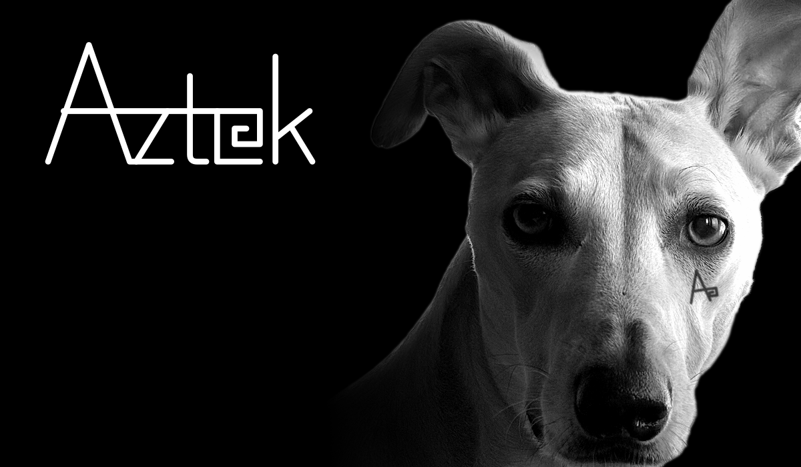

  
  
  
  

## Why

The tools we build our work on shouldn't belong to whoever bought them last. Too many of them were bought, left to stand still, and kept on subscription while bugs older than some of the people using them went unfixed. Aztek works the way you already work, and it belongs to everyone who uses it: no account, no subscription, no owner who can sell it, shelve it or switch it off.

**Back it up, clone it, fork it.** As long as one copy exists somewhere, nobody can take it away. See [Copy it anywhere](#copy-it-anywhere).

A modelling, UV, rigging and animation application with the industry-standard commands, hotkeys, menus and file format. Rust core (scene graph, commands,
geometry, Vulkan viewport), Qt Widgets shell in C++, a MEL interpreter, and embedded Python with `aztek.cmds`,
compatibility modules so existing scripts import unchanged, and an API 2.0 subset. Reads and writes `.ma` files. [PARITY.md](PARITY.md) has the behaviour
target and status, including known differences; [docs/COMMANDS.md](docs/COMMANDS.md) lists all 1103 commands.

Website: [srlegrand.github.io/Aztek](https://srlegrand.github.io/Aztek/). Downloads: [latest build](https://github.com/srlegrand/Aztek/releases/latest) for Windows and Linux. Licence: [MIT-0](LICENSE).

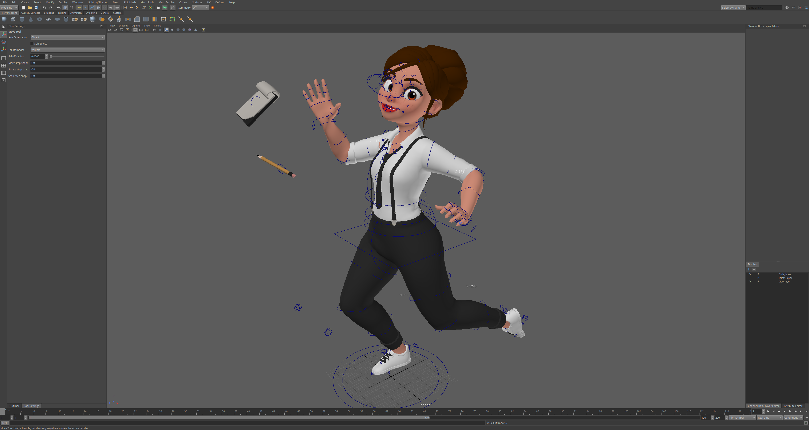

A production character rig, opened from its `.ma` file and posed: 414 joints, 37 skinClusters, 17
blendShapes, 82 IK handles, follicles, ribbons and wires. It opens in about 3 seconds and responds in 13 to 44 ms per change.

## Copy it anywhere

Copying Aztek somewhere else is welcome. Clone it, fork it, mirror it or re-host it on any git server or other version
control: Codeberg, GitLab, a forge in your country, a server at your studio, a drive in your pocket. With or without
changes, under your own name or none. There is nothing to ask and no one to credit: the licence is [MIT-0](LICENSE).
Every extra copy makes the project harder to lose.

    git clone --mirror https://github.com/srlegrand/Aztek.git
    cd Aztek.git
    git push --mirror <your repository's URL>

## This doesn't feel right!

Aztek should feel like second nature to anyone who has spent years in a 3D package. If something doesn't work, or works but
doesn't feel quite right (a hotkey, a drag, a default, a menu in the wrong place), press the orange **This doesn't feel
right!** button at the far right of the shelf bar. Say what you did and what you expected; that's the whole report. It opens a filled-in
GitHub issue, so every rough edge anyone notices ends up in one public list.

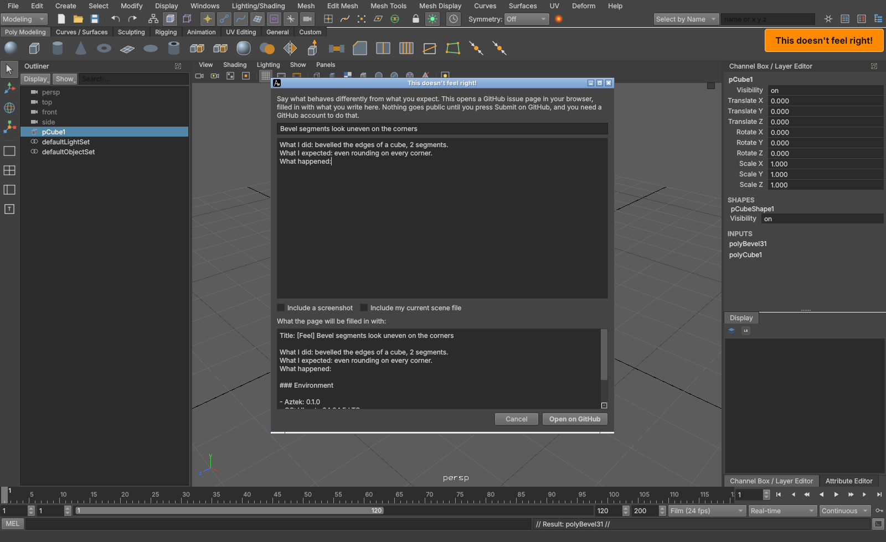

It is also under Help > This doesn't feel right!, and the `AztekFeedback` runtime command. Optionally add:

- a screenshot of the app, which you can draw on with a pen, arrows, rectangles and text;
- a zipped `.ma` copy of the current scene. Your scene stays as it is, and the copy has a generic name. It holds the names of everything in
  the scene and may hold file paths. Referenced files and textures are not included.

Both are off by default and ask you to confirm. **Reports are public: never include work under NDA or anything confidential. If you do, it
is at your own risk.**

The app makes no network requests. "Open on GitHub" opens a filled-in issue page in your browser, puts the picture on the clipboard (Ctrl+V
in the description box) and shows the folder holding the attachments, under `feedback/` in the app's data location, so the zip can be dragged
in. You need a GitHub account, and nothing is public until you press Submit on that page. The window shows exactly what the page will be
filled in with. GitHub takes files up to 25 MB and images up to 10 MB.

## What's in it

- **Polygon modelling:** the standard polygon commands with construction history; Quad Draw, Multi-Cut, Insert and Offset Edge
  Loop, Target Weld, Slide Edge, Crease, Create and Append Polygon; symmetry, soft selection; eighteen sculpting brushes.
- **NURBS:** curves (CV and EP tools, rebuild, attach, detach, offset) and surfaces (primitives, loft, revolve, extrude,
  boundary, birail, `nurbsToPoly`), with CVs as components.
- **UVs:** projections, unfold, layout, cut and sew, UV Editor.
- **Materials and textures:** a physically based standard surface, and lambert, blinn, phong, phongE and surfaceShader with file textures and place2dTexture, assigned to objects or faces; Textured mode (6) in the viewport; Hypershade lists; the image behind the UV Editor.

  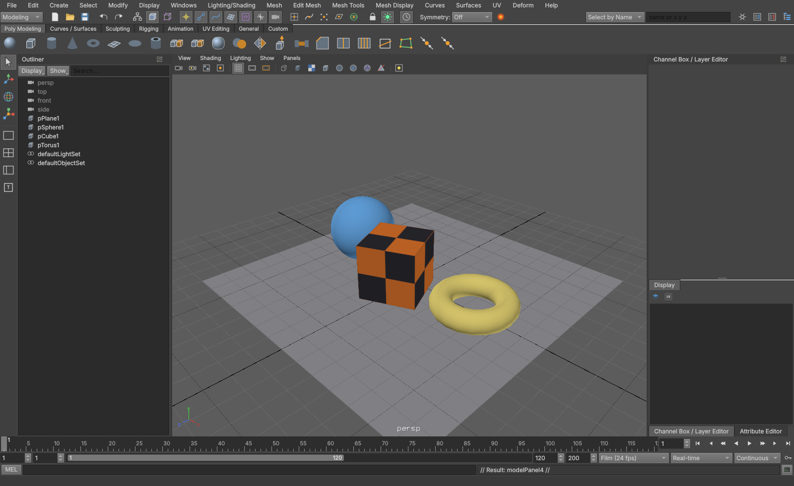
- **Rigging:** joints (orient, mirror, insert, segment scale compensate), RP, SC and spline IK, every constraint, smooth
  skin with weight painting, mirror and copy, dual quaternion; lattice, wrap, wire, delta mush, softMod, nonlinears,
  clusters, blend shapes; HumanIK characters with definitions, T-pose checks, control rig and retargeting between skeletons of different sizes. Controls keep their colours:
  drawing overrides, templates, reference display, display layer colours and wireframe colours.

  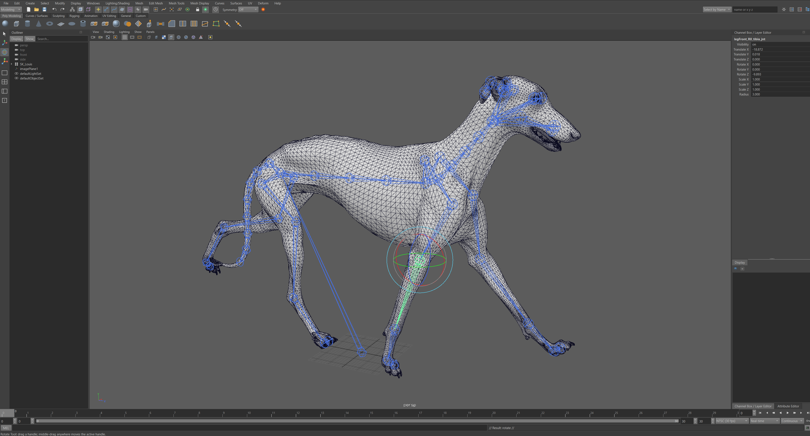
- **Animation:** keys with weighted tangents and infinities, Graph Editor, Dope Sheet, set driven keys, breakdowns,
  copy and paste keys, baking, motion paths, animation layers with their editor (additive, override, passthrough, merge, extract), character sets and clips.
- **Deformers:** blendShape in full (Shape Editor, in-between and live targets), sculpt, jiggle, shrinkWrap, proximityWrap,
  curveWarp, wrinkle, morph and more; deformer weights painted with the Paint Attribute tool or exported.
- **Dynamics:** one solver for cloth, particles and rigid bodies, which all collide with and push each other. Cloth
  on skinned or animated meshes with material presets, colliders, emitters, fields and constraints; it never explodes,
  and a vertex it cannot place leaves the simulation for a while and comes back, marked in the view. Older dynamics
  nodes in `.ma` files load into it. See [docs/DYNAMICS.md](docs/DYNAMICS.md).
- **Lights:** ambient, directional, point, spot, area and volume lights with their icons, attributes and `.ma` layout; Use All Lights (7), Use Selected Lights, flat and no lights in the viewport, with decay, spot cones, blinn and phong highlights and light linking; shadows in renders.
- **Rendering:** Harold, a physically based path tracer on the CPU: the standard surface with subsurface, coat, sheen,
  transmission and thin film; area, sky dome with HDR images, mesh and photometric lights; subdivision, displacement,
  motion blur and depth of field; light and data AOVs into multi-layer EXR; interactive rendering in the Render View as
  the scene changes, Render Settings, and batch rendering with no display (`aztek -render`). Every material and light
  in a scene renders through it. See [docs/HAROLD.md](docs/HAROLD.md).

  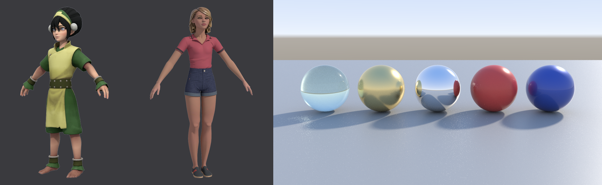
- **Files:** `.ma` read and written in the standard layout, deformer chains, constraints, utility nodes, expressions, materials,
  NURBS and references with their edits included; namespaces, instances, locked nodes, Z up.

  
- **USD:** `.usd`, `.usda`, `.usdc` and `.usdz` read and written with transforms, meshes, skeletons, blend shapes, materials and animation; a stage in the scene with no node per prim, prims to select and edit, variants, payloads, a Layer Editor, editing a prim as scene nodes and merging back, `pxr` in Python. No C++ library needed. See [docs/USD.md](docs/USD.md).
- **Scripting:** MEL (procedures, arrays, control flow, backticks), Python, the API 2.0 subset, Python plug-ins with
  `MPxCommand` and `MPxNode`; `scriptJob`, `scriptNode` and `evalDeferred`.

  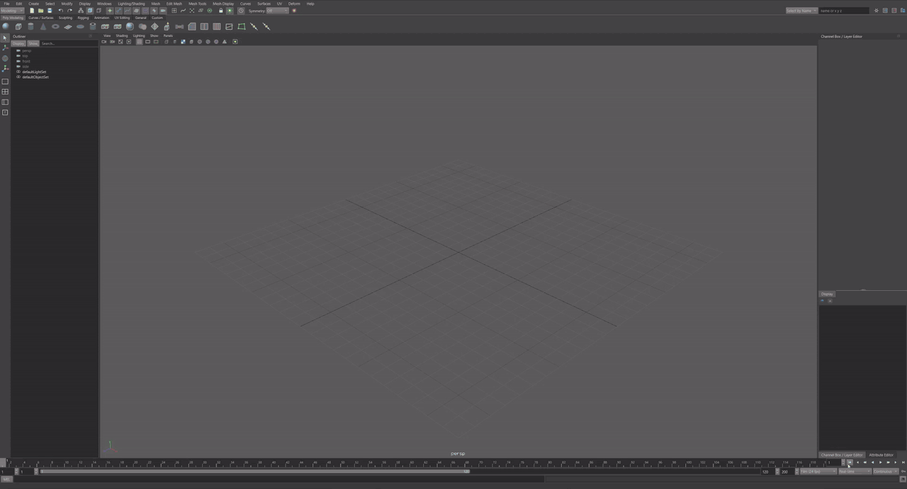
- **Script-built interface:** `window`, layouts, controls, menus and dialogs from MEL or Python become Qt widgets;
  attribute-bound controls, `AE<type>Template` procedures, `workspaceControl` docking, editors and panels created by script.

  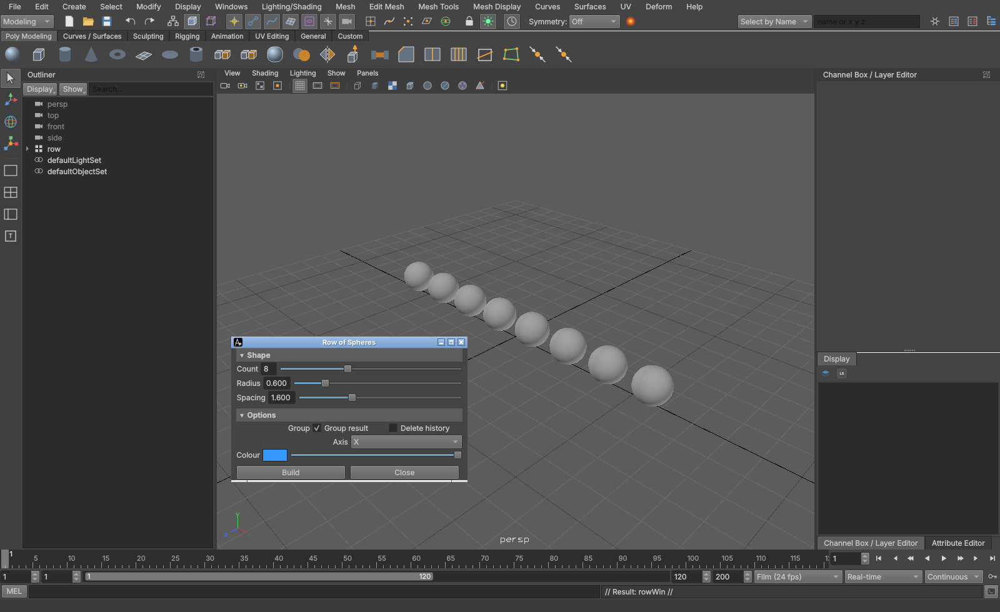
- **Playblast** to images or, through ffmpeg, to a movie.
- **Interface:** menu sets, shelves with an editor, hotkey editor, marking menus, hotbox, channel box, outliner, attribute
  editor, node editor, tool settings, panel layouts, workspaces.
- **Manipulators** on history and deformer nodes (T), with in-view numbers: extrude, projections, primitives, nonlinears, soft
  modification and more. Move along normals, custom axes, step snap, tweak mode.

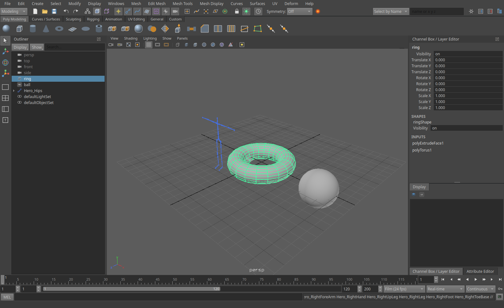

Lights in the viewport, Use All Lights on the 7 key, with highlights from blinn and phong materials:

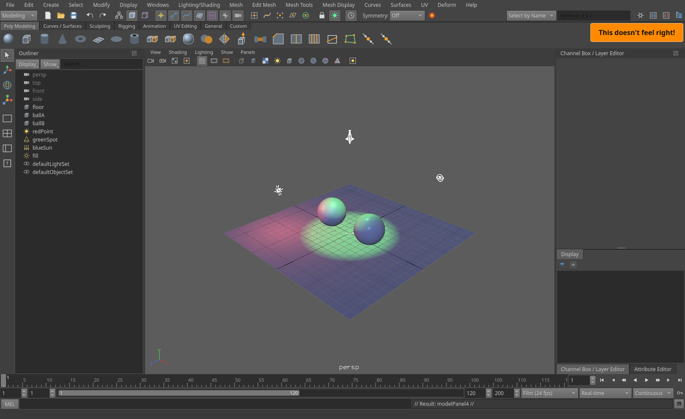

Real production rigs, opened from their `.ma` files with their textures and control colours:

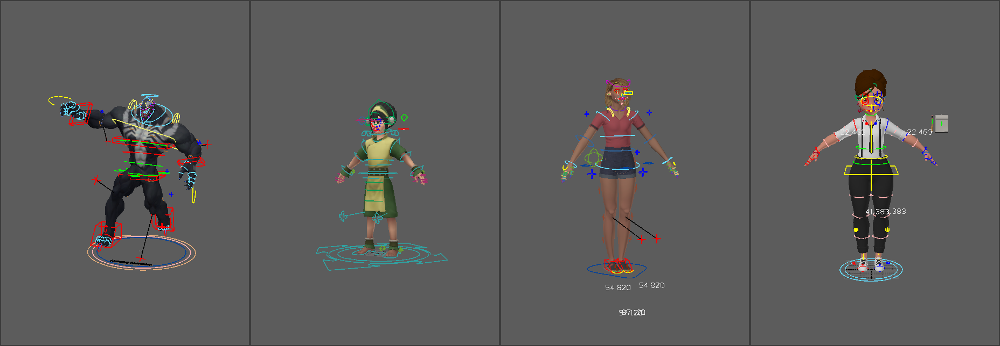

The Harold image above shows Toph and Lou, rendered with a sky and a key light added.

Left to right: a Venom rig, whose download names no author; Toph, a fan art rig by Ninjin Studios of the character from Nickelodeon's The Last Airbender; Lou, model by Dmitry Danilov and rig by Boris Klimov; the Waitress, model by François Boquet. They're used here as test rigs under their authors' terms and aren't part of this repository.

## In the works

- **Dynamics:** one solver for cloth, particles and rigid bodies, in place of several overlapping systems. `.ma` files that
  use any of the older systems load into it.
- **Bicurious:** liquids, smoke, fire and procedural graphs inside that same solver, colliding with and pushing cloth,
  particles and rigid bodies.
- **Harold:** Aztek's own renderer.
- **C++ plug-in kit:** rebuild a plug-in from its source against Aztek's headers.

## Examples

File > Examples opens scenes from the `examples` folder: modelling history, materials and textures, a small coloured and keyed arm rig, and nested references with their edits, and all the default lights; cloth draped on a ball, particles with fields, and boxes dropped on a hammock. `examples/tools/make_examples.mel` writes them.

## Screens

Four views, Space to toggle:

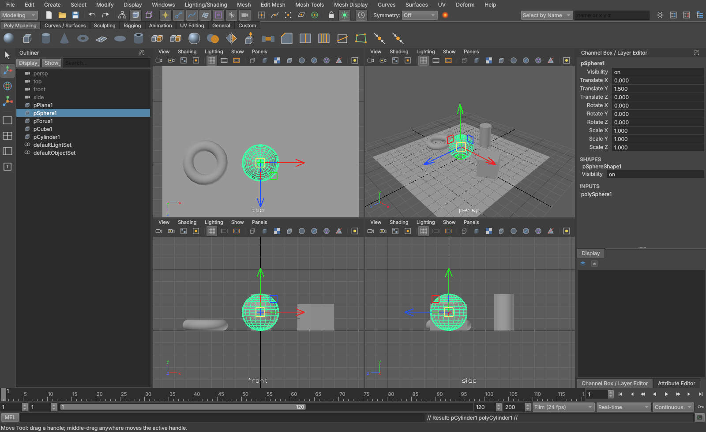

Component editing with construction history (`polyExtrudeFace1` in the channel box's inputs) and the move manipulator:

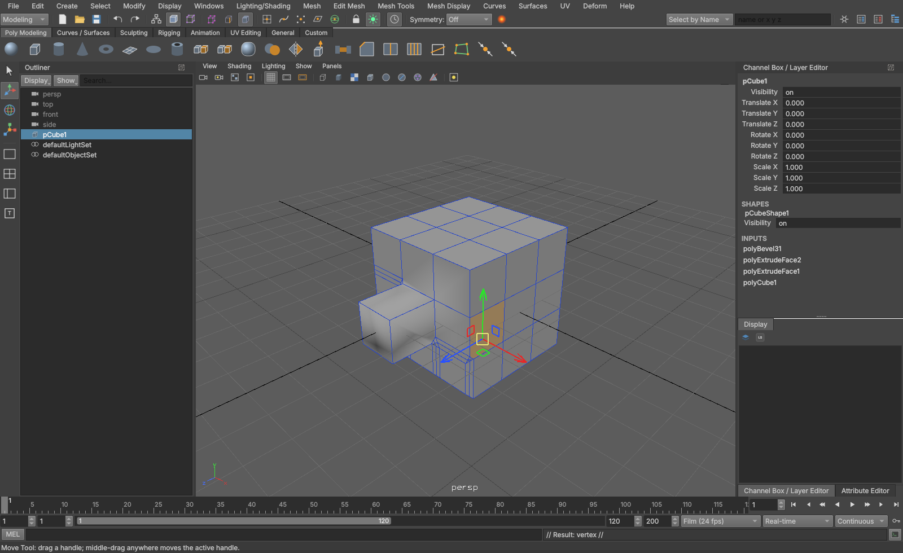

Marking menus on the right button:

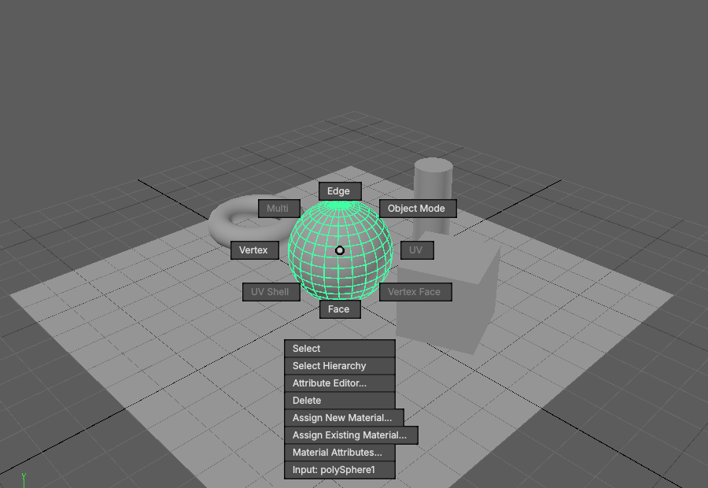

Soft selection (B), falloff shown on the vertices:

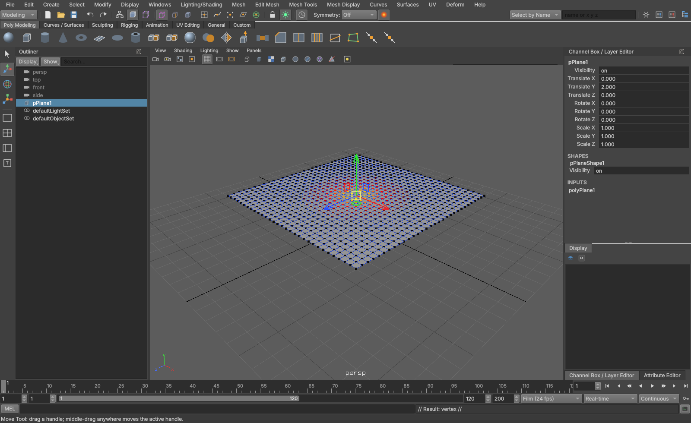

UV Editor: automatic projection and layout:

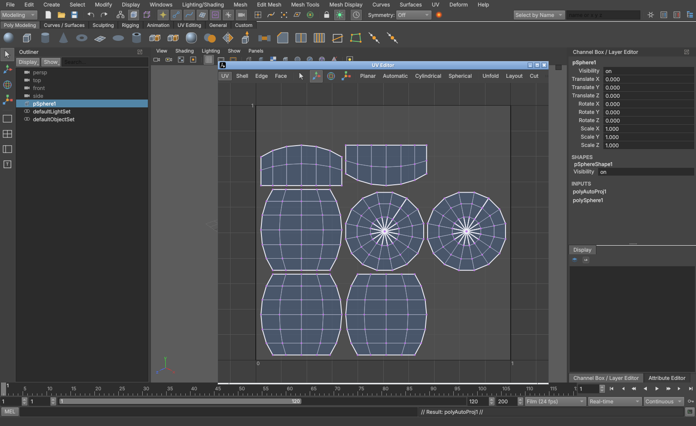

Graph Editor, with keyed channels in the channel box and key ticks on the time slider:

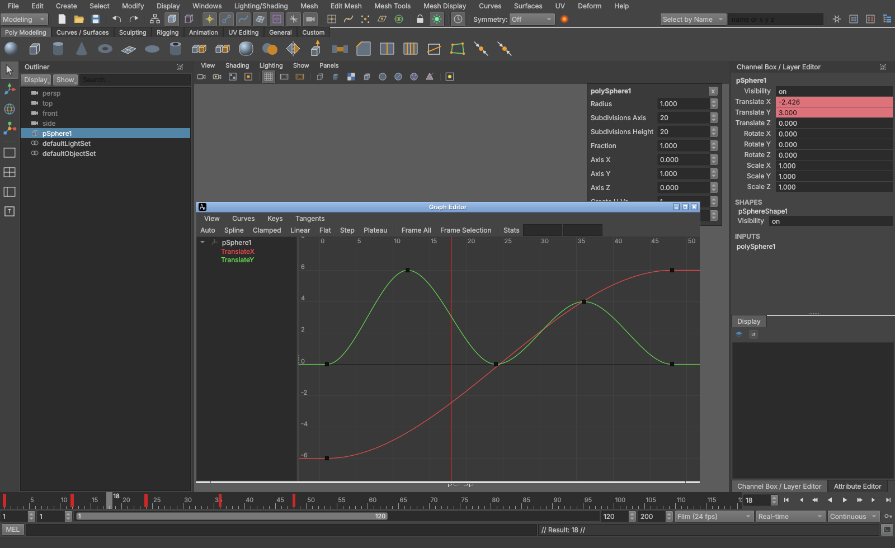

The production rig in another pose, its controls driving joints, skin and blend shapes:

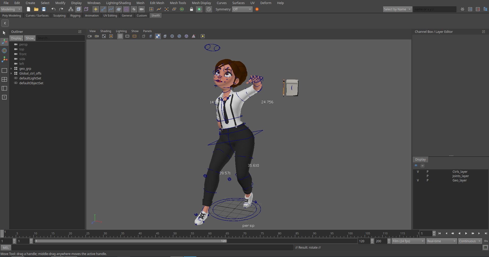

Joints, smooth skin and an RP IK handle:

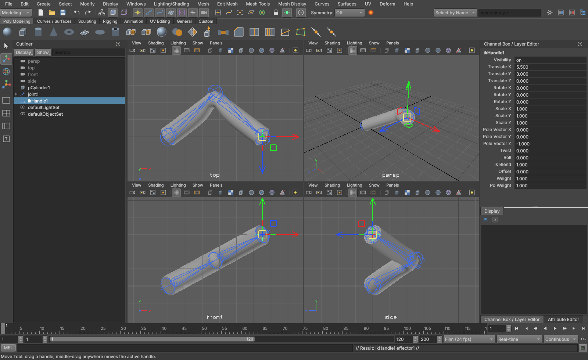

Paint Skin Weights, with the influence list and brush settings in Tool Settings:

NURBS surfaces and curves, with a drawing override on the control:

Quad Draw on a live surface:

Dope Sheet, with a breakdown in green:

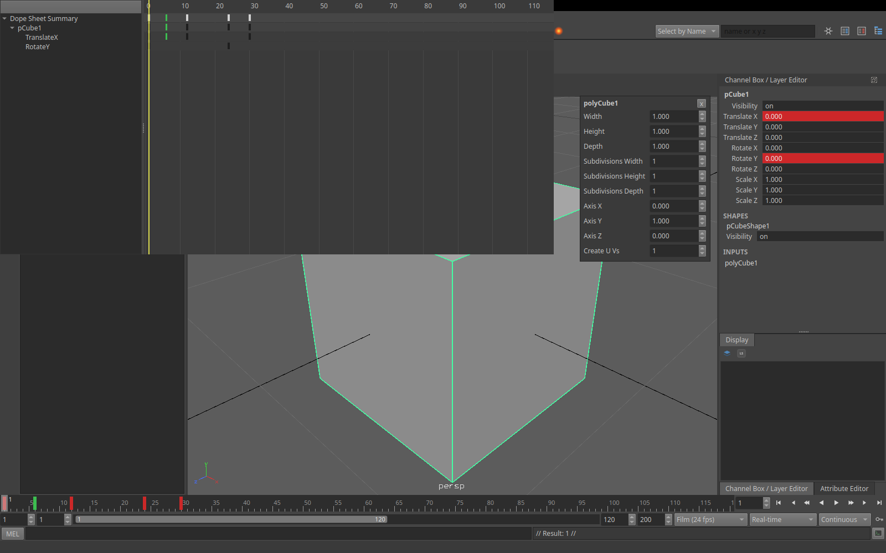

Node Editor:

## Install

Packages are on the [releases page](https://github.com/srlegrand/Aztek/releases): each build of the main branch is a release of its own, numbered 1.N where N counts the changes so far.

| System | Package | Install |
| --- | --- | --- |
| Rocky Linux 8 | `aztek-<version>-1.el8.x86_64.rpm` | `sudo dnf install ./aztek-*.el8.x86_64.rpm` (Qt is bundled) |
| Rocky Linux 9 | `aztek-<version>-1.el9.x86_64.rpm` | `sudo dnf install epel-release`, then `sudo dnf install ./aztek-*.el9.x86_64.rpm` |
| Ubuntu 22.04, 24.04 | `aztek_<version>-1_ubuntu22.04_amd64.deb`, `..._ubuntu24.04_...` | `sudo apt install ./aztek_*.deb` |
| Windows 10 and 11 | `aztek-<version>-setup-x64.exe`, or the zip | Run it. It isn't signed, so SmartScreen asks first |

The viewport needs a Vulkan driver: NVIDIA's own driver has one, and Mesa's `mesa-vulkan-drivers` covers AMD and Intel.
[docs/PACKAGING.md](docs/PACKAGING.md) has the details, and how the packages are built.

## Build

Linux:

    ./build.sh --deps --run

`--deps` installs the build dependencies (apt, dnf or pacman) and only needs running once; `--run` starts Aztek
afterwards; `--install` puts it in `~/.local` with a menu entry and icon; `--debug` builds into `build-debug/`. Rust comes from [rustup](https://rustup.rs). An active conda
environment is fine: the script builds against the system Python and ignores conda's libraries.

Windows, from PowerShell or a command prompt:

    build.bat -Run

Needs Visual Studio 2022 (or its Build Tools) with "Desktop development with C++", Rust from
[rustup](https://rustup.rs), CMake, Qt 6.4+ for MSVC from the [Qt online installer](https://www.qt.io/download-qt-installer-oss),
and Python 3 from [python.org](https://www.python.org/downloads/). The script finds Visual Studio and the newest Qt
under `C:\Qt` (or takes `-Qt C:\Qt\6.8.0\msvc2022_64`), builds, and makes a folder that runs by itself in `build\dist`:
Qt's DLLs, the VC runtime and Python's standard library beside `aztek.exe`.

By hand, on either: `cmake -B build -G Ninja -DCMAKE_BUILD_TYPE=Release && cmake --build build`. The first build
compiles the Rust core (a few minutes); later builds only rebuild what changed. `-DAZTEK_PYTHON=OFF` builds without
Python.

Options:

    aztek [scene.aztek|scene.ma] [--script file.mel|file.py] [--screenshot out.png]

On KDE Plasma, Alt + drag moves windows by default: set System Settings > Window Management > Window Behavior >
Window Actions > Modifier key to Meta.

## Hotkeys

| Keys | Action |
|---|---|
| Alt + left / middle / right drag, wheel | Tumble, track, dolly |
| Space tap / hold | Toggle single and four views / hotbox |
| Right button | Marking menu (Shift: modelling tools, Ctrl: selection conversion) |
| Q W E R | Select, move, rotate, scale |
| F / A, Shift+F / Shift+A | Frame selection / all, in every view |
| F8, F9, F10, F11 | Object/component, vertex, edge, face |
| F2, F3, F4 | Animation, Modeling, Rigging menu sets |
| Click, drag, double-click an edge | Select, marquee, edge loop |
| Shift / Ctrl / Ctrl+Shift click | Toggle / deselect / add |
| Z, Shift+Z (Ctrl+Z, Ctrl+Y) | Undo, redo |
| G | Repeat last |
| Ctrl+D, Shift+D, Ctrl+G, P, Shift+P | Duplicate, duplicate with transform, group, parent, unparent |
| Ctrl+E, Ctrl+B | Extrude, bevel |
| 1, 2, 3 | Smooth preview off, cage, smooth |
| 4, 5 | Wireframe, shaded |
| B | Soft selection |
| > and < | Grow and shrink selection |
| Delete | Delete objects or components |
| S, Shift+W/E/R | Set key on all channels, on translate/rotate/scale |
| . and , | Next and previous key |
| Alt+. and Alt+, | Next and previous frame |
| Alt+V, Esc | Play / stop |
| Ctrl+A | Attribute Editor |
| Enter | Joint tool: end the chain. Curve, Multi-Cut and polygon tools: finish |
| B drag | Paint and sculpting tools: size the brush |
| Ctrl+Shift+T | Tool Settings (also: double-click a tool) |

In the channel box, click channel names to pick them (Ctrl and Shift add); middle-drag in a view then changes them
(Ctrl fine, Shift coarse). Right-click for keys, locks and connections.

## Editors

- Outliner, Channel Box / Layer Editor, Attribute Editor (docked), Script Editor with MEL and Python tabs.
- Graph Editor and Dope Sheet (Windows > Animation Editors): curves and keys of the selection.
- Node Editor (Windows > General Editors): graph the selection, wire attributes, Tab creates a node.
- Hotkeys and shelves are editable; the Hotkey Editor is under Windows > Settings/Preferences.
- UV Editor (Windows > Modeling Editors, or UV > UV Editor): UVs by UV, shell, edge or face; move, rotate and scale;
  projections, unfold, layout, cut, sew, normalize, flip.

## Scripting

The command line and the Script Editor take MEL (`polyCube -w 2 -sx 3; select -r pCube1.f[0:3]; polyExtrudeFacet
-ltz 1;`) and Python:

    from aztek import cmds
    cube = cmds.polyCube(w=2)[0]
    cmds.setKeyframe(cube, at='ty', t=1, v=0)
    cmds.setKeyframe(cube, at='ty', t=24, v=5)
    cmds.polyCube(cube, q=True, w=True)

`aztek.cmds` is the module of record; the compatibility modules map onto it, so existing scripts run unchanged. Python plug-ins load
with `loadPlugin`. C++ plug-ins can't load.

## Compatibility

Existing scripts, habits and `.ma` files carry over: a production rig opens, poses and saves (see "A real rig" in
[PARITY.md](PARITY.md)). Behaviour comes from published references, so expect differences in details; PARITY.md lists
the known ones. `.mb` files and C++ plug-ins are not supported yet. Materials and render settings from other renderers in a file are
read and rendered with Harold, with a warning naming what isn't honoured.

## Licence

[MIT-0](LICENSE): use, copy, change, sell, re-host and redistribute it however you like, with no attribution required.
Copies on any other host are welcome (see [Copy it anywhere](#copy-it-anywhere)). It comes with no warranty of any kind.
