<p align="center"></p>

<p align="center">
  <a href="https://github.com/srlegrand/Aztek/releases/latest"></a>
  <a href="https://github.com/srlegrand/Aztek/fork"></a>
  <a href="#copy-it-anywhere"></a>
  <a href="#fix-it-yourself"></a>
  <a href="https://srlegrand.github.io/Aztek/"></a>
</p>

## This doesn't feel right!

Aztek should feel like second nature to anyone who has spent years in a 3D package. If something doesn't work, or works but
doesn't feel quite right (a hotkey, a drag, a default, a menu in the wrong place), press the orange **This doesn't feel
right!** button at the far right of the shelf bar. Say what you did and what you expected; that's the whole report. It opens a filled-in
GitHub issue, so every rough edge anyone notices ends up in one public list.


It is also under Help > This doesn't feel right!, and the `AztekFeedback` runtime command. The small arrow on the
button's left folds it away, and brings it back; Aztek remembers which. Optionally add:

- a screenshot of the app, which you can draw on with a pen, arrows, rectangles and text;
- a zipped `.ma` copy of the current scene. Your scene stays as it is, and the copy has a generic name. It holds the names of everything in
  the scene and may hold file paths. Referenced files and textures are not included.

Both are off by default and ask you to confirm. **Reports are public: never include work under NDA or anything confidential. If you do, it
is at your own risk.**

Sending a report makes no network request from the app. "Open on GitHub" opens a filled-in issue page in your browser, puts the picture on the clipboard (Ctrl+V
in the description box) and shows the folder holding the attachments, under `feedback/` in the app's data location, so the zip can be dragged
in. You need a GitHub account, and nothing is public until you press Submit on that page. The window shows exactly what the page will be
filled in with. GitHub takes files up to 25 MB and images up to 10 MB.

## Fix it yourself

If something is wrong and you can see how to fix it, fix it and send the change. Small fixes are as welcome as large
ones, and there is nothing to ask first. Three ways, each unfolds:

<details>
<summary><b>By hand: build it, change it, send a patch or a pull request</b></summary>

1. **Get the tools, the source, and build it.** You need `git`, and `gh` (GitHub's command line tool) if you will
   send a pull request. What the build itself needs is under [Build](#build).

   Linux:

       sudo apt install git        # or: sudo dnf install git, sudo pacman -S git
       git clone https://github.com/srlegrand/Aztek.git
       cd Aztek
       ./build.sh --deps --run

   For `gh`, follow [its Linux instructions](https://github.com/cli/cli/blob/trunk/docs/install_linux.md): the `gh`
   that Debian and Ubuntu ship themselves is too old to work with GitHub (as of 11/2025, by its maintainers' note).

   macOS, with [Homebrew](https://brew.sh):

       brew install git gh
       git clone https://github.com/srlegrand/Aztek.git
       cd Aztek
       ./build-macos.sh --deps --run

   Windows, from PowerShell, with Visual Studio 2022 and Qt installed as [Build](#build) says:

       winget install --id Git.Git
       winget install --id GitHub.cli
       git clone https://github.com/srlegrand/Aztek.git
       cd Aztek
       .\build.bat -Run

   Open a new terminal after installing so `git` and `gh` are found. Then, once, sign `gh` in to your GitHub account
   (a free one will do; make it at [github.com/signup](https://github.com/signup)):

       gh auth login

   Answer GitHub.com, HTTPS, Yes to authenticating Git, and "Login with a web browser": it shows a code, opens the
   browser, and you paste the code there. `gh auth status` says whether it worked. A patch attached to an issue needs
   no `gh`, only the account.

2. **Find the code.** The Rust core is under `crates/`: `aztek_scene` holds the nodes and commands, `aztek_geo` the mesh
   operations, `aztek_host` the viewport and everything the interface asks of the core. The Qt interface is under
   `app/src`. Searching for a command's name, a menu label or an error message usually lands on the right file.
   [PARITY.md](PARITY.md) says how each area is meant to behave.

3. **Make the change and check it.** `./build.sh --run` rebuilds and starts Aztek (`./build-macos.sh --run` on macOS,
   `.\build.bat -Run` on Windows). Each crate keeps its tests in its
   `tests/` folder; run the ones for the crate you touched, and add one beside them if the fix can be tested.

       cargo test -p aztek_scene

4. **Send it**, as a patch or as a pull request.

   A patch needs no fork. Make one file holding everything you changed, new files included:

       git add -A
       git diff --cached > my-fix.patch

   Attach `my-fix.patch` to the issue it fixes, or to a [new issue](https://github.com/srlegrand/Aztek/issues/new)
   saying what it changes. If GitHub refuses the file, zip it first.

   A pull request, with `gh` signed in. The first command makes your own copy of the repository on GitHub and points
   this folder at it; the last pushes your branch there and opens the pull request:

       gh repo fork --remote
       git checkout -b my-fix
       git add -A
       git commit -m "What the fix does"
       gh pr create --fill

   If git asks who you are at the commit, tell it once: `git config --global user.name "Your Name"` and
   `git config --global user.email "you@example.com"`.

</details>

<details>
<summary><b>With an LLM, nothing to install: the source zip and a chat</b></summary>


No git, no build: a chat service that takes a file and can give one back is enough.

1. Download the source: [Aztek-main.zip](https://github.com/srlegrand/Aztek/archive/refs/heads/main.zip) (about 30 MB).
2. Start a new chat, attach the zip, and send this with the problem filled in. If the service refuses the zip for its
   size, unzip it and zip only `crates`, `app`, `CLAUDE.md` and `PARITY.md` (about 5 MB).

   ```text
   The attached zip is the source of Aztek (https://github.com/srlegrand/Aztek), a 3D application
   with a Rust core under crates/ and a Qt interface in C++ under app/src. Unzipped, everything
   sits in one top folder (Aztek-main).

   Read CLAUDE.md first: it holds the project's rules and layout. PARITY.md says how each area
   is meant to behave.

   The problem:
   <What you did, what happened, and what you expected instead. Paste the issue's text and
   its number if there is one.>

   Do this, in order:
   1. Find the code responsible and tell me what causes the problem.
   2. Make the smallest change that fixes it, in the style of the code around it. Don't
      refactor, rename or reformat what the fix doesn't need.
   3. If the fix can be tested, add a test in that crate's tests/ folder.
   4. If the change alters behaviour that PARITY.md describes, update PARITY.md.

   Give me the result as one file to download, named my-fix.patch: a unified diff that
   `git apply` accepts, with paths from the repository's root (a/crates/..., b/crates/...,
   without the Aztek-main folder), holding only the lines that change and their context. Add
   no credit or attribution lines anywhere. If you can't make a file, put the whole diff in
   one code block.

   Then tell me, in a few lines: the files you changed and why, how to check the fix by hand
   in the app, and what you could not build, run or verify.
   ```

3. Save what it gives back as `my-fix.patch`, and attach it to the issue it fixes or to a
   [new issue](https://github.com/srlegrand/Aztek/issues/new). You need a GitHub account for that, nothing else. If
   GitHub refuses the file, zip it first.
4. Say in the issue that the patch was made this way and has not been built or run: nobody has yet seen it work, so
   it gets checked before it goes in.

</details>

<details>
<summary><b>With an LLM, in the built source</b></summary>


A coding assistant that can read the folder and run commands in it can find the code and make the change with you, and build
and test what it changes. Clone and build first (step 1 of By hand), start the assistant in the `Aztek` folder, and give it this, with the
problem filled in:

```text
You are working in a clone of Aztek (https://github.com/srlegrand/Aztek), a 3D application
with a Rust core under crates/ and a Qt interface in C++ under app/src.

Read CLAUDE.md first: it holds the project's rules and layout. PARITY.md says how each area
is meant to behave.

The problem:
<What you did, what happened, and what you expected instead. Paste the issue's text and
its number if there is one.>

Do this, in order:
1. Find the code responsible and tell me what causes the problem before changing anything.
2. Make the smallest change that fixes it, in the style of the code around it. Don't
   refactor, rename or reformat what the fix doesn't need.
3. If the fix can be tested, add a test in that crate's tests/ folder, and run the crate's
   tests: cargo test -p <crate>.
4. Build with ./build.sh (build.bat on Windows, ./build-macos.sh on macOS) and fix what
   doesn't compile.
5. If the change alters behaviour that PARITY.md describes, update PARITY.md.
6. Don't commit or push, and add no credit or attribution lines anywhere.

When you are done:
- run: git add -A && git diff --cached > my-fix.patch
- list the files you changed and why, in a few lines
- give me the steps to check the fix by hand in the app
- say plainly what you could not test or verify
```

Then build, start Aztek and check the fix yourself by the steps it gives: it can be wrong while sounding sure. Read the
patch before sending it (step 4 of By hand), and say in the issue what you checked.

</details>

What helps it go in quickly: one fix per patch, a line on what was wrong and what happens now, and the issue's number
if there is one. A change you send goes in under [MIT-0](LICENSE) like everything else here. And if you would rather
keep the fix in your own copy, that is fine too: see [Copy it anywhere](#copy-it-anywhere).

## Why

The tools we build our work on shouldn't belong to whoever bought them last. Too many of them were bought, left to stand still, and kept on subscription while bugs older than some of the people using them went unfixed. Aztek works the way you already work, and it belongs to everyone who uses it: no account, no subscription, no owner who can sell it, shelve it or switch it off.

**Back it up, clone it, fork it.** As long as one copy exists somewhere, nobody can take it away. See [Copy it anywhere](#copy-it-anywhere).

[](https://github.com/srlegrand/Aztek/actions/workflows/build.yml)

A 3D application for modelling, UVs, rigging, animation, dynamics and rendering, with the industry-standard commands, hotkeys, menus and file format. Rust core (scene graph, commands,
geometry, Vulkan viewport), Qt Widgets shell in C++, a MEL interpreter, and embedded Python with `aztek.cmds`,
compatibility modules so existing scripts import unchanged, and the Python API (2.0, and 1.0 as `maya.OpenMaya`). Reads and writes `.ma` files and reads `.mb` files. [PARITY.md](PARITY.md) has the behaviour
target and status, including known differences; [docs/COMMANDS.md](docs/COMMANDS.md) lists all 1111 commands.

Website: [srlegrand.github.io/Aztek](https://srlegrand.github.io/Aztek/). Licence: [MIT-0](LICENSE).

**Download** from the [latest release](https://github.com/srlegrand/Aztek/releases/latest): Windows installer or zip, Rocky Linux 9 and 8 `.rpm`, Ubuntu 24.04 and 22.04 `.deb`, an AppImage for any other Linux, Linux `.tar.gz`, and an early macOS build for Apple silicon. Install steps are under [Install](#install).

| Modelling history | A flag in a breeze | A tower knocked down |
| --- | --- | --- |
| 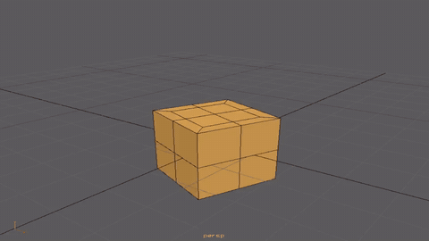 | 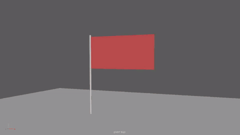 | 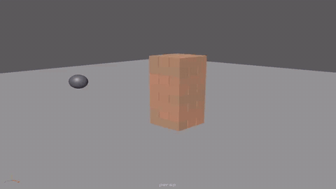 |


A production character rig, opened from its `.ma` file and posed: 414 joints, 37 skinClusters, 17
blendShapes, 82 IK handles, follicles, ribbons and wires. It opens in about 3 seconds and responds in 13 to 44 ms per change.

## Copy it anywhere

Copying Aztek somewhere else is welcome. Clone it, fork it, mirror it or re-host it on any git server or other version
control: Codeberg, GitLab, a forge in your country, a server at your studio, a drive in your pocket. With or without
changes, under your own name or none. There is nothing to ask and no one to credit: the licence is [MIT-0](LICENSE).
Every extra copy makes the project harder to lose.

    git clone --mirror https://github.com/srlegrand/Aztek.git
    cd Aztek.git
    git push --mirror <your repository's URL>

## What's in it

**Modelling**

- **Polygons:** the standard polygon commands with construction history; Quad Draw, Multi-Cut, Insert and Offset Edge
  Loop, Target Weld, Slide Edge, Crease, Create and Append Polygon, booleans; symmetry, soft selection; eighteen sculpting brushes.
- **NURBS:** curves (CV and EP tools, rebuild, attach, detach, offset) and surfaces (primitives, loft, revolve, extrude,
  boundary, birail, `nurbsToPoly`), with CVs as components.
- **Manipulators** on history and deformer nodes (T), with in-view numbers: extrude, projections, primitives, nonlinears, soft
  modification and more. Move along normals, custom axes, step snap, tweak mode.

**UVs**

- Projections, unfold, layout, cut and sew in the UV Editor, by UV, shell, edge or face.

**Rigging**

- **Skeletons and skinning:** joints (orient, mirror, insert, segment scale compensate), RP, SC and spline IK, every constraint, smooth
  skin with weight painting, mirror and copy, dual quaternion; HumanIK characters with definitions, T-pose checks, control rig and
  retargeting between skeletons of different sizes. Controls keep their colours: drawing overrides, templates, reference display,
  display layer colours and wireframe colours.

  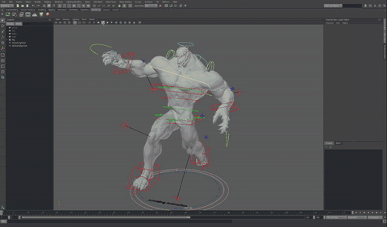

  
- **Deformers:** blendShape in full (Shape Editor, in-between and live targets), lattice, wrap, wire, delta mush, softMod,
  nonlinears, clusters, sculpt, jiggle, shrinkWrap, proximityWrap, curveWarp, wrinkle, morph and more; deformer weights painted
  with the Paint Attribute tool or exported.

**Animation**

- Keys with weighted tangents and infinities, Graph Editor, Dope Sheet, set driven keys, breakdowns,
  copy and paste keys, baking, motion paths, animation layers with their editor (additive, override, passthrough, merge, extract),
  character sets and clips. **Playblast** to images or, through ffmpeg, to a movie.

  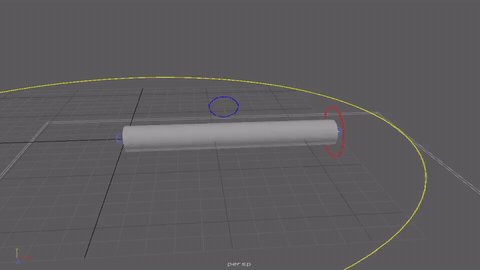

**Dynamics**

- One solver for cloth, particles and rigid bodies, which all collide with and push each other. Cloth
  on skinned or animated meshes with material presets, colliders, emitters, fields and constraints; it never explodes,
  and a vertex it cannot place leaves the simulation for a while and comes back, marked in the view. Older dynamics
  nodes in `.ma` files load into it. See [docs/DYNAMICS.md](docs/DYNAMICS.md).

  | Cloth, rendered with Harold | Rigid bodies on cloth | Particles |
  | --- | --- | --- |
  | 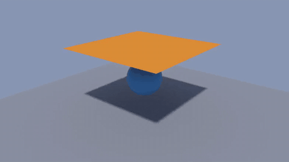 | 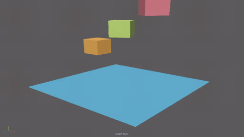 | 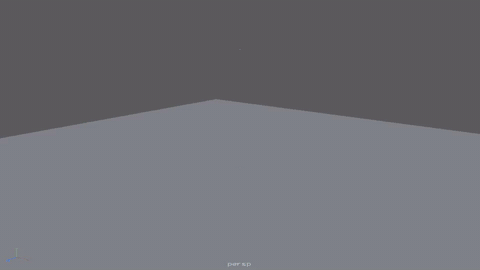 |

**Rendering and look development**

- **Harold**, a physically based path tracer on the CPU: the standard surface with subsurface, coat, sheen,
  transmission and thin film; area, sky dome with HDR images, mesh and photometric lights; subdivision, displacement,
  motion blur and depth of field; light and data AOVs into multi-layer EXR; interactive rendering in the Render View as
  the scene changes, Render Settings, and batch rendering with no display (`aztek -render`). Every material and light
  in a scene renders through it. See [docs/HAROLD.md](docs/HAROLD.md).

  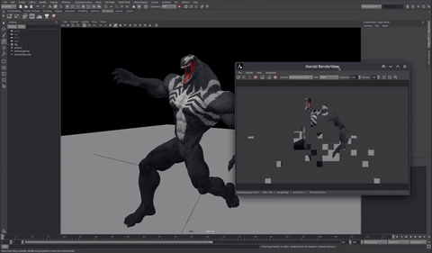

  
- **Materials and textures:** a physically based standard surface, and lambert, blinn, phong, phongE and surfaceShader with file textures and place2dTexture, assigned to objects or faces; Textured mode (6) in the viewport; Hypershade lists; the image behind the UV Editor.

  
- **Lights:** ambient, directional, point, spot, area and volume lights with their icons, attributes and `.ma` layout; Use All Lights (7), Use Selected Lights, flat and no lights in the viewport, with decay, spot cones, blinn and phong highlights and light linking. A matte surface lights the same in the viewport and in Harold.

**Pipeline**

- **Files:** `.ma` read and written in the standard layout, `.mb` read, deformer chains, constraints, utility nodes, expressions, materials,
  NURBS and references with their edits included; namespaces, instances, locked nodes, Z up.

  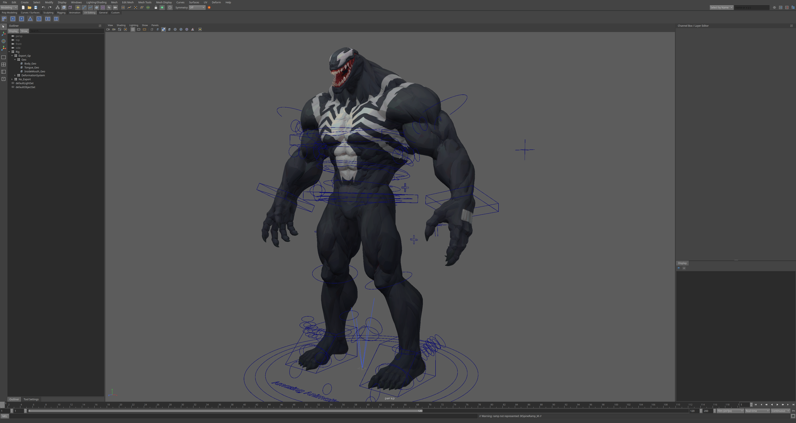
- **USD:** `.usd`, `.usda`, `.usdc` and `.usdz` read and written with transforms, meshes, skeletons, blend shapes, materials and animation; a stage in the scene with no node per prim, prims to select and edit, variants, payloads, a Layer Editor, editing a prim as scene nodes and merging back, `pxr` in Python. No C++ library needed. See [docs/USD.md](docs/USD.md).

**Scripting**

- **Scripting:** MEL (procedures, arrays, control flow, backticks), Python, the Python API 2.0 and 1.0 (`maya.OpenMaya`,
  `MScriptUtil` and all), Python plug-ins of either API with `MPxCommand` and `MPxNode`; `scriptJob`, `scriptNode` and `evalDeferred`.

  
- **Script-built interface:** `window`, layouts, controls, menus and dialogs from MEL or Python become Qt widgets;
  attribute-bound controls, `AE<type>Template` procedures, `workspaceControl` docking, editors and panels created by script.

  
- **C++ plug-ins:** a kit to rebuild a plug-in from its source against Aztek's headers. Commands, nodes and deformers load; more classes are coming.

**Interface**

- **Interface:** menu sets, shelves with an editor, hotkey editor, marking menus, hotbox, channel box, outliner, attribute
  editor, node editor, tool settings, panel layouts, workspaces.
- **Units and up axis:** Y or Z up throughout (cameras, views, grid, primitives, files), and working units in every
  linear, angular and time unit, set in Preferences > Settings, with new scene defaults in File > New Scene's options.


Lights in the viewport, Use All Lights on the 7 key, with highlights from blinn and phong materials:


Real production rigs, opened from their `.ma` files with their textures and control colours:


The Harold image above shows Toph and Lou, rendered with a sky and a key light added.

Left to right: a Venom rig, whose download names no author; Toph, a fan art rig by Ninjin Studios of the character from Nickelodeon's The Last Airbender; Lou, model by Dmitry Danilov and rig by Boris Klimov; the Waitress, model by François Boquet. They're used here as test rigs under their authors' terms and aren't part of this repository.

## In the works

- **Bicurious:** liquids, smoke, fire and procedural graphs inside the same solver as cloth, particles and rigid bodies,
  colliding with and pushing them.
- **Harold:** render layers and render setup, hair and curves, USD stages in renders.
- **Dynamics speed:** large cloth with self collision at interactive rates.
- **C++ plug-in kit:** commands, nodes and deformers load; more classes are coming.

## Examples

File > Examples opens over fifty scenes from the `examples` folder, a submenu per area, and the example scripts in the
Script Editor. Every one opens without a warning; a test plays each.

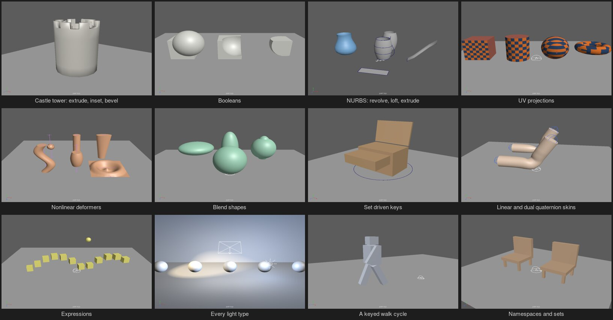

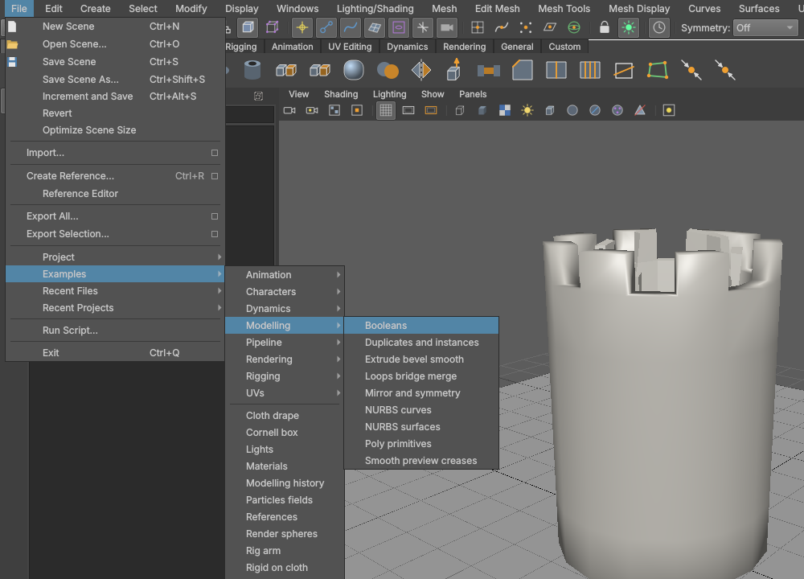

- **Modelling:** every polygon primitive; a castle tower from one cylinder (extrude, inset, bevel, all as history);
  booleans; edge loops, a bridge and welds; a spaceship half mirrored live; smooth mesh preview with creases;
  duplicates and instances; NURBS curves and surfaces (revolve, loft, extrude along a path, planar trim); construction history.
- **UVs:** planar, cylindrical, spherical and automatic projections; unfold and layout, with a checker.
- **Rigging:** every constraint; an IK leg with a reverse foot; a spline IK tail; nonlinear deformers; lattice, wire,
  wrap, cluster and softMod; linear against dual quaternion skinning; blend shapes with an in-between; set driven keys;
  delta mush and jiggle; a small keyed arm rig.
- **Characters:** a keyed walking robot.
- **Animation:** a bouncing ball, a motion path, animation layers, expressions, pendulums on cycles.
- **Dynamics:** a flag in the wind, cloth on a moving collider, cloth draped on a ball, boxes on a hammock, bouncing
  particles, a particle vortex, particles with fields, a tower knocked down.
- **Rendering:** the standard surface's lobes, depth of field, motion blur, displacement and subdivision, every light
  type, the Cornell box, materials and lights.
- **Pipeline:** display layers and drawing overrides, namespaces and sets, a USD round trip, nested references.
- **Scripts:** a spiral staircase, scattered rocks, a rename window in MEL, a selection scriptJob, a mesh report with
  the API, a Python plug-in command, a turntable playblast.

`examples/tools/make_showcase.py` and `make_examples.mel` write the scenes.

## Screens

Four views, Space to toggle:


Component editing with construction history (`polyExtrudeFace1` in the channel box's inputs) and the move manipulator:


Marking menus on the right button:


Soft selection (B), falloff shown on the vertices:


UV Editor: automatic projection and layout:


Graph Editor, with keyed channels in the channel box and key ticks on the time slider:


The production rig in another pose, its controls driving joints, skin and blend shapes:


Joints, smooth skin and an RP IK handle:


Paint Skin Weights, with the influence list and brush settings in Tool Settings:

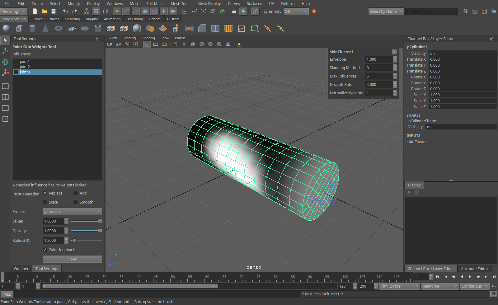

NURBS surfaces and curves, with a drawing override on the control:

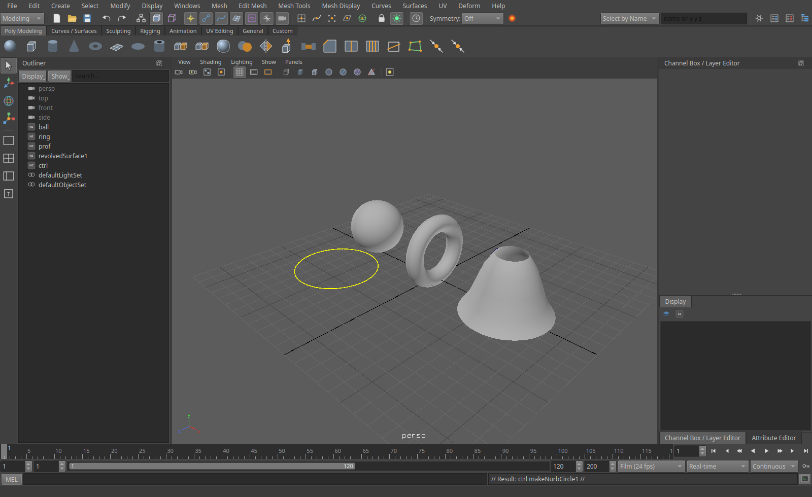

Quad Draw on a live surface:

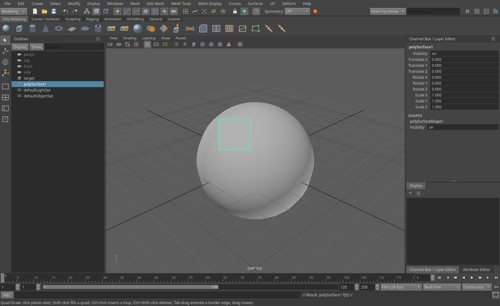

Dope Sheet, with a breakdown in green:


Node Editor:

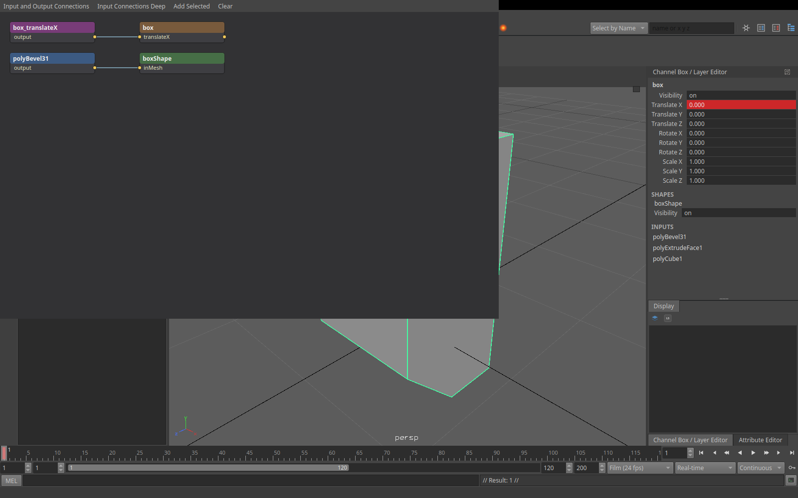

## Install

Packages are on the [releases page](https://github.com/srlegrand/Aztek/releases): each build of the main branch is a release of its own, numbered 2.N where N counts the changes so far. A build from source of the same commit shows the same number in Help > About.

**Updates.** On its first start Aztek asks whether to check for new versions when it starts; the answer can be changed in
Preferences > Interface, and Help > Check for Updates works either way. The check asks GitHub for the latest release and
sends nothing else: no identifiers, nothing about you or your scenes. That is the only request Aztek makes by itself. When
a newer version is out it shows what changed and offers to install it the way this copy was installed: the Windows
installer runs, a `.deb` or `.rpm` installs with your password, the macOS app, the AppImage and the Linux tarball are replaced in
place, and a Windows zip opens its download. Downloads are checked against the release's checksum. A copy built from
source is pointed at `git pull`. It goes through the proxy in `HTTPS_PROXY`, minding `NO_PROXY`.

| System | Package | Install |
| --- | --- | --- |
| Rocky Linux 8 | `aztek-<version>-1.el8.x86_64.rpm` | `sudo dnf install ./aztek-*.el8.x86_64.rpm` (Qt is bundled) |
| Rocky Linux 9 | `aztek-<version>-1.el9.x86_64.rpm` | `sudo dnf install epel-release`, then `sudo dnf install ./aztek-*.el9.x86_64.rpm` |
| Ubuntu 22.04, 24.04 | `aztek_<version>-1_ubuntu22.04_amd64.deb`, `..._ubuntu24.04_...` | `sudo apt install ./aztek_*.deb` |
| Any other Linux, x86_64 | `aztek-<version>-x86_64.AppImage` | `chmod +x aztek-*.AppImage`, then run it (Qt and Python are inside) |
| Windows 10 and 11 | `aztek-<version>-setup-x64.exe`, or the zip | Run it. It isn't signed, so SmartScreen asks first |
| macOS 14+, Apple silicon (early) | `aztek-macos-arm64.zip` | `brew install python@3.12`, unzip, then right-click Aztek.app and Open the first time: it isn't notarized |

The viewport needs a Vulkan driver: NVIDIA's own driver has one, and Mesa's `mesa-vulkan-drivers` covers AMD and Intel. On macOS it
draws through MoltenVK, which comes inside Aztek.app.
[docs/PACKAGING.md](docs/PACKAGING.md) has the details, and how the packages are built.

## Build

Linux:

    ./build.sh --deps --run

`--deps` installs the build dependencies (apt, dnf or pacman) and only needs running once; `--run` starts Aztek
afterwards; `--install` puts it in `~/.local` with a menu entry and icon; `--debug` builds into `build-debug/`. Rust comes from [rustup](https://rustup.rs). An active conda
environment is fine: the script builds against the system Python and ignores conda's libraries.

macOS, with [Homebrew](https://brew.sh):

    ./build-macos.sh --deps --run

`--deps` installs Xcode's command line tools, CMake, Ninja, Qt, Python 3.12, MoltenVK and Rust. The build is
`build/aztek.app`. `--package` makes a self-contained `Aztek.app` and `dist/aztek-macos-<arch>.zip`, as the release
build does; `--install` puts it in `~/Applications`. macOS is new: the viewport, menus and shortcuts haven't been checked
there yet.

Windows, from PowerShell or a command prompt:

    build.bat -Run

Needs Visual Studio 2022 (or its Build Tools) with "Desktop development with C++", Rust from
[rustup](https://rustup.rs), CMake, Qt 6.4+ for MSVC from the [Qt online installer](https://www.qt.io/download-qt-installer-oss),
and Python 3 from [python.org](https://www.python.org/downloads/). The script finds Visual Studio and the newest Qt
under `C:\Qt` (or takes `-Qt C:\Qt\6.8.0\msvc2022_64`), builds, and makes a folder that runs by itself in `build\dist`:
Qt's DLLs, the VC runtime and Python's standard library beside `aztek.exe`.

By hand, on either: `cmake -B build -G Ninja -DCMAKE_BUILD_TYPE=Release && cmake --build build`. The first build
compiles the Rust core (a few minutes); later builds only rebuild what changed. `-DAZTEK_PYTHON=OFF` builds without
Python.

Options:

    aztek [scene.aztek|scene.ma|scene.mb] [--script file.mel|file.py] [--screenshot out.png]

On KDE Plasma, Alt + drag moves windows by default: set System Settings > Window Management > Window Behavior >
Window Actions > Modifier key to Meta.

## Hotkeys

| Keys | Action |
|---|---|
| Alt + left / middle / right drag, wheel | Tumble, track, dolly |
| Space tap / hold | Toggle single and four views / hotbox |
| Right button | Marking menu (Shift: modelling tools, Ctrl: selection conversion) |
| Q W E R | Select, move, rotate, scale |
| F / A, Shift+F / Shift+A | Frame selection / all, in every view |
| F8, F9, F10, F11 | Object/component, vertex, edge, face |
| F2, F3, F4 | Animation, Modeling, Rigging menu sets |
| Click, drag, double-click an edge | Select, marquee, edge loop |
| Shift / Ctrl / Ctrl+Shift click | Toggle / deselect / add |
| Z, Shift+Z (Ctrl+Z, Ctrl+Y) | Undo, redo |
| G | Repeat last |
| Ctrl+D, Shift+D, Ctrl+G, P, Shift+P | Duplicate, duplicate with transform, group, parent, unparent |
| Ctrl+E, Ctrl+B | Extrude, bevel |
| 1, 2, 3 | Smooth preview off, cage, smooth |
| 4, 5 | Wireframe, shaded |
| B | Soft selection |
| > and < | Grow and shrink selection |
| Delete | Delete objects or components |
| S, Shift+W/E/R | Set key on all channels, on translate/rotate/scale |
| . and , | Next and previous key |
| Alt+. and Alt+, | Next and previous frame |
| Alt+V, Esc | Play / stop |
| Ctrl+A | Attribute Editor |
| Enter | Joint tool: end the chain. Curve, Multi-Cut and polygon tools: finish |
| B drag | Paint and sculpting tools: size the brush |
| Ctrl+Shift+T | Tool Settings (also: double-click a tool) |

In the channel box, click channel names to pick them (Ctrl and Shift add); middle-drag in a view then changes them
(Ctrl fine, Shift coarse). Right-click for keys, locks and connections.

## Editors

- Outliner, Channel Box / Layer Editor, Attribute Editor (docked), Script Editor with MEL and Python tabs.
- Graph Editor and Dope Sheet (Windows > Animation Editors): curves and keys of the selection.
- Node Editor (Windows > General Editors): graph the selection, wire attributes, Tab creates a node.
- Hotkeys and shelves are editable; the Hotkey Editor is under Windows > Settings/Preferences.
- UV Editor (Windows > Modeling Editors, or UV > UV Editor): UVs by UV, shell, edge or face; move, rotate and scale;
  projections, unfold, layout, cut, sew, normalize, flip.

## Scripting

The command line and the Script Editor take MEL (`polyCube -w 2 -sx 3; select -r pCube1.f[0:3]; polyExtrudeFacet
-ltz 1;`) and Python:

    from aztek import cmds
    cube = cmds.polyCube(w=2)[0]
    cmds.setKeyframe(cube, at='ty', t=1, v=0)
    cmds.setKeyframe(cube, at='ty', t=24, v=5)
    cmds.polyCube(cube, q=True, w=True)

`aztek.cmds` is the module of record; the compatibility modules map onto it, so existing scripts run unchanged. Python plug-ins load
with `loadPlugin`. C++ plug-ins rebuilt with the kit in `devkit/` load too.

## Compatibility

Existing scripts, habits and `.ma` files carry over: a production rig opens, poses and saves (see "A real rig" in
[PARITY.md](PARITY.md)). Behaviour comes from published references, so expect differences in details; PARITY.md lists
the known ones. `.mb` files open, import and load as references but can't be saved yet (save as `.ma`), and the C++ plug-in kit covers part of the API so far. Materials and render settings from other renderers in a file are
read and rendered with Harold, with a warning naming what isn't honoured.

## Licence

[MIT-0](LICENSE): use, copy, change, sell, re-host and redistribute it however you like, with no attribution required.
One table of binary file type ids in it comes from an MIT project; its notice is in [THIRD_PARTY.md](THIRD_PARTY.md).
Copies on any other host are welcome (see [Copy it anywhere](#copy-it-anywhere)). It comes with no warranty of any kind.
