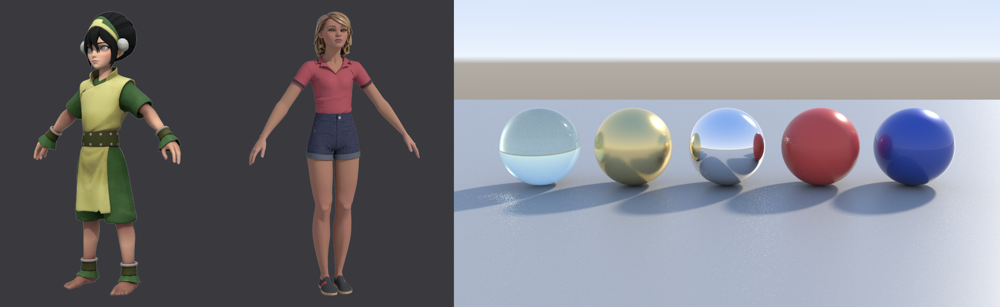
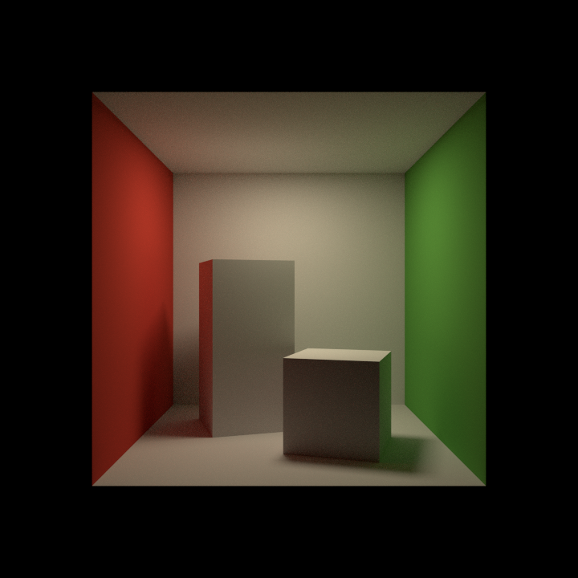

# Harold

Harold is Aztek's renderer: a physically based, unidirectional path tracer on the CPU, written in Rust with no native
dependencies. Brute force Monte Carlo with next event estimation and multiple importance sampling, one material model
(the standard surface), sample counts per ray type, and progressive interactive rendering. Every material and light a
scene holds is rendered by it; there is no choice of renderer.

## Where it lives

- `crates/aztek_render`: the renderer, knowing nothing of the scene graph. `bvh.rs` (binned SAH hierarchy, refit),
  `geom.rs` (meshes in object space with motion keys, instances over a top level hierarchy), `camera.rs` (film back,
  film fit, thin lens), `texture.rs` (images, mip pyramids, UDIM and `<uvtile>`, colour spaces, a memory limit),
  `shader.rs` (shading networks and the material description), `bsdf.rs` (the standard surface's lobes), `lights.rs`,
  `integrator.rs`, `path.rs` and `first_hit.rs` (the path tracer), `film.rs` (AOVs and filters), `render.rs` (buckets,
  passes, the background job), `output.rs` (EXR, PNG, TIFF, JPEG, TGA), `denoise.rs`.
- `crates/aztek_scene/src/harold`: translation from the scene (`mod.rs` geometry and instances, `network.rs` shading
  networks, `materials.rs` every material onto the standard surface, `lights.rs`, `settings.rs`, `displace.rs`) and the
  commands (`commands.rs`). `harold_nodes.rs` registers the node types files hold.
- `crates/aztek_host/src/harold_view.rs`: the render view's C functions and batch rendering. The interface is in
  `app/src/renderview.cpp`, `rendersettings.cpp`, `renderui.h` and `icons_render.cpp`.

## Rendering

- **Geometry.** What the viewport draws at the frame: meshes after deformers and skinning, NURBS surfaces through their
  tessellation, references; hidden, templated and intermediate shapes left out. Catmull-Clark subdivision at render from
  `aiSubdivType` and `aiSubdivIterations`, or from smooth preview (2 and 3 keys) at `smoothLevel`. Height displacement
  from the shading group's `displacementShader` (or a texture straight into it), after subdivision, scaled by the
  shape's `aiDispHeight`. Instances share one mesh.
- **Render stats.** `primaryVisibility`, `castsShadows`, `receiveShadows`, `visibleInReflections`,
  `visibleInRefractions`, the `aiVisibleIn*` flags, `aiOpaque`, `aiMatte`, `aiSelfShadows` read per shape. Light linking
  from the light linker.
- **Motion blur.** Transforms and deformation, keys evaluated across the shutter from the options' range type, length
  and steps; camera motion when asked. Off in interactive rendering.
- **Camera.** Focal length over the film back in inches, film fit (fill, horizontal, vertical, overscan), film offset,
  orthographic width, depth of field from `fStop` and `focusDistance` with a thin lens.
- **Integrator.** At the camera's first hit each lobe category takes its own samples squared (diffuse, specular for
  specular, coat and sheen, transmission, subsurface), and each light its `aiSamples` squared, weighted by the power
  heuristic with the counts. Below the first hit, one sample per bounce, Russian roulette from the fourth. Ray depths
  per type and in total, transparency depth, low light threshold, an AA sample clamp (optionally on AOVs) and an
  indirect clamp. Caustics are off unless a material asks.
- **Sampling.** Owen scrambled Sobol pairs per dimension, pixel shuffled; filter importance sampling for box,
  triangle, gaussian, Blackman-Harris, Mitchell-Netravali, Catmull-Rom, sinc and closest. Adaptive sampling stops a
  pixel when the noise of its neighbourhood is under the threshold, up to the maximum AA samples.
- **Standard surface.** Base with Oren-Nayar roughness; specular (GGX, anisotropic, rotation, IOR, thin film); metal
  with an F82-tint Fresnel and multiple scattering compensation; transmission (rough refraction, colour at the surface
  or by absorption over the depth, scatter in the volume, extra roughness, thin walled); subsurface by random walk with
  the colour mapped to albedo, radius and scale, anisotropy (translucency when thin walled); sheen; coat with its own
  normal, colour, IOR and the affect colour and roughness controls; emission; opacity; bump and normal maps. Layers
  combine by albedo scaling.
- **Lights.** One light model with the viewport: the reference's six lights light a matte surface in a render exactly as
  they light it in the viewport (Use All Lights, 7), and a render adds only what a path tracer has: shadows, bounce
  light, soft light from lights with a size. `decayRate` none, linear, quadratic or cubic; colour times intensity;
  spot cone, penumbra (linear across it, either sign) and dropoff; ambient with `ambientShade`; area lights as the
  viewport's, sized so that far off they light as its one point does, `normalize` honoured; volume lights in a box,
  sphere, cylinder or cone, fading to their boundary, lighting outward, inward or down their axis, or all round with
  emit ambient; `emitDiffuse` and `emitSpecular`; light linking. The viewport's formula is
  `aztek_scene::lights::viewport_diffuse`, the shader's GLSL its copy; `tests/light_parity.rs` compares the renderer
  with it for every type, decay rate and setting. A scene with no lights renders with the viewport's default lighting
  (a key and a fill that follow the camera, and a little all round). `physicalLights` on the options node switches
  to physical units instead: quadratic falloff, intensity as radiant intensity, `aiDecayType` honoured.
  Harold's own lights: point radius (`aiRadius`), directional angle (`aiAngle`), sky dome (colour or a latitude-longitude
  image, importance sampled), Harold area lights (quad, disc, cylinder, normalised by area unless `aiNormalize` is off,
  `aiSpread`), mesh lights, photometric with IES files, and every glowing surface sampled as a light; these use
  physical units, times two to `aiExposure`. Shadows with `shadowColor` and `aiShadowDensity`; `aiCastShadows`,
  `aiDiffuse`, `aiSpecular`, `aiSss`, `aiVolume`, `aiTransmission`, `aiMaxBounces`; `aiAov` puts a light in a light
  group. Specular highlights are the standard surface's, not the viewport's blinn and phong shapes.
- **Background.** Camera rays that meet nothing see the options' `background` colour (black by default) where there is
  no sky dome; a shader connected to it (`aiFlat`, as the reference's Arnold plug-in connects one) gives its colour.
  The background adds to the colour and leaves alpha clear, so the image is premultiplied. EXR keeps alpha; eight bit
  images are written opaque. The render view shows the colour alone by default (View > RGB); View > Alpha shows the
  alpha and View > RGBA Over Checker the image over a checker.
- **Atmosphere.** A homogeneous fog over the scene's bounds from the `aiAtmosphereVolume` connected to the options'
  `atmosphere`: density, colour, anisotropy, lit by every light with shadows.
- **Textures.** `file` and `aiImage`: PNG, JPEG, TGA, TIFF, BMP, HDR and EXR; sRGB, linear and raw by `colorSpace`;
  placement (coverage, translate and rotate frame, repeat, offset, rotate UV, mirror, wrap, stagger); UDIM by token or
  by `uvTilingMode`; mip pyramids with the level from the ray's footprint; one load per file shared by every material.
  `checker`, `ramp`, `noise`, `layeredTexture`, `multiplyDivide`, `plusMinusAverage`, `blendColors`, `remapValue`,
  `reverse`, `clamp`, `luminance`, `gammaCorrect`, `setRange`, `condition`, `contrast`, `hsvToRgb`, `rgbToHsv`,
  `samplerInfo` (facing ratio), `bump2d`, `aiBump2d`, `aiNormalMap`, `aiAmbientOcclusion`, `aiCurvature`, `aiUtility`
  evaluated per sample. Any other node feeding a material is read as its value at the frame.
- **AOVs.** Beauty, direct and indirect, and per lobe direct and indirect (diffuse, specular, coat, sheen, sss,
  transmission), emission, background, volume, albedo, N, P, Z, object and material ID mattes as colours, shadow matte,
  alpha, light groups as `RGBA_<group>`, and a denoised beauty. All AOVs go into one EXR, half or full float, or the
  beauty and one file per AOV for the eight bit formats.
- **Denoiser.** Non-local means on the beauty with albedo and normal guides, pure Rust, off by default
  (`denoiseBeauty` on the options node; the render view's "denoised").

## Materials from older renderers

Kept as they are in the scene and the Hypershade; at render each becomes a standard surface. What isn't honoured is
named in a warning.

| Material | Becomes | Not honoured |
| --- | --- | --- |
| lambert | base `diffuse`, base colour `color`, no specular, ambient colour added as the viewport adds it | translucence, glow |
| blinn | lambert's, specular colour twice `specularColor`, roughness from eccentricity | as lambert's, reflected colour |
| phong | roughness from the cosine power (alpha squared is 2 / (n + 2)) | as blinn's |
| phongE | roughness from `roughness` | as blinn's |
| anisotropic | anisotropy and rotation from the spreads and angle | as blinn's, Fresnel index |
| rampShader | lambert's from `color` | the colour, specular and transparency ramps |
| transparency on any of them | opacity, or transmission with `refractiveIndex` when refractions are on | |
| incandescence | emission | |
| surfaceShader, aiFlat | unlit colour | |
| layeredShader | layers blended by their transparency | layer textures, glow |
| aiMixShader | blend or add, chosen per sample | |
| mia_material, mia_material_x | diffuse, reflectivity, glossiness, metal, refraction, cutout, additional colour | the custom reflection curve, translucency |

Render settings from older renderers in a file are read as Harold's own where the names match; a file set to another
renderer renders with Harold and says so.

## Commands

- `hrender` renders the current frame (waits), `-async` (returns at once, the render view follows), `-ipr start`,
  `stop`, `refresh` or `pause`, `-seq "1 10 2"` and `-batch` (writes the frames the settings name), `-camera`, `-width`,
  `-height`, `-region x0 y0 x1 y1`. `arnoldRender` takes the same flags, for scripts written for it.
- `render [camera]` renders the current frame and returns the image's path.
- `renderSettings -firstImageName`, `-lastImageName`, `-imageGenericName`, `-fullPath`, `-fullPathTemp`.
- `renderWindowEditor -e -writeImage path`, `-snapShot`, `-removeAllImages`, `-removeImage`, `-exposure`, `-gamma`;
  `-q -nbImages`, `-currentCamera`.
- Settings are attributes: `defaultRenderGlobals`, `defaultResolution`, `defaultArnoldRenderOptions` (samples, depths,
  clamps, adaptive, motion blur, textures, ignore switches, threads), `defaultArnoldFilter`, `defaultArnoldDriver` (its
  `ai_translator` picks the format), `aiAOV` nodes. The names are those files use.

Batch rendering needs no display:

    aztek -render -s 1 -e 10 -cam shotCam -x 1920 -y 1080 -rd renders -of exr scene.ma

`-b` steps frames, `-im` sets the file name prefix (tokens `<Scene>`, `<Camera>`, `<RenderLayer>`, `<AOV>`), `-as` the
camera samples. Images go to the project's `images` folder, or `images` beside the scene, unless the prefix is a path.

## Interface

Render menu (Rendering menu set, F6): Render Current Frame, Render Sequence (one `aztek -render` process per frame, the
interface stays free), Harold RenderView, IPR Render Current Frame, Redo Previous Render, Render Settings. The render
view: render, IPR, refresh, stop, region of interest, snapshots with an A/B wipe, the AOV list, exposure and gamma, zoom
and pan, Save Image, and a status line with passes, time, rays per second, memory, camera and the interactive restart
time. Interactive rendering restarts on any change to the scene or the frame, reusing every mesh that didn't change.
Render Settings: Common (file output, frames, camera, image size and presets), Harold (sampling with the effective
counts, adaptive, clamping, ray depth, environment, motion blur, lights, textures, subdivision, diagnostics,
denoiser), AOVs. Create > Harold: sky dome, area, mesh and photometric lights, atmosphere, standard surface. The
Attribute Editor groups the standard surface's attributes and adds Harold frames for lights, shapes and cameras.
A Rendering shelf.

## Checks

`crates/aztek_render/tests/accuracy.rs`:

- Furnace: a white diffuse sphere in a white environment returns 1 within 3%; the white standard surface (specular over
  diffuse) between 0.95 and 1.03; a smooth white metal 1 within 1%; clear glass 1 within 3%.
- Rough white metal: 1.001 of the environment at roughness 0.3, 0.999 at 0.6, 0.90 at 1.0. The multiple scattering term
  comes from a table that runs out at the roughest end, where a tenth is still lost.
- A point light over a lambert plane against the closed form, within 2%; a quad light against the point to rectangle
  form factor, within 1%, which also checks that light and BSDF samples' MIS weights sum to one.
- The AA sample clamp holds with a tiny, very bright light. A small, very bright sun in a dome image lights a plane
  evenly (a firefly test, failing before the fix that went with it).
- The Cornell box: the image mean at 4 samples a pixel agrees with a 256 sample reference within 4%, the per pixel error
  falls by more than half from 4 to 64 samples, and the red wall bleeds onto the white. The reference is our own render:
  no published radiance values were compared.
- The surface an indirect ray reaches is lit even when no depth is left.

`crates/aztek_scene/tests/harold.rs`: lambert under a point light, exposure and colour, older materials and their
warnings, emission, settings and render attributes through a file, sequences, mesh reuse and refit, subdivision,
displacement, light linking, glowing surfaces keep the default light, values from outside shading.

## Numbers

On a Ryzen 9 5950X (16 cores, 32 threads), release build:

- The spheres example (five spheres, sky image with sun, 1280 x 720 or 960 x 540 at AA 4): 18 to 24 million rays a
  second, 24 times one core's work in parallel. About 1 million rays a second per thread, shading included.
- Camera rays alone through the Venom rig's geometry: 185 million a second (most miss).
- The Waitress rig at 1920 x 1080, default settings (AA 3, diffuse 2, specular 2), a sky and a key light: 3.4 seconds,
  10 million rays a second, 128 MB for the renderer's scene and image; the whole process 575 MB with the rig loaded.
- Interactive restart after an edit, at 960 x 540 on the same rig: 14 ms from the change to a coarse image (cancel 1 ms,
  translation 5 ms with all 14 meshes reused, first coarse pass 7 ms); the first full pass at 0.26 s.
- Translation of the four test rigs: 0.03 to 0.09 s.

## Not done, or shallower

Ranked by how much a user would notice:

1. Render layers and render setup are not read: everything renders as the master layer.
2. Hair and curves are not rendered; nor are particles or volumes other than the atmosphere fog.
3. Subsurface scattering is noisy at default samples, more than a production renderer's.
4. USD stages in the scene are not rendered.
5. Textures load whole on first use, as mip pyramids, with a memory limit that drops fine levels of later images; there
   is no tile cache that evicts.
6. No vector displacement, autobump or adaptive subdivision; displacement happens on the vertices of the subdivided mesh.
7. The denoiser is simple non-local means, run on the interface thread when its view is shown.
8. Light group AOVs carry direct and indirect light by the light that started it; mesh lights' direct light seen in
   specular reflection goes to the indirect AOVs.
9. AOVs have no per-AOV filters or drivers; the colour of ID mattes is a hash.
10. `aiCurvature` is an occlusion measure at a short distance, not true curvature. `samplerInfo` gives the facing ratio
    only.
11. The sky dome reads the latitude-longitude format only; its orientation convention was not compared with another
    renderer's.
12. Nothing here has been compared with a real copy of another renderer.
